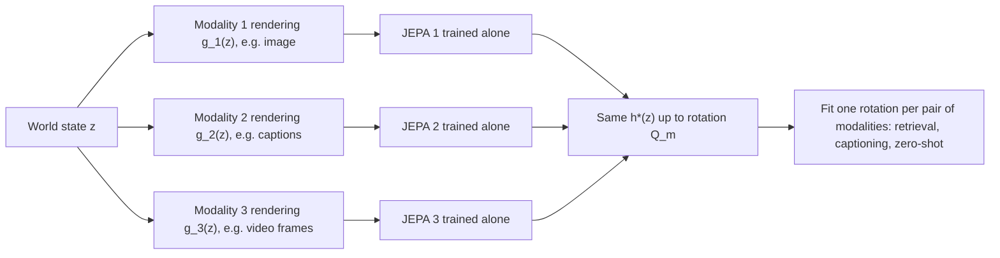
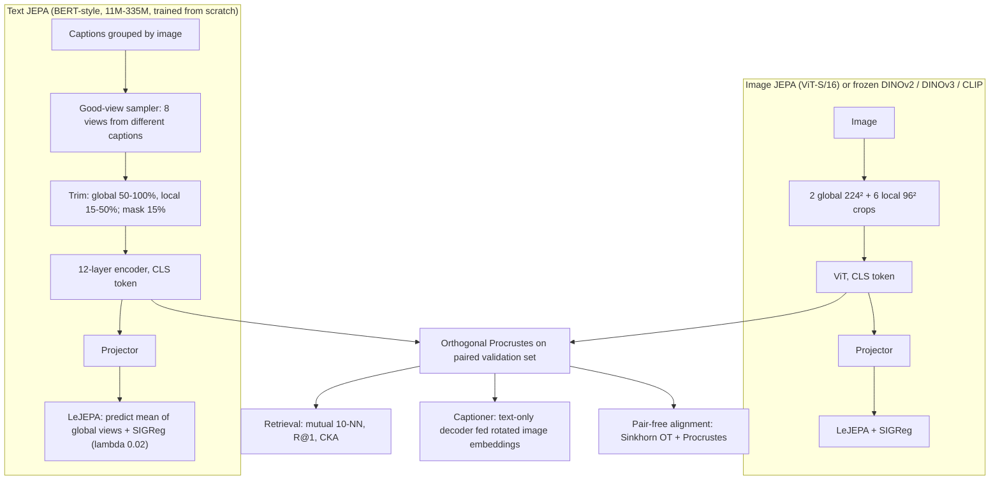
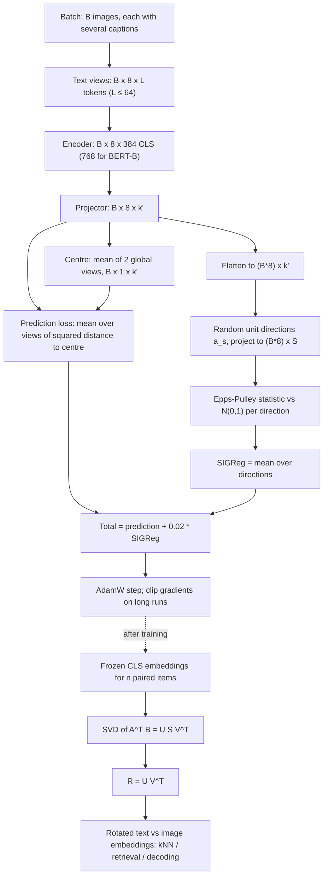
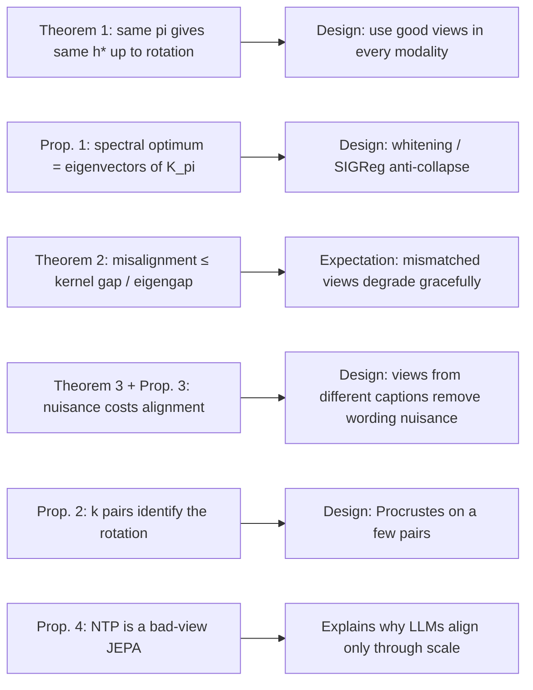

# Architecture: Proving and Improving the Platonic Representation Hypothesis with JEPAs (Paper 01)

Back to the analysis: [../papers/paper-01-analysis.md](../papers/paper-01-analysis.md). Raw diagram: [../diagrams/paper-01-system.mmd](../diagrams/paper-01-system.mmd).

The paper's own figures are mostly plots: the theory check (Fig. 2), connectivity panels (Fig. 3), alignment curves (Figs. 5-9, 11) and caption examples (Fig. 10). It contains no block-diagram of the system. Every diagram below is therefore a **[Conceptual reconstruction]** built from the paper's method section and theorems, unless it is marked otherwise.

## Level 1: concept [Conceptual reconstruction]

**Components and flow.**

- **World state $z$.** The scene itself. Each modality only observes a rendering of it.
- **Per-modality JEPA.** An encoder trained with a rotation-invariant prediction loss plus anti-collapse. No cross-modal data is used.
- **Theorem 1.** If every JEPA uses the *same* pairing distribution $\pi$ over world states (good views), all optima equal $\boldsymbol{Q}_m h^\star$.
- **Use.** A rotation $\boldsymbol{Q}_m\boldsymbol{Q}_{m'}^\top$, fitted by Procrustes on $\ge k$ pairs (Proposition 2), aligns any two modalities.

## Level 2: components of the experimental system [Conceptual reconstruction]

**Component notes.**

- **Good-view sampler.** This is the key design choice. Positives come from *different* captions of the same image, or different frames or captions of the same video clip. The paper's ablation finds trimming is the most important knob: whole captions as views drop R@1 from .246 to .185 (Fig. 7).
- **Encoders.** The text side uses BERT-T 11M, BERT-S 33M, BERT-B 109M or BERT-L 335M. The image side is ViT-S/16, or frozen DINOv2 ViT-B/14 for most alignment tables.
- **Loss.** LeJEPA invariance to the mean of the two global views, with SIGReg anti-collapse. AdamW, batch 256, 200 epochs.
- **Alignment.** One orthogonal map. When encoder widths differ (768 vs 384), it is a map with orthonormal rows.
- **Captioner.** It is trained only on text, by reconstructing captions from noisy text embeddings with $\sigma\approx3$. At test time it receives image embeddings rotated into text space.

## Level 3: low-level execution and data flow [Conceptual reconstruction]

**Data-flow notes.**

- The prediction term and SIGReg act on projector outputs. The visible text does not specify the projector width, so it is shown as $k'$.
- SIGReg is computed per GPU batch and scales with batch size. The paper flags this as a reason the effective weight changes between hardware setups.
- Procrustes is solved in closed form once. With zero pairs, the paper alternates Sinkhorn optimal transport (to guess correspondences) with Procrustes.

## Theory-to-architecture map [Conceptual reconstruction]

