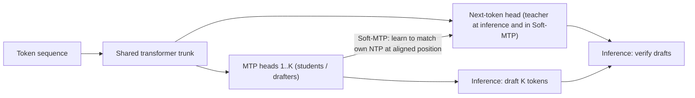
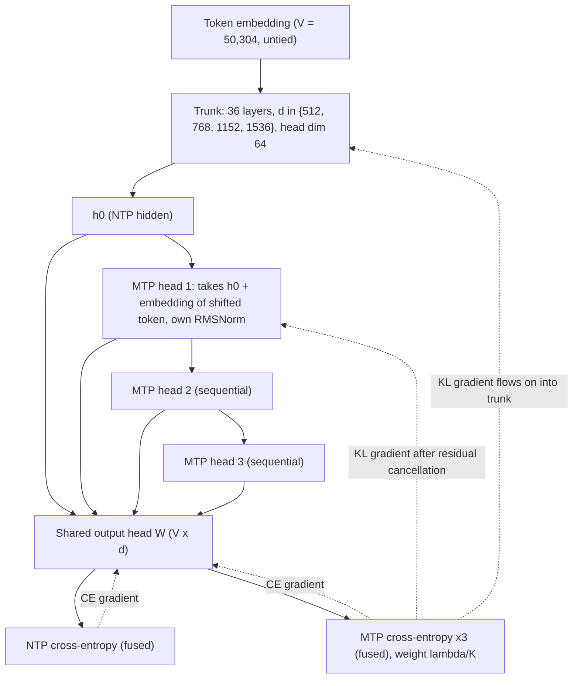
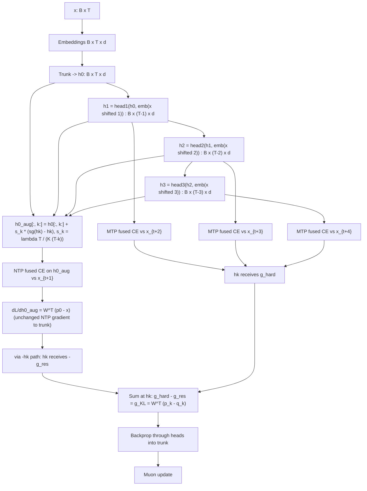
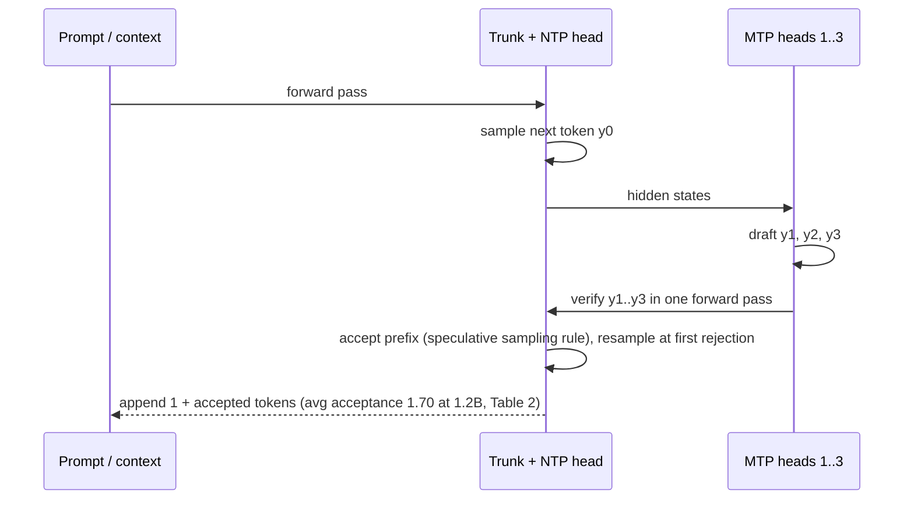

# Architecture: Multi-Token Prediction Done Right, Soft-MTP (Paper 02)

Back to the analysis: [../papers/paper-02-analysis.md](../papers/paper-02-analysis.md). Raw diagram: [../diagrams/paper-02-system.mmd](../diagrams/paper-02-system.mmd).

Sources for the diagrams:

- Fig. 1 (illustration, pseudocode, loss curves)
- Fig. 2 (position-aligned NTP distributions)
- Table 1 (gradient routing)
- Algorithm 1 / Appendix B.4 (the trick)
- Appendix D (model configs)

The paper does not spell out the internal sub-layers of the DeepSeek-style head. Where a diagram shows them, they are marked as reconstruction.

## Level 1: concept [Conceptual reconstruction, informed by Fig. 1]

**Idea.** The MTP heads exist to draft tokens the NTP head will accept. Soft-MTP therefore trains them, through the trunk as well, to match the NTP distribution at the aligned future position (Fig. 2) rather than the noisy one-hot data token. It does this without computing any explicit KL.

## Level 2: components and gradient routing [From paper: Table 1 and Appendix D; layout is a reconstruction]

| Component | Standard MTP | KL-MTP | Soft-MTP |
|---|---|---|---|
| Output head $W$ | CE | KL | CE |
| MTP heads | CE | KL | KL (recovered) |
| Shared trunk | CE | KL | KL (recovered) |

(Table 1 in the paper.)

Each MTP head is about 3.2% of the trunk's non-embedding parameters. At 1.2B the heads total 99.1M against a 1173.9M NTP path (Appendix D).

## Level 3: execution and gradient data flow [Conceptual reconstruction from Algorithm 1 and Appendix B.4]

**Data-flow notes.**

- **Forward values are unchanged.** `sg(hk) - hk` is exactly zero, so losses and logged metrics are identical to standard MTP.
- **Backward.** The NTP loss's gradient with respect to `h0_aug` is copied, with a minus sign and scaled by $s_k$, into `hk`. This is exactly the residual term of the MTP gradient, so it cancels.
- **No logits are materialised.** Every loss uses the same fused CE kernel as standard MTP. This is why memory is 107.0 GB for both, vs 128.1 GB for explicit KL-MTP (Table 5).

## Inference path [Conceptual reconstruction]

