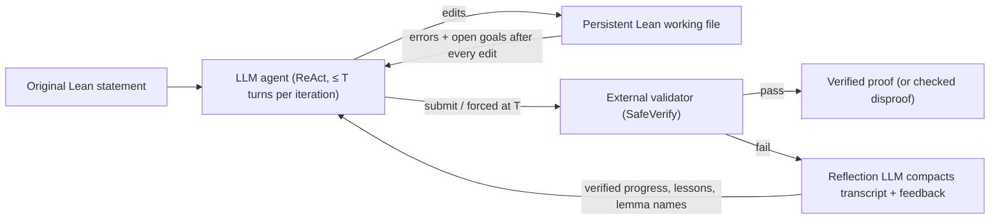
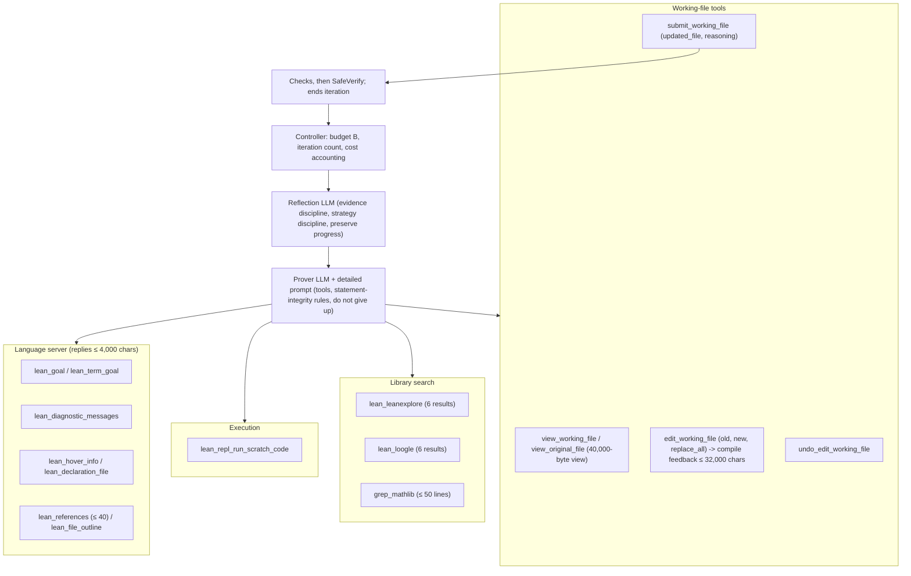
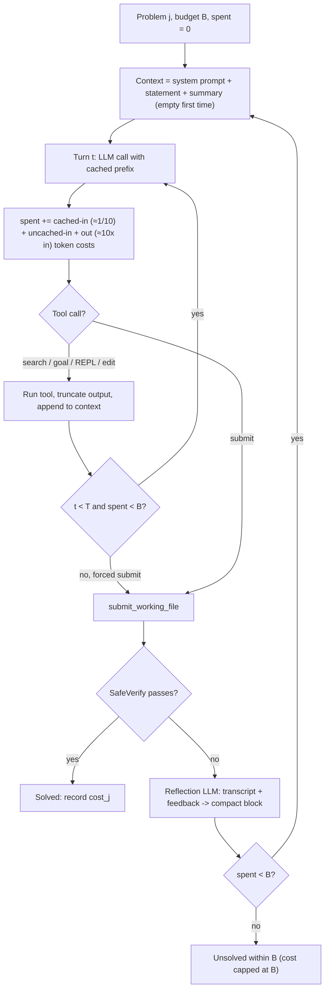
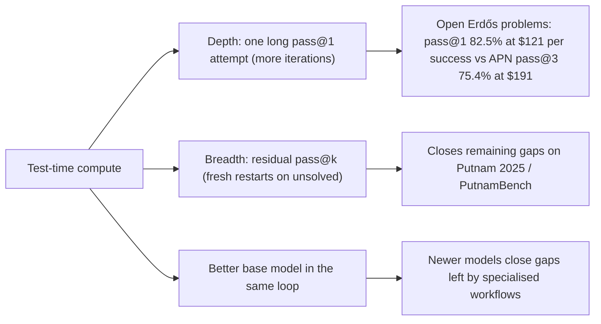

# Architecture: h1, A Taste of the Bitter Lesson in Automated Theorem Proving (Paper 03)

Back to the analysis: [../papers/paper-03-analysis.md](../papers/paper-03-analysis.md). Raw diagram: [../diagrams/paper-03-system.mmd](../diagrams/paper-03-system.mmd).

Fig. 2 of the paper ("h1: a simple harness that scales") is the paper's own system diagram. It shows an LLM agent editing a Lean file until it submits or hits the $T$-turn limit, then validation and reflection. Level 1 below redraws that figure. Levels 2 and 3 are reconstructions from Section 2.2 and Appendix B (Table 3 tool schemas, B.2 prompts).

## Level 1: concept [From paper: Fig. 2, redrawn]

**Components.**

- **Agent.** Any frontier LLM; no fine-tuning.
- **Working file.** Persists across iterations, so verified progress is never lost when context is reset.
- **Validator.** Rejects placeholders and added assumptions, and checks the proof against the *original* statement.
- **Reflection.** Bounds the context length and filters out defeatist or unsound reasoning.

## Level 2: components and tool interface [Conceptual reconstruction from Appendix B.1, Table 3]

**Design notes.**

- **Tight output limits** (generic 6,000 chars, LSP 4,000, compile feedback 32,000) keep context small and cacheable.
- **Lean timeouts.** 600 s for snippets and 1,200 s for the working file. Three consecutive deterministic failures mark the problem unsolved.
- **The tool set is what matters.** Removing search, REPL and LSP drops Putnam100 from 69 to 49 and FATE-X from 63 to 49.

## Level 3: low-level execution and context/cost flow [Conceptual reconstruction]

**Why this flow is efficient (as reported).**

- **Cached prefixes.** Within an iteration the context is append-only, so most input is cached. h1 reuses 74-94% of input from cache, vs ≤0.5% for AxProverBase.
- **Moderate T is optimal.** T = 1 gets almost no caching (0.2% cached) and loses reasoning continuity. T = 200 lets context bloat. 10 turns gave the best Putnam100/FATE-X results (72/65 vs 50/39 and 60/52; Fig. 4 right).
- **Reflection resets context** while the working file preserves state. Removing reflection drops PutnamBench (DeepSeek V4 Flash) from 598 to 554 (Fig. 6).

## Scaling axes [Conceptual reconstruction]

