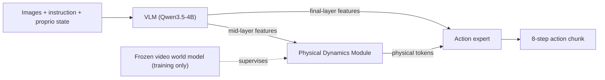
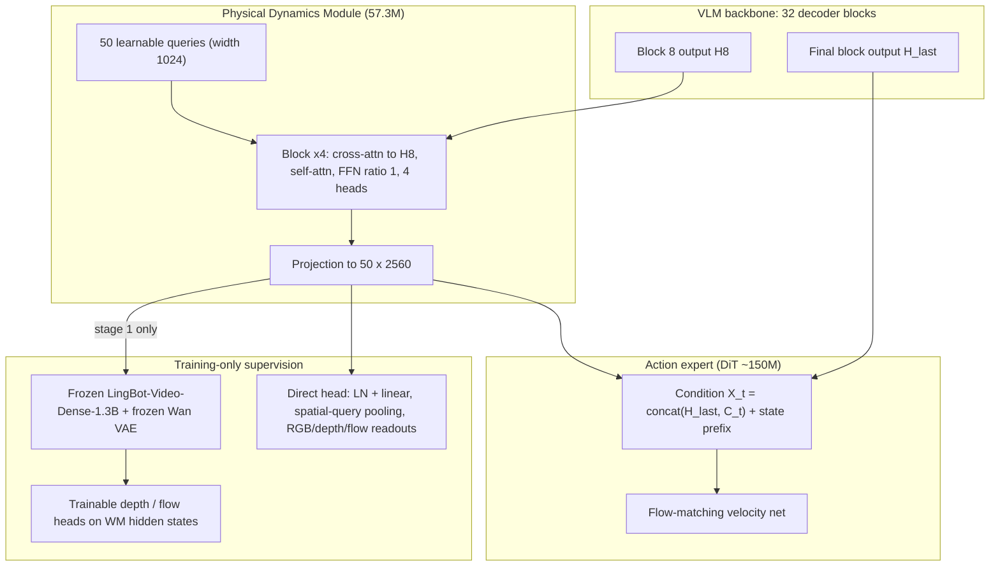
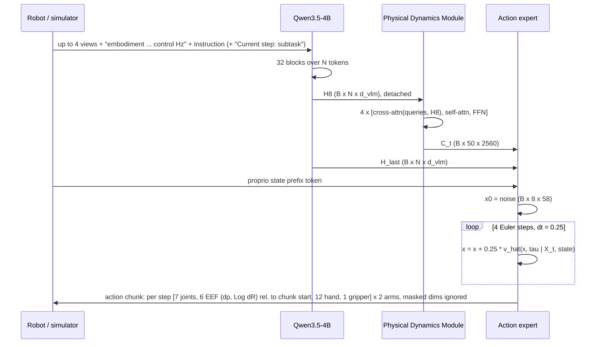

# Paper 04 architecture — PDRVLA

Back to the analysis: [../papers/paper-04-analysis.md](../papers/paper-04-analysis.md) · Raw diagram: [../diagrams/paper-04-system.mmd](../diagrams/paper-04-system.mmd)

PDRVLA = a Qwen3.5-4B VLM + a 57.3M-parameter **Physical Dynamics Module (PDM)** + a ~150M DiT **action expert** trained with flow matching. A frozen video world model is used only during pretraining to shape the PDM's 50 "physical tokens".

---

## Level 1 — concept  **[From paper: Fig. 1a / Fig. 3a — redrawn]**

**Explanation.** The VLM understands *what* is in the scene and *what* the task is. The PDM summarizes *how the scene is about to change*. The action expert combines both to generate actions. The dotted edge is the key idea: the world model teaches the PDM during training but is absent at inference.

---

## Level 2 — components and training stages  **[From paper: Fig. 3b, Fig. 4 — redrawn]**

| Component | Role | Trainable in stage 1 | Trainable in stage 2 |
|---|---|---|---|
| VLM (Qwen3.5-4B) | Perception + language; taps at block 8 and final block | No | Yes (final-layer path + VL loss) |
| PDM | Produces physical tokens C_t | Yes | Yes (input detached) |
| Direct head | Regresses standardized future RGB/depth/flow latents | Yes | Yes (weight 0.1) |
| Frozen video WM + depth/flow heads | Denoises future latents conditioned on C_t | WM frozen, heads trainable | Removed |
| Action expert (DiT) | Flow-matching action generator, K = 8, 58-dim | — | Yes |

**Data flow in training.** Stage 1 loss: $\mathcal{L}_{\mathrm{pre}}=\mathcal{L}_{\mathrm{WM}}+\lambda(k)\mathcal{L}_{\mathrm{direct}}$ with λ ramped 0 → 0.5 over 2,000 updates. Stage 2 loss: $\mathcal{L}_{\mathrm{act}}+0.1\mathcal{L}_{\mathrm{VL}}+0.1\mathcal{L}_{\mathrm{direct}}$. Stage 3: per-benchmark adaptation.

---

## Level 3 — low-level execution  **[Conceptual reconstruction from Sec. 4, App. A.1]**

**Execution notes**
- The PDM's cost is linear in VLM sequence length (50 queries × N keys) — tiny compared to the VLM.
- EEF actions in a chunk are all relative to the **chunk-start** pose; joint, hand and gripper values are absolute targets.
- Training-time future targets: 5-frame clips spanning the current step and the next 30 action steps, encoded by the frozen Wan VAE; depth and flow are rendered as images (grayscale / color-coded) before encoding.
- Inference latency and control frequency are not reported in the paper.
