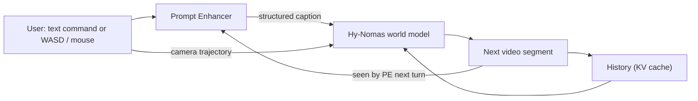
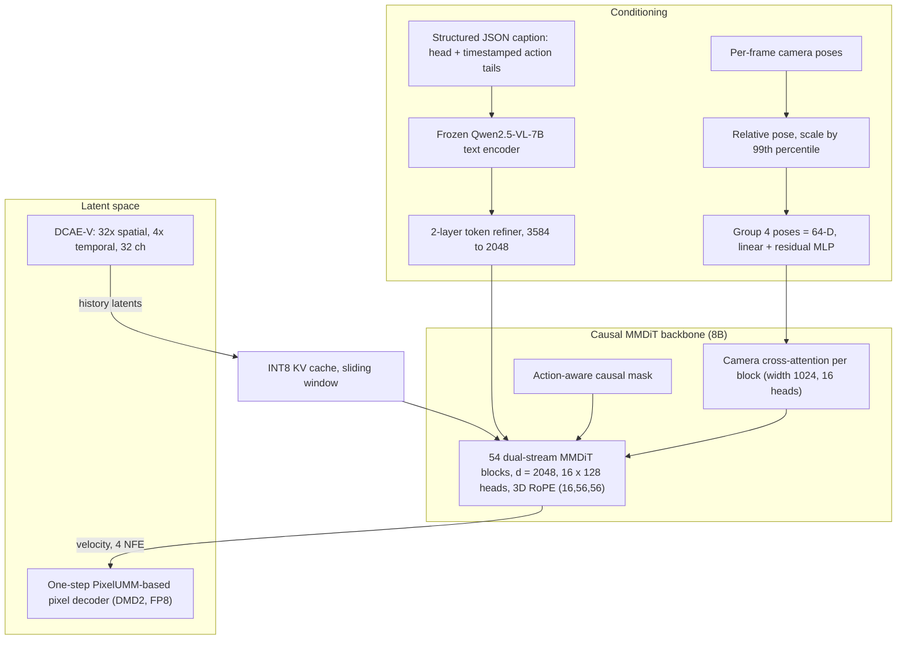
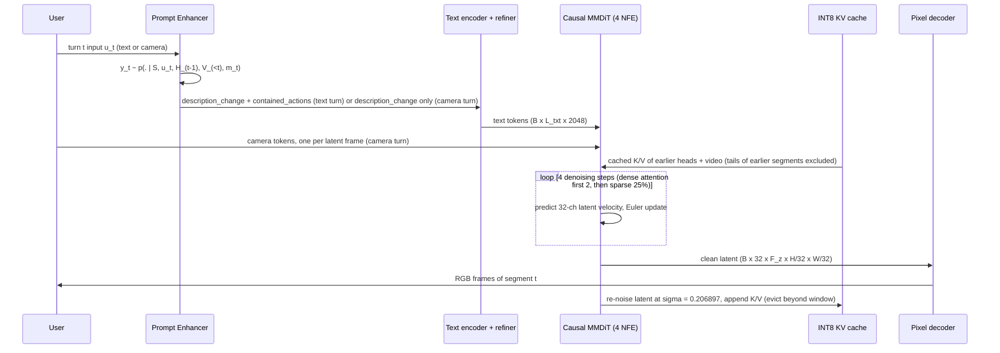

# Paper 05 architecture — Hy-Nomas

Back to the analysis: [../papers/paper-05-analysis.md](../papers/paper-05-analysis.md) · Raw diagram: [../diagrams/paper-05-system.mmd](../diagrams/paper-05-system.mmd)

Hy-Nomas is an 8B causal video world model (HunyuanVideo 1.5 lineage) that generates video segment by segment, steered by free-form text and continuous camera control, with a Prompt Enhancer in front and a KV cache of history behind.

---

## Level 1 — concept  **[From paper: Fig. 1 — redrawn]**

**Explanation.** Each turn is one segment. The PE converts messy user intent into a strict JSON caption (scene changes + timestamped actions). The world model renders the segment conditioned on that caption, an optional camera path, and cached history; the result is cached for the next turn.

---

## Level 2 — components  **[From paper: Fig. 5, Table 1 — redrawn]**

| Component | Role | Key numbers |
|---|---|---|
| DCAE-V autoencoder | Video ↔ latent | 32× spatial, 4× temporal, 32 channels, patch 1×1×1 |
| Text encoder + refiner | Caption → tokens | Qwen2.5-VL-7B frozen, width 3584, max 1280 tokens → 2048 |
| MMDiT backbone | Joint text/video denoiser | 54 blocks, width 2048, MLP 8192, 16 heads × 128 |
| Camera branch | Continuous 6-DoF control | 64-D grouped extrinsics, cross-attn width 1024, one per block |
| Action-aware mask | Temporal grounding of actions | Heads persist; tails only in own window and segment |
| Prompt Enhancer | Multi-turn intent → structured caption | SFT VLM (named Qwen3.8-27B); ~100% format adherence (text) |
| Inference stack | Consumer GPU | INT8 weights/KV, sparse attn (25% blocks) after 2 dense steps, 20.53 GiB peak on RTX 4090 for 100 s @ 1280×704, 24 FPS |

---

## Level 3 — low-level execution of one turn  **[Conceptual reconstruction from Sec. 3–6]**

**Training-time counterpart (Fig. 7):** segment forcing replaces ground-truth history with the model's own one-step low-noise estimate ($t_{\mathrm{ctx}}\sim\mathcal{U}(0.1,0.3)$), applies the flow-matching loss per segment, and backpropagates each segment immediately (streaming backward) before accumulating one optimizer step.
