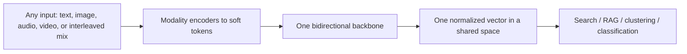
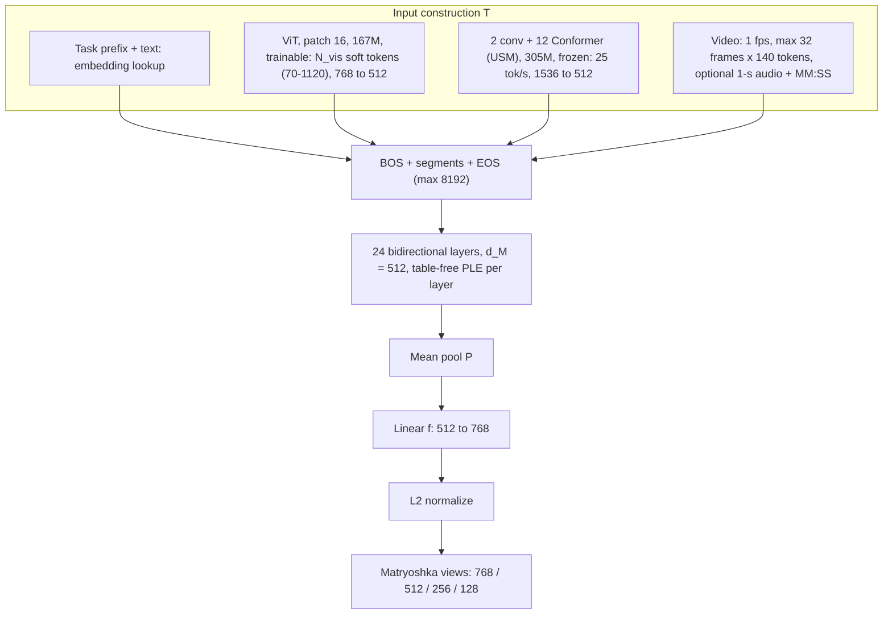
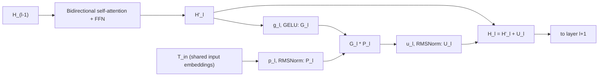

# Paper 06 architecture — EmbeddingGemma 2

Back to the analysis: [../papers/paper-06-analysis.md](../papers/paper-06-analysis.md) · Raw diagram: [../diagrams/paper-06-system.mmd](../diagrams/paper-06-system.mmd)

EmbeddingGemma 2 = a 271M bidirectional Gemma 4 backbone (24 layers, width 512, table-free per-layer embeddings) + a 167M trainable ViT + a 305M frozen Conformer audio encoder, mean-pooled into a 768-d Matryoshka embedding. All 744M parameters together; modular subsets of 271M / 439M / 577M.

---

## Level 1 — concept  **[Conceptual reconstruction from Sec. 2]**



**Explanation.** Unlike CLIP-style two-tower models, every modality flows through the **same** backbone, so a query mixing a photo and a question gets a single vector comparable to text, images, audio or video documents.

---

## Level 2 — components  **[Conceptual reconstruction from Sec. 2 (architecture and input handling)]**



| Component | Params | Trainable | Notes |
|---|---|---|---|
| Backbone (incl. embedder) | 271M | Yes | Gemma 4 decoder weights, causal mask flipped to bidirectional; n = 24, d_M = 512 |
| Vision encoder | 167M | Yes (multimodal stages) | Init from smaller Gemma 4 vision encoder; trainable gives +4.09 MMEB-v2 (Table 4) |
| Audio encoder | 305M | Frozen | Bit-identical to Gemma 4 E2B/E4B audio encoder |
| Pooling + projection | small | Yes | Mean pool → linear (random init) → ℓ2 |
| Quantized deployment | — | QAT tail | Backbone int4 (Q4_0 / Q4_C), vision W8A8, audio mixed 2/4/8-bit weights |

---

## Level 3 — inside one backbone layer (table-free PLE)  **[Conceptual reconstruction from the PLE equations]**



**Data flow.** Each layer re-reads the original token embeddings through its own projection $p_l$, gates them with a GELU of its current hidden state, projects back and adds to the residual stream. Gemma 3n/4 used a separate large PLE lookup table for this; EmbeddingGemma 2 removes it and derives the per-layer signal from the shared input embeddings, scoring slightly higher (MMEB-v2 55.46 vs 55.07, Table 2).

---

## Training flow  **[Conceptual reconstruction from Sec. 3]**

```mermaid
sequenceDiagram
    participant G4 as Gemma 4 decoder init
    participant TPF as Text pre-finetune (~300B)
    participant MPF as Multimodal pre-finetune (~2T)
    participant MFT as Multimodal finetune (~600B)
    participant MG as Merge
    participant QAT as QAT tail
    G4->>TPF: flip mask to bidirectional
    TPF->>MPF: distillation from Gemini Embedding 2 (+ small contrastive weight)
    MPF->>MFT: distillation only; image / audio / video / docs; larger batch and LR
    MFT->>MG: contrastive NCE + spread-out + MRL; smaller LR and batch
    MG->>QAT: average final with much earlier checkpoint
    QAT-->>QAT: distil quantized student from frozen float model
```
