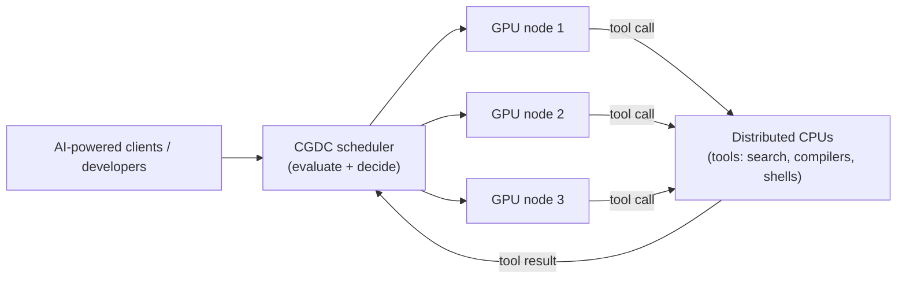
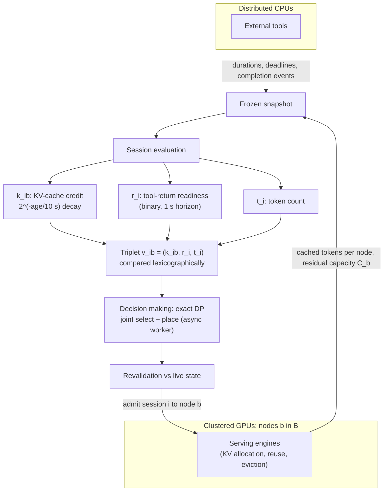
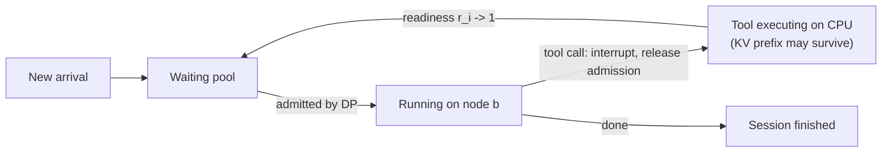

# Paper 07 architecture — TAO: Tool-Aware Joint Scheduling for LLM-Based Agentic Serving

Back to the analysis: [../papers/paper-07-analysis.md](../papers/paper-07-analysis.md) · Raw diagram: [../diagrams/paper-07-system.mmd](../diagrams/paper-07-system.mmd) · Paper: arXiv:2610.37230v1 (Shanghai Jiao Tong University; Stanford University)

TAO is a **scheduler layer** that sits between agent clients and a pool of GPU inference replicas. It does not change the model or the inference engine; it decides *which waiting agent sessions are admitted, and to which GPU node*, every scheduling tick.

---

## Level 1 — Concept: the CGDC serving scenario

**[From paper: Fig. 1 (left)]**, redrawn



| Component | Role |
|---|---|
| Clients | Agent harnesses (mini-SWE-agent, Claude Code) issuing multi-turn sessions |
| CGDC scheduler | TAO: values sessions and plans admission/placement |
| GPU nodes | One tensor-parallel model replica each, with its own KV cache |
| Distributed CPUs | Tool execution outside the GPU admission budget |

**Data flow.** A session's model turn runs on a GPU node, emits a tool call, the tool runs on CPUs, and the result re-enters the scheduler as a request for the next model turn. The scheduler sees GPU demand appear and disappear as tools start and finish.

---

## Level 2 — Components: evaluate-then-decide

**[From paper: Fig. 2]**, redrawn



**Components.**
- **Frozen snapshot** — waiting pool \(P\) (interrupted sessions + new arrivals), nodes \(B\), costs \(w_i\), capacities \(C_b\), eligibility \(E\).
- **KV-cache credit \(k_{i,b}\)** — observed (or estimated) reusable prefix tokens of session \(i\) on node \(b\), halved every 10 s of observation age (motivated by Fig. 3 retention traces).
- **Readiness \(r_i\)** — 1 if the tool has completed, or if the predicted completion / exposed deadline falls within the next 1 s and the prediction is fresh (< 30 s old); overdue predictions get probe opportunities. Prediction uses timing hints first, then an empirical-Bernstein upper estimate of historical tool duration (Appendix A), then a 5 s default.
- **Token count \(t_i\)** — favours larger accumulated contexts among ties.
- **DP planner** — multiple-knapsack / generalized-assignment DP over quantised capacity vectors; exact for the snapshot; BFD fallback if the state budget is exceeded.
- **Revalidation** — discards a plan if any selected session's signature or eligibility changed, then applies the longest feasible prefix.

---

## Level 3 — Low-level execution: one scheduling tick

**[Conceptual reconstruction]** from Algorithm 1 (Appendix B.1), Eqs. 4–7 and Appendix B.2

```mermaid
sequenceDiagram
    participant Pool as Waiting pool P
    participant Eval as Session evaluator
    participant W as Async DP worker
    participant Ex as Executor
    participant Eng as GPU engines
    Pool->>Eval: candidates (interrupted + new)
    Eng->>Eval: cache obs (k0_ib, t_obs), residual C_b
    Eval->>Eval: k_ib = round(k0_ib * 2^(-tau/h)), h = 10 s
    Eval->>Eval: d_i = max(0, D_f - e_i); r_i via Eq. 6, H = 1 s
    Eval->>W: snapshot (w_i, C_b, E, v_ib)
    W->>W: w_bar = ceil(w/Delta), C_bar = floor(C/Delta)
    loop for each candidate j
        W->>W: D_j(s) = lexmax(skip, assign j to eligible b)
    end
    alt state budget exceeded
        W->>W: best-fit-decreasing fallback
    end
    W->>Ex: plan x* + recorded signatures
    Ex->>Ex: discard if signature/eligibility changed
    Ex->>Eng: apply longest prefix feasible under live capacities
```

**Step detail.**
1. **Cache decay** — \(O(nm)\) preprocessing folds node-specific observations into assignment values; cache-equivalent nodes can be merged into \(g \le m\) capacity dimensions.
2. **DP recurrence** — \(D_j(s)=\operatorname{lexmax}\{D_{j-1}(s),\ \max_b[D_{j-1}(s-\bar w_j e_b)+u_{j,b}]\}\), \(D_0(0)=0\). Best final state is backtracked through stored predecessors.
3. **Async execution** — solve runs in an isolated worker; recorded preparation + solve is < 0.12% of runtime in the four-replica sweep (Appendix I).
4. **Loss bound** — the gap between the applied plan and a fresh optimum is at most \(A_{s,t}+2\epsilon_{s,t}+T_{s,t}\) (feasibility changes + twice value drift + revalidation loss), Eq. 10.

### Session lifecycle

**[Conceptual reconstruction]** from Sec. 2.2



Interruption happens only at tool boundaries (no in-flight compute lost); preempting an active inference would require recomputation and cause KV thrashing.
