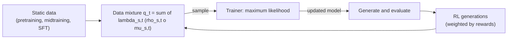
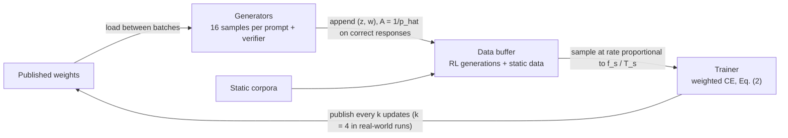
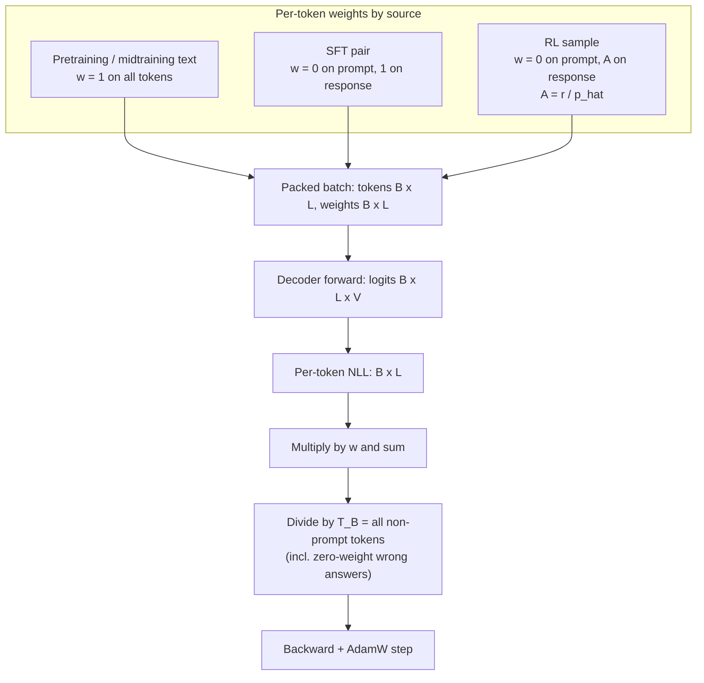
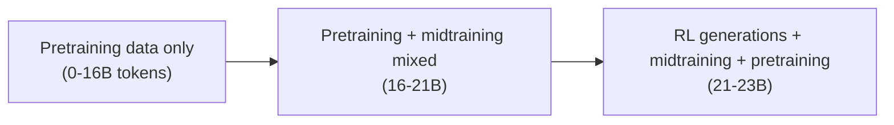

# Paper 08 architecture — Training Foundation Models with a Single Algorithm (unified training)

Back to the analysis: [../papers/paper-08-analysis.md](../papers/paper-08-analysis.md) · Raw diagram: [../diagrams/paper-08-system.mmd](../diagrams/paper-08-system.mmd) · Paper: arXiv:2610.40564v1 (Carnegie Mellon University; Johns Hopkins University; Aurora Innovation) · Code: https://github.com/yudasong/unified-training

The contribution is a **training-system architecture**: one loss, one data format and one trainer for pretraining, midtraining, SFT and (suitable) RL. The network itself is a standard decoder-only transformer (124M: 12 layers, hidden 768, 12 heads, RoPE, RMSNorm, tied embeddings, GPT-2 tokenizer, 2048 context — Table 6; a 0.76B model for real-world experiments).

---

## Level 1 — Concept: one likelihood loop

**[From paper: Fig. 1 (left)]**, redrawn

**Explanation.** Each data source is a pair (prompt distribution, target distribution). RL contributes the success-conditioned distribution of a generator (\(\pi^+_{\theta_t}\) on-policy, or \(\nu^+\) for any fixed generator). The only design knobs are mixture weights \(\lambda_{s,t}\) over time; staged training puts all weight on one source at a time.

---

## Level 2 — Components: asynchronous generator / buffer / trainer

**[From paper: Fig. 2 (left)]**, redrawn

| Component | Role | Key settings reported |
|---|---|---|
| Generators | Sample N completions from a recent weight copy, score with verifier, compute \(\hat p\) and weights | N = 16; temperature 1 (Tables 7, 13) |
| Data buffer | Holds static data and the newest generation rounds | available rounds were 12–44 updates stale (Appendix D.6) |
| Mixture sampler | Hits target token fractions / schedules (constant, growth, full or half annealing) | 0–5% midtraining fraction (Fig. 7) |
| Trainer | Weighted next-token CE, single token-mean normaliser | AdamW, 512 RL responses/update |

---

## Level 3 — Low-level: data format and one loss

**[From paper: Fig. 2 (right)]** for the token weights; loss flow is a **[Conceptual reconstruction]** of Eq. (2)

**Why the normaliser matters.** With one global token mean, the relative contribution of midtraining vs RL data follows the token mixture automatically (effective coefficient \(wT_D/T_R\)); a separately normalised sum needs a tuned \(\alpha\) whose best value varied across configurations (Appendix C.9).

**Finite-sample MaxRL identity.** \(\frac1N\sum_i \frac{r_i}{\hat p}\nabla\log\pi(y_i|x)=\frac{1}{N\hat p}\sum_{r_i=1}\nabla\log\pi(y_i|x)\): the average score over correct samples; in expectation it weights each prompt by \(1-(1-p_\nu(x))^N\).

### Lifecycle view

**[From paper: Fig. 3]**, schematic

Staged training would instead be three disjoint blocks: pretraining → midtraining → RL.
