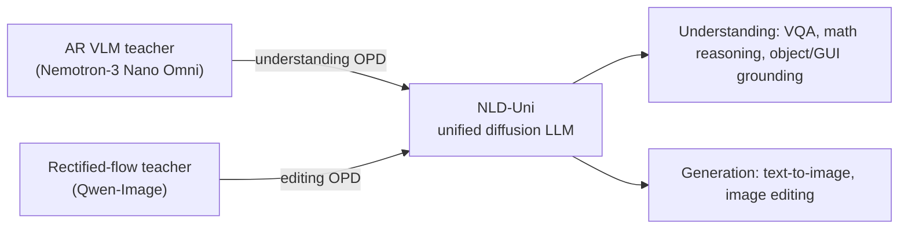
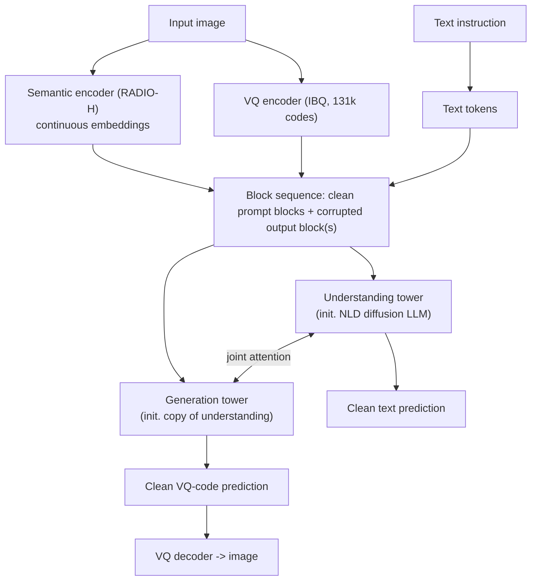
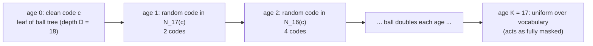
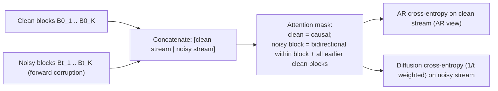
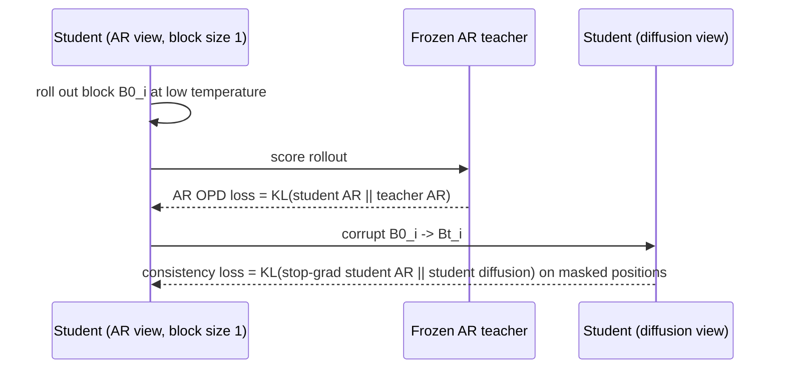
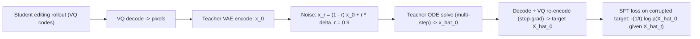
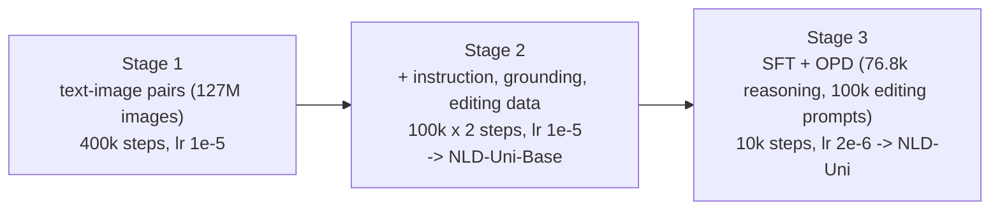

# Paper 09 architecture — Nemotron-Labs-Diffusion-Uni (NLD-Uni)

Back to the analysis: [../papers/paper-09-analysis.md](../papers/paper-09-analysis.md) · Raw diagram: [../diagrams/paper-09-system.mmd](../diagrams/paper-09-system.mmd) · Paper: arXiv:2610.36466v1 (NVIDIA-branded report; per-author affiliations not listed in the PDF) · Code: https://github.com/NVlabs/Nemotron-Labs-Diffusion-Uni · Weights: https://huggingface.co/nvidia/NLD-Uni

NLD-Uni is a unified **discrete diffusion LLM** for image understanding and image generation/editing, built as a two-tower Elastic Mixture-of-Transformers, trained with **cross-paradigm on-policy distillation** and a **self-refining** corruption process for image tokens.

---

## Level 1 — Concept

**[From paper: Fig. 1 (left)]**, redrawn

**Idea.** One sequence model, one diffusion objective over text and image tokens; borrow skills from best-in-class teachers of *other* paradigms.

---

## Level 2 — Components

**[From paper: Figs. 2–3]**, redrawn

| Component | Detail (as reported) |
|---|---|
| Backbone formulation | Set Block Decoding (position-shifted variant); block size randomised in training; each image is one block of resolution-dependent size |
| Understanding tower | Initialised from Nemotron-Labs-Diffusion (NLD) LLM |
| Generation tower | Initialised as a copy of the understanding tower |
| Elastic views (Fig. 2) | VLM view 8B active; T2I view 12B (4B understanding + 8B generation); interleaved view 16B |
| Input image encoding | RADIO-H semantic encoder + IBQ VQ encoder |
| Output image encoding | VQ codes only |
| Text corruption | standard binary masking |
| Image corruption | self-refining ball-tree process (below) |

---

## Level 3 — Low-level mechanics

### 3a. Self-refining image-token corruption

**[From paper: Fig. 4 and Fig. 11]**, redrawn

- Each token \(i\) gets a window \((\tau_i,\tau_i+\epsilon)\); age rises linearly through the window (Eq. 16). \(\epsilon\to 0\) recovers ordinary one-jump masked diffusion.
- Reverse step: predict clean code \(\hat c\); re-sample from \(N_{D-a}(\hat c)\) at the new, lower age (Eq. 12). Tokens are committed coarsely, then refined — and may move to a different ball if the prediction changes.
- Tree stored as a 1-D array (524 KB) instead of a 131k×131k distance matrix (32 GB).
- Default inference: 64 NFE with 8 refinements per token (Table 6).

### 3b. Block-diffusion training stream

**[Conceptual reconstruction]** from Appendix A.1 and Fig. 10

### 3c. Understanding OPD (transitive distillation)

**[From paper: Fig. 5]**, redrawn

### 3d. Generation OPD (teacher-refined student output)

**[From paper: Fig. 6 and Algorithm 1]**, redrawn

### Training stages

**[Conceptual reconstruction]** from Sec. 4.1, Appendix B and Table 5

Compute: 64 H100 GPUs (8 nodes), 26 days total, OPD stage 5 days (Appendix B.3).
