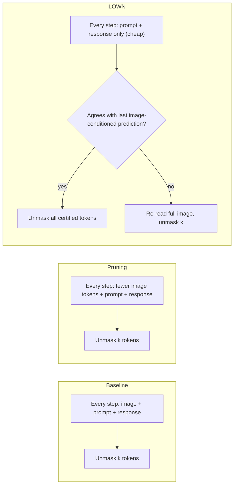
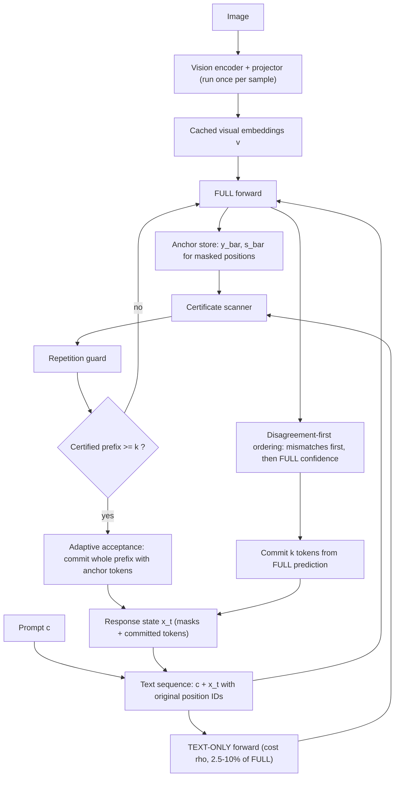
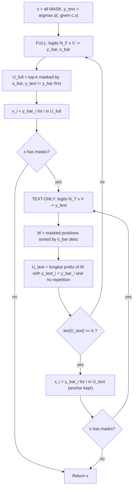
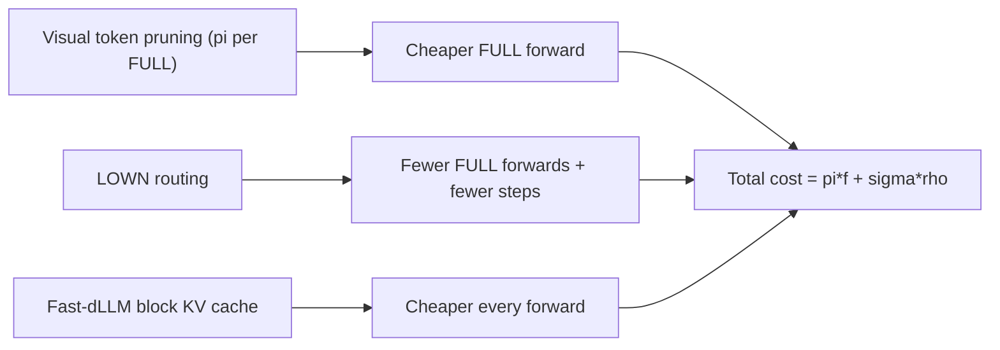

# Paper 10 architecture — LOWN (Look Only When Needed)

Back to analysis: [../papers/paper-10-analysis.md](../papers/paper-10-analysis.md) · Raw diagram: [../diagrams/paper-10-system.mmd](../diagrams/paper-10-system.mmd)

LOWN is not a new network. It is a **decoding controller** wrapped around an unchanged diffusion VLM (LLaDA-V, LaViDa, VidLaDA). The controller decides, per denoising step, (a) whether to run the expensive image-conditioned forward and (b) how many tokens to commit.

## Level 1 — Concept **[Conceptual reconstruction]** (based on Fig. 1a, 1b)

- **Baseline** pays for the image on every step (visual tokens ≈ 94.4% of input on average, Table 6).
- **Pruning** reduces *how many* visual tokens each forward reads.
- **LOWN** reduces *how often* a forward reads them at all. The two are multiplicative: cost `πf + σρ` (Sec. 4.3).

## Level 2 — Components **[From paper: Fig. 3, Algorithm 1]** (redrawn)

**Component roles**

| Component | Input | Output | Notes |
|---|---|---|---|
| Vision encoder | image | visual embeddings `v` (`|v|×d`) | Run once; excluded from FLOPs (adds 0.16–1.89%, App. B.2) |
| TEXT-ONLY forward | `c`, `x_t` (`N_T = |c|+|x_t|` tokens) | top-1 `ŷ_text` per masked position | Position IDs preserved; run every step |
| FULL forward | `v`, `c`, `x_t` (`N_F` tokens) | top-1 `ȳ`, confidence `s̄` | Only when certificate fails; replaces entire anchor |
| Anchor store | FULL outputs | `ȳ, s̄` | Every certificate is checked against the most recent FULL forward |
| Certificate scanner | `ŷ_text`, `ȳ`, `s̄` | certified prefix `𝒰_text` | Scan by decreasing `s̄`; stop at first mismatch — length adapts per step |
| Repetition guard | candidate token, neighbours | stop signal | Stops prefix if token equals an already-unmasked/accepted neighbour (App. B.1) |
| Adaptive acceptance | `𝒰_text` | commits ≥ k tokens | Lets a step advance further than the baseline |
| Disagreement-first ordering | `ŷ_text`, `ŷ_full`, confidence | `𝒰_full` (k positions) | Image-dependent tokens get committed immediately |

## Level 3 — Low-level execution and data flow **[Conceptual reconstruction]** from Algorithm 1 and Eq. 2–4

**Data shapes per step** (LLaDA-V: `L=32, d=4096, m=12288, |𝒱|=126,349`, App. B.2)

- TEXT-ONLY: hidden `N_T×d`, logits gathered for masked positions `|M_t|×|𝒱|`.
- FULL: hidden `N_F×d` with `N_F ≈ 9–33× N_T` (App. B.2).
- Anchor: two vectors of length `|M_t|` (token IDs, float confidences).

**Cost flow.** `R = f + σρ` (Eq. 3): `f` = share of steps that run FULL, `σ` = steps relative to baseline (≤ 1 because acceptance can commit > k), `ρ` = TEXT-ONLY/FULL cost (Table 8: 2.54% ChartQA to 10.07% MathVista). Measured average `R` = 0.353 on LLaDA-V (Table 1).

## Composition with other accelerators **[Conceptual reconstruction]** from Sec. 4.3, App. B.3, D.3

With Fast-dLLM, separate image-conditioned and TEXT-ONLY prefix caches are kept, and committed tokens are the union of Fast-dLLM's selection and LOWN's accepted tokens (App. D.3).
