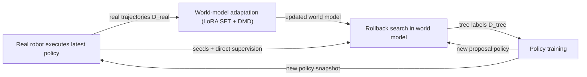
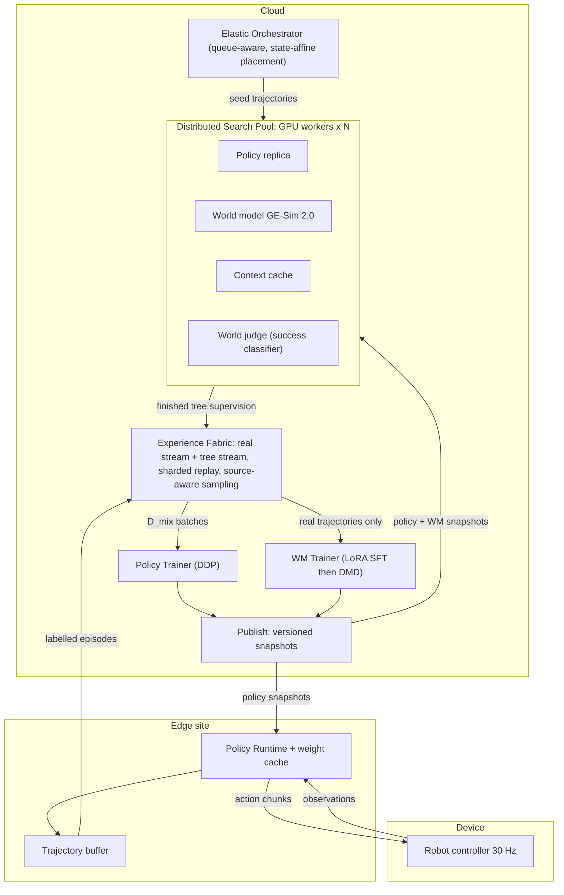
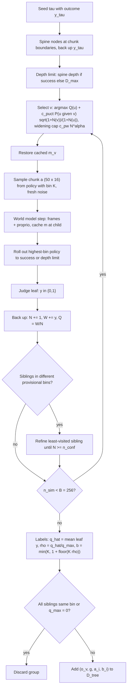
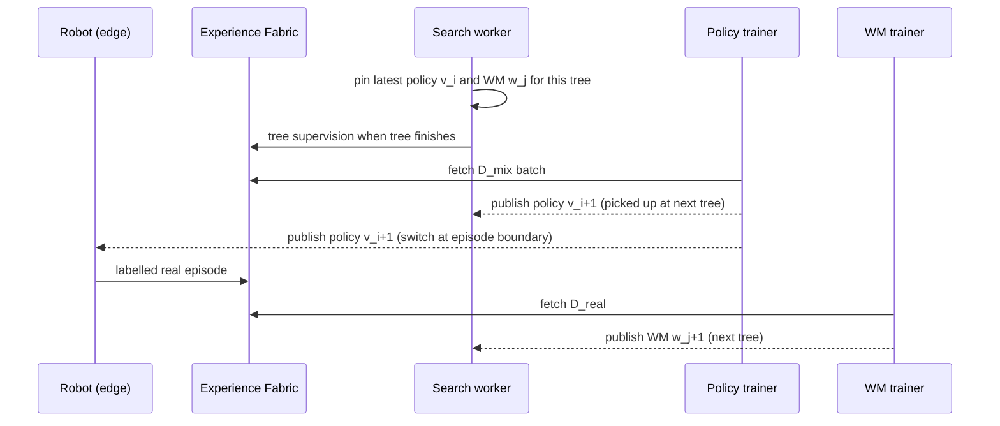

# Paper 11 architecture — Rollback (experience backtracking in world models)

Back to analysis: [../papers/paper-11-analysis.md](../papers/paper-11-analysis.md) · Raw diagram: [../diagrams/paper-11-system.mmd](../diagrams/paper-11-system.mmd)

Rollback has two layers: an **algorithm** (tree search in a rewindable world model → relative value labels → advantage-conditioned policy; real data → world-model adaptation) and a **system** (cloud–edge–device asynchronous training).

## Level 1 — Concept **[From paper: Fig. 1c and Fig. 4]** (redrawn)

- Forward-rollout world-model RL (Fig. 1b) wastes budget on independent rollouts. Rollback (Fig. 1c) rewinds to key decisions and learns from outcome differences, while real feedback refines the world model.

## Level 2 — Components **[From paper: Fig. 2 and Fig. 3]** (redrawn and merged)

| Component | Role | Key details (paper) |
|---|---|---|
| GE-Sim 2.0 world model | Predict 3-view frames + proprio state from context + action chunk | 25 frames per chunk at 16 fps; pose-expert head for proprio (Sec. 4.1, Table 5) |
| Context cache | Store `m_t` per node so branches restore instead of regenerate | Kept in GPU memory on the worker for the whole tree (Sec. 5.2) |
| World judge | Binary success on imagined rollouts | Fine-tuned with BCE on annotated task videos; threshold 0.5 |
| Policy (π0.5) | Proposes chunks (highest bin) and is trained | 50-step chunks, 16-D actions, K=5 bins, p_drop 0.5, CFG β=1.5 |
| Orchestrator | Assign seeds to idle workers, recover workers | Workers don't communicate during search |
| Experience Fabric | Only data exchange point | Separate real / tree streams; prefetch to learners |
| Policy Trainer | Optimise Eq. 5 continuously | 8 H200, DDP |
| WM Trainer | Test-time physics grounding | 400 LoRA SFT + 100 DMD steps per adaptation |
| Edge runtime | Inference next to robot | Swaps weights only at episode boundaries |

## Level 3 — Search and label extraction data flow **[Conceptual reconstruction]** from Algorithms 2–3, Eq. 2–5

**Data shapes**
- Observation: 3 RGB views on a 384×512 canvas + proprio (2 × (7 joints + 1 gripper) = 16 values).
- Action chunk: `50 × 16`.
- Tree sample: `(o_v, g, a_i, b_i)` with `b_i ∈ {1..5}`.
- Flow-matching batch: noisy chunk `x_s = (1−s)a + sε`, target velocity `ε − a` (both `50×16` per sample).

## Version pinning and asynchrony **[From paper: Fig. 4, Sec. 5.2–5.3]** (redrawn)

No process waits for another; they exchange only data and versioned snapshots (Sec. 5).
