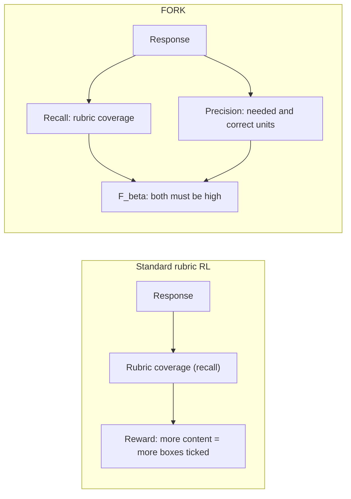
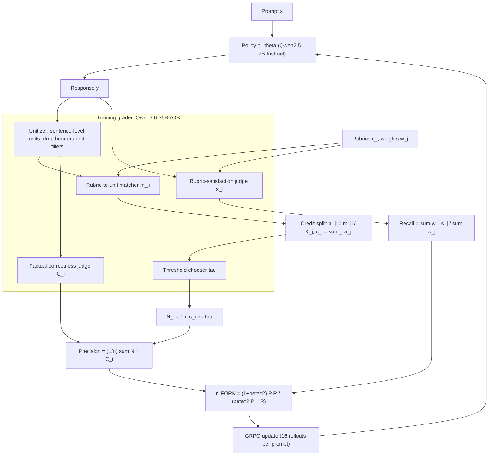
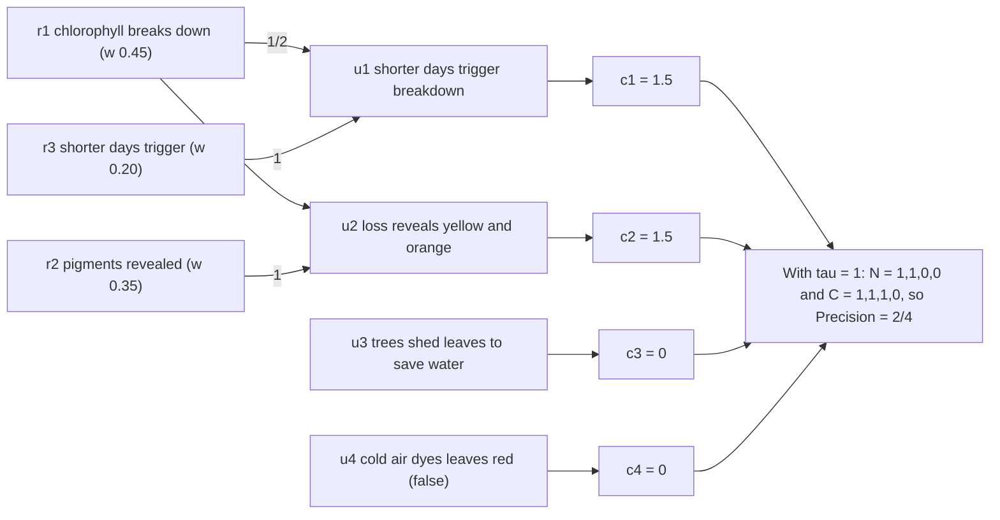
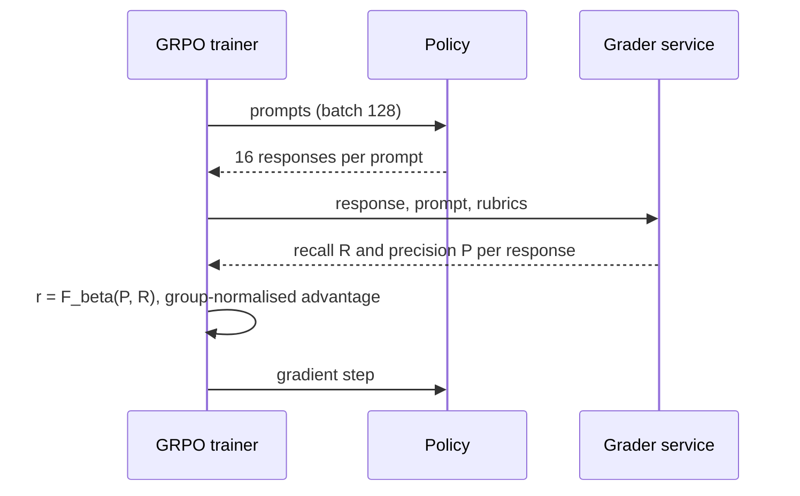

# Paper 12 architecture — FORK precision-aware rubric reward

Back to analysis: [../papers/paper-12-analysis.md](../papers/paper-12-analysis.md) · Raw diagram: [../diagrams/paper-12-system.mmd](../diagrams/paper-12-system.mmd)

FORK changes no model architecture. It is a **reward-computation pipeline** plugged into a standard GRPO loop: the reward becomes `F_β(precision, recall)` instead of rubric recall alone.

## Level 1 — Concept **[Conceptual reconstruction]** (based on Fig. 1)

Fig. 1 of the paper shows the motivation: with the standard reward, recall saturates while precision and win rate vs the base model fall and length rises; with FORK, recall reaches a similar level while precision and win rate rise and length falls.

## Level 2 — Components **[From paper: Fig. 2]** (redrawn)

| Component | Input | Output | Notes |
|---|---|---|---|
| Unitizer | response | units `u_1..u_n` | ≈ sentences; preserve wording; pronoun resolution only (Sec. 3.2) |
| Matcher | rubrics, units | binary matrix `m` (`M×n`) | "does unit i contribute to rubric j" |
| Credit split | `m` | credits `c_i` | each rubric distributes 1 credit equally → redundancy is diluted |
| Threshold chooser | units + credits | `τ > 0` | dynamic per response, chosen by the grader |
| Correctness judge | prompt, unit | `C_i ∈ {0,1}` | strict: any factual error → 0 |
| Satisfaction judge | response, rubric | `s_j ∈ {0,1}` | standard rubric coverage |
| F_β combiner | P, R | scalar reward | `β = 1` or `1.25` |
| GRPO | rewards for 16 samples | policy update | batch 128, lr 4.2e-6, 3 epochs, 8× H100 |

## Level 3 — Credit computation on the Fig. 2 example **[From paper: Fig. 2]** with illustrative τ and correctness

Credits are from Fig. 2. The threshold value and correctness labels in the final node are illustrative assumptions for teaching.

## Where FORK sits in the RL loop **[Conceptual reconstruction]**

Evaluation is separate: GPT-5.4 acts as a reference grader for recall, precision, F1, and rubric-free win rate vs the base model.
