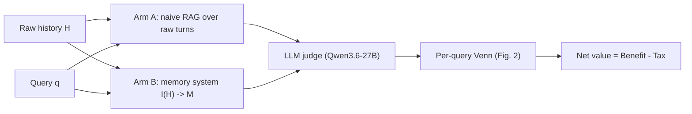
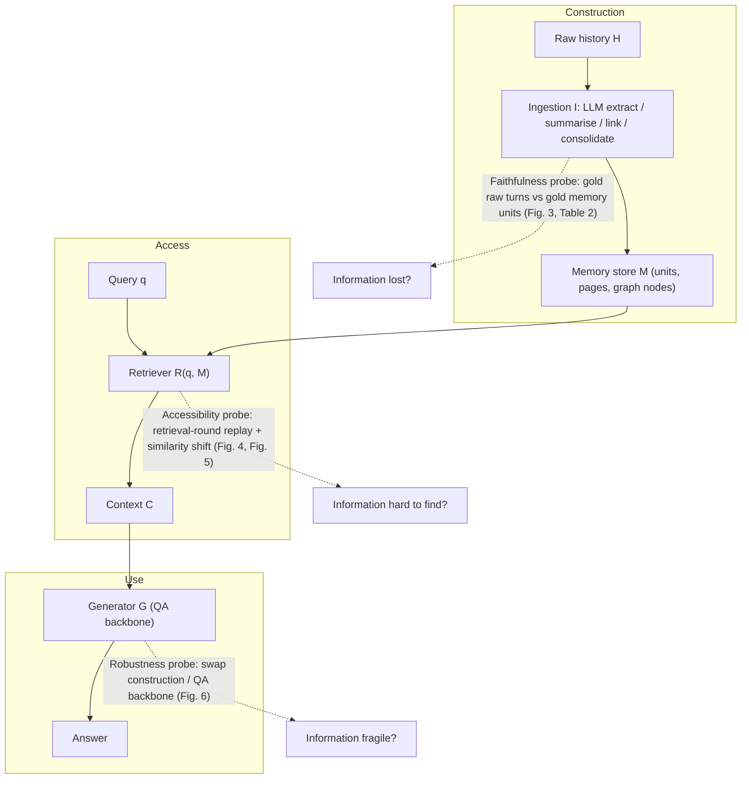
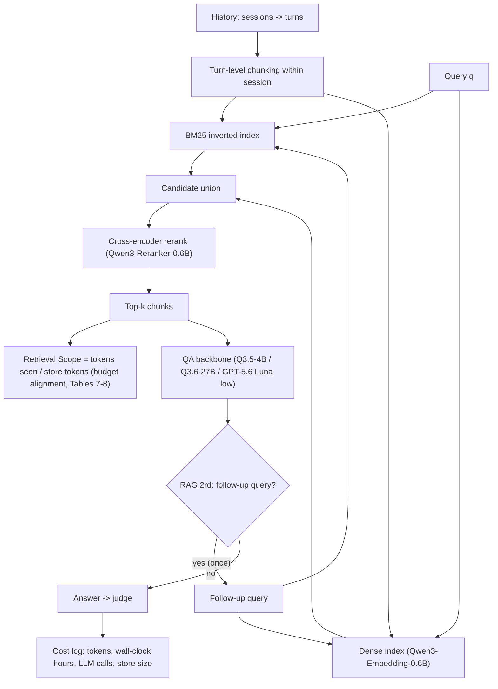

# Paper 13 — Architecture: the Memory Tax evaluation framework

Back to the analysis: [../papers/paper-13-analysis.md](../papers/paper-13-analysis.md)

This is an evaluation and audit paper. The "architecture" is the counterfactual pipeline it uses to measure what a memory system adds over naive RAG, together with the three diagnostic probes. The paper has no system-diagram figure (its figures are result plots), so **every diagram here is a [Conceptual reconstruction]** built from the Section 2 formalisation ($\mathcal{M}=I(\mathcal{H})$, $\mathcal{C}=R(q,\mathcal{M})$, $\hat y=G(q,\mathcal{C})$), the RAG specification, and the diagnostics in Figures 2–6.

---

## Level 1 — Concept: two arms, one ledger **[Conceptual reconstruction]**

**Components.**
- **Arm A (reference).** Retrieval directly over the raw history, with no LLM rewriting.
- **Arm B (system under test).** Any memory system: flat, hierarchical, graph or trained policy.
- **Judge.** Grades both answers. Its agreement with human labels is 95.1% / 100.0% / 97.3% across the three benchmarks.
- **Ledger.** Benefit counts queries only memory solves. Tax counts queries only RAG solves. Net value equals the accuracy gap.

---

## Level 2 — Components: where deviations enter **[Conceptual reconstruction]**

**Data flow and explanation.**
1. **Construction** turns turns into units. Any deletion or distortion here is a *faithfulness* deviation. Table 2 measures it as the share of atomic facts with no loss (NL) or with no unit at all (NU). OpenViking has 38.0% NU and LightMem 9.6% NU.
2. **Access** maps the query to units. Even if the information survived, rewriting moves its embedding away from the query (Fig. 5), and fragmentation spreads evidence across several units, so more retrieval rounds are needed (Fig. 4). That is an *accessibility* deviation.
3. **Use**: different QA backbones read compressed units differently. Fig. 6 marks with red segments the cases where a backbone swap drops accuracy more than it drops RAG's. That is a *robustness* deviation.

---

## Level 3 — Low-level execution: reference RAG and budget alignment **[Conceptual reconstruction]**

**Explanation.**
- Chunking never crosses a session boundary, so a retrieved chunk is always one coherent turn. The Table 6 ablation shows streaming chunking is the most harmful variant (69.4 vs 77.6 on LME-s Q27B).
- The hybrid union protects against both lexical misses (dense-only) and paraphrase misses (BM25-only). BM25-only drops to 68.2 (Table 6).
- **Retrieval Scope** puts systems on an equal retrieval budget. Without it, a system that surfaces more tokens wins for the wrong reason (Tables 7–8).
- The 2-round variant gives RAG a single agentic follow-up. On LME-s with GPT-5.6 Luna this reaches 90.0, the top score in Table 1.

---

## Extension views **[Conceptual reconstruction]**

- **Experiential memory.** The history is past task trajectories, and memory is a distilled workflow or skill (Memp, ReasoningBank, G-Memory, SkillPro). The reference is naive RAG over raw trajectories (Table 16, Fig. 8).
- **World-model memory.** The history is past video frames, and memory is a raw KV cache (WorldKV), visual latents (FramePack) or naive frames (I3DM). Naive frames score best on C-as-M-eval: SSIM .560 and 1−LPIPS .704 (Table 17).
