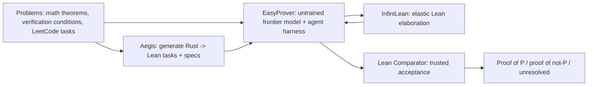
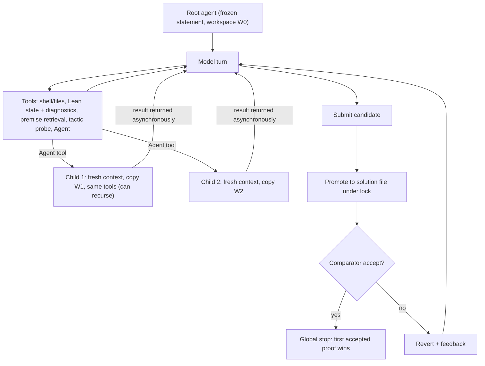
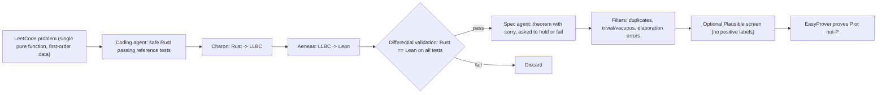
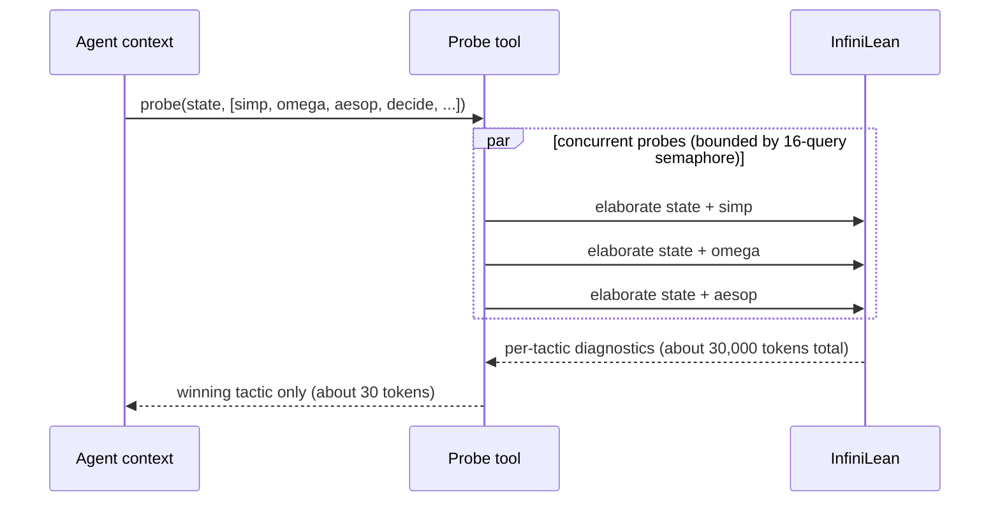
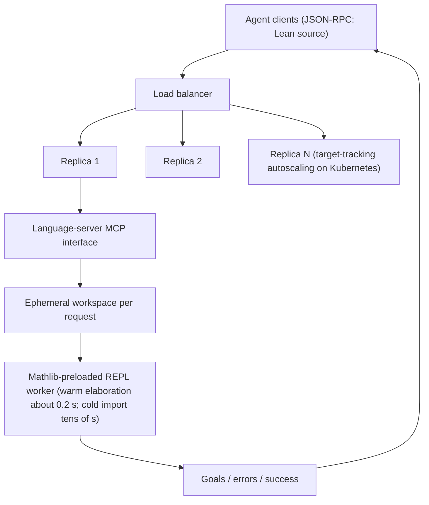
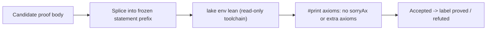

# Paper 14 — Architecture: EasyProver and Aegis

Back to the analysis: [../papers/paper-14-analysis.md](../papers/paper-14-analysis.md)

Provenance: the paper has Fig. 1 (asynchronous agent loop), Fig. 2 (parallel tactic probing), Fig. 3 (InfiniLean service) and Fig. 4 (Aegis pipeline). Diagrams labelled **[From paper: Fig. X — redrawn]** follow those figures' described structure. Everything else is a **[Conceptual reconstruction]**.

---

## Level 1 — Concept **[Conceptual reconstruction]**

- **Aegis** supplies harder tasks whose obligations come from real implementation semantics.
- **EasyProver** is the search policy. All of its intelligence is in the frozen model plus the harness.
- **InfiniLean** is the compute substrate for Lean queries.
- **Comparator** is the only source of truth for success.

---

## Level 2 — Components

### 2a. EasyProver agent loop **[From paper: Fig. 1 — redrawn]**

**Explanation.**
- Children isolate both context and filesystem, so failed explorations never pollute the parent.
- Asynchrony means one slow child cannot block progress.
- The model, not a value function, decides which branch to expand. The paper calls this only "loosely analogous" to MCTS.

### 2b. Aegis pipeline **[From paper: Fig. 4 — redrawn]**

Yield: 2,045 / 2,356 problems validated (86.8%), 11,533 candidate specifications over 1,257 translated programs.

---

## Level 3 — Low-level execution

### 3a. Parallel tactic probing **[From paper: Fig. 2 — redrawn]**

### 3b. InfiniLean elaboration service **[From paper: Fig. 3 — redrawn]**

**Why stateless.** Any replica can serve any request, which allows horizontal scaling to the bursts created by up to 64 concurrent agents and 300+ sub-agents per hard proof.

### 3c. Acceptance path **[Conceptual reconstruction]**

