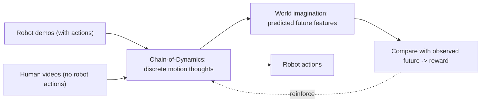
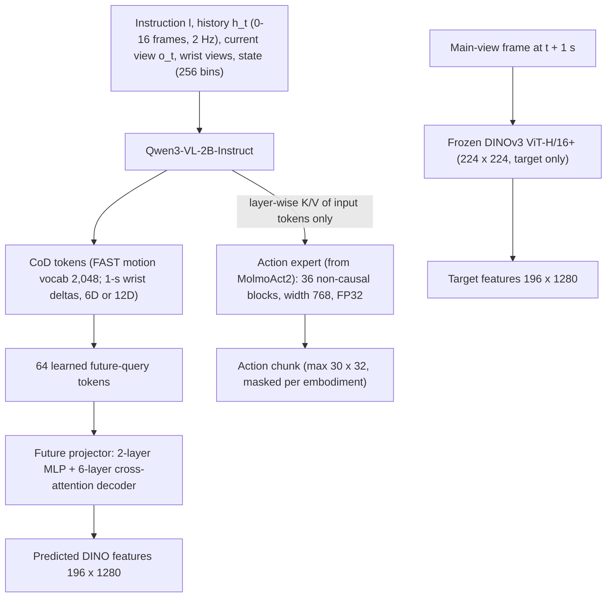
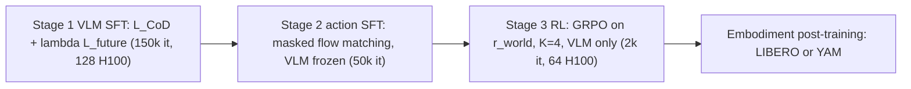
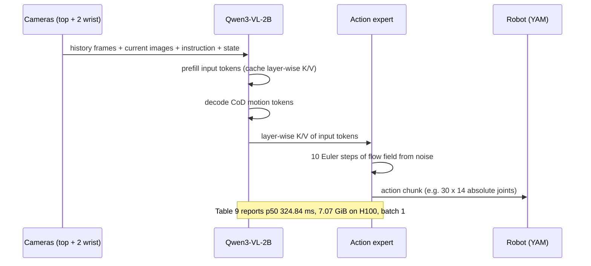
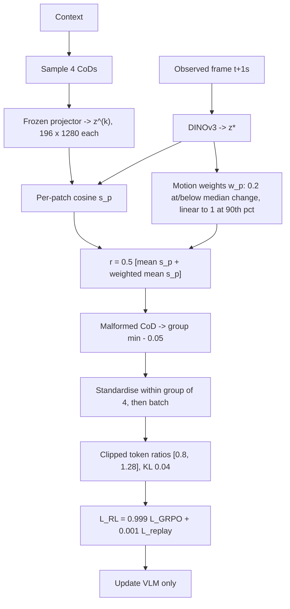

# Paper 15 — Architecture: ThinkWorld

Back to the analysis: [../papers/paper-15-analysis.md](../papers/paper-15-analysis.md)

Provenance: the paper's Fig. 1 gives the concept overview, and Fig. 2 gives the architecture with (a) the SFT stage and (b) the RL stage. Diagrams labelled **[From paper: Fig. X — redrawn]** follow those figures' described structure, with component sizes from Section 3 and Appendix A. The others are **[Conceptual reconstruction]**.

---

## Level 1 — Concept **[From paper: Fig. 1 — redrawn as a flow]**

**Explanation.** Both data sources meet in one motion-token reasoning space. Imagination makes every video a source of reward, and actions are decoded from the same grounded context.

---

## Level 2 — Components **[From paper: Fig. 2 — redrawn]**

| Component | Role | Trained in |
|---|---|---|
| Qwen3-VL-2B VLM | Encodes context, generates CoD, hosts future queries | Stage 1 SFT, Stage 3 RL |
| Motion tokenizer | Turns robot/human wrist motion into CoD targets | Fixed |
| Future projector | Maps future queries to DINO-space predictions | Stage 1; frozen in RL |
| DINOv3 | Produces target features of the real future | Always frozen |
| Action expert | Flow-matching decoder of continuous actions | Stage 2 (VLM frozen); frozen in RL |

### Training-stage view **[From paper: Fig. 2(a)/(b) — redrawn; stage details from Section 3]**

---

## Level 3 — Low-level execution

### 3a. Inference step **[Conceptual reconstruction]**

### 3b. RL reward computation **[Conceptual reconstruction]** (from Eq. 4, Eq. 6 and the GRPO settings)

**Data-flow note.** In human-video batches, the action-expert path is absent: no action loss is computed, and only CoD and future-prediction or reward signals train the VLM.
