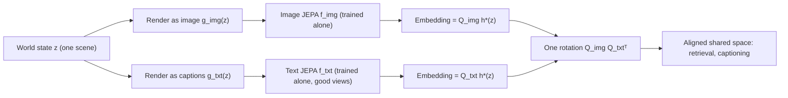
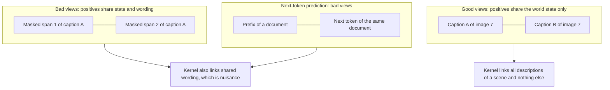
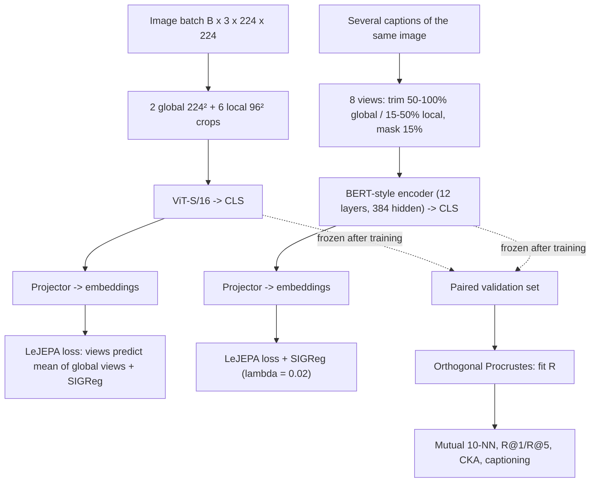

# Paper 01: Proving and Improving the Platonic Representation Hypothesis with JEPAs

> Reporting week: 2026-W44 (2026-10-26 to 2026-11-01 IST). Source read: arXiv HTML v1 (full text incl. appendix). Institutions were checked against the title block of the local PDF.

## A. Overview

| Field | Value |
|---|---|
| Title | Proving and Improving the Platonic Representation Hypothesis with JEPAs |
| Authors | Randall Balestriero, Yann LeCun |
| Institutions | Balestriero: Brown University and AMI Labs. LeCun: New York University and AMI Labs (from the PDF title block) |
| First submitted | 2026-10-29 (v1). This analysis covers v1 |
| Identifier | arXiv:2610.39302v1 [cs.AI] |
| Status | **New**, first published inside the reporting period |
| Official link | https://arxiv.org/abs/2610.39302v1 (HTML: https://arxiv.org/html/2610.39302v1) |
| Local PDF | [./paper-01.pdf](./paper-01.pdf) |
| Code | The paper links `github.com/galilai-group/prh-proof` and a Hugging Face live demo (`galilai-group/prh_demo`). The abstract page did not link code, but the paper does. |
| Areas | Representation learning, multimodal alignment, self-supervised learning, world models |

**Abstract (paraphrased).** The Platonic Representation Hypothesis (PRH) says that models trained on different data and modalities converge towards a shared representation of the world as they scale. Until now it was an empirical observation without a proof or a recipe. The authors prove that JEPAs trained *separately* on any number of modalities learn the same representation, up to a single rotation, when each JEPA's positive pairs are two observations of the same world state. They call these "good views". With other positives the misalignment is bounded by how much the pairing kernels differ. They show that next-token prediction has the form of a JEPA with "bad views" (two pieces of the same document). This explains why language models align with vision only slowly, through scale. Empirically, good views reach the same alignment as next-token prediction with **42× fewer samples**. A **109M-parameter text JEPA** aligns with DINOv2 and CLIP image encoders better than every language model the authors evaluated, up to 72B parameters. One fitted rotation turns two separately trained encoders into an image captioner (**CIDEr 0.838 on COCO**).

## B. Problem

- **What it solves.** It asks when models trained separately on different modalities *provably* learn the same representation, and it gives a training recipe that makes this happen on purpose.
- **Why it matters.** If text and image encoders share geometry up to a rotation, you can connect separately trained models with a few paired examples, or none. You do not need huge paired datasets such as CLIP's. This bears on world models, on reusing unimodal models, and on whether bigger LLMs "understand" the world.
- **Prior limitations.** The original PRH work (Huh et al.) measured that alignment rises with scale but offered no mechanism. Alignment in LLMs appeared to emerge only from very large models and corpora. CLIP-style alignment needs hundreds of millions of image-text pairs and joint training.
- **Gap addressed.** The paper supplies a theorem (when alignment is exact), a bound (how far off you are otherwise), a diagnosis (next-token prediction uses "bad views"), and a recipe (use good views) that is far more sample-efficient.

## C. Fundamentals

**A concrete example first.** Two people each describe the same set of photos. One writes in English and one draws sketches, and they never meet. Each person builds an internal "map" in which similar scenes sit close together. If both maps are organised only by *what is in the scene*, they have the same shape. One map may simply be turned relative to the other. A single rotation, learned from a handful of photo-sketch matches, then lines them up everywhere. The paper proves this happens for JEPAs when the training pairs are "two observations of the same scene".

Terms used in this analysis:

- **Representation / embedding.** A vector $f(x)\in\mathbb{R}^k$ an encoder outputs for an input $x$.
- **World state $z$.** The underlying scene, for example the content of one photo. A modality *renders* it: $x=g_m(z)$ is an image, a caption or a video frame.
- **Positive pair.** Two inputs the training objective says should map close together.
  - **Good views:** two observations of the *same world state*, such as two different captions of one image or two frames of one clip.
  - **Bad views:** two corruptions of one sample, such as two masked spans of the same caption or a prefix and its next token. They share *wording* (nuisance) as well as state.
- **JEPA (Joint-Embedding Predictive Architecture).** It trains an encoder so that the embedding of one view predicts the embedding of another view. A separate term stops the trivial "all embeddings equal" solution, called **collapse**.
- **Anti-collapse / whitening.** Force embeddings to have zero mean and identity covariance. SIGReg (from LeJEPA) instead pushes the embedding distribution towards an isotropic Gaussian.
- **Rotation $\boldsymbol{Q}\in\mathrm{O}(k)$.** An orthogonal matrix. Rotating whitened embeddings keeps them whitened, so the loss cannot tell rotated solutions apart. This is why "equal up to rotation" is the best possible result.
- **Kernel / spectral embedding.** Collect how often state $z$ is paired with $z'$ in a matrix and normalise it. Its top eigenvectors give a $k$-dimensional coordinate system, the spectral embedding. The JEPA optimum turns out to be exactly this embedding.
- **Orthogonal Procrustes.** Finds the rotation that best maps one set of points onto another. It has a closed form via SVD.
- **Alignment metrics.** *Mutual k-NN* counts the nearest neighbours that two embedding spaces share for the same items. *R@1* is the share of retrievals where the correct cross-modal partner comes first. *CKA* is centred kernel alignment.

## D. Core contribution

1. **Platonic Representation Theorem (Theorem 1).** Suppose all modalities share one positive-pair distribution $\pi$ over world states and the loss minimiser is unique up to rotation. Then every modality's optimal encoder equals one shared $h^\star$ up to its own rotation. So any two modalities differ by one rotation.
2. **Spectral JEPAs satisfy the uniqueness assumption (Proposition 1).** The optimum is the spectral embedding of the pairing kernel.
3. **Mismatch bound (Theorem 2).** If two modalities use different pairing kernels, their misalignment is bounded by the kernel difference divided by the eigengap.
4. **Nuisance theory (Theorem 3, Proposition 3, Theorem 4).** Embedding variance that is not explained by the world state costs alignment. Good views provably ignore nuisance. Bad views spend some embedding directions on it.
5. **Next-token prediction is a JEPA (Proposition 4).** Softmax cross-entropy splits into a prediction term and a log-sum-exp anti-collapse term. Its positives (context, next token) come from one document, so they are bad views. Its optimum is identified only up to an invertible linear map, not a rotation.
6. **Recipe and evidence.** Train a text JEPA whose positives are different captions of the same image, trimmed and masked. Train an image JEPA separately. Then fit one rotation. The authors report better alignment than LLMs up to 72B, a scaling law of alignment, zero-pair alignment, and a captioner.

**What differs from prior work.** The PRH paper observed convergence. This paper proves when it holds and engineers it through the choice of positives rather than through scale. CLIP aligns modalities through *joint* contrastive training on pairs. Here every encoder is trained *alone*, and at most a few paired examples are used afterwards to fit a rotation.

## E. Architecture deep dive

Full diagrams are in [../architectures/paper-01-architecture.md](../architectures/paper-01-architecture.md).

### Level 1: concept [Conceptual reconstruction]



### Level 2: good views vs bad views [Conceptual reconstruction of Fig. 3's idea]



Figure 3 in the paper shows four panels of which captions get connected under good views, weak bad views, strong bad views and next-token prediction. The diagram above is a schematic of that idea, not a copy.

### Level 3: training and alignment data flow [Conceptual reconstruction from the method section]



## F. Low-level mechanics

### F.1 Setup

The world is a finite set of states $z\in\mathcal{Z}$ with $p(z)>0$. Modality $m$ renders a state injectively as $x=g_m(z)$. Positive pairs $(z,z')\sim\pi_m$ have marginals equal to $p$.

$$\mathcal{L}_m(f)=\mathbb{E}_{(z,z')\sim\pi_m}\,\ell\big(f(g_m(z)),f(g_m(z'))\big)+\Omega(f)$$

- $\mathcal{L}_m(f)$: JEPA loss of encoder $f$ on modality $m$.
- $\pi_m$: joint distribution of positive pairs of world states, which encodes "what counts as the same thing".
- $g_m$: rendering of a world state into modality $m$'s input space $\mathcal{X}_m$.
- $f:\mathcal{X}_m\to\mathbb{R}^k$: the encoder, with embedding dimension $k$.
- $\ell$: prediction term. The predictor is the identity in the experiments, so this compares the two embeddings directly.
- $\Omega(f)$: anti-collapse term. It depends only on the *distribution* of embeddings and may be a hard constraint taking values in $\{0,\infty\}$.
- Both $\ell$ and $\Omega$ are rotation-invariant. This is the source of the "up to rotation" in every result.

The paper notes that spectral contrastive learning, whitened MSE, VICReg and Barlow Twins (in a whitened limit) and LeJEPA's SIGReg all fit this template.

### F.2 Kernel and spectral embedding

$$\boldsymbol{\Pi}_{zz'}=\pi(z,z'),\qquad \boldsymbol{D}=\mathrm{diag}(p),\qquad \boldsymbol{K}_\pi=\boldsymbol{D}^{-1/2}\boldsymbol{\Pi}\,\boldsymbol{D}^{-1/2}$$

- $\boldsymbol{\Pi}$: $|\mathcal{Z}|\times|\mathcal{Z}|$ matrix of pair probabilities.
- $\boldsymbol{D}$: diagonal matrix of state probabilities.
- $\boldsymbol{K}_\pi$: normalised pairing kernel. Its eigenvalues satisfy $1=\mu_0\ge\mu_1\ge\dots$ and its eigenvectors are $v_i$.

**Proposition 1 (spectral case).** Take $\ell(a,b)=\|a-b\|^2$ and let $\Omega$ enforce whitening, so that $\mathbb{E}_p h=0$ and $\mathbb{E}_p hh^\top=I_k$. Then:

$$\min\mathcal{L}_\pi=2\sum_{i=1}^{k}(1-\mu_i),\qquad \boldsymbol{\Phi}_\pi(z)=\frac{\big(v_1(z),\dots,v_k(z)\big)}{\sqrt{p(z)}}$$

- $\mu_i$: the $i$-th eigenvalue of $\boldsymbol{K}_\pi$, skipping the trivial $\mu_0=1$ (the constant direction is removed by centring).
- $\boldsymbol{\Phi}_\pi(z)\in\mathbb{R}^k$: the spectral embedding of state $z$.
- If the eigengap $\mu_k>\mu_{k+1}$ holds, the minimisers are exactly $\boldsymbol{Q}\boldsymbol{\Phi}_\pi$ with $\boldsymbol{Q}\in\mathrm{O}(k)$. The solution is unique up to rotation.

### F.3 Theorem 1 (Platonic Representation Theorem)

$$f_m^\star\circ g_m=\boldsymbol{Q}_m\,h^\star,\qquad \boldsymbol{Q}_m\in\mathrm{O}(k)$$

- $f_m^\star$: optimal encoder for modality $m$.
- $h^\star:\mathcal{Z}\to\mathbb{R}^k$: one modality-independent representation of world states.
- $\boldsymbol{Q}_m$: rotation specific to modality $m$. Modalities $m$ and $m'$ are related by $\boldsymbol{Q}_m\boldsymbol{Q}_{m'}^\top$.

The intuition is that the loss sees $f_m$ only through $f_m\circ g_m$, a function of $z$. Because $g_m$ is injective and every modality uses the same $\pi$, every modality solves the *same* optimisation problem over functions of $z$.

### F.4 Theorem 2 (kernel mismatch bound)

$$\min_{\boldsymbol{Q}\in\mathrm{O}(k)}\Big(\mathbb{E}_p\|\boldsymbol{\Phi}_1(z)-\boldsymbol{Q}\boldsymbol{\Phi}_2(z)\|^2\Big)^{1/2}\le\frac{2\sqrt{2}}{\delta}\min\Big(\sqrt{k}\,\|\boldsymbol{K}_{\pi_1}-\boldsymbol{K}_{\pi_2}\|_2,\ \|\boldsymbol{K}_{\pi_1}-\boldsymbol{K}_{\pi_2}\|_F\Big)$$

- Left side: root-mean-square misalignment after the best rotation.
- $\boldsymbol{\Phi}_1,\boldsymbol{\Phi}_2$: spectral embeddings under pairing distributions $\pi_1,\pi_2$, which share the marginal $p$.
- $\delta=\mu_k-\mu_{k+1}>0$: eigengap of $\boldsymbol{K}_{\pi_2}$. A large gap means stable, well-separated directions.
- $\|\cdot\|_2$, $\|\cdot\|_F$: spectral and Frobenius norms of the kernel difference.

This is a Davis-Kahan-style perturbation bound. Figure 2 checks it on 300 random finite worlds (8-39 states, $k=1$-$5$). Error stays below the bound in every world and reaches at most 18% of it.

### F.5 Theorem 3 (nuisance costs alignment)

$$\min_{\boldsymbol{Q}}\mathbb{E}\|\boldsymbol{Q}f_1(x_1)-f_2(x_2)\|^2\ge 2k\big(1-\min_m\rho(f_m)\big),\qquad \rho(f)=\frac{\mathrm{tr}\,\boldsymbol{C}_f^{1/2}}{k},\quad \boldsymbol{C}_f=\mathrm{Cov}\big(\mathbb{E}[f(x)\mid z]\big)$$

- $f_1,f_2$: centred, whitened encoders. $x_1,x_2$ are paired observations of the same $z$ with independent nuisances.
- $\rho(f)\in[0,1]$: the "scene-explained fraction", the share of embedding variance explained by the world state. $\rho=1$ exactly when $f(x)$ depends on $z$ alone.
- $\boldsymbol{C}_f$: covariance of the state-conditional mean embedding.
- Uncorrelated embeddings give the maximum error $2k$.

**Proposition 3.** (i) Good views give $\rho=1$ when $\mu_k>\max(\mu_{k+1},0)$. (ii) Let $\alpha_k$ be the correlation two corruptions keep along the $k$-th state direction and $\beta_1$ the largest correlation they keep along a nuisance direction. A bad-view JEPA spends $r$ of its $k$ directions on nuisance, with alignment error at least $2r$, and $r\ge1$ exactly when $\beta_1>\alpha_k$.

### F.6 Proposition 4 (next-token prediction is a JEPA)

$$-\log\frac{e^{\langle h(c),w_y\rangle}}{\sum_v e^{\langle h(c),w_v\rangle}}=\underbrace{-\langle h(c),w_y\rangle}_{\text{prediction}}+\underbrace{\log\textstyle\sum_v e^{\langle h(c),w_v\rangle}}_{A(h(c))\ \text{anti-collapse}}$$

- $c$: the context (prefix) and $h(c)\in\mathbb{R}^k$ its embedding, which plays the role of the context encoder.
- $y$: the observed next token. $w_y$ is its row of the token table, which plays the role of the target encoder.
- $\langle\cdot,\cdot\rangle$: inner product, the prediction function.
- $A(h)$: log-partition function. It penalises embeddings that score every token highly, so it acts as anti-collapse.
- As temperature $t\to0$, $tA(h/t)\to\max_v\langle h,w_v\rangle$, so the loss tends to a margin loss.
- At the optimum, $\langle h(c),w_v\rangle=\log p(v\mid c)+b(c)$. This is invariant under $\mathrm{GL}(k)$, so $h$ is identified only up to an invertible linear map, not a rotation. The authors call the "bad view" reading of next-token prediction heuristic, not a formal corollary.

### F.7 Rotation fitting (orthogonal Procrustes)

Proposition 2 shows that first and second moments of unpaired whitened data cannot identify the rotation. With $n\ge k$ paired states whose embeddings span $\mathbb{R}^k$, the rotation is the unique minimiser of:

$$\boldsymbol{R}^\star=\arg\min_{\boldsymbol{R}\in\mathrm{O}(k)}\sum_{i=1}^{n}\big\|f_1^\star(g_1(z_i))-\boldsymbol{R}\,f_2^\star(g_2(z_i))\big\|^2$$

The standard closed form, which is textbook material and not printed in the paper, is: stack paired embeddings as $\boldsymbol{A},\boldsymbol{B}\in\mathbb{R}^{n\times k}$, compute $\boldsymbol{A}^\top\boldsymbol{B}=\boldsymbol{U}\boldsymbol{\Sigma}\boldsymbol{V}^\top$, then $\boldsymbol{R}^\star=\boldsymbol{U}\boldsymbol{V}^\top$. When dimensions differ (for example 768 vs 384), the paper uses a map with orthonormal rows, a case it notes the theory does not cover. For the zero-pair setting, it alternates Sinkhorn optimal transport with Procrustes on the transport plan.

### F.8 Training objective in practice (LeJEPA + SIGReg)

The experiments use the LeJEPA objective: every view's embedding is pulled towards the mean of the two global-view embeddings, plus SIGReg with $\lambda=0.02$. SIGReg is an Epps-Pulley normality test applied to random 1-D projections of the batch embeddings. The paper notes the statistic is computed on each GPU's batch and scaled by batch size. **[Conceptual reconstruction]** A compact form:

$$\mathcal{L}=\frac{1}{V}\sum_{v=1}^{V}\Big\|z_v-\tfrac12(z_{g_1}+z_{g_2})\Big\|^2+\lambda\cdot\frac{1}{S}\sum_{s=1}^{S}\mathrm{EP}\big(\{a_s^\top z_{i}\}_{i=1}^{B}\big)$$

- $z_v$: projector output for view $v$ of one sample. $z_{g_1},z_{g_2}$ are the two global views.
- $V$: number of views (8 here).
- $a_s$: random unit direction. $S$ is the number of directions.
- $\mathrm{EP}$: Epps-Pulley statistic comparing the empirical characteristic function of the 1-D projections with that of $\mathcal{N}(0,1)$.
- $\lambda$: SIGReg weight, 0.02 by default.

The exact LeJEPA formula is not restated in the visible paper text, so treat this as a reading aid.

### F.9 Tensor shapes [Conceptual reconstruction from the stated configs]

| Stage | Shape | Note |
|---|---|---|
| Image views | `B×V×3×H×W` with 2 global (224²) and 6 local (96²) | ViT-S/16 gives 196 patches at 224² |
| ViT CLS | `B×V×384` | ViT-S width 384 |
| Text views | `B×V×L` tokens, L ≤ 64 | BERT-style, max length 64 |
| BERT CLS | `B×V×384` (BERT-S); 768 for BERT-B | 12 layers, 6 heads at 384 |
| Projector output | `B×V×k'` | SIGReg acts here. The projector size is not stated in the visible text |
| Alignment | `n×d_img`, `n×d_txt` → `R` of shape `d_txt×d_img` | Fitted once on pairs |

**Complexity.** Training cost is that of a standard ViT or BERT forward and backward pass per view. It is linear in $V$ and quadratic in sequence length per attention layer. SIGReg costs $O(BSk')$ per batch. Procrustes costs $O(nk^2+k^3)$ once. Compute per run (as reported): one GPU for most runs, eight for ImageNet and ViT-B image JEPAs, and 8-16 for the 940M-image BERT-B runs.

## G. Execution walkthrough

Take one COCO-style image $z$ with five human captions.

1. **Text side (training).** Pick captions "A man rides a red bike down a hill" and "Cyclist descending a slope". Make 8 views: global views keep 50-100% of a caption's tokens and local views keep 15-50%, and 15% of tokens are masked. Tokenise each to ≤64 tokens, run the 12-layer encoder, take CLS (384-d) and project. The LeJEPA loss pulls all 8 view embeddings towards the mean of the 2 global views, and SIGReg keeps the batch Gaussian-like. Because the views come from *different* captions, wording such as "bike" vs "cyclist" is nuisance the encoder learns to ignore.
2. **Image side (training, separately).** Two 224² and six 96² crops of the photo go through ViT-S/16 and the same loss. Note that crops of one image are *bad views* in the paper's sense.
3. **Alignment.** After training, embed ~1k-30k paired validation images and captions. Run Procrustes to get $\boldsymbol{R}$.
4. **Use.** At test time a new caption's embedding, rotated by $\boldsymbol{R}$, sits near its image's embedding. Retrieval gives R@1. For captioning, a decoder trained only on text maps (noised) text embeddings back to captions. At test time it is fed rotated *image* embeddings. Noise $\sigma=(c^{-2}-1)^{1/2}\approx3$ is matched to a residual cosine $c\approx0.3$.

## H. Comparison with prior approaches

| Approach | Architecture | Training | Inference | Alignment performance (reported) | Compute | Limitations |
|---|---|---|---|---|---|---|
| CLIP (joint contrastive) | Image + text encoders | Joint, on hundreds of millions of pairs | Cosine similarity | CLIP B/32 text: Flickr R@1 .489 vs DINOv2 (Table 3) | Very high, paired data | Needs pairs; not unimodal |
| Large LLMs as encoders (PRH, Huh et al.) | Decoder LLM | Next-token prediction (bad views) | Pooled hidden state | Qwen2.5-72B WIT 10-NN .154 (Table 3) | Very high | Alignment only via scale; identifiable only up to GL(k) |
| Bad-view text JEPA (masked spans) | BERT-style | JEPA, spans of one caption | CLS | WIT 10-NN .088 at 109M/900M samples (Table 3) | Low | Learns wording nuisance |
| **Good-view text JEPA (this paper)** | BERT-style 11M-335M | JEPA, different captions of one scene | CLS + 1 rotation | WIT 10-NN .184, beats Qwen2.5-72B (Table 3) | Low (1-16 GPUs) | Needs to know which texts describe the same scene |

## I. Experiments

**Datasets.** Flickr30k (30k training pairs; 5,000 test captions), COCO (82,783 pairs; 40,504 val2014 pairs in Table 4), WIT-1024 (the PRH benchmark protocol), Recap-DataComp-based web texts (up to 940M images, some recaptioned by LLaVA), MSR-VTT (7,010 clips plus 1,990 more; 1,000 JSFUSION test clips), and a synthetic finite world.

**Metrics.** Mutual 10-NN (chance .01 on WIT-style benchmarks), R@1/R@5, linear CKA, FOSCTTM, zero-shot accuracy, and CIDEr/BLEU-4.

**Main results (reported values).**

- **Table 1, Flickr, image JEPA vs text encoders, 3 seeds (mutual 10-NN / R@1 / R@5).** Good-view JEPA .062/.044/.133. Bad-view JEPA .047/.027/.095. Next-token .042/.021/.077. Random init .010/.001/.011.
- **Table 2, text encoders vs frozen DINOv2 ViT-B/14 (10-NN / R@1 with 1k pairs / R@1 with 30k pairs).** Good-view JEPA trained on texts of 940M images (BERT-B): .257/.349/.464. CLIP B/32 text: .167/.320/.489. Qwen2.5-0.5B: .098/.135/.240.
- **Table 3, at scale (109M BERT-B, 900M samples).** Good-view JEPA WIT 10-NN with DINOv2-B **.184**, CKA .507, with CLIP-H .230. Next-token .111. Bad-view .088. Qwen2.5-72B .154. Llama-3-70B .151.
- **Figure 1 and text, sample efficiency.** 21.6M good-view samples match 900M next-token samples (.109 vs .111): **42× fewer samples**, 14× fewer text tokens and 435× fewer unique images.
- **Table 4, pair-free protocol of Schnaus et al., COCO.** The 109M good-view JEPA reaches FOSCTTM .018, CIFAR-10 86.0%, CIFAR-100 top-5 67.2% and ImageNet-100 top-5 **64.4%**. Qwen3-8B rerun: .018/83.4/61.7/**47.6**. Next-token 109M: .287/25.5/19.9/20.3. CLIP B/32 text: .006/84.0/67.0/68.7.
- **Captioning (text).** COCO CIDEr **.838** (Qwen2.5-1.5B text-only decoder, DINOv2 ViT-g + DINOv3 ViT-L, 32-sample consensus). Flickr CIDEr .396, or .431 with a 30k-pair rotation. COCO transfer .668 CIDEr / .199 BLEU-4. A random rotation gives .038. Reported comparisons: ZeroCap .345, MAGIC .493, CapDec .918, DeCap .912.
- **Video (MSR-VTT, text, Fig. 8).** Mutual 10-NN with good views on both sides .067, good text only .059, good image only .043, neither .039. Video captioning CIDEr .246 vs ZeroCap .058, DeCap .150-.186, VideoCoCa .271.
- **Scaling law (Eq. 7, Fig. 11).** $\mathrm{R@1}=a+d\log M+b\log(1+q^{\alpha}M^{\beta}N^{\gamma}/c)$. It was fitted on 45 cells (RMSE .007) and predicts 85 unseen runs with RMSE .0093, versus a seed-to-seed difference of .0096. The authors report $\gamma=.19$. It fails at 320M samples with heavy data repetition (.418 observed vs .455 predicted).
- **Theory checks.** Fig. 2: the Theorem 2 bound holds in all 300 synthetic worlds. Table 6 ($k=32$): scene-explained fraction $\rho$ is .804 (good) vs .655 (bad) vs .608 (next-token).

**Ablations (Fig. 7, text).** Trimming is the most important knob: whole captions as views drop R@1 from .246 to .185. Masking, number of views, batch size, width and schedule move the mean by at most .016, about the spread across seeds (.230-.260). Without gradient clipping, 3 of 36 default SIGReg runs collapsed. For the captioner, a rotation transfers better than an unconstrained linear map (COCO CIDEr .802 vs .635) or an MLP (.585).

## J. Implementation

**Components.** (1) An image JEPA (ViT-S/16; the experiments also use frozen DINOv2/DINOv3/CLIP as image encoders). (2) A BERT-style text JEPA trained from scratch. (3) A good-view sampler that groups captions by image. (4) LeJEPA loss with SIGReg. (5) Procrustes alignment. (6) Optionally, a text-only caption decoder.

**Frameworks.** PyTorch. The paper mentions the `stable-pretraining` library in connection with SIGReg scaling. Official code: `github.com/galilai-group/prh-proof`.

**Hyperparameters (as reported).** AdamW, learning rate 1e-4 (5e-4 on Flickr), weight decay 0.05, batch 256, 200 epochs, $\lambda=0.02$, gradient clipping on longer runs.

**Illustrative, not from the paper:**

```python
# Good-view text JEPA step + Procrustes alignment (sketch)
import torch, torch.nn.functional as F

def make_views(captions, n_global=2, n_local=6, mask_p=0.15):
    # captions: list of strings describing the SAME image (good views)
    views = []
    for i in range(n_global + n_local):
        cap = captions[i % len(captions)]
        keep = (0.5, 1.0) if i < n_global else (0.15, 0.5)
        views.append(random_trim_and_mask(cap, keep, mask_p))
    return views

def sigreg(z, n_dirs=256):
    # Epps-Pulley-style normality test on random 1-D projections (schematic)
    a = F.normalize(torch.randn(z.shape[1], n_dirs, device=z.device), dim=0)
    p = z @ a                                   # B x S
    t = torch.linspace(-3, 3, 17, device=z.device)
    ecf = torch.exp(1j * p[..., None] * t).mean(0)          # S x T
    target = torch.exp(-0.5 * t**2)
    return ((ecf - target).abs() ** 2 * target).mean()

def lejepa_loss(z, lam=0.02):                   # z: B x V x k, first 2 views global
    center = z[:, :2].mean(1, keepdim=True)
    pred = ((z - center) ** 2).sum(-1).mean()
    return pred + lam * sigreg(z.flatten(0, 1))

def procrustes(A, B):                           # A, B: n x k paired embeddings
    U, _, Vt = torch.linalg.svd(A.T @ B)
    return U @ Vt                               # R such that A ≈ B @ R.T
```

**Hardware.** Most runs need one GPU. Scale-up runs used up to 16 GPUs (as reported).

**Practical pitfalls.** Use gradient clipping because SIGReg runs can collapse. SIGReg's effective weight scales with per-GPU batch size. Good views need grouping metadata (several captions per image). Dimension mismatch between encoders needs an orthonormal-rows map. Check for overlap between evaluation captions and training texts: the authors found at least 43 of 1,024 WIT captions in Recap-DataComp, and removing them changed results by at most .002.

## K. Limitations

- **Idealised theory.** It assumes a finite world, injective renderings, population optima, an identity predictor, and uniqueness up to rotation. For SIGReg this uniqueness is assumed, not proved.
- **Captions are partial.** Theorem 3 assumes each observation determines its state, but a caption sees only part of a photo.
- **Image side uses bad views.** Crops are bad views, and the image JEPAs trained on small data are much weaker than DINOv2. Scaling good image views is left to future work.
- **Good views need supervision-like grouping.** You must know which texts describe the same scene. On Recap-DataComp, two of three texts per image are LLaVA recaptions, and LLaVA sees images through CLIP ViT-L/14, which could bias the texts towards CLIP's geometry.
- **Scaling law is empirical.** Its exponents are poorly identified and it fails under data repetition.
- **Statistics.** Some comparisons use a single seed (for example BERT-L and some large-model rows).
- **Open questions.** Can good views be found without metadata (for example, via temporal co-occurrence in video)? Does the result extend to non-finite worlds and learned predictors?

## L. Learning takeaways

- **The positive-pair distribution defines the geometry you learn.** Picking "what counts as the same" is a modelling decision that can matter more than scale.
- **Cross-entropy LM training can be read as a JEPA** with a log-sum-exp anti-collapse term. This is a useful lens on why LLM embeddings capture wording as well as meaning.
- **Rotation-invariant losses identify representations only up to rotation.** Procrustes on a few pairs is therefore a principled bridge between separately trained models.
- **Study next:** LeJEPA and SIGReg; spectral contrastive learning (HaoChen et al.); the Davis-Kahan theorem; the original Platonic Representation Hypothesis (Huh et al.); I-JEPA/V-JEPA; unpaired alignment with Sinkhorn optimal transport.
