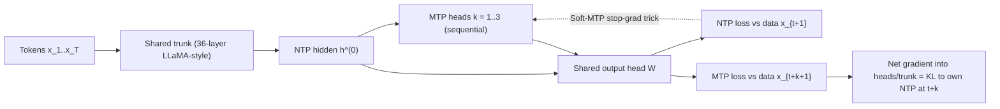
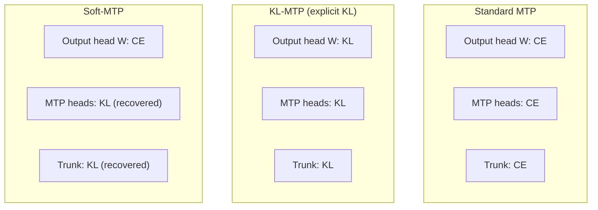
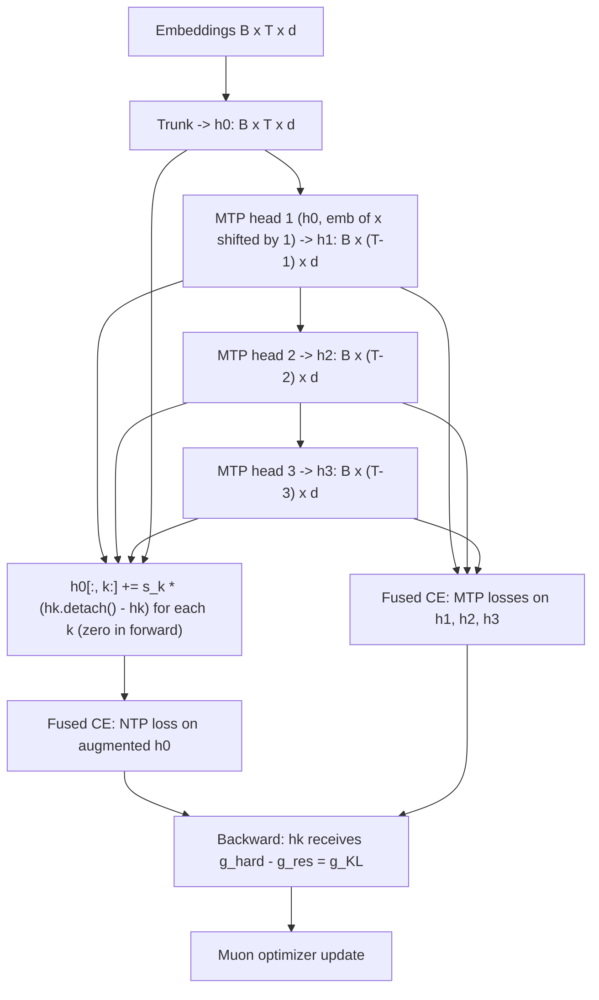

# Paper 02: Multi-Token Prediction Done Right (Soft-MTP)

> Reporting week: 2026-W44 (2026-10-26 to 2026-11-01 IST). Source read: arXiv HTML v1 (main text and appendices A, B, D; Appendix C only in part). The institution was checked against the title block of the local PDF.

## A. Overview

| Field | Value |
|---|---|
| Title | Multi-Token Prediction Done Right |
| Author | Jayden Teoh (sole author) |
| Institution | MIT (from the PDF title block). The paper says experiments were mostly self-funded on 8× RTX PRO 6000 GPUs rented from Vast.ai |
| First submitted | 2026-10-28 (v1). This analysis covers v1 |
| Identifier | arXiv:2610.38331v1 |
| Status | **New**, first published inside the reporting period |
| Official link | https://arxiv.org/abs/2610.38331v1 |
| Local PDF | [./paper-02.pdf](./paper-02.pdf) |
| Code | https://github.com/JaydenTeoh/Soft-MTP |
| Areas | LLM pre-training, multi-token prediction, speculative decoding, self-distillation |

**Abstract (paraphrased).** Multi-token prediction (MTP) is now common in LLM pre-training. It adds heads that predict tokens 2, 3, … steps ahead, which improves downstream quality and gives free draft tokens for speculative decoding. The paper shows that the standard MTP cross-entropy gradient is the sum of two parts. One is a useful *self-distillation* term that pulls MTP heads toward the model's own next-token distribution. The other is a noisy *residual* that interferes with next-token learning, and the interference grows with scale. **Soft-MTP** removes the residual with a "one-line" stop-gradient trick. It adds no parameters and keeps fused cross-entropy kernels. From 167M to 1.2B parameters it gives lower NTP perplexity, faster self-speculative decoding and higher zero-shot accuracy, and at 1.2B better math and code results after fine-tuning.

## B. Problem

- **What it solves.** It makes MTP auxiliary losses stop hurting the main next-token predictor (NTP), and makes MTP heads better speculative drafters.
- **Why it matters.** Frontier models such as the DeepSeek-V3 family train with MTP heads, and the heads double as drafters at inference. Any free improvement in pre-training loss or decoding speed matters at that scale.
- **Prior limitations.** Standard MTP trains each head against the one-hot data token $x_{t+k+1}$. But at inference, a draft is accepted only if it agrees with the model's *own* NTP distribution. That argues for training heads to match NTP (self-distillation). Explicit KL self-distillation has prior versions (Teoh et al. 2025; Zhao et al. 2026a; Kirchenbauer et al. 2026). These materialise vocabulary-sized logits, approximate with top-k or argmax, or need a frozen output head. Full-vocabulary logits are memory-heavy and incompatible with fused cross-entropy kernels.
- **Gap addressed.** The paper gets the exact KL gradient into the MTP heads and trunk *without* materialising logits and without changing the NTP gradient.

## C. Fundamentals

**A concrete example first.** A model reads "The cat sat on the". The normal head predicts the next token ("mat"). An MTP head also tries to guess the token after that, and one beyond. Standard MTP grades those guesses against what the text actually says. Text is noisy: after "the mat" the text may say "and", "." or "while", and each training example shows only one of these. The head is pushed toward a different random answer each time. Soft-MTP grades the far-ahead heads against *what the model itself would predict at that position*, a smooth distribution. That target is far less noisy.

Terms used in this analysis:

- **NTP (next-token prediction).** Cross-entropy between $\mathrm{softmax}(W h_t)$ and the one-hot next token.
- **MTP head $k$.** An extra module producing hidden state $h_t^{(k)}$ that predicts token $t+k+1$ through the *shared* output matrix $W$. "DeepSeek-style" heads are sequential: head $k$ takes head $k-1$'s states plus the embedding of the shifted input token. "Meta-style" heads run in parallel off the trunk.
- **Self-distillation.** Training a student (the MTP head) to match a teacher that is the same model (its NTP head at the aligned position).
- **KL divergence.** $\mathrm{KL}(q\|p)=\sum_v q_v\log(q_v/p_v)$. For softmax outputs, the gradient with respect to the logits is $p-q$.
- **Stop-gradient $\mathrm{sg}(\cdot)$.** Identity in the forward pass, zero gradient in the backward pass (`.detach()` in PyTorch).
- **Speculative decoding.** A cheap drafter proposes several tokens and the main model verifies them in one forward pass. Accepted drafts save sequential steps. *Acceptance length* is the average number of tokens accepted per verification step.
- **Fused cross-entropy kernels.** Compute loss and gradient chunk by chunk without ever storing the full `B×T×V` logits tensor.

## D. Core contribution

1. **Gradient decomposition.** The hard-label MTP gradient at the MTP hidden state equals a KL self-distillation term plus a residual. The residual equals the NTP cross-entropy gradient against the data.
2. **Diagnosis.** The residual carries about 80% of the trunk gradient share at every scale (Fig. 3c). Its signal-to-noise ratio is about 4× lower than the KL term's, and the gap grows from 4.1× at 167M to 4.6× at 1.2B (Fig. 3a). A step along the residual *raises* NTP loss, while a step along the KL term lowers it (Fig. 4a).
3. **KL gradient-recovery trick.** Add a numerically zero term $\mathrm{sg}(h^{(k)})-h^{(k)}$ to the NTP hidden state. Backprop through the NTP loss then injects $-g_{\text{res}}$ into the MTP state, cancelling the residual exactly. No logits are materialised, and the NTP gradient is unchanged.
4. **Gradient routing (Table 1).** The output head gets the cross-entropy gradient, while the MTP heads and shared trunk get the KL gradient. Standard MTP uses cross-entropy everywhere, and KL-MTP (explicit) uses KL everywhere.
5. **Evidence.** Soft-MTP wins at four scales on perplexity, zero-shot accuracy (from 689M), speculative-decoding metrics, and fine-tuned math and code at 1.2B. Throughput and memory match standard MTP.

## E. Architecture deep dive

Full diagrams are in [../architectures/paper-02-architecture.md](../architectures/paper-02-architecture.md).

### Level 1: concept [Conceptual reconstruction, informed by Fig. 1 and Fig. 2]



### Level 2: gradient routing [From paper: Table 1, redrawn as a diagram]



### Level 3: forward and backward [Conceptual reconstruction from Algorithm 1 and Appendix B.4]



## F. Low-level mechanics

### F.1 Shapes (from Appendix D configs)

| Tensor | Shape | Notes |
|---|---|---|
| Input ids | `B×T`, T = 2048 | ~0.5M tokens per batch |
| Trunk hidden $h^{(0)}$ | `B×T×d` | d ∈ {512, 768, 1152, 1536}, 36 layers, head dim 64 |
| MTP hidden $h^{(k)}$ | `B×(T−k)×d` | K = 3 heads, each ~3.2% of trunk non-embedding params |
| Output head $W$ | `V×d`, V = 50,304 | Shared by NTP and all MTP heads; untied from input embeddings |
| Logits (never fully materialised) | `B×T×V` | Fused CE computes chunk-wise |

Parameter counts (Appendix D): at 1.2B, the NTP path has 1173.9M parameters and the MTP heads 99.1M (1273.0M total). At 167M the split is 167.2M + 11.2M.

### F.2 Training objective

$$\mathcal{L}_{\text{MTP}}=\mathcal{L}_{\text{NTP}}+\lambda_{\text{MTP}}\cdot\frac{1}{K}\sum_{k=1}^{K}\mathcal{L}^{(k)}_{\text{MTP}}$$

- $\mathcal{L}_{\text{NTP}}$: mean cross-entropy of next-token prediction over positions.
- $\mathcal{L}^{(k)}_{\text{MTP}}$: mean cross-entropy of head $k$ predicting token $t+k+1$, averaged over its $T-k$ valid positions.
- $K$: number of MTP heads (3 in the main experiments).
- $\lambda_{\text{MTP}}$: MTP weight (1.0 in the main experiments; swept over {0.25, 0.5, 0.75, 1.0} in Fig. 5).

### F.3 The hard-label MTP gradient and its decomposition

$$p_t^{(k)}=\mathrm{softmax}\big(W h_t^{(k)}\big),\qquad g_{\text{hard}}=\nabla_{h_t^{(k)}}\mathcal{L}^{(k)}_{\text{MTP}}=W^\top\big(p_t^{(k)}-x_{t+k+1}\big)$$

- $h_t^{(k)}\in\mathbb{R}^d$: head $k$'s hidden state at position $t$.
- $W\in\mathbb{R}^{V\times d}$: shared output matrix. $W^\top$ maps a vocabulary-space error back to hidden space.
- $p_t^{(k)}\in\Delta^{V}$: head $k$'s predicted distribution.
- $x_{t+k+1}\in\{0,1\}^V$: one-hot data token $k+1$ steps ahead.

(Per-position scaling factors from loss averaging are omitted here, as in the paper's presentation.)

Introduce the teacher $q_t^{(k)}=p^{(0)}_{t+k}$, the model's own NTP distribution at the aligned position (Fig. 2):

$$g_{\text{hard}}=\underbrace{W^\top\big(p_t^{(k)}-q_t^{(k)}\big)}_{g_{\text{KL}}}+\underbrace{W^\top\big(q_t^{(k)}-x_{t+k+1}\big)}_{g_{\text{res}}}$$

- $g_{\text{KL}}$: gradient of $\mathrm{KL}(q_t^{(k)}\,\|\,p_t^{(k)})$ with respect to $h_t^{(k)}$, treating $q$ as fixed. This is the self-distillation signal.
- $g_{\text{res}}$: the residual. It is exactly the NTP cross-entropy gradient at position $t+k$ against the data, pushed into the MTP head.
- **Bias-variance reading.** $g_{\text{res}}$ splits into NTP error (bias) and one-hot sampling noise (variance). Soft-MTP drops it, removing the variance at the cost of biasing heads towards NTP rather than the data. The author argues this bias *helps* speculative decoding, because verification is against NTP.

### F.4 The KL gradient-recovery trick (Appendix B.4)

$$\tilde h_t=h_t^{(0)}+\sum_{k=1}^{K}\Big[\mathrm{sg}\big(h_{t-k}^{(k)}\big)-h_{t-k}^{(k)}\Big]$$

- $\tilde h_t$: augmented NTP hidden state. In the forward pass it equals $h_t^{(0)}$ because each bracket is zero.
- $\mathrm{sg}(\cdot)$: stop-gradient.
- $h_{t-k}^{(k)}$: the MTP state whose prediction target ($x_{t+1}$) coincides with the NTP target at position $t$.

Backward: $\nabla_{\tilde h_t}\mathcal{L}_{\text{NTP}}=W^\top(p_t^{(0)}-x_{t+1})$. Through the $-h_{t-k}^{(k)}$ term, the MTP state receives the negative of this, which is $-W^\top(q_{t-k}^{(k)}-x_{(t-k)+k+1})=-g_{\text{res}}$. Hence:

$$\nabla_{h_t^{(k)}}\big(\tilde{\mathcal{L}}_{\text{NTP}}+\mathcal{L}^{(k)}_{\text{MTP}}\big)=g_{\text{hard}}-g_{\text{res}}=g_{\text{KL}}$$

The trunk's gradient through $h^{(0)}$ is unchanged, because the gradient with respect to $h^{(0)}$ is the same as without augmentation. The output head $W$ still sees ordinary cross-entropy gradients from both losses, which is why Table 1 lists CE for $W$.

### F.5 The per-head scale (Algorithm 1)

The code adds `s_k * (hk.detach() - hk)` with

$$s_k=\frac{\lambda_{\text{MTP}}\,T}{K\,(T-k)}$$

- $T$: sequence length. NTP loss is averaged over $T$ positions.
- $T-k$: number of positions over which head $k$'s loss is averaged.
- $\lambda_{\text{MTP}}/K$: the weight on each MTP head in the total loss.

The factor makes the injected $-g_{\text{res}}$ (which arrives with NTP's $1/T$ normalisation) exactly match the scale of $g_{\text{hard}}$ (which carries the $\lambda/(K(T-k))$ normalisation), so the cancellation is exact.

### F.6 Inference: self-speculative decoding

Speculative sampling (Leviathan et al., 2022) uses the $K=3$ MTP heads as drafters and the NTP head as verifier. Draft token $i$ is accepted with probability $\min(1,\,p^{\text{NTP}}(y_i)/p^{\text{draft}}(y_i))$. On rejection, the token is resampled from the normalised residual $\max(0,p^{\text{NTP}}-p^{\text{draft}})$. This is the standard rule, not restated in detail in the paper. A drafter whose distribution is closer to NTP (lower KL and TV) has higher acceptance, which is exactly what Soft-MTP targets.

### F.7 Cost and complexity

- **Parameters.** None added.
- **Compute.** One extra elementwise add per head on `B×(T−k)×d` tensors.
- **Memory (Table 5, 1.2B, one H200, fused CE).** Peak memory is 107.0 GB for Soft-MTP, the same as standard MTP, vs 128.1 GB for explicit KL-MTP and 95.5 GB for NTP-only.
- **Throughput (Table 5).** Soft-MTP 49,748 tok/s vs MTP 49,783, KL-MTP 46,990 and NTP 62,851. MFU is 51.7% for both MTP and Soft-MTP.
- **Distributed training (Section 7).** Data, ZeRO, expert and pipeline parallelism need no extra communication. Context parallelism needs to exchange at most $K$ hidden-state gradients per shard boundary in the backward pass.

### F.8 Optimisation

Muon optimizer with update-RMS rescaling (Liu et al., 2025a). The run is 60,000 steps at 0.5M tokens per step, about 31.5B tokens in total (~1.3× Chinchilla-optimal for the 1.2B model).

## G. Execution walkthrough

Take one training sequence "… the cat sat on the mat and purred" at $T=2048$.

1. **Embed and trunk.** Tokens become `1×2048×1536` embeddings (1.2B config). The 36-layer trunk produces $h^{(0)}$ of the same shape.
2. **MTP heads.** Head 1 combines $h^{(0)}$ with embeddings of tokens shifted by one and produces $h^{(1)}$ (`1×2047×1536`). At the position of "on", $h^{(1)}$ aims at "the mat"'s second token. Heads 2 and 3 continue sequentially, giving lengths 2046 and 2045.
3. **Augment.** For each $k$, `h0[:, k:] += s_k * (hk.detach() - hk)`. The forward values are unchanged.
4. **Losses.** Fused CE computes NTP loss on augmented $h^{(0)}$ and MTP losses on $h^{(1..3)}$, never storing `2048×50304` logits at once.
5. **Backward.** At "on", head 2's hidden state receives $W^\top(p^{(2)}-q^{(2)})$. This pulls it toward the NTP distribution at the aligned position, for example a smooth mix of "and"/"."/"while" instead of the single observed token. The trunk receives NTP gradient plus KL gradients flowing back through the heads.
6. **Inference.** Given a prompt, NTP emits a token and heads 1-3 draft three more. One verification pass of the main model accepts a prefix of the drafts. At 1.2B on FineWeb-Edu, the average acceptance length is 1.70 for Soft-MTP vs 1.67 for MTP (Table 2/6).

## H. Comparison with prior approaches

| Approach | Architecture | Training signal to MTP heads/trunk | Inference | Performance (1.2B, reported) | Compute cost | Limitations |
|---|---|---|---|---|---|---|
| NTP only | Trunk + head | n/a | No free drafter | Avg acc 56.75 (Table 3) | 62,851 tok/s, 95.5 GB (Table 5) | No self-speculation |
| Standard MTP (DeepSeek/Meta style) | Trunk + K heads | CE vs one-hot data | Self-speculative | Avg acc 56.80; speedup 1.74 (Tables 3, 2) | 49,783 tok/s, 107.0 GB | Noisy residual interferes with NTP |
| Explicit KL-MTP | Same | KL to own NTP everywhere (materialised logits) | Self-speculative | Avg acc 57.22; speedup 1.76 (Table 6) | 46,990 tok/s, 128.1 GB | Not fused-CE compatible; more memory |
| **Soft-MTP** | Same | KL (recovered) to heads/trunk, CE to W | Self-speculative | **Avg acc 57.31; speedup 1.76** (Tables 3, 6) | 49,748 tok/s, 107.0 GB | Output head still CE; tested ≤1.2B |

## I. Experiments

**Setup.** LLaMA-style models at 167M, 332M, 689M and 1.2B, trained on FineWeb-Edu (~31.5B tokens), 36 layers, sequence length 2048, with Muon. DeepSeek-style sequential heads, $K=3$, $\lambda_{\text{MTP}}=1$.

**Benchmarks.** Perplexity on FineWeb-Edu, WikiText and LAMBADA. Zero-shot (LM Evaluation Harness): LAMBADA, PIQA, HellaSwag, Winogrande, ARC-e, ARC-c, OpenBookQA, SciQ. After NTP-only fine-tuning: GSM8K and MATH-500 (OpenMathInstruct-2, 4.2B tokens), and HumanEval and MBPP pass@16/32/64 (Stack-Edu Python, 21.0B tokens). Speculative decoding across FineWeb-Edu, Wikipedia, Books, Science and Math.

**Results (reported).**

- **Table 3, average zero-shot accuracy (NTP / MTP / Soft-MTP).** 167M 47.42/46.84/46.91. 332M 50.79/50.38/50.46. 689M 54.79/54.47/**55.01**. 1.2B 56.75/56.80/**57.31**. Soft-MTP beats standard MTP at every scale and beats NTP from 689M up.
- **Table 3, perplexity at 1.2B (MTP vs Soft-MTP).** FineWeb-Edu 10.891 vs **10.741**. WikiText 18.156 vs 17.489. LAMBADA 14.996 vs 14.073.
- **Table 2, self-speculative decoding at 1.2B, FineWeb-Edu (MTP vs Soft-MTP).** KL 0.384 vs 0.364. TV 0.260 vs 0.253. Acceptance length 1.67 vs **1.70**. Speedup 1.74× vs **1.76×**. Averaged over five domains, Soft-MTP improves acceptance length by 1.8-2.2% and speedup by 1.4-1.5% over MTP at each scale.
- **Table 4, 1.2B after fine-tuning (NTP / MTP / Soft-MTP).** GSM8K 47.69/48.60/**49.66**. MATH-500 24.80/23.20/**25.00**. HumanEval pass@64 (NTP not extracted here)/40.85/**43.90**. MBPP pass@64 (NTP not extracted here)/59.80/**61.00**.
- **Table 6, Soft-MTP vs explicit KL-MTP (1.2B).** Average accuracy 57.31 vs 57.22. KL-MTP leads on math (GSM8K 50.34 vs 49.66; MATH-500 26.00 vs 25.00). Soft-MTP wins all six code metrics.
- **Table 5, efficiency.** See F.7.

**Analyses and ablations.**

- **Fig. 3.** Residual SNR is ~4× lower than KL's, with the gap growing with scale. The residual carries ~80% of the trunk gradient share.
- **Fig. 4.** A step along $g_{\text{res}}$ increases NTP loss and a step along $g_{\text{KL}}$ decreases it. NTP and MTP loss curves favour Soft-MTP.
- **Fig. 5 (332M, 7.3B tokens).** Soft-MTP is lower in NTP and MTP loss across $\lambda_{\text{MTP}}\in\{0.25,0.5,0.75,1.0\}$ and horizons $K=3$-$8$.
- **Fig. 6.** Effective rank of the logit map: standard MTP 131, KL-MTP 321, Soft-MTP 437, NTP baseline 496. Standard MTP compresses the representation the most.
- **Appendix C / Fig. 7.** Meta-style parallel heads at 332M also show lower final NTP and MTP validation loss. No numeric values were visible.

## J. Implementation

**Official code:** https://github.com/JaydenTeoh/Soft-MTP. The key lines are quoted from the paper's Algorithm 1:

```python
s_k = lambda_mtp * T / (K * (T - k))
h0[:, k:] = h0[:, k:] + s_k * (hk.detach() - hk)
```

**Illustrative, not from the paper:** where those lines sit in a training step.

```python
def soft_mtp_step(model, x, K=3, lambda_mtp=1.0):
    B, T = x.shape
    h0 = model.trunk(model.embed(x))                 # B x T x d
    hs, h_prev = [], h0
    for k in range(1, K + 1):
        hk = model.mtp_head[k - 1](h_prev[:, :-1], model.embed(x[:, k:]))  # B x (T-k) x d (schematic)
        hk = model.mtp_norm[k - 1](hk)
        hs.append(hk); h_prev = hk
    # Soft-MTP: zero in forward, cancels the residual in backward
    for k, hk in enumerate(hs, start=1):
        s_k = lambda_mtp * T / (K * (T - k))
        h0 = torch.cat([h0[:, :k], h0[:, k:] + s_k * (hk.detach() - hk)], dim=1)
    ntp = fused_ce(model.norm(h0)[:, :-1], model.W, x[:, 1:])
    mtp = sum(fused_ce(hk[:, :-1], model.W, x[:, k + 1:])
              for k, hk in enumerate(hs, start=1)) / K
    return ntp + lambda_mtp * mtp
```

The index alignment above is schematic. Align so that `hk[:, t]` and `h0[:, t+k]` predict the same target token, as in Fig. 2.

**Hardware.** The paper's runs used 8× RTX PRO 6000. Efficiency was measured on one H200.

**Pitfalls.**

- Get the position alignment ($h_{t-k}^{(k)}$ vs $h_t^{(0)}$) exactly right, or the cancellation targets the wrong token.
- The scale $s_k$ depends on how your framework averages per-head losses (Appendix B.5).
- Apply the augmentation *before* the final norm only if your reference implementation does. The paper's heads each have their own final RMSNorm.
- With context parallelism, the injected gradients cross shard boundaries.

## K. Limitations

- **Output head still uses CE.** Only MTP heads and trunk receive the exact KL gradient.
- **Biased target.** Heads are biased toward the model's NTP distribution rather than the data. The author argues this helps and shrinks with scale, but this is an argument, not a proof.
- **Scale.** The largest model is 1.2B on ~31.5B tokens. The frontier discussion (Section 7) is qualitative. The paper also notes DeepSeek-V4.1-Flash dropped MTP for a post-training drafter, so MTP's long-term role in pre-training is uncertain.
- **Small gains at small scale.** At 167M and 332M, Soft-MTP improves on MTP but is still below NTP-only on average accuracy (Table 3).
- **Math vs explicit KL.** Explicit KL-MTP is better on GSM8K and MATH-500 (Table 6).
- **Single seed.** The visible tables give no seed variance. Speculative-decoding gains are 1-4%.
- **Reproducibility.** Code is public and the compute is modest.

## L. Learning takeaways

- **Decompose your gradients.** A cross-entropy gradient against hard labels equals "distil toward a teacher" plus "teacher's own error against data". When the teacher is your own model, the second part may be pure noise for the student.
- **Stop-gradient algebra ($x + \mathrm{sg}(y) - y$) is a powerful pattern.** It changes gradients without changing forward values, and keeps fused kernels intact. It generalises to any teacher and student that share a linear output head (the paper names MTP boosting, on-policy self-distillation and score centring).
- **Train auxiliary drafters for the metric they serve.** Acceptance depends on matching the verifier, not the data.
- **Study next:** DeepSeek-V3 MTP; Gloeckle et al. (Meta) MTP; speculative sampling (Leviathan et al.; Chen et al.); Medusa/EAGLE drafters; fused/chunked cross-entropy kernels (Liger, Cut-Cross-Entropy); the Muon optimizer.
