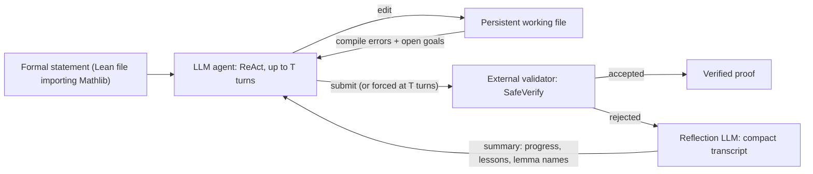
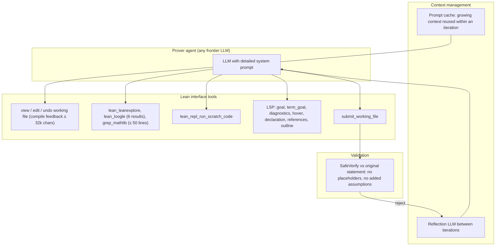
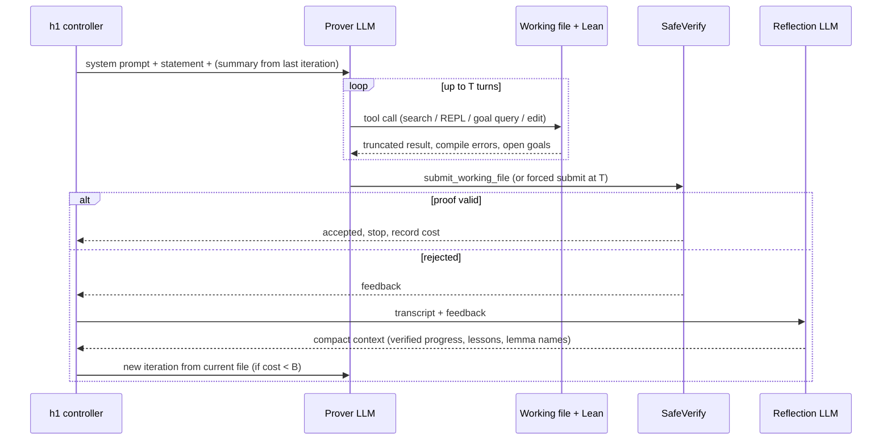

# Paper 03: h1: A Taste of the Bitter Lesson in Automated Theorem Proving

> Reporting week: 2026-W44 (2026-10-26 to 2026-11-01 IST). Source read: arXiv HTML v2 (main text and appendices B and C). Institutions were checked against the title block of the local PDF.

## A. Overview

| Field | Value |
|---|---|
| Title | h1: A Taste of the Bitter Lesson in Automated Theorem Proving (PDF metadata title; the HTML heading omits "h1:") |
| Authors | Skander Moalla, Ahmad Rammal, Niket Patel, Rémi Munos, Julia Kempe |
| Institutions | All five: FAIR at Meta. Also: Moalla, EPFL; Rammal, CERMICS, ENPC, Institut Polytechnique de Paris; Patel and Kempe, New York University. Moalla, Patel and Kempe are marked "work done at Meta" (from the PDF title block) |
| First submitted | v1: 2026-10-25 11:07 UTC (16:37 IST), just before the reporting window. v2: 2026-10-30. This analysis covers v2 |
| Identifier | arXiv:2610.35962v2 [cs.LG] |
| Status | **Older, trending.** v1 predates the window. It was featured on the Hugging Face Papers daily page on 2026-10-28, and v2 was posted on 2026-10-30, inside the window. The visible v2 text has no changelog |
| Official link | https://arxiv.org/abs/2610.35962v2 |
| Local PDF | [./paper-03.pdf](./paper-03.pdf) |
| Code | Not reported in the text read for this analysis |
| Areas | Reasoning, agentic AI, formal verification (Lean 4), test-time compute scaling |

**Abstract (paraphrased).** Progress in *informal* mathematics has come mostly from scaling frontier models. *Formal* theorem proving instead relies on human-designed workflows: planners, decomposers and orchestrated specialist provers. The authors ask whether a simple agentic loop that scales test-time compute can match these workflows. **h1** gives a general-purpose LLM three things: an efficient Lean 4 interface, verifier feedback, and self-reflection between attempts. It imposes no decomposition or search. h1 reports state-of-the-art results on PutnamBench, FATE-X and FormalConjectures100-Solved, and settles **eight problems listed as open** in Formal Conjectures. At matched models, it matches or beats Goedel-Architect and AlphaProof Nexus (APN). The authors conclude that the efficiency of the Lean interface largely determines cost and solve rate, and recommend evaluating frontier models with execution feedback before prescribing workflows.

## B. Problem

- **What it solves.** It asks whether a minimal "model + Lean + loop" harness is enough for frontier-level formal proving, and what a harness must provide for compute to turn efficiently into proofs.
- **Why it matters.** Formal proofs are machine-checkable, so they are the gold standard for trustworthy AI mathematics and for verified software. If simple loops suffice, the field should invest in interfaces and compute rather than hand-crafted pipelines. That is Sutton's "bitter lesson".
- **Prior limitations.** Leading systems combine specialised components: Goedel-Architect, AlphaProof Nexus, Numina's multi-model system, MerLean, Hilbert, Aleph Prover, and Humanfia. These are costly, hard to reproduce, and tied to particular models. Earlier simple harnesses such as AxProverBase wasted budget on poor interfaces: 42.2% of its failed compilations were invalid library imports.
- **Gap addressed.** The authors make a controlled comparison at matched models and matched cost, with a carefully engineered but conceptually simple Lean interface. They also study scaling depth (one long attempt) against breadth (pass@k).

## C. Fundamentals

**A concrete example first.** Picture a student proving a competition problem with a proof assistant open. They write a few lines, the checker says "error on line 12, goal remaining: n² ≥ 2n", they look up a lemma, fix the line, and repeat. When stuck for a long time they step back, write a summary ("what I know works, what failed, useful lemma names"), clear their head and continue. h1 automates exactly this with an LLM.

Terms used in this analysis:

- **Lean 4 / Mathlib.** Lean is an interactive theorem prover in which a proof is a program the kernel type-checks. Mathlib is its large library of formalised mathematics.
- **Formal vs informal proving.** Informal proofs are natural-language arguments checked by humans. Formal proofs are checked mechanically and cannot be "almost right".
- **Goal / tactic.** Lean tracks open goals. Tactics such as `simp`, `nlinarith` and `induction` transform them.
- **Placeholder (`sorry`).** Marks an unfinished step. A real proof must have none.
- **ReAct loop.** An agent alternates reasoning with tool calls and observations.
- **Test-time compute scaling.** Spend more inference (longer attempts or more attempts) to solve more problems.
- **pass@k.** Solved if any of $k$ independent attempts succeeds. h1 also uses *residual* pass@k: rerun only the unsolved problems.
- **Prompt caching.** Providers bill re-read prefix tokens much more cheaply. The paper uses ~10× cheaper than uncached input and ~100× cheaper than output.
- **Benchmarks.** PutnamBench (672 Putnam problems), Putnam100 (a 100-problem subset), FATE-X (100 abstract-algebra problems), FC100-solved (100 Formal Conjectures with known informal solutions), FormalQualBench (23), Putnam 2025 (12), IMO 2026 (6), and open Erdős and Formal Conjectures problems.

## D. Core contribution

1. **The h1 harness (Fig. 2).** A persistent Lean working file, a ReAct agent with up to $T$ turns per iteration, compile feedback on every edit, explicit submission, external validation (SafeVerify), and a reflection LLM that compacts the transcript between iterations. Nothing else: no planner, no lemma decomposition, no tree search.
2. **An efficient Lean interface (Appendix B.1, Table 3).** It provides file view/edit/undo with compile feedback, Mathlib search (LeanExplore, Loogle, grep), a REPL for scratch code, and language-server queries (goals, diagnostics, hover, declarations, references, outline). Output is truncated to tight limits.
3. **Cost-aware evaluation.** Costs are API-equivalent and computed from token usage, with a per-problem budget cap $B$. The paper reports Pareto curves of solve rate against cost and a "mean cost conditional on success" for APN comparisons.
4. **Findings.**
   - Generalist frontier models in a simple loop match or beat specialised systems at matched models.
   - Longer single attempts (depth) can beat repetition (breadth) on open problems.
   - Interface quality and cache-friendliness dominate cost.
   - Eight open Formal Conjectures problems were settled with GPT-5.6 Sol (Table 1).

**What differs from prior work.** Specialised systems hard-code *how* to prove: decompose, plan, call specialist provers. h1 hard-codes only *where* the model works (a file plus a checker) and *how context is managed* (reflection and caching), and leaves strategy to the model.

## E. Architecture deep dive

Full diagrams are in [../architectures/paper-03-architecture.md](../architectures/paper-03-architecture.md).

### Level 1: concept [From paper: Fig. 2, redrawn]



### Level 2: components [Conceptual reconstruction from Section 2.2 and Appendix B]



### Level 3: execution within one problem [Conceptual reconstruction]



## F. Low-level mechanics

**Tensor shapes, attention, backprop and training do not apply.** h1 trains nothing. It wraps black-box API models (GPT-5.x, Claude Opus 4.x, Gemini 3.x) and the open-weight DeepSeek V4 Flash at inference time. The relevant "mechanics" are the control loop, the context and token economics, and the evaluation statistics. These are formalised below as **[Conceptual reconstruction]** of definitions the paper describes in prose.

### F.1 Iteration dynamics

$$c_{i+1}=\mathrm{Reflect}\big(\tau_i,\ \mathrm{fb}_i\big),\qquad \tau_i=\mathrm{ReAct}_{\le T}\big(\text{prompt},\ c_i,\ F_i\big),\qquad F_{i+1}=F_i\oplus\text{edits}(\tau_i)$$

- $i$: iteration index.
- $\tau_i$: transcript of iteration $i$ (all turns, tool calls and observations), at most $T$ turns.
- $c_i$: compact context carried into iteration $i$ (empty for $i=0$), produced by the reflection LLM.
- $\mathrm{fb}_i$: validator feedback on the submission.
- $F_i$: the persistent working file. Edits accumulate across iterations, so progress survives the context reset.
- $\mathrm{Reflect}$: keeps verified progress, lessons from failures and useful lemma names, and filters out "defeatist" or unsound reasoning (Appendix B.2).

### F.2 Budgeted solve rate and cost

$$\mathrm{Solved}(B)=\sum_{j=1}^{N}\mathbf{1}\big[\text{verified proof of }j\text{ found with }\mathrm{cost}_j\le B\big],\qquad \overline{\mathrm{cost}}(B)=\frac1N\sum_{j=1}^{N}\min(\mathrm{cost}_j,B)$$

- $N$: number of problems in the benchmark.
- $B$: per-problem dollar cap.
- $\mathrm{cost}_j$: API-equivalent spend on problem $j$, computed from token counts.
- The average cost caps each problem at $B$, matching the paper's description.

### F.3 Token cost model (why caching dominates)

$$\mathrm{cost}=c_{\text{in}}\,N_{\text{uncached}}+c_{\text{cache}}\,N_{\text{cached}}+c_{\text{out}}\,N_{\text{out}},\qquad c_{\text{cache}}\approx\tfrac{1}{10}c_{\text{in}}\approx\tfrac{1}{100}c_{\text{out}}$$

- $N_{\text{uncached}},N_{\text{cached}}$: input tokens billed at full and at cached rates.
- $N_{\text{out}}$: generated tokens.
- The ratios are the paper's stated approximations.

Within an iteration the context only grows, so each turn re-reads a cached prefix. h1 reuses 74-94% of its input from cache (Table 11 gives per-model figures, e.g. DeepSeek V4 Flash 92.26% on PutnamBench). With 200 turns per reflection, the cached share is 86%. With one turn per reflection, it is 0.2%. For comparison, AxProverBase spends 89% of its $17.39/problem on *output* and reuses at most 0.5% of input from cache. h1 spends 34% of $9.00/problem on output.

### F.4 Depth vs breadth

- **pass@1.** One run per problem, no repetition or parallelism. Compute is scaled only by letting the single run iterate longer.
- **Residual pass@k.** Rerun only unsolved problems, from a fresh context.
- **Mean cost conditional on success (APN comparison).** Each group is charged its summed cost up to the first accepted proof.

$$\mathbb{E}[\mathrm{cost}\mid\mathrm{success}]=\frac{\sum_{g\in\mathcal{S}}\sum_{a\le a^\star_g}\mathrm{cost}_{g,a}}{|\mathcal{S}|}$$

- $\mathcal{S}$: problems (groups) eventually solved.
- $a^\star_g$: index of the first successful attempt for group $g$.

### F.5 Complexity notes

Cost per iteration grows roughly quadratically in turns without caching (each turn re-reads the whole context) and roughly linearly with caching. This is why moderate $T$ is optimal: too few turns waste the cache, while too many bloat context and the model loses focus (Fig. 4 right). Lean compile time is bounded by timeouts: 600 s for snippets and 1,200 s for the working file. A deterministic failure on three consecutive executions counts as unsolved.

## G. Execution walkthrough

Take one PutnamBench problem with DeepSeek V4 Flash.

1. **Setup.** h1 writes the formal statement into a working file that imports all of Mathlib, and gives the model the detailed prompt describing the tools and the integrity rules.
2. **Turns 1-k.** The model calls `lean_goal` to see the goal. It searches `lean_loogle` for a relevant inequality lemma. It tests a candidate tactic in `lean_repl_run_scratch_code`. It then calls `edit_working_file` to insert a proof skeleton and receives compile errors (≤32k characters) and open goals. Each response is appended to context and the prefix is cached.
3. **Submit.** The model calls `submit_working_file`. The checks run, then SafeVerify compares the result against the original statement and rejects any `sorry` or added hypothesis.
4. **Reject → reflect.** Suppose one lemma is still unproven. The reflection LLM writes a compact block: "Verified: lemmas A, B compile. Failed: nlinarith on goal C. Useful: `Finset.sum_le_sum`, `pow_le_pow_left`."
5. **Next iteration.** A fresh context holds the prompt, that block and the current file. The model continues on goal C.
6. **Stop.** The run ends on an accepted proof or when spend reaches $B$. With reflection, DeepSeek V4 Flash reaches 598/672 at about $1.08/problem. Without reflection it reaches 554 (Fig. 6 / ablation text).

## H. Comparison with prior approaches

| System | Architecture | Training | Inference | Performance (reported) | Compute cost (reported) | Limitations |
|---|---|---|---|---|---|---|
| Goedel-Architect | Specialised workflow | n/a here | Proof-seeded pass@4 | PutnamBench 88.8% (597) with DeepSeek V4 Flash/Pro (Table 10) | $1.47/problem | Workflow-specific |
| AlphaProof Nexus (APN) | Specialised agentic system | n/a | pass@3 (basic) / full | Erdős: basic 75.4%, full 76% (Section 3.3) | $191 / $317 mean per success | Costly |
| Numina (multi-model) | Opus 4.5 + Gemini 3 Pro + GPT-5.2 + informal prover | n/a | Orchestrated | Putnam 2025 12/12 (Table 2) | $1,800 cap | Many models, complex |
| MerLean | Specialised | n/a | Opus 4.7 | FormalQualBench 9/23 (4 h cap) (Table 2) | $101.09 | Expensive |
| AxProverBase | Simple loop, weaker interface | n/a | Gemini 3 Flash | Putnam100 18 at $20 (ablation) | 89% of spend on output | Interface errors |
| Claude Code (native) | General coding agent | n/a | Opus 4.8 | FATE-X 63, Putnam100 81 (Fig. 5 / ablation) | n/r | Not Lean-specialised |
| **h1** | Simple loop + efficient Lean interface + reflection | None | pass@1 depth scaling | PutnamBench 598 (DeepSeek V4 Flash), 670/672 (GPT-5.5); Putnam 2025 12/12; Erdős 82.5% | $1.08/problem (DSV4F); $565 total (Putnam 2025); $121 per Erdős success | Single file, Lean-only tools, contamination unmeasurable |

## I. Experiments

**Models.** GPT-5.6 Sol, GPT-5.5, GPT-5.2, Claude Opus 4.5/4.6/4.7/4.8, Gemini 3.1 Pro, Gemini 3 Flash, and DeepSeek V4 Flash (open weights).

**Lean versions (Table 7).** 4.26.0 to 4.29.1, depending on the benchmark.

**Headline results (reported).**

- **PutnamBench, 672 problems (Section 3.2, Fig. 1, Table 10).** h1 + DeepSeek V4 Flash solves 598 (89.0%) at ~$1.08/problem, vs Goedel-Architect's 597 (88.8%) at pass@4 for $1.47. h1 + GPT-5.5 solves 670/672 (99.7%) at $9.17/problem, and 100% with 8 extra attempts at $17.86. Others reported: Aleph Prover 100% at $74, Humanfia + GPT-5.6 Sol 100% at $44.50, Hilbert 70.0% at ≈$244.
- **FC100-solved and FATE-X (Fig. 3).** GPT-5.6 Sol scores **78/100** on FC100-solved and **90/100** on FATE-X. Gemini 3.1 Pro reaches 73 on FC100-solved at a $150 cap, vs the DM prover agent's 66 at $100. DeepSeek V4 Flash reaches 43 on FATE-X (Leanstral 1.5: 34) and 64 on FC100-solved at $4.89.
- **Table 1, open problems.** Eight problems listed as open in Formal Conjectures were proved with GPT-5.6 Sol: Erdős 138 and 337 variants, OEIS A108081, A211417, A022030, Open Quantum Problem 35 (AME(9,10) existence), and Written on the Wall II statements 100 and 314.
- **Erdős problems (Section 3.3).** h1 pass@1 reaches **82.5%** at $121 mean cost per success, vs APN basic pass@3 at 75.4% ($191) and full APN at 76% ($317).
- **Table 2 / Table 14, system comparisons.**
  - Putnam 2025: h1 + GPT-5.2 solves 12/12 for $565 total, vs Numina 12/12 at an $1,800 cap. h1 + Opus 4.5 solves 7/12.
  - IMO 2026: h1 + GPT-5.6 Sol solves 6/6 at $8.07/problem (T200), vs Humanfia 6/6 at $21.23.
  - FormalQualBench (4 h cap): h1 + GPT-5.6 Sol solves 11/23 at $8.97, vs MerLean + Opus 4.7 9/23 at $101.09 and Claude Code (rerun) 7/23. Without a time cap, h1 + GPT-5.6 Sol solves 14/23.
  - PutnamBench 2025 slice: h1 + Opus 4.7 solves 11/12, vs MerLean 12/12.

**Ablations (reported).**

- **Tools.** Without search, REPL or LSP, h1 solves 49 vs 69 on Putnam100 and 49 vs 63 on FATE-X.
- **Interface.** AxProverBase with Gemini 3 Flash at $20 solves 18 on Putnam100, vs h1's 69.
- **Turns per reflection (Fig. 4 right).** On Putnam100 / FATE-X: 1 turn gives 50/39, 10 turns 72/65, 200 turns 60/52. Moderate is best.
- **Reflection (Fig. 6).** PutnamBench with DeepSeek V4 Flash: 554 without reflection vs 598 with it.
- **Prompts (Fig. 4 left).** Detailed prompts beat brief ones on Erdős problems.
- **Harness vs general agent (Fig. 5, Opus 4.8).** On FATE-X: native Claude Code 63, Claude Code with MCP Lean tools 73, h1 83. On Putnam100: 81 / 95 / 99.
- **Reasoning effort.** Gemini 3.1 Pro on Putnam100 solves 89 at $20.63 with low effort vs 99 at $5.34 with high effort. One plausible reading (this analysis's interpretation, not a paper claim) is that higher effort needs fewer iterations.

**Statistics.** Bootstrap with 50,000 resamples (Appendix C.6). Replicas: 9-16 per configuration in the Erdős ablations.

## J. Implementation

**Components to build.**

1. A Lean 4 + Mathlib project, pinned to the benchmark's version.
2. A Lean REPL and the Lean language server.
3. Search backends (LeanExplore, Loogle, ripgrep over Mathlib).
4. Tool wrappers with strict output truncation.
5. SafeVerify for final checking.
6. An LLM client with prompt caching and cost accounting.
7. A reflection prompt.
8. A budget controller.

**Tool surface (from paper, Table 3).** `view_working_file`, `view_original_file`, `edit_working_file(old_string,new_string,replace_all)`, `undo_edit_working_file`, `submit_working_file(updated_file,reasoning)`, `lean_leanexplore`, `lean_loogle`, `grep_mathlib`, `lean_repl_run_scratch_code`, `lean_goal`, `lean_term_goal`, `lean_diagnostic_messages`, `lean_hover_info`, `lean_declaration_file`, `lean_references`, `lean_file_outline`.

**Illustrative, not from the paper:**

```python
def h1_solve(statement, llm, reflector, tools, T=10, budget=20.0):
    file = init_working_file(statement)          # imports Mathlib
    summary, spent = "", 0.0
    while spent < budget:
        msgs = [system_prompt(tools), user_msg(statement, summary)]
        for turn in range(T):
            reply, cost = llm.chat(msgs, tools=tools.schemas, cache=True)
            spent += cost
            if reply.tool == "submit_working_file" or turn == T - 1:
                ok, feedback = safeverify(file, statement)   # no sorry, no new hypotheses
                if ok:
                    return file, spent
                break
            obs = tools.run(reply.tool, reply.args, file)    # compile errors / goals, truncated
            msgs += [reply.as_message(), obs.as_message()]
            if spent >= budget:
                return None, spent
        summary, cost = reflector.compact(msgs, feedback)    # progress, lessons, lemma names
        spent += cost
    return None, spent
```

**Hardware.** Not reported in detail. As general guidance, not from the paper: you need CPU workers for Lean and Mathlib compilation (memory-hungry with all of Mathlib imported) plus API access. Self-hosting DeepSeek V4 Flash needs GPU serving, which the paper does not detail.

**Pitfalls.**

- Invalid imports and oversized tool outputs burn budget (the AxProverBase failure mode).
- Without SafeVerify, models "prove" weakened statements.
- Uncached long contexts explode cost.
- Reflection prompts that endorse giving up or false disproofs hurt results on open problems.
- Lean and Mathlib version drift breaks benchmark statements.

## K. Limitations

- **Contamination.** Frontier models are black boxes, so benchmark contamination cannot be measured.
- **Single file.** h1 does not handle cross-file dependencies or very large formalisations without extra machinery.
- **Lean-only tools.** No numerical computation, simulation or web search.
- **Reported misses.** Erdős 125 was solved by full APN while all sixteen h1 attempts timed out. BurnsidePrimeDegree was solved by MerLean + Opus 4.7. h1 + Opus 4.8 did not solve it, though h1 + GPT-5.6 Sol did.
- **Cost estimates.** Costs are API-equivalent estimates. Some DeepSeek cache shares are estimated (Table 11).
- **Model dependence.** The strongest results rely on proprietary models (GPT-5.6 Sol), which limits reproducibility.
- **Open questions.** Does this scale to multi-file research formalisation? Is there an optimal depth/breadth allocation per problem?

## L. Learning takeaways

- **Before building a complex agent workflow, test a strong model in a simple loop with a great tool interface and a verifier.** Interface quality (search, goals, diagnostics, tight outputs) moved Putnam100 from 18 (AxProverBase) to 69 at a similar budget.
- **Design for the cache.** Append-only contexts within an iteration plus periodic compaction cut cost dramatically. A moderate number of turns per reflection is the sweet spot.
- **Verification makes test-time scaling safe.** With a perfect checker, longer single attempts can beat many short ones.
- **Study next:** ReAct; the Lean 4 metaprogramming book and Mathlib; PutnamBench and miniF2F; AlphaProof; DeepSeek-Prover and Goedel-Prover; SafeVerify-style statement checking; Sutton's "The Bitter Lesson".
