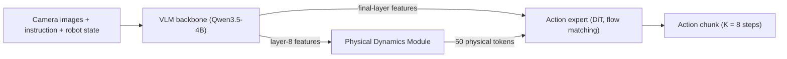
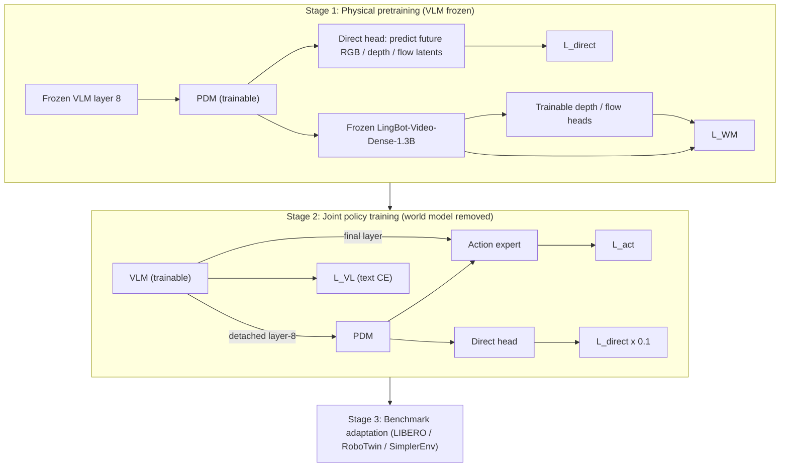
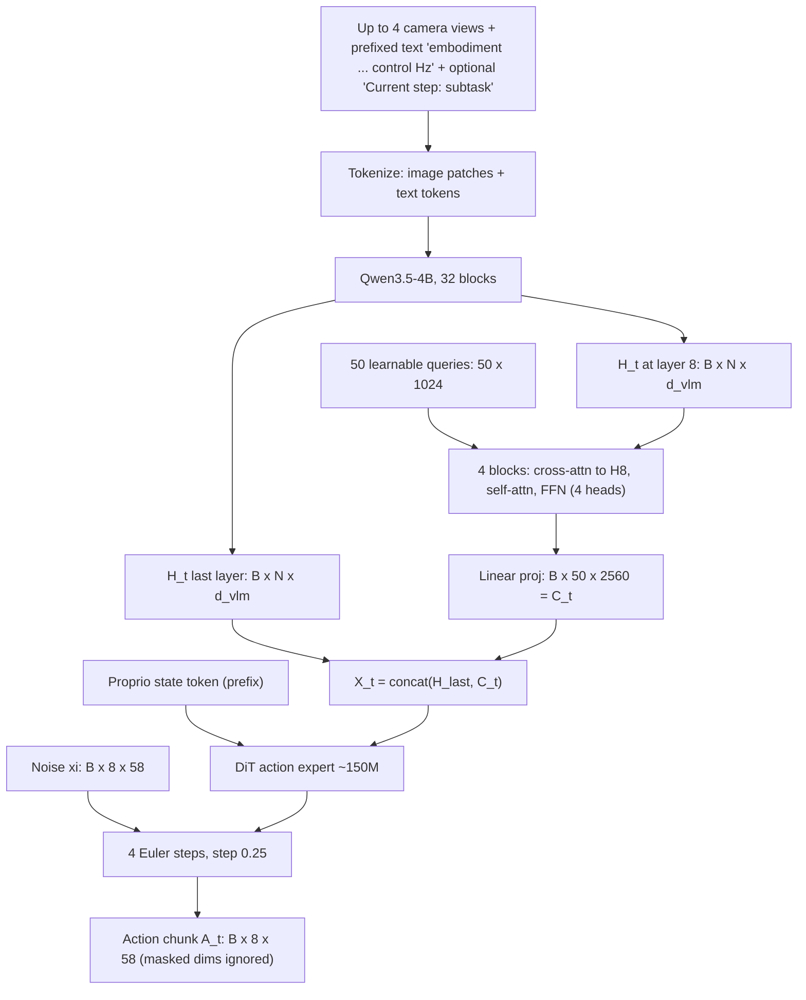

# Paper 04 — PDRVLA: A Vision-Language-Action Model with Physical Dynamics Representations

> Reporting week: 2026-W44 (2026-10-26 to 2026-11-01, IST). Areas: robotics, VLA, world models.
> Source read: arXiv HTML of v2 (the local PDF could not be text-extracted in this environment because no PDF renderer was available; the HTML is the same paper).

---

## A. Overview

| Field | Value |
|---|---|
| Title | PDRVLA: A Vision-Language-Action Model with Physical Dynamics Representations |
| Authors | Hanqing Wang, Zhaotian Cai, Ruichuan An, Bohan Zeng, Tao Zhang, Yilin Chen, Xu Jiang, Kaiquan Chen, Chongyang Wu, Haoran Li, Fan Yang, Mingan Lin, Wentao Zhang, Zenan Zhou, Youzheng Wu (equal contribution marked) |
| Institutions (confirmed from paper) | **Peking University** and **JD.com** (most authors are listed with both). Corresponding authors: Zenan Zhou (jd.com) and Wentao Zhang (pku.edu.cn). Ruichuan An, Bohan Zeng and Wentao Zhang have no affiliation marker in the HTML rendering. |
| Dates | v1 first submitted 2026-10-27; v2 (this version) 2026-10-29 |
| Identifier | arXiv:2610.37381v2 [cs.RO] |
| Status | **New** (first submitted inside the reporting week; top-upvoted paper on the HF Papers week page) |
| Official link | https://arxiv.org/abs/2610.37381v2 |
| Local PDF | [./paper-04.pdf](./paper-04.pdf) |
| Code / weights | Not reported in the paper (no repository or model link found in the text). |

**Abstract (paraphrased).** Vision-language-action (VLA) models map camera images plus an instruction to robot actions, but they have a weak grasp of physical dynamics. Video world models do capture how scenes evolve, yet generating future video inside the control loop is too slow. PDRVLA adds a lightweight *Physical Dynamics Module* that reads intermediate VLM features and emits 50 "physical tokens" which condition the action generator — no video is generated at inference time. The module is trained to predict future RGB, depth and optical-flow latents directly, with extra supervision routed through a frozen pretrained video world model during a pretraining stage only. Training uses only public data, expanded with human-to-robot video synthesis, subtask annotation and embodied chain-of-thought (ECoT) annotation. Reported success: 99.3% LIBERO, 89.9% LIBERO-Plus, 93.6% RoboTwin 2.0, 81.5% SimplerEnv (Table 5).

---

## B. Problem

- **What it solves:** VLAs inherit semantic knowledge from vision-language models (VLMs), but VLM features are trained for describing images, not for anticipating *how the scene will move* when the robot acts (object motion, depth change, contact consequences).
- **Why it matters:** Manipulation success depends on predicting consequences — where an object will be after a push, how a gripper approach changes depth. Policies that only "see the present" are brittle under perturbations (camera shifts, different initial robot poses).
- **Prior limitations:**
  1. *Plain VLAs* (π0, OpenVLA-OFT, GR00T) condition actions on VLM features with no explicit dynamics signal.
  2. *World-model-in-the-loop policies* (e.g., video-action models) generate future frames and then act — expensive and slow at control time.
- **Gap addressed:** Get the *benefit* of a video world model (dynamics knowledge) without *paying* for it at inference: distil the world model's predictive knowledge into a small set of tokens computed in one forward pass.

---

## C. Fundamentals

**A concrete example first.** A robot is told "put the eggplant in the basket." A human, before moving, already imagines: the gripper will descend, the eggplant will lift, its shadow and depth will change, then it will move right toward the basket. If the robot policy had a compact "imagination summary" — *what will change, where, and how fast* — its action predictions should be better. PDRVLA builds exactly that summary, as 50 vectors, without drawing the imagined video.

Key concepts:

1. **VLM (vision-language model).** A transformer that takes image patches and text tokens and produces hidden states per token. Here: Qwen3.5-4B with 32 decoder blocks.
2. **VLA.** A VLM plus an *action head* that outputs robot commands (joint targets, end-effector deltas, gripper state).
3. **Action chunking.** Instead of one action per step, the policy outputs K future actions at once (here K = 8). Reduces compounding error and calls to the big model.
4. **Flow matching.** A generative method: start from Gaussian noise ξ, learn a velocity field v that transports noise to the data (an action chunk) along a straight line. At inference, integrate the velocity with a few Euler steps (here 4).
5. **DiT (Diffusion Transformer).** A transformer used as the denoiser/velocity predictor in diffusion or flow models.
6. **Video world model.** A model that predicts future video frames given past frames and conditioning. Here: frozen LingBot-Video-Dense-1.3B, used only during pretraining.
7. **VAE latents.** Images are compressed by a variational autoencoder into latent grids; predicting latents is cheaper than predicting pixels. Here the frozen Wan VAE (from LingBot-Video).
8. **Depth and optical flow.** Depth = distance per pixel (geometry). Optical flow = per-pixel 2D motion between frames (dynamics). Pseudo-labels come from DA3 (depth) and DPFlow (flow).
9. **Learnable queries / cross-attention (Perceiver/Q-Former style).** A fixed number of trainable vectors "ask questions" of a long feature sequence via cross-attention, producing a fixed-size summary regardless of input length.
10. **SO(3) log map.** Converts a 3×3 rotation matrix into a 3-D axis-angle vector, letting rotations be regressed as ordinary vectors.

---

## D. Core contribution

1. **Physical Dynamics Module (PDM).** 50 learnable queries, 4 transformer blocks (cross-attn → self-attn → FFN), width 1024, 4 heads, FFN ratio 1, projecting to 50 physical tokens of width 2560. ~57.3M parameters ≈ 1.4% of the backbone. It reads **intermediate** VLM features from layer 8 of 32 (not the final layer).
2. **Two-route supervision of the physical tokens.**
   - *Direct route:* a light head regresses standardized, pooled future RGB/depth/flow VAE latents from the physical tokens.
   - *World-model route (pretraining only):* the physical tokens condition a **frozen** video world model; the WM must denoise future RGB latents and trainable heads read depth/flow from its hidden states. Gradients flow back into the PDM, so the tokens are shaped to be *useful conditioning for a real world model*.
3. **No video generation at inference.** The world model is removed after pretraining; the action expert consumes `[final VLM features ; physical tokens]`.
4. **Public-data-only recipe at scale.** ~4.35M robot/UMI/sim trajectories plus ~31.7M VL examples (Table 1), and derived data: 0.90M synthetic egocentric robot trajectories (human video retargeted to 12 arm models), 1.1M subtask VL examples, 2.56M ECoT keyframes (Table 2).
5. **Unified cross-embodiment action space** of 58 dims (two arm slots × [7 joints, 9 EEF reserved (6 used), 12 hand joints, 1 gripper]).

**What differs from prior work:** unlike world-model-in-the-loop policies, inference cost is a 57M-parameter module, not a 1.3B video generator rollout; unlike plain VLAs, the action head gets an explicit, supervised dynamics representation.

---

## E. Architecture deep dive

Full architecture document: [../architectures/paper-04-architecture.md](../architectures/paper-04-architecture.md). Raw diagram: [../diagrams/paper-04-system.mmd](../diagrams/paper-04-system.mmd).

### Level 1 — concept  **[From paper: Fig. 1a, Fig. 3a — redrawn]**



### Level 2 — training stages  **[From paper: Fig. 4 — redrawn]**



### Level 3 — inference data flow  **[Conceptual reconstruction from Sec. 4 and Fig. 3]**



Notes: `d_vlm` (Qwen3.5-4B hidden width) is not stated explicitly; the physical-token output width 2560 is chosen to match the space the action expert consumes alongside VLM features.

---

## F. Low-level mechanics

### F.1 Tensor shapes (named dims)

| Tensor | Shape | Notes |
|---|---|---|
| VLM token states at layer l=8 | `B × N × d_vlm` | N = visual + text tokens; up to 4 views |
| Learnable queries | `50 × 1024` | broadcast to `B × 50 × 1024` |
| PDM block hidden | `B × 50 × 1024` | 4 heads ⇒ head dim 256 |
| Physical tokens C_t | `B × 50 × 2560` | after final projection |
| Conditioning X_t | `B × (N + 50) × 2560` (if d_vlm = 2560; otherwise projected) | Eq. 3 |
| Action chunk A_t | `B × 8 × 58` | K = 8, 58-dim unified action |
| Action mask M | `B × 8 × 58` | zeros on padded/absent dims |
| Future targets y^m | 5-frame clip latents from Wan VAE, adaptively pooled | m ∈ {RGB, depth, flow}; clips are 480×640 (App. A.3) |

### F.2 Action representation

$$\Delta a^{\mathrm{eef}}_{t}=\left(\Delta\mathbf{p}_{r,t},\,\Delta R_{r,t}\right),\quad \Delta\mathbf{p}_{r,t}=\mathbf{p}_{r,t}^{*}-\mathbf{p}_{r,t},\quad \Delta R_{r,t}=R_{re,t}^{*}R_{re,t}^{\mathsf{T}}$$

- $\mathbf{p}_{r,t}$: current end-effector (EEF) position in the robot frame r at time t; $\mathbf{p}^{*}_{r,t}$: target position.
- $R_{re,t}$: current EEF orientation (rotation from EEF frame e to robot frame r); $R^{*}_{re,t}$ target orientation.
- $\Delta R$: relative rotation that takes current to target.

$$\mathbf{a}^{\mathrm{eef}}_{t,k}=\left[\mathbf{p}^{*}_{t+k}-\mathbf{p}_{t},\;\operatorname{Log}\left(R^{*}_{t+k}R_{t}^{\mathsf{T}}\right)\right]\in\mathbb{R}^{6}$$

- $k \in \{0,\dots,K-1\}$: index inside the chunk; $\mathbf{p}_t, R_t$: pose at **chunk start** (all K actions are relative to the same anchor, not to each other).
- $\operatorname{Log}$: SO(3) → $\mathbb{R}^3$ axis-angle. Result: 3 translation + 3 rotation = 6 dims (the 9-dim reserved slot pads 3 dims, masked).

### F.3 Conditioning

$$X_t=\left[H_t^{\text{last}};\,C_t\right]$$

- $H_t^{\text{last}}$: final-layer VLM hidden states for all tokens at time t.
- $C_t$: the 50 physical tokens. Semicolon = sequence concatenation.

### F.4 Physical-token computation (one PDM block, standard transformer math)

$$Q^{(b)} \leftarrow Q^{(b)} + \mathrm{softmax}\!\left(\frac{(Q^{(b)}W_Q)(H^{(8)}W_K)^{\top}}{\sqrt{d_h}}\right)H^{(8)}W_V$$

then self-attention over the 50 queries and an FFN (expansion ratio 1). Variables: $Q^{(b)}$ query states at block b (`B×50×1024`); $H^{(8)}$ layer-8 VLM features; $W_Q,W_K,W_V$ projections; $d_h=256$ head dim. *This block equation is the standard formulation, written here for teaching; the paper describes the block order (cross-attn, self-attn, FFN) in words and Fig. 3b.*

**Complexity:** cross-attention is $O(B \cdot 50 \cdot N \cdot 1024)$ — linear in the VLM sequence length N — and self-attention is $O(B\cdot 50^2\cdot 1024)$, negligible next to the 4B VLM.

### F.5 Direct future-prediction loss

Target standardization:

$$\widetilde{y}^{m}=\frac{y^{m}-\mu^{m}}{s^{m}}$$

- $y^m$: pooled VAE latent target for modality m; $\mu^m, s^m$: dataset mean and scale for that modality (so RGB, depth, flow contribute comparably).

$$\mathcal{L}_{\mathrm{direct}}=\frac{1}{3}\sum_{m\in\{r,d,f\}}\operatorname{MSE}\left(g_{\eta}^{m}(C_t),\,\widetilde{y}^{m}\right)$$

- $g^m_\eta$: direct head for modality m (LayerNorm + linear → learned spatial-query attention pooling → modality-specific linear readout), parameters η.
- $r,d,f$: RGB, depth, flow.

### F.6 World-model-assisted loss (pretraining only)

$$z^{r}_{\sigma,\mathrm{future}}=(1-\sigma)z^{r}_{\mathrm{future}}+\sigma\epsilon,\quad \sigma\sim\mathcal{U}(0,1)$$

- $z^r_{\mathrm{future}}$: clean RGB latents of the 4 future frames; $\epsilon\sim\mathcal{N}(0,I)$; $\sigma$: noise level. The current-frame latent is kept clean (it is the context).

$$\mathcal{L}_{\mathrm{WM}}=\sum_{m\in\{r,d,f\}}\operatorname{MSE}\left(\widehat{v}^{m}_{\mathrm{future}},\,\epsilon-z^{m}_{\mathrm{future}}\right)$$

- $\widehat{v}^m_{\mathrm{future}}$: velocity predicted by the frozen WM (RGB) or by trainable depth/flow heads reading the WM's final hidden features; target $\epsilon - z^m$ is the flow-matching velocity. The WM is frozen, so the **only** way to lower this loss is to make $C_t$ (its conditioning) more informative about the future.

### F.7 Pretraining objective

$$\mathcal{L}_{\mathrm{pre}}=\mathcal{L}_{\mathrm{WM}}+\lambda(k)\mathcal{L}_{\mathrm{direct}},\quad \lambda(k)=0.5\min(k/2000,1)$$

- $k$: optimizer update index; λ warms linearly from 0 to 0.5 over 2,000 updates (Table 15 found this best among weightings tried: probe score 0.3834).

### F.8 Policy training (flow matching)

$$x_\tau=(1-\tau)\xi+\tau\mathbf{A}_t,\quad v^{*}=\mathbf{A}_t-\xi$$

- $\xi\sim\mathcal{N}(0,I)$: noise chunk; $\mathbf{A}_t$: ground-truth action chunk; $\tau\in[0,1]$: interpolation time (τ=0 noise, τ=1 data); $v^*$: target velocity. (Note the direction convention is opposite to F.6.)

$$\mathcal{L}_{\mathrm{act}}=\frac{\sum_{i\in\mathcal{B}}\|M_i\odot(\widehat{v}_i-v_i^{*})\|_F^2}{\sum_{i\in\mathcal{B}}\|M_i\|_1+\delta},\quad \delta=10^{-6}$$

- $\mathcal{B}$: batch; $M_i$: binary mask of valid action dims for sample i (embodiments lacking a hand, padded EEF dims, invalid frames); $\odot$ elementwise; $\|\cdot\|_F$ Frobenius norm; denominator normalizes by the count of valid entries; δ avoids divide-by-zero.

$$\mathcal{L}_{\mathrm{policy}}=\mathcal{L}_{\mathrm{act}}+0.1\,\mathcal{L}_{\mathrm{VL}}+0.1\,\mathcal{L}_{\mathrm{direct}}$$

- $\mathcal{L}_{\mathrm{VL}}$: next-token cross-entropy on response tokens of VL data (keeps the VLM's language/spatial skills; updates VLM only).

**Gradient routing (important):** layer-8 features entering the PDM are **detached**, so the action loss reaches the VLM only through the final-layer path. This protects the representation the PDM was pretrained on.

### F.9 Inference

Start at $x_0=\xi$, take 4 Euler steps of size 0.25: $x_{\tau+0.25}=x_\tau+0.25\,\widehat{v}(x_\tau,\tau\mid X_t,\text{state})$ (App. A.1). Cost = 1 VLM pass + 1 PDM pass + 4 DiT passes per 8-step chunk. Latency / control frequency: **not reported in the paper**.

### F.10 Optimisation

AdamW, peak LR 3×10⁻⁴, weight decay 0.01, 5% linear warmup then cosine decay; 8 GPUs, global batch 128, 35,082 updates (physical-pretraining runs, App. A.3). GPU type not reported.

---

## G. Execution walkthrough

Input: SimplerEnv WidowX, "put eggplant into basket".

1. **Text formatting:** `embodiment WidowX, arm ..., hand none. control <rate> Hz.` + instruction (+ optional `Current step: grasp the eggplant`).
2. **Images:** the camera frame is resized/tokenized into visual tokens; together with text → N tokens.
3. **VLM forward:** 32 decoder blocks. Two taps are kept: layer-8 states (rich in low-level spatial detail; Table 15 probe score 0.3617 vs 0.2432 for the final block) and final-layer states (semantic, task-level).
4. **PDM:** 50 queries cross-attend to layer-8 states four times, mixing via self-attention; projected to 50×2560 physical tokens — implicitly encoding "what will move and how" over the next ~30 action steps (what pretraining forced them to predict).
5. **Conditioning sequence:** `[state token] + [final VLM states] + [50 physical tokens]`.
6. **Action expert:** noise chunk 8×58 → 4 Euler steps through the ~150M DiT → velocity-integrated chunk. WidowX uses only the arm-EEF (6 dims) + gripper (1) slots; other dims are masked/ignored.
7. **Execution:** EEF deltas are relative to the chunk-start pose; the controller converts `[Δp, Log ΔR]` targets for each of 8 steps into commands. After the chunk, repeat from step 1.

---

## H. Comparison with prior approaches

| Approach | Architecture | Training | Inference | Performance (reported) | Compute cost | Limitations |
|---|---|---|---|---|---|---|
| π0 / π0.5 | VLM + flow-matching action expert | Large robot data | VLM + few denoise steps | LIBERO 94.4 / 96.9; SimplerEnv 27.1 / 57.1 (Table 5) | Low | No explicit dynamics representation |
| OpenVLA-OFT | VLM with parallel decoding / continuous actions | Fine-tuned | Single pass | LIBERO 97.1, LIBERO-Plus 69.6 (Table 5) | Low | Weak robustness to camera/robot-init perturbations (Table 7) |
| Video-action / world-model policies (e.g., LingBot-VA, Cosmos-Policy) | Video generator coupled to actions | Video + action | Generate future then act | LIBERO 98.5 both; RoboTwin 92.3 (LingBot-VA) (Table 5) | High at inference | Latency of video generation in the loop |
| InternVLA-A1.5 | VLA (strongest prior across all 4 benchmarks) | — | — | 98.9 / 84.8 / 93.2 / 80.8 (Table 5) | — | — |
| **PDRVLA** | VLM + 57M PDM + 150M DiT | Physical pretraining with frozen WM → joint policy → benchmark adaptation | VLM + PDM + 4 Euler steps; **no video generation** | 99.3 / 89.9 / 93.6 / 81.5 (Table 5) | Low (+1.4% params) | Sim-only evaluation; small margins over best baselines |

---

## I. Experiments

**Benchmarks:** LIBERO (4 suites), LIBERO-Plus (7 perturbation types), RoboTwin 2.0 (clean + randomized), SimplerEnv WidowX/Bridge visual matching. RoboCasa365 used for subtask-refresh analysis. Metric: task success rate (%).

**Adaptation budgets:** LIBERO 40k updates (batch 128, all suites jointly); RoboTwin 2.0 150k updates (batch 1024); SimplerEnv 50k updates (batch 128).

**Main results (Table 5):** PDRVLA 99.3 LIBERO / 89.9 LIBERO-Plus / 93.6 RoboTwin 2.0 / 81.5 SimplerEnv — best on all four, but margins over the strongest baseline are small: +0.2 over Qwen-RobotManip on LIBERO (99.1), +0.9 on LIBERO-Plus (89.0), +0.4 over LingBot-VLA 2.0/InternVLA-A1.5 on RoboTwin (93.2), +0.7 over InternVLA-A1.5 on SimplerEnv (80.8).

**Per-suite highlights:**
- LIBERO (Table 6): Spatial 100.0, Object 99.8, Goal 99.8, Long 97.6 (Long is *below* LingBot-VA 98.5 and InternVLA-A1.5 98.4).
- LIBERO-Plus (Table 7): best on Camera (88.2), Light (99.1), Language (90.7), Background (99.4); not best on Sensor (95.6 vs 97.7 Qwen-RobotManip), Robot-init (75.2 vs 75.5), Layout (86.5 vs 87.3).
- RoboTwin 2.0 (Table 8): Clean 93.9, Randomized 93.3.
- SimplerEnv (Table 9): Eggplant→Basket 97.6 (large lead), but Carrot→Plate 64.6 vs 85.4 for InternVLA-A1.5.

**Ablations / analyses:**
- **World-model supervision helps future prediction** (Table 10, held-out RoboCOIN, 828 clips): mean normalized MSE 0.6439 → 0.6354 (−1.32%, 95% CI [0.71, 1.89]); RGB −4.06%, depth −2.12%, flow −0.62% (CI includes 0). Note: this measures prediction quality, **not** downstream task success; no success-rate ablation of removing the PDM or WM is reported in the text read.
- **Tap layer** (Table 15, probe): block 8 = 0.3617 vs final block 0.2432. Queries: 50 → 0.3844 vs 256 → 0.3834.
- **Subtask conditioning** (Table 11): LIBERO-Plus 89.93 → 90.23. **Refresh interval** (Table 12, RoboCasa365): avg 26.25 baseline → 32.25 (every chunk) / 32.13 (every 8) / 20.63 (every 32 — worse than baseline).
- **ECoT** (Table 13): training with ECoT lifts LIBERO Long 92.8 → 96.0 and avg 97.1 → 98.2; *generating* reasoning at inference adds nothing (98.3) and LIBERO-Plus slightly declines (79.59 → 79.12).
- **Object-pose auxiliary supervision** (Table 14): 89.93 → 90.12 (marginal).

---

## J. Implementation

**Components to build:**
1. VLM backbone with hidden-state taps (Hugging Face `output_hidden_states=True`).
2. PDM: Perceiver-style resampler (50 queries, 4 blocks).
3. Direct head + frozen video world model + frozen VAE for pretraining targets; offline depth (DA3) and flow (DPFlow) pseudo-labels.
4. DiT action expert with flow matching, masked loss across a 58-dim unified action space.
5. Data pipeline: multi-view video at up to 30 Hz, resized to 640 px; chunk starts sampled on ~8 Hz grid plus gripper/hand-change frames.

**Illustrative, not from the paper** (PyTorch-style sketch):

```python
class PhysicalDynamicsModule(nn.Module):
    def __init__(self, d_vlm, n_q=50, d=1024, heads=4, blocks=4, d_out=2560):
        super().__init__()
        self.q = nn.Parameter(torch.randn(n_q, d) * 0.02)
        self.inp = nn.Linear(d_vlm, d)
        self.blocks = nn.ModuleList([
            nn.ModuleDict(dict(
                xattn=nn.MultiheadAttention(d, heads, batch_first=True),
                sattn=nn.MultiheadAttention(d, heads, batch_first=True),
                ffn=nn.Sequential(nn.Linear(d, d), nn.GELU(), nn.Linear(d, d)),  # ratio 1
                n1=nn.LayerNorm(d), n2=nn.LayerNorm(d), n3=nn.LayerNorm(d)))
            for _ in range(blocks)])
        self.out = nn.Linear(d, d_out)

    def forward(self, h8):                      # h8: B x N x d_vlm (detached in stage 2)
        kv = self.inp(h8)
        x = self.q.expand(h8.size(0), -1, -1)   # B x 50 x d
        for b in self.blocks:
            x = x + b.xattn(b.n1(x), kv, kv)[0]
            y = b.n2(x); x = x + b.sattn(y, y, y)[0]
            x = x + b.ffn(b.n3(x))
        return self.out(x)                      # B x 50 x 2560

def masked_flow_loss(v_hat, actions, noise, mask, eps=1e-6):
    v_star = actions - noise
    return ((mask * (v_hat - v_star)) ** 2).sum() / (mask.sum() + eps)

@torch.no_grad()
def sample_chunk(dit, cond, state, K=8, A=58, steps=4):
    x = torch.randn(cond.size(0), K, A, device=cond.device)
    for i in range(steps):
        tau = torch.full((x.size(0),), i / steps, device=x.device)
        x = x + (1.0 / steps) * dit(x, tau, cond, state)
    return x
```

**Hardware:** 8 GPUs, global batch 128 for pretraining runs (App. A.3); GPU model not reported. The frozen 1.3B video model must fit alongside the 4B VLM during stage 1.

**Pitfalls:**
- Forgetting to **detach** the layer-8 tap in stage 2 lets the action loss rewrite the features the PDM relies on.
- Unstandardized targets: flow latents have much higher error scale (Table 10: 1.36 vs 0.25) and would dominate without μ/s normalization.
- Out-of-distribution EEF workspace: Table 17 shows LIBERO Spatial/Goal EEF heights exceed the pretraining upper bound (0.772 m) in 100% of samples — normalize frames and expect adaptation to be necessary.
- Subtask refresh too infrequent hurts (Table 12).

---

## K. Limitations

- **Simulation only:** all reported success rates are on simulated benchmarks; no real-robot experiments appear in the text read.
- **Small margins, no variance:** improvements over the best baselines are 0.2–0.9 points (Table 5), without seeds/confidence intervals for success rates.
- **Missing causal ablation:** the text read does not report success rates with the PDM removed or without the world-model route; the evidence for the WM route is a 1.32% reduction in future-prediction MSE (Table 10), with the flow gain not significant.
- **Latency not reported** despite "no online video generation" being the main efficiency argument.
- **Pseudo-label dependence:** depth/flow targets come from DA3 and DPFlow; their errors bound what the tokens learn.
- **Code/weights:** not reported, limiting reproducibility; the data recipe is large (≈4.35M trajectories + derived data).
- **Open questions (authors' future work):** richer predictive targets — object-centric geometry, contact states, material properties.

---

## L. Learning takeaways

- **"Train with a world model, act without one"** is a strong pattern: use an expensive generative model as a *teacher/critic of representations* during training, then drop it.
- **Which layer you tap matters:** mid-depth VLM features carry more spatial/dynamics information than the final layer (Table 15).
- **Perceiver-style resamplers** (fixed queries + cross-attention) are the cheap glue for adding a new representation stream to a big backbone.
- **Gradient hygiene** (detach, frozen components, staged training) is as important as architecture.
- **Unified action spaces with masks** are how cross-embodiment VLAs train on heterogeneous robots.
- **Study next:** flow matching (Lipman et al.), π0 / π0.5, Perceiver IO / Q-Former, video world models (LingBot-Video, Wan), ECoT, LIBERO-Plus robustness evaluation, SO(3) Lie-group parameterizations.
