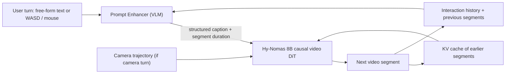
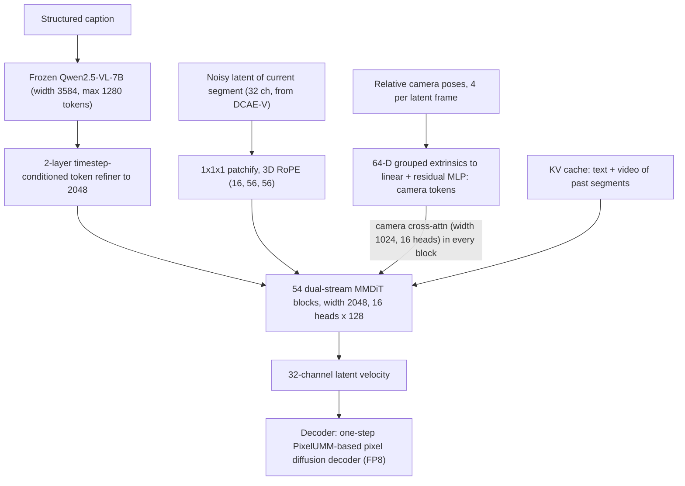
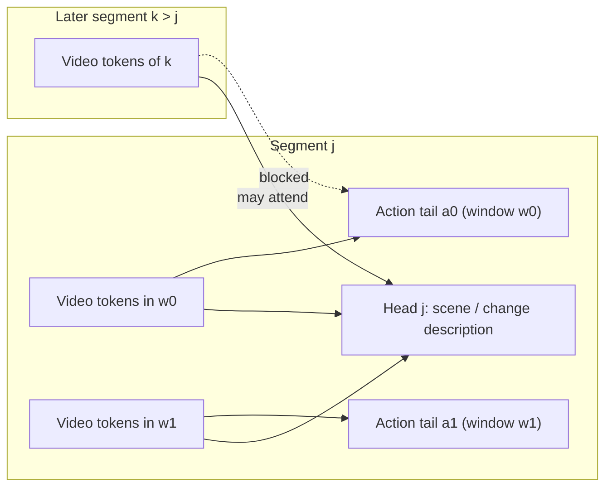
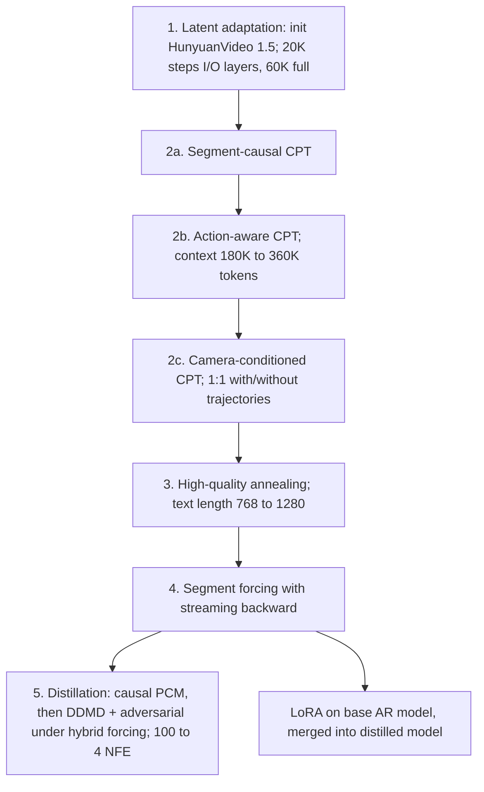

# Paper 05 — Hy-Nomas: Towards Free-form Interactive World Generation

> Reporting week: 2026-W44 (2026-10-26 to 2026-11-01, IST). Areas: world models, video diffusion, interactive generation.
> Source read: arXiv HTML of v1 (the ~20 MB local PDF could not be text-extracted in this environment; the HTML is the same paper).

---

## A. Overview

| Field | Value |
|---|---|
| Title | Hy-Nomas: Towards Free-form Interactive World Generation |
| Authors | Byline: "Tencent Hy Visual Generation Team". Contributors section (38 people): **core contributors** Qiaoling Chen, Jiaxiang Cheng, Xueqing Deng, Tiankai Hang, Ji Hou, Jiaqi Li, Yifan Liu, Tao Lu, Junshu Tang, Yu Tang, Yao Teng, Yu Tian, Heng Wang, Weizhi Wang, Xiyao Wang, Xilun Wu, Mingyu Yang, Yangbin Yu, Rui Zhao; **contributors** Longjun Cao, Linghao Chen, Haoyi Duan, Jiaming Han, Mingji Han, Enhua Jiang, Shunkai Li, Yanzhe Liang, Qinwei Ma, Cong Wang, Lei Wang, Bing Wu, Ke Xing, Ray Ying, Zhentao Yu, Key Zhang, Yuan Zhou, Zhengguang Zhou, Kai Zou. Leadership acknowledged: Xudong Lin, Yonglong Tian. |
| Institution (confirmed from paper) | **Tencent** — "Tencent Hy Visual Generation Team" (Hunyuan). No per-author university affiliations are given. |
| Dates | First submitted 2026-10-27 (v1, this version) |
| Identifier | arXiv:2610.36729v1 [cs.CV] |
| Status | **New** |
| Official link | https://arxiv.org/abs/2610.36729v1 |
| Local PDF | [./paper-05.pdf](./paper-05.pdf) |
| Code / weights / benchmark | Code https://github.com/Tencent-Hunyuan/Hy-Nomas · Weights https://huggingface.co/tencent/Hy-Nomas · Benchmark https://huggingface.co/datasets/tencent/Hy-Nomas-Bench · Project page https://hy-nomas.hy.tencent.com/ |

**Abstract (paraphrased).** Hy-Nomas is an 8B-parameter video world model built on a diffusion backbone (HunyuanVideo 1.5). Users steer it over many turns with **free-form text** ("a dragon lands on the roof") and **continuous camera control** (WASD + mouse). It generates variable-length segments autoregressively, conditioned on the current command and a KV cache of history. Its central design pairs **structured captions** with **action-aware causal attention**: descriptive scene context persists across segments while each action instruction is visible only in its intended time window. A vision-language **Prompt Enhancer** turns user requests plus history into the next structured condition. A multi-stage curriculum ends in diffusion distillation to 4 function evaluations per segment. Human evaluation favours it over existing world models on most axes; weights, code, benchmark and a LoRA workflow are released.

---

## B. Problem

- **What it solves:** "Interactive world generation" — a video model you can *play*: keep issuing commands, see the world respond, keep going for minutes, and come back to places you've seen.
- **Why it matters:** These are the substrate for game prototyping, simulation for embodied agents, and interactive media. Commercial systems (Genie 3, etc.) are closed; open systems mostly support only discrete navigation keys.
- **Prior limitations (as argued in the paper):**
  1. Adding a causal mask to a bidirectional video DiT is not enough to follow the *current* command while respecting history.
  2. Autoregressive rollouts **compound errors** — drift in appearance, implausible motion, scene breakdown.
  3. Text actions leak in time: actions occur in the wrong order inside a segment, or earlier actions are **replayed** in later segments.
  4. Prior interactive models quantize camera motion into discrete commands.
  5. Spatial memory: revisited content should keep identity and layout.
- **Gap addressed:** an open, 8B model that combines free-form text events and continuous 6-DoF camera control over multi-turn, minute-scale rollouts, with a practical consumer-GPU inference stack (single RTX 4090).

---

## C. Fundamentals

**A concrete example first.** Turn 1: "A medieval village at dusk, viewed from a walking traveler." The model renders 5 s of video. Turn 2: you press W for 3 s and drag the mouse right — the camera walks forward and pans. Turn 3: "A horse cart crosses the street, then a lantern lights up." The model must render the cart *first* and the lantern *second*, keep the village identical, and not make the cart cross again in turn 4.

Key concepts:

1. **Latent video diffusion / flow matching.** Videos are compressed by an autoencoder (here DCAE-V: 32× spatial, 4× temporal, 32 channels) into latents; a transformer learns to turn noise into latents by predicting a velocity field.
2. **MMDiT (multimodal diffusion transformer).** Text tokens and video tokens are processed in "dual streams" with separate weights but joint attention. Hy-Nomas: 54 blocks, width 2048, 16 heads × 128.
3. **Bidirectional vs causal attention.** Standard video diffusion sees all frames at once (bidirectional). Interactive generation needs *causal* generation: the future must not influence the past, so new segments can be appended.
4. **KV cache.** Keys/values of previously generated tokens are stored so new segments attend to history without recomputing it.
5. **Exposure bias & "forcing".** Trained on ground-truth history but run on its own imperfect outputs ⇒ errors compound. *Self/segment forcing* trains on self-generated context to close this gap.
6. **Diffusion distillation.** Compress a 100-step sampler into a few steps (here 4 NFEs) using consistency models (PCM) and distribution matching (DMD).
7. **Camera extrinsics.** A 4×4 matrix giving camera rotation and translation per frame; relative poses describe motion between frames.
8. **LoRA.** Low-rank adapters for cheap task-specific fine-tuning.

---

## D. Core contribution

1. **Structured captions + action-aware causal attention.** Each segment's caption is split into a *head* (scene description / changes) and *action tails* with timestamps. Attention masks let video tokens in an action's time window see only that action's text (plus the head), and let heads — but not tails — persist into later segments. This targets two failure modes the authors name: within-segment misordering and cross-segment repetition.
2. **Continuous camera conditioning** via relative poses grouped 4-at-a-time (matching the VAE's 4× temporal compression) into 64-D tokens, injected through a camera cross-attention module in every MMDiT block. Mixed-control training lets text *or* trajectories drive the camera.
3. **Prompt Enhancer (PE).** A fine-tuned VLM (named in the text as Qwen3.8-27B) rewrites multi-turn user input + generated history into the structured caption format; reported near-100% format adherence vs ~50% (Qwen3.8-27B base) and ~70% (Kimi-K3).
4. **Segment forcing with streaming backward** to train on the model's own KV state, plus **two-stage distillation** (causal PCM → hybrid forcing with causal DDMD + adversarial loss) from 100 to 4 NFEs per segment.
5. **Systems stack:** INT8 weights + KV, sliding-window attention, sparse attention after the first two denoising steps, CPU offload, and a one-step distilled pixel-space decoder (PixelUMM-based, FP8). Reported: 100 s, 7 segments, 1280×704 @ 24 FPS with **20.53 GiB peak** on an RTX 4090.
6. **Hy-Nomas-Bench** (280 cases, 4 benchmarks) and open release of weights/code/benchmark.

---

## E. Architecture deep dive

Full architecture document: [../architectures/paper-05-architecture.md](../architectures/paper-05-architecture.md). Raw diagram: [../diagrams/paper-05-system.mmd](../diagrams/paper-05-system.mmd).

### Level 1 — interactive loop  **[From paper: Fig. 1, Fig. 9 — redrawn]**



### Level 2 — model components  **[From paper: Fig. 5, Table 1 — redrawn]**



### Level 2b — attention masks  **[From paper: Fig. 6 — redrawn as rules]**



### Level 3 — training curriculum  **[From paper: Table 2 — redrawn]**



---

## F. Low-level mechanics

### F.1 Latent shapes

$$Z=\mathcal{E}(X)\in\mathbb{R}^{B\times 32\times F_{z}\times H_{z}\times W_{z}},\qquad F_{z}=\left\lfloor\frac{F-1}{4}\right\rfloor+1,\quad H_{z}=\left\lfloor\frac{H}{32}\right\rfloor,\quad W_{z}=\left\lfloor\frac{W}{32}\right\rfloor$$

- $X\in\mathbb{R}^{B\times3\times F\times H\times W}$: RGB video; B batch, F frames, H×W resolution.
- $\mathcal{E}$: causal DCAE-V encoder (first frame encoded alone, then groups of 4 ⇒ the "+1").
- 32: latent channels; $\mathcal{D}$: decoder back to pixels.

**Worked example (arithmetic from the formula):** a 5 s clip at 24 FPS (F = 121) and 1280×704: $F_z = 31$, $H_z = 22$, $W_z = 40$ ⇒ 31·22·40 = **27,280 video tokens** per segment (patch 1×1×1). A 100 s rollout would be ~20× that — why sliding-window attention, INT8 KV and sparse attention are necessary.

### F.2 Flow-matching objective

$$Z_{t}=(1-t)Z+t\epsilon,\qquad V_{t}=\epsilon-Z$$

- $t\in[0,1]$: noise level (t = 1 pure noise); $\epsilon\sim\mathcal{N}(0,I)$; $V_t$: target velocity the network $v_\theta(Z_t,t,c)$ predicts. Training loss is MSE $\|v_\theta - V_t\|^2$ (standard). Base sampler: 100 Euler steps from t = 1 → 0 with text CFG and camera guidance.

### F.3 Segment-wise and action-aware causal attention

Let segment index $s(\cdot)$ map each token to its segment. Segment-wise causal mask:

$$M_{pq} = \begin{cases} 0 & s(q)\le s(p) \\ -\infty & \text{otherwise}\end{cases}$$

added to attention logits $\frac{QK^\top}{\sqrt{128}} + M$. *(Mask written formally here for teaching; the paper specifies the rule in words and Fig. 6a.)*

Action-aware refinement (Fig. 6b): for a video query $p$ in action window $w_i$ of segment $j$, allowed text keys = head$_j$ ∪ tail$_{a_i}$ ∪ heads of segments $<j$; tails of other actions and of earlier segments are masked to $-\infty$.

**Complexity:** attention is $O(L^2)$ in packed length L (up to 360K tokens in training) but structured masks skip blocked pairs — exploited by the Flex-Flash-Attention kernel (MagiAttention), with Ulysses sequence parallelism $N_{SP}=8$ (~45K tokens per rank).

### F.4 Camera tokens

$$\Delta P_t = P_{t-1}^{-1}P_t \quad(\Delta P_1 = I)$$

- $P_t$: camera-to-world 4×4 pose at frame t; $\Delta P_t$: relative motion. Translations divided by one video-level scale (99th percentile translation magnitude). Pad by repeating the first transform to length divisible by 4; flatten each group of four 4×4 matrices → 64-D → linear + residual MLP → one camera token per latent frame.

$$\widetilde{V}=V+\operatorname{CrossAttn}(V,C)$$

- $V$: visual tokens (queries), shape `B × L_v × 2048`; $C$: camera tokens of the *same segment* (keys/values), `B × F_z × d_c`; cross-attention width 1024, 16 heads; one module per MMDiT block.

### F.5 Prompt Enhancer

$$y_{t}\sim p_{\theta}\!\left(\cdot\mid S,u_{t},H_{t-1},V_{<t},m_{t}\right)$$

- $y_t$: structured caption for the next segment; $p_\theta$: the PE VLM; $S$: system prompt; $u_t$: current user input; $H_{t-1}$: dialogue history; $V_{<t}$: previously generated segments (as visual input); $m_t$: rewriting mode (first turn / text turn / camera turn). Trained by SFT on multi-turn multimodal conversations.

### F.6 Segment forcing

$$\tilde{\mathbf{x}}_{s,t_{\mathrm{ctx}}}=\mathbf{x}_{s,t}+(t_{\mathrm{ctx}}-t)\hat{\mathbf{v}}_{s},\qquad t_{\mathrm{ctx}}\sim\mathcal{U}(0.1,0.3)$$

- $\mathbf{x}_{s,t}$: noisy latent of segment s at noise level t; $\hat{\mathbf{v}}_s$: predicted velocity (given the KV cache of earlier self-generated segments); $\tilde{\mathbf{x}}_{s,t_{\mathrm{ctx}}}$: a one-Euler-step estimate moved to low noise $t_{\mathrm{ctx}}$, appended to the KV cache as context for segment $s+1$. Loss: flow-matching MSE on the current segment only. **Streaming backward:** backprop each segment's loss immediately and free its graph; accumulate gradients for one optimizer step — memory stays O(one segment) instead of O(rollout).

At inference, each generated segment is re-noised with $\sigma = 0.206897$ before updating the KV cache — consistent with training on low-noise context.

### F.7 Distillation

- Stage I: causal Phased Consistency Model with teacher forcing.
- Stage II: hybrid forcing — noise-perturbed GT prefix initializes the KV cache for long sequences; student rolls out the suffix at 4 NFE; loss = causal **Decoupled DMD** (on the final segment only, stop-grad through earlier segments) + adversarial hinge loss. CFG is applied over part of the denoising interval.

### F.8 Training-system cost model (sequence packing)

$$F_i=\alpha n_i+\beta A_i,\qquad A_i=\sum_{p\in i}\bigl|\{q:M^{(i)}_{pq}\neq-\infty\}\bigr|$$

- $F_i$: estimated FLOP cost of sample i; $n_i$: valid tokens; $A_i$: number of unmasked query-key pairs under mask $M^{(i)}$; $\alpha$: per-token linear cost over 54 blocks; $\beta$: per-pair attention cost. Packs are formed under a token budget and assigned to data-parallel replicas by longest-processing-time-first greedy to balance load.

### F.9 Optimisation & memory

Muon for attention/FFN weight matrices, AdamW for the rest; FSDP2 within 8-GPU groups; activation checkpointing; ~1.6 GB/rank saved by not retaining attention outputs during segment forcing. Batch size, learning rates and GPU count: **not reported** in the text read.

---

## G. Execution walkthrough

1. **Turn 1 (text):** user types "A rainy neon street, third-person following a cyclist." PE outputs JSON: video-level fields (perspective, style, `subject_list` with `<|Subject1|>`), segment 1 `visual_description_long`, duration.
2. **Encode text:** Qwen2.5-VL-7B → 3584-d tokens → refiner → 2048-d text tokens.
3. **Generate segment 1:** noise latent (e.g., 31×22×40×32) → 4 distilled NFEs through 54 MMDiT blocks (bidirectional within the segment) → clean latent → one-step pixel decoder → frames.
4. **Cache:** re-noise latent with σ = 0.206897, store text + video K/V (INT8) in the sliding-window cache.
5. **Turn 2 (camera):** user holds W and drags mouse. Keyboard increments accumulate into per-frame camera-to-world poses → relative poses → 64-D grouped tokens. PE emits only `description_change`; trajectory goes directly to camera cross-attention. Segment 2 attends to segment-1 *head* tokens and video cache.
6. **Turn 3 (text actions):** "The cyclist rings a bell, then turns left." PE emits `contained_actions` with timestamps `<Action1>` (0–1.5 s), `<Action2>` (1.5–4 s). Action-aware mask confines each to its window ⇒ correct order.
7. **Turn 4:** the "turns left" tail is invisible to segment 4, so the action is not replayed; the scene head remains visible, preserving identity.

---

## H. Comparison with prior approaches

| Approach | Architecture | Control | Inference | Performance (reported) | Compute | Limitations |
|---|---|---|---|---|---|---|
| Genie 3 (closed) | Not disclosed | Navigation + text events | Real-time (closed) | Beats Hy-Nomas on spatial memory: Hy-Nomas net −16.7 (Fig. 17); Hy-Nomas net +18.0 on camera control (Fig. 15) | Unknown | Closed |
| LingBot-World v2 | Interactive video world model | Text + camera | — | Hy-Nomas net +66.7 prompt following (Fig. 13), +56.6 memory (Fig. 17) | — | — |
| HappyOyster (Directing / Wandering) | Interactive world model | Text / navigation | — | Hy-Nomas net +55.0 prompt following (Fig. 13), +26.0 camera (Fig. 15), +6.7 memory (Fig. 17) | — | — |
| Bidirectional video DiT (e.g., HunyuanVideo 1.5) | Full-sequence diffusion | Single prompt | Whole clip at once | — | High per clip | Not interactive |
| **Hy-Nomas** | 8B causal MMDiT, action-aware masks, camera cross-attn | Free-form text + continuous 6-DoF camera | 4 NFE / segment, KV cache, single RTX 4090 (20.53 GiB peak for 100 s) | See Sec. I | Training at 360K-token context | Spatial memory trails Genie 3 |

---

## I. Experiments

**Benchmark: Hy-Nomas-Bench** — 280 cases: Bench-1 multi-turn text (60, 2–6 turns), Bench-2 camera navigation (100; all 8 keys + 24 two-key combos, each followed by its inverse), Bench-3 interleaved text+camera (60, 2–7 segments), Bench-4 spatial memory (60; 4 outbound–return pairs around an anchor object). Some cases exceed 60 s.

**Metrics:** pairwise human preference by 3 annotators on prompt following, physical plausibility, camera control, memory consistency; win/tie/loss and net win (win − loss). No FVD/aesthetic metrics.

**Results (Hy-Nomas perspective, %):**

| Bench | Opponent | Metric | Win / Tie / Loss | Net | Source |
|---|---|---|---|---|---|
| 1 | HappyOyster-Directing | Prompt following | 65.0 / 25.0 / 10.0 | +55.0 | Fig. 13 |
| 1 | LingBot-World v2 | Prompt following | 75.0 / 16.7 / 8.3 | +66.7 | Fig. 13 |
| 1 | HappyOyster-Directing | Physical plausibility | 45.0 / 43.3 / 11.7 | +33.3 | Fig. 13 |
| 1 | LingBot-World v2 | Physical plausibility | 68.3 / 26.7 / 5.0 | +63.3 | Fig. 13 |
| 2 | Genie 3 | Camera control | 32.0 / 54.0 / 14.0 | +18.0 | Fig. 15 |
| 2 | HappyOyster-Wandering | Camera control | 36.0 / 54.0 / 10.0 | +26.0 | Fig. 15 |
| 2 | LingBot-World v2 | Camera control | 29.0 / 61.0 / 10.0 | +19.0 | Fig. 15 |
| 3 | LingBot-World v2 | Prompt following | 75.0 / 16.7 / 8.3 | +66.7 | Fig. 16 |
| 3 | LingBot-World v2 | Physical plausibility | 73.3 / 25.0 / 1.7 | +71.6 | Fig. 16 |
| 3 | LingBot-World v2 | Camera control | 26.7 / 68.3 / 5.0 | +21.7 | Fig. 16 |
| 4 | Genie 3 | Memory | 13.3 / 56.7 / 30.0 | **−16.7** | Fig. 17 |
| 4 | HappyOyster | Memory | 30.0 / 46.7 / 23.3 | +6.7 | Fig. 17 |
| 4 | LingBot-World v2 | Memory | 58.3 / 40.0 / 1.7 | +56.6 | Fig. 17 |

**LoRA (Fig. 20, LoRA-SFT vs distilled base):** Bench-1 prompt following net +11.0, physical plausibility +33.0, but Bench-2 camera control **−18.0** (attributed to low trajectory diversity in SFT data).

**Prompt Enhancer (Fig. 21):** vs Qwen3.8-27B and Kimi-K3 as rewriters, the fine-tuned PE wins more than it loses on most metrics (e.g., Bench-1 prompt following 41.4/36.2/22.4 vs Qwen3.8-27B) but not all (Bench-3 physical plausibility vs Kimi-K3 23.3/40.0/36.7). *Caveat: figure labels were garbled in the extracted HTML, so the metric-to-opponent mapping of these PE numbers is inferred by position.* Format adherence: nearly 100% vs ~50% (Qwen3.8-27B) and ~70% (Kimi-K3) (text).

**Ablations:** action-aware attention is reported qualitatively to "substantially" reduce misordering and repetition; **no numerical ablation** of the attention design, segment forcing, or distillation is reported in the text read.

**Efficiency:** 100 s, 7 segments, 1280×704 @ 24 FPS: 20.53 GiB peak GPU memory on one RTX 4090 (Sec. 6). Wall-clock latency / FPS of generation: not reported in the text read.

---

## J. Implementation

**Official code:** https://github.com/Tencent-Hunyuan/Hy-Nomas (weights on Hugging Face). Building blocks if re-implementing:
- A pretrained MMDiT video model + causal VAE; structured-mask attention kernel (FlexAttention / MagiAttention FFA).
- Captioning pipeline producing JSON captions with timestamped actions (VLM captioners; V-JEPA 2 features for segmentation).
- Camera pose estimation (ViPE), an inverse-dynamics model for WASD labels, filters (CoTracker3, AnyCalib).
- Long-context training: Ulysses SP + FSDP2, sequence packing with the cost model above, Muon optimizer, async checkpointing.

**Illustrative, not from the paper** — building the action-aware mask:

```python
def action_aware_mask(tokens):
    """tokens: list of dicts with keys
       kind in {'video','head','tail'}, seg (int), win (action id or None)"""
    L = len(tokens)
    M = torch.full((L, L), float('-inf'))
    for p, tp in enumerate(tokens):
        for q, tq in enumerate(tokens):
            if tq['seg'] > tp['seg']:
                continue                                  # causal across segments
            if tq['kind'] == 'video':
                M[p, q] = 0                               # past + same-segment video
            elif tq['kind'] == 'head':
                M[p, q] = 0                               # heads persist
            elif tq['kind'] == 'tail' and tq['seg'] == tp['seg']:
                if tp['kind'] != 'video' or tp['win'] in (None, tq['win']):
                    M[p, q] = 0                           # action only in its window
    return M

def camera_tokens(P, mlp, proj):               # P: F x 4 x 4 camera-to-world
    rel = [torch.eye(4)] + [torch.linalg.inv(P[i-1]) @ P[i] for i in range(1, len(P))]
    rel = torch.stack(rel)
    scale = torch.quantile(rel[:, :3, 3].norm(dim=-1), 0.99).clamp(min=1e-6)
    rel[:, :3, 3] /= scale
    pad = (-len(rel)) % 4
    rel = torch.cat([rel[:1].repeat(pad, 1, 1), rel])
    x = proj(rel.reshape(-1, 64))              # one token per 4 frames
    return x + mlp(x)                          # residual MLP
```

**Hardware:** inference fits one RTX 4090 (24 GB) with INT8 weights/KV and offload; training GPU count not reported (8-GPU SP groups).

**Pitfalls:** caption quality is load-bearing (the authors note heavy demands on captions and the PE); removing camera sentences from captions when a trajectory is given prevents shortcutting; inference speedups can introduce differences that accumulate over long rollouts (Sec. 6.2); DCAE-V decoder showed grid artifacts on complex textures.

---

## K. Limitations

- **Spatial memory** trails Genie 3 (net −16.7, Fig. 17); authors suggest more looped-trajectory data.
- **Human-preference-only evaluation**, 3 annotators, against a small set of baselines; no automatic metrics or inter-annotator agreement reported in the text read.
- **No numeric ablations** for the key design (action-aware attention, segment forcing).
- **Fine-tuning fragility:** LoRA degraded camera control (−18.0 net, Fig. 20).
- **Off-screen state:** retrieval-style memory cannot advance unseen state (e.g., a clock).
- **Robotics transfer** needs action-paired video, which is scarce.
- **Cost:** 360K-token context training; higher resolution/longer horizons raise latency and KV memory.
- Training data sizes and compute are not reported, limiting reproducibility of training (inference is reproducible via released weights).

---

## L. Learning takeaways

- **Attention masks are a control interface.** Deciding *which text each video token may see, and when*, solves ordering and repetition bugs that pure conditioning cannot.
- **Structured, timestamped captions** + an LLM rewriter (PE) are how you get free-form, multi-turn control without retraining for each command type.
- **Train on your own outputs** (segment forcing) and **re-noise context at inference** to fight compounding error in AR diffusion.
- **Group camera poses to match the VAE's temporal compression** so every latent frame gets exactly one control token.
- **Systems matter:** INT8 KV, sliding windows, sparse attention after early steps and one-step decoders make an 8B world model run on a consumer GPU.
- **Study next:** HunyuanVideo 1.5, Diffusion Forcing / Self-Forcing, CausVid, Phased Consistency Models, DMD/DMD2, Genie 3, MagiAttention, Ulysses sequence parallelism, Muon optimizer.
