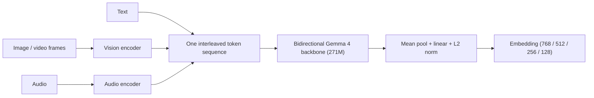
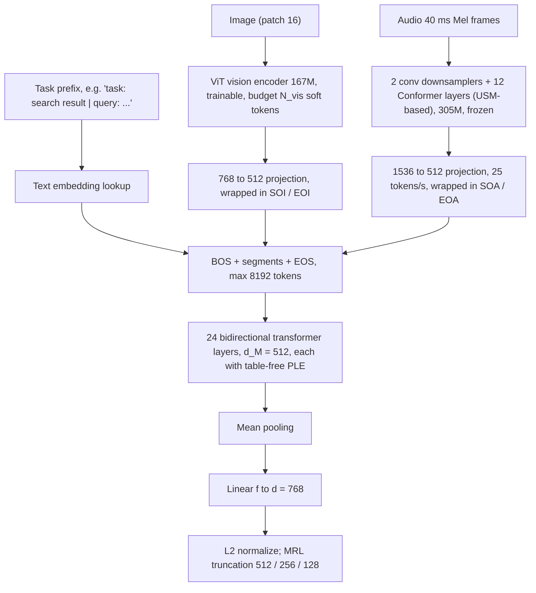
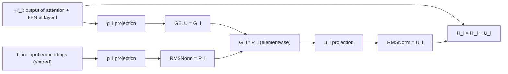
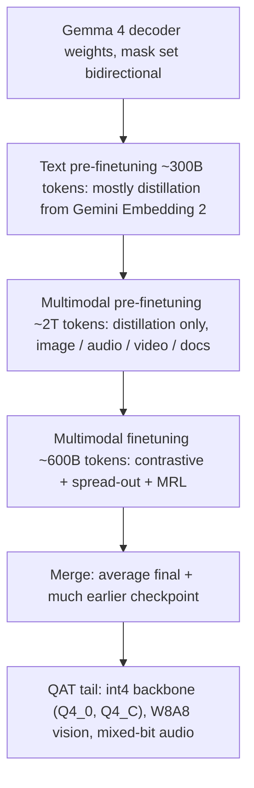

# Paper 06 — EmbeddingGemma 2: Unified and Efficient Multimodal Representations

> Reporting week: 2026-W44 (2026-10-26 to 2026-11-01, IST). Areas: embeddings / RAG, multimodal, on-device.
> Source read: arXiv HTML of v1 (the local PDF could not be text-extracted in this environment; the HTML is the same paper).

---

## A. Overview

| Field | Value |
|---|---|
| Title | EmbeddingGemma 2: Unified and Efficient Multimodal Representations |
| Authors | Henrique Schechter Vera (corresponding), Sahil Dua, Jovan Andonov, Sara Smoot, Sebastian Russo, Ivan Llanos, Max Matveev, Jae Hyeon Yoo, Kat Black, Shih-Cheng Huang, … Armand Joulin, Tom Duerig, Mojtaba Seyedhosseini (73 authors listed; co-first authors marked as equal contributors) |
| Institution (confirmed from paper) | **Google** — "EmbeddingGemma Team, Google" for all authors |
| Dates | First submitted 2026-10-27 (v1, this version) |
| Identifier | arXiv:2610.37364v1 (CC BY 4.0) |
| Status | **New** |
| Official link | https://arxiv.org/abs/2610.37364v1 |
| Local PDF | [./paper-06.pdf](./paper-06.pdf) |
| Weights / docs | Paper links https://ai.google.dev/gemma/docs/embeddinggemma ; Hugging Face weights https://huggingface.co/google/embeddinggemma-2 (link supplied with the assignment, not quoted in the text read). Training code: not reported. |

**Abstract (paraphrased).** EmbeddingGemma 2 is an open embedding model that maps text, images, audio, video and interleaved combinations into **one shared vector space**. It is built from a Gemma 4 decoder turned bidirectional, with simplified per-layer embeddings, a trainable vision encoder and a frozen audio encoder, trained with a multi-stage curriculum that moves from text to multimodal data and from distillation to contrastive objectives. The authors report a new quality/size Pareto frontier across text, image, audio and video embedding benchmarks, beating specialist models and models 2–12× larger. Deployment knobs: load only the encoders you need, choose the vision token budget at inference, truncate embeddings (Matryoshka), and run int4/int8 quantized weights.

---

## B. Problem

- **What it solves:** a single, small, on-device-capable embedding model for *any* modality and *mixed* inputs (e.g., "screenshot + question", "video with soundtrack").
- **Why it matters:** RAG, semantic search, recommendation and agents' memory all depend on embeddings. Today's options force trade-offs:
  1. **Text embedders + converters** (ASR, captioners) for audio/images — extra cost, lose visual detail and non-verbal sound.
  2. **CLIP-style dual towers** (CLIP, ALIGN, SigLIP) — one tower per modality, cannot embed interleaved mixed-modal inputs.
  3. **MLLM-based embedders** — handle everything but are several billion parameters: too slow/expensive for on-device and high-throughput use.
- **Gap addressed:** a sub-1B (744M total, 271M text-only) unified embedder with competitive multimodal quality and a ~0.2–0.6 GB on-device footprint.

---

## C. Fundamentals

**A concrete example first.** You photograph a broken bicycle chain and ask your phone "how do I fix this?". An embedding model turns the photo+question into a 768-number vector. Your phone has previously turned thousands of repair videos, manual pages and podcast clips into vectors in the *same space*. The nearest vectors (by cosine similarity) are the relevant resources. One model, any modality, no captioning step.

Key concepts:

1. **Embedding.** A fixed-length vector representing meaning; similar items → high cosine similarity.
2. **Bidirectional encoder from a decoder LLM.** Decoder LLMs use causal masks (each token sees only the past). For embeddings, every token should see every other token, so the mask is switched to bidirectional.
3. **Mean pooling.** Average the output token vectors into one vector.
4. **Contrastive learning (InfoNCE).** Pull a query toward its positive document, push it away from negatives (hard negatives, other items in the batch). Temperature τ controls sharpness.
5. **Knowledge distillation (embedding regression).** Make the student's vector equal to a strong teacher's (here Gemini Embedding 2) via MSE.
6. **Matryoshka Representation Learning (MRL).** Train so that the first 128/256/512 dims of the 768-d vector are themselves good embeddings — truncate for cheaper storage.
7. **Soft tokens.** Encoders for images/audio produce continuous vectors that are projected to the LLM's width and inserted into the token sequence like words.
8. **Per-Layer Embeddings (PLE).** A Gemma 3n/4 technique adding a small, layer-specific input signal to each layer's residual stream.
9. **Quantization-aware training (QAT).** Train with simulated low-precision weights so int4 deployment loses little quality.

---

## D. Core contribution

1. **Unified any-to-any embedder** in one shared space: text, image, audio, video (optionally interleaved with 1-s audio chunks and MM:SS timestamps), and mixed inputs, from a 271M bidirectional backbone + 167M vision encoder + 305M audio encoder (744M total).
2. **Modular deployment:** 271M text-only, 439M vision-language, 577M audio-language configurations from the same weights; vision token budget selectable at inference (70/140/280/560/1120); MRL dims 768/512/256/128; int4 (Q4_0 / Q4_C) backbone.
3. **Simplified PLE without the lookup table:** per-layer inputs derived from shared input embeddings only; slightly *better* than with the table (MMEB-v2 55.46 vs 55.07, Table 2) and removes a large embedding table.
4. **Curriculum:** ~2.9T tokens — text pre-finetuning (~300B, mostly distillation) → multimodal pre-finetuning (~2T, distillation only) → multimodal finetuning (~600B, contrastive + spread-out + MRL) → checkpoint merging → QAT tail.
5. **No separate bidirectional-adaptation stage:** initialize directly from Gemma 4 decoder weights with the mask flipped.

---

## E. Architecture deep dive

Full architecture document: [../architectures/paper-06-architecture.md](../architectures/paper-06-architecture.md). Raw diagram: [../diagrams/paper-06-system.mmd](../diagrams/paper-06-system.mmd).

### Level 1 — concept  **[Conceptual reconstruction from Sec. 2]**



### Level 2 — components  **[Conceptual reconstruction from Sec. 2 (architecture text)]**



### Level 3 — PLE inside one layer  **[Conceptual reconstruction from the PLE equations in Sec. 2]**



### Training pipeline  **[Conceptual reconstruction from Sec. 3]**



---

## F. Low-level mechanics

### F.1 Shapes

| Tensor | Shape | Notes |
|---|---|---|
| Token sequence | `B × L × 512`, L ≤ 8192 (training) | text + soft tokens + delimiters |
| Image soft tokens | `N_vis × 768 → N_vis × 512` | N_vis ∈ {70,140,280,560,1120}; default train 280 (image) / 140 (video frame) |
| Video | up to `32 frames × 140 tokens` = 4,480 visual tokens (+ audio 25 tok/s) | 1 fps sampling, cap N_frm = 32 *(product computed here)* |
| Audio soft tokens | `25·sec × 1536 → 25·sec × 512` | 40 ms chunks |
| Backbone hidden | `B × L × 512` | 24 layers |
| Pooled | `B × 512` → f → `B × 768` | then ℓ2 normalize |
| MRL views | first 512 / 256 / 128 dims | each re-normalized for similarity |

### F.2 Embedding function (Eq. 1)

$$\mathbf{q}_i = f\big(\mathcal{P}(\mathcal{M}_n(\mathcal{T}(t_q \oplus q_i)))\big), \qquad \mathbf{p}_i^{\pm} = f\big(\mathcal{P}(\mathcal{M}_n(\mathcal{T}(t_p \oplus p_i^{\pm})))\big)$$

- $q_i$: i-th query input (any modality mix); $p_i^{+}$ / $p_i^{-}$: its positive / hard-negative target.
- $t_q, t_p$: task prefixes for queries and targets; $\oplus$: concatenation.
- $\mathcal{T}$: builds the multimodal token sequence (text lookup + encoder soft tokens + delimiters).
- $\mathcal{M}_n$: the $n=24$-layer bidirectional transformer.
- $\mathcal{P}$: mean pooling over tokens; $f$: randomly initialized linear map to $d=768$; output is ℓ2-normalized.

### F.3 Per-layer embeddings (table-free)

$$\mathbf{P}_l = \mathrm{RMSNorm}(p_l(\mathbf{T}_{in})),\quad \mathbf{G}_l = \sigma(g_l(\mathbf{H}'_l)),\quad \mathbf{U}_l = \mathrm{RMSNorm}(u_l(\mathbf{G}_l \odot \mathbf{P}_l)),\quad \mathbf{H}_l = \mathbf{H}'_l + \mathbf{U}_l$$

- $l\in[n]$: layer index; $\mathbf{T}_{in}$: the shared input embeddings (`B×L×512`).
- $p_l, g_l, u_l$: layer-specific linear projections ($d_P=d_M=512$).
- $\mathbf{H}'_l$: layer l's hidden state after its attention/FFN; $\sigma$: GELU; $\odot$: elementwise product.
- $\mathbf{U}_l$: the gated per-layer correction added to the residual stream giving $\mathbf{H}_l$.
- Intuition: each layer gets re-injected, gated access to the original token identities — cheap extra capacity for a narrow (512-d) model, without Gemma 3n/4's large PLE lookup table.

### F.4 Contrastive loss (Eq. 2)

$$\mathcal{L}_C = -\frac{1}{B}\sum_{i=1}^{B}\log\frac{Z_i^{P}}{Z_i^{P}+Z_i^{HN}+Z_i^{IB}+Z_i^{STN}}$$

with $\mathrm{sim}(\mathbf{x},\mathbf{y}) = \frac{\mathbf{x}^\top\mathbf{y}}{\|\mathbf{x}\|\|\mathbf{y}\|}$ and, in the standard EmbeddingGemma form,

$$Z_i^{P}=e^{\mathrm{sim}(\mathbf{q}_i,\mathbf{p}_i^+)/\tau},\; Z_i^{HN}=e^{\mathrm{sim}(\mathbf{q}_i,\mathbf{p}_i^-)/\tau},\; Z_i^{IB}=\sum_{j\ne i}\mathbb{1}_{TN}(i,j)\,e^{\mathrm{sim}(\mathbf{q}_i,\mathbf{p}_j^+)/\tau},\; Z_i^{STN}=\sum_{j\ne i}\mathbb{1}_{TN}(i,j)\,e^{\mathrm{sim}(\mathbf{q}_i,\mathbf{q}_j)/\tau}$$

- $B$: batch size; $\tau$: temperature.
- $Z^P$: positive term; $Z^{HN}$: hard negative; $Z^{IB}$: in-batch negatives (other queries' positives); $Z^{STN}$: same-tower negatives (other queries).
- $\mathbb{1}_{TN}(i,j)=0$ if $\mathbf{q}_i=\mathbf{q}_j$ or $\mathbf{p}^+_i=\mathbf{p}^+_j$ (duplicate ⇒ not a true negative), else 1.
- Change from EmbeddingGemma 1: the hard-negative *hardness weighting* is dropped.
- *The individual Z-term definitions are written out here for teaching in the standard form; the paper defines the four terms and the mask as described.*

### F.5 Listwise Plackett–Luce extension (Eq. 4)

$$\mathcal{L}_C^{list} = -\frac{1}{BP}\sum_{i=1}^{B}\sum_{r=1}^{P}\log\frac{Z_{i,r}^{P}}{\sum_{k=r}^{P} Z_{i,k}^{P} + Z_i^{HN} + Z_i^{IB}}$$

- $P$: number of ranked positives per query; $r$: rank. The rank-r positive must beat every *lower-ranked* positive ($k\ge r$) plus negatives — a Plackett–Luce likelihood over the ranking. The paper adds squared-hinge penalties to calibrate absolute scores.

### F.6 Spread-out regularizer (Eq. 5)

$$\mathcal{L}_S = \frac{1}{B(B-1)}\sum_{1\le i\neq j\le B}(\mathbf{q}_i^\top\mathbf{q}_j)^2 + \frac{1}{B(B-1)}\sum_{1\le i\neq j\le B}(\mathbf{p}_i^{+\top}\mathbf{p}_j^+)^2$$

- Penalizes the second moment of similarities between random pairs ⇒ unrelated embeddings tend toward orthogonality, using the space uniformly (helps quantization and truncation robustness).

### F.7 Distillation loss (Eq. 6)

$$\mathcal{L}_D = \mathcal{L}_D^{\mathbf{q}} + \mathcal{L}_D^{\mathbf{p}^+} + \mathcal{L}_D^{\mathbf{p}^-}, \qquad \mathcal{L}_D^{\mathbf{u}} = \frac{1}{B}\sum_{i=1}^{B}\|\mathbf{u}_i - \tilde{\mathbf{u}}_i\|_2^2$$

- $\mathbf{u}$ ranges over queries, positives, hard negatives; $\tilde{\mathbf{u}}_i$: Gemini Embedding 2 teacher embedding truncated to the student's dimension and ℓ2-normalized. Equal weights.

### F.8 MRL

For nested prefixes $d' \in \{768, 512, 256, 128\}$, each loss above is evaluated on $\mathbf{x}_{[:d']}$ (re-normalized) and summed — so truncated vectors remain usable.

### F.9 Complexity & memory

- Attention: $O(L^2\cdot 512)$ per layer; a 32-frame video at 140 tokens/frame is ~4.5K visual tokens — the inference-time vision budget is the main latency knob.
- On-device peak memory with Q4_C on Pixel 11 Pro: **191 MB** (text), **447 MB** (text+vision), **567 MB** (full multimodal) (Sec. on efficiency). Latency/throughput: not reported in the text read.
- Batch sizes, learning rates, hardware: not reported numerically.

---

## G. Execution walkthrough

Query: a 10-second phone video of a dog barking at a doorbell, used to retrieve similar clips.

1. **Prefix:** `task: search result | query: ` → text tokens.
2. **Video frames:** sampled at 1 fps → 10 frames; each → ViT (patch 16) → 140 soft tokens × 768 → project to 512; wrapped `<|SOI|>…<|EOI|>`.
3. **Audio:** soundtrack split into 1-s chunks; each → Conformer → 25 tokens × 1536 → 512; wrapped `<|SOA|>…<|EOA|>`, interleaved with frames and `MM:SS` timestamps.
4. **Sequence:** `<|BOS|> prefix frame0 audio0 00:01 frame1 audio1 … <|EOS|>` ≈ 10×(140+25) + prefix ≈ 1.7K tokens *(computed here)*.
5. **Backbone:** 24 bidirectional layers at width 512, each adding its PLE gate correction.
6. **Pool & project:** mean over all tokens → 512 → linear → 768 → ℓ2 normalize.
7. **Index:** store the first 256 dims (MRL) to cut storage 3×; compare by cosine to documents embedded with `title: … | text: …` prefixes (text), images, or other videos.

---

## H. Comparison with prior approaches

| Approach | Architecture | Training | Inference | Performance (reported) | Size | Limitations |
|---|---|---|---|---|---|---|
| EmbeddingGemma 1 | Bidirectional Gemma 3, text only | Distill + contrastive | Text only | MTEB Eng 69.67 / 65.11; Code 68.76; MSEB (via ASR) 50.95 (Table 6 / 11) | 308M | No native media |
| Qwen3 Embedding 0.6B | Decoder-based text embedder | — | Text | MTEB Multi 64.34 / 56.01, Eng 70.47 / 64.72, Code 75.42 (Table 6) | 596M | Text only |
| Jina Embed v5 Omni Nano | Multimodal embedder | — | — | MTEB Multi 65.52 / 57.66, Eng 71.11 / 65.22 (Table 6) | 986M | Larger |
| SigLIP SoViT 400M | Dual-tower image-text | Sigmoid contrastive | Two towers | MIEB(lite) 52.28 / 53.50 (Table 6) | 878M | No interleaved input, no audio |
| LAION CLAP General | Dual-tower audio-text | Contrastive | Two towers | MAEB 34.98 / 41.08 (Table 6) | 194M | Audio-text only |
| Gemini Embedding 2 (teacher) | Large proprietary | — | API | MSEB 73.99 (Table 11) | Not disclosed | Not on-device |
| **EmbeddingGemma 2** | Bidirectional Gemma 4 + ViT + Conformer, table-free PLE | Distill → contrastive curriculum, merge, QAT | Modular; int4; budget/MRL knobs | MTEB Multi 61.36 / 53.82; Eng 68.46 / 63.86; Code 78.68; MMEB-v2 59.01; MIEB 60.17 / 65.67; MAEB 49.87 / 48.65; MSEB 69.54 (Table 6) | 744M total | See K |

*Caveat: some baseline cells in the extracted Table 6 were garbled; only cleanly read values are shown. Note that on pure-text MTEB, Qwen3 Embedding 0.6B and Jina v5 Omni Nano score higher than EmbeddingGemma 2 in these values — EG2's advantage is breadth across modalities at small size, plus code retrieval.*

---

## I. Experiments

**Protocol:** bf16, task-instruction prefixes, single-vector models only; baselines under 1B params (MTEB, MAEB, MIEB-lite) or under 2B (MMEB-v2); models trained on >25% of evaluation data excluded.

**Headline results (Table 6):** MTEB(Multilingual v2) 61.36 / 53.82; MTEB(English v2) 68.46 / 63.86; MTEB(Code) 78.68; MMEB-v2 59.01 (image 57.28, video 50.67, VisDoc 67.84); MIEB(lite) 60.17 / 65.67; MAEB 49.87 / 48.65; MSEB retrieval 69.54 MRR@10.

**Text:**
- MTEB Multilingual (Table 13): 61.4 / 53.8 @768 → 57.9 / 50.7 @128; improves over EG1 (driven by bitext mining, classification).
- MTEB English (Table 14): 68.5 / 63.9 — a modest **regression** vs EG1 (69.67 / 65.11).
- MTEB Code (Table 7): 78.7 @768, 71.4 @128; "outperforms every sub-4B model", within 2 points of a 28× larger model.

**Vision:** MMEB-v2 (Table 8) 59.0 at 439M, exceeded only by ~2B models. MIEB(lite) (Table 9) 60.2 / 65.7, +7.9 Task / +12.2 Type over best sub-1B baseline.

**Audio:** MAEB (Table 10) 49.9 / 48.7 — SOTA among sub-1B on any-to-any retrieval and audio classification; CLAP specialists still lead audio captioning. MSEB (Table 11): native audio 69.54 vs EG2-via-ASR 57.59 vs EG1-via-ASR 50.95 — **native audio beats the ASR pipeline by ~12 points**; cross-lingual 67.68 vs 53.52. Teacher Gemini Embedding 2: 73.99.

**Quantization (Table 1):** int4 Q4_C vs bf16 — MTEB Multi 60.84 vs 61.36, Eng 68.49 vs 68.46, Code 76.70 vs 78.68, MIEB 56.71 vs 60.17, MSEB 67.93 vs 69.54 (some harness differences footnoted).

**Ablations:**
- PLE without lookup table: MMEB-v2 55.46 vs 55.07 with table (Table 2).
- Curriculum: pre-finetuning 52.27 → extra pre-finetuning 52.28 → + contrastive finetuning 55.46 (Table 3) — contrastive finetuning, not more distillation, gives the gain.
- Trainable vs frozen vision encoder: 52.27 vs 48.18 (Table 4).
- Inference vision budget on a 280/140-trained model: 70 → 50.07, 140 → 55.37, 280 → 56.15, 560 → 57.02 overall; video drops at 560 (46.52 vs 48.51), VisDoc rises to 67.62 (Table 5).

---

## J. Implementation

**Using it (Illustrative, not from the paper — API shape assumed, check the model card):**

```python
import numpy as np
from sentence_transformers import SentenceTransformer
m = SentenceTransformer("google/embeddinggemma-2")          # weights per assignment link
q = m.encode(["task: search result | query: how to fix a slipped bike chain"],
             normalize_embeddings=True)
d = m.encode(["title: Chain repair | text: Shift to the smallest cog, then ..."],
             normalize_embeddings=True)
q256, d256 = q[:, :256], d[:, :256]                         # MRL truncation
q256 /= np.linalg.norm(q256, axis=1, keepdims=True); d256 /= np.linalg.norm(d256, axis=1, keepdims=True)
score = q256 @ d256.T
```

**Training-loss sketch (Illustrative, not from the paper):**

```python
def nce_loss(q, p_pos, p_neg, tau, dup_q, dup_p):           # all L2-normalized, B x d
    pos = (q * p_pos).sum(-1) / tau                          # B
    hn  = (q * p_neg).sum(-1) / tau                          # B
    ib  = q @ p_pos.T / tau                                  # B x B
    st  = q @ q.T / tau                                      # B x B
    mask = ~(dup_q | dup_p) & ~torch.eye(len(q), dtype=bool) # 1_TN, exclude self
    ib = ib.masked_fill(~mask, float('-inf')); st = st.masked_fill(~mask, float('-inf'))
    denom = torch.logsumexp(torch.stack([pos, hn, torch.logsumexp(ib, 1), torch.logsumexp(st, 1)]), 0)
    return (denom - pos).mean()

def spread_out(q, p_pos):
    B = len(q); off = ~torch.eye(B, dtype=bool)
    return ((q @ q.T)[off] ** 2).mean() + ((p_pos @ p_pos.T)[off] ** 2).mean()

def mrl(loss_fn, *embs, dims=(768, 512, 256, 128)):
    return sum(loss_fn(*[F.normalize(e[:, :k], dim=-1) for e in embs]) for k in dims)
```

**Hardware:** on-device Q4_C peak 191–567 MB (Pixel 11 Pro). Training hardware not reported.

**Pitfalls:**
- Always use the documented **task prefixes**; queries and documents use different ones.
- Choose the **vision budget** per task: higher helps documents (VisDoc), can hurt video (Table 5).
- Truncate to 128 dims cautiously: MTEB Code drops 78.7 → 71.4 (Table 7), MSEB 69.54 → 56.71 (Table 11).
- int4 costs ~3.5 points on MIEB (Table 1) — validate image retrieval quality before shipping quantized.
- Zero-shot clustering on some audio attributes is weak (VoxPopuli gender 0.40) even when a linear probe works (IEMOCAP 66.40) (Table 10 discussion).

---

## K. Limitations

- **English text regression** vs EmbeddingGemma 1 (Table 14), and below larger text specialists (Qwen3 Embedding 0.6B, Jina v5 Omni Nano) on MTEB text (Table 6).
- **Audio captioning** still led by CLAP specialists; some zero-shot audio attributes poorly separated.
- **Teacher dependence:** most training is distillation from proprietary Gemini Embedding 2 — not reproducible without it; training data, batch sizes, LRs and hardware not disclosed numerically.
- **Video length:** capped at 32 frames at 1 fps; long media requires chunking (authors list content-aware long context as future work).
- **Quantized evals** partly use different harnesses (footnoted), so float vs int4 comparisons are approximate.
- **Latency** on device not reported — only memory.
- **Open questions (authors):** encoder-free architectures, end-to-end RAG training, interleaved all-to-all evaluation, reuse as reranker/router/reward model.

---

## L. Learning takeaways

- **Decoder → bidirectional encoder** by flipping the mask is enough as an initialization; no separate adaptation stage needed.
- **Distill first, contrast last:** cheap, dense teacher signal for broad coverage; contrastive finetuning on curated data produces the final quality jump (Table 3).
- **Native modalities beat pipelines:** embedding audio directly beats ASR→text by ~12 MRR points (Table 11).
- **Knobs over models:** modular encoders, token budgets, MRL dims and int4 weights let one checkpoint cover servers and phones.
- **Train the vision encoder** for embedding tasks (Table 4: +4.1 points).
- **Study next:** EmbeddingGemma 1, Gecko / Gemini Embedding, Matryoshka Representation Learning, SigLIP, Gemma 3n per-layer embeddings, USM / Conformer, MMEB-v2 / MTEB v2 / MAEB / MSEB benchmarks, model soups (checkpoint averaging), QAT.
