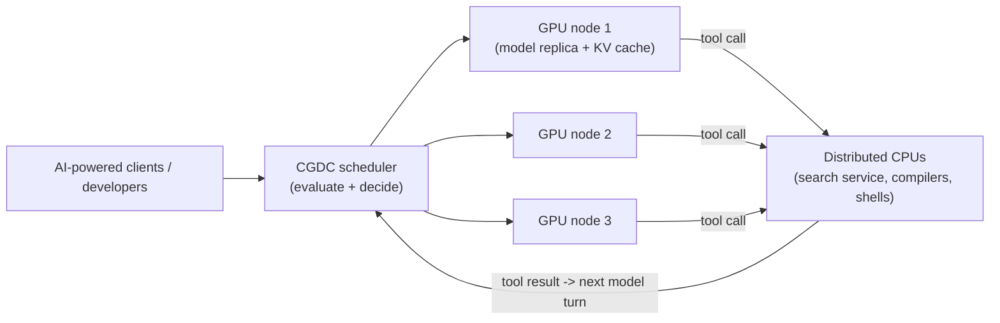
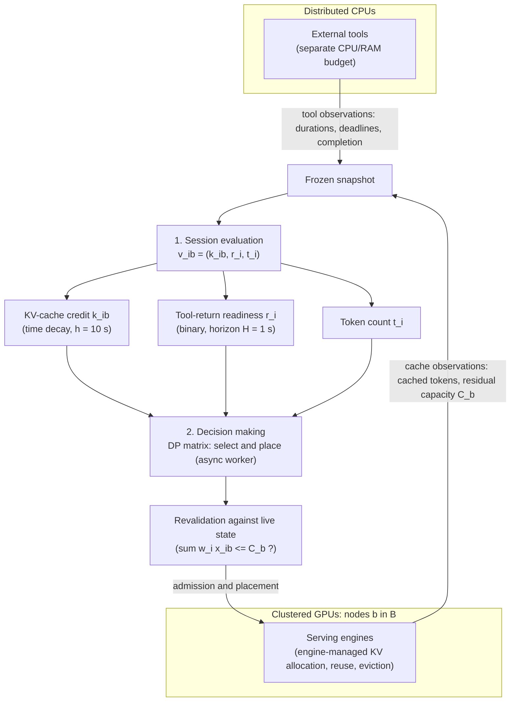
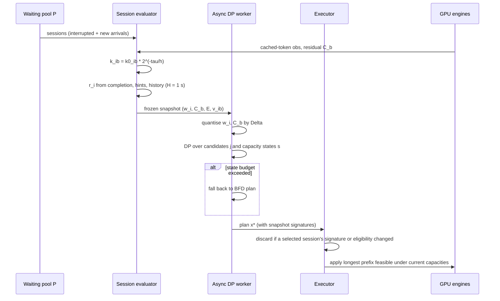
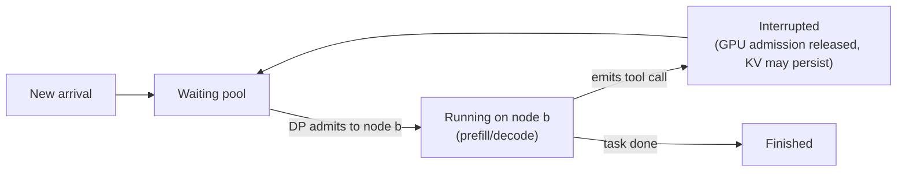

# Paper 07 — TAO: Tool-Aware Joint Scheduling for LLM-Based Agentic Serving

> Reporting week: 2026-W44 (2026-10-26 to 2026-11-01, IST). Source read: local PDF `./paper-07.pdf` (26 pages, main text + appendices A–I).

---

## A. Overview

| Field | Value |
|---|---|
| Title | TAO: Tool-Aware Joint Scheduling for LLM-Based Agentic Serving |
| Authors | Shuhuai Li, Shengdong Ye, Dongdong Ge, Yinyu Ye, Jianghao Lin (corresponding author) |
| Institutions (from the PDF title page) | Shanghai Jiao Tong University (Li, Ye, Ge, Lin); Stanford University (Yinyu Ye) |
| Identifier | arXiv:2610.37230v1 [cs.DC] |
| Date | First submitted 2026-10-27 (v1; this is the version analysed) |
| Status | **New** (first published inside the reporting week) |
| Area | AI infrastructure, LLM serving, agents |
| Official link | https://arxiv.org/abs/2610.37230v1 |
| Local PDF | [./paper-07.pdf](./paper-07.pdf) |
| Code repo | Not reported in the paper (no repository link found in the PDF) |

**Abstract (paraphrased).** Agent sessions alternate between LLM inference on a GPU cluster and tool calls (compilers, shells, retrievers) on separate CPUs. Existing serving schedulers (1) ignore *when* a tool will return when they value a session, and (2) decide admission and GPU placement one session at a time with heuristics. TAO scores every (session, node) pair with a lexicographic triplet — time-decayed KV-cache credit, binary tool-return readiness, token footprint — and solves a multiple-knapsack-style dynamic program that jointly picks which waiting sessions to admit and where. Across 12 model–workload–concurrency settings it reports up to 26.8% lower latency, 36.3% lower mean TTFT and 29.5% higher decode throughput than the best baseline per metric.

---

## B. Problem

**What it solves.** Scheduling *agent sessions* (multi-turn LLM programs that pause for tools) onto a pool of GPU inference replicas.

**Why it matters.** In coding agents (SWE-bench harnesses, Claude Code on Terminal-Bench) a large share of wall-clock time is spent inside tools, not inside the model. The authors name this deployment pattern **CGDC — Clustered GPUs with Distributed CPUs** (Fig. 1 left): GPU replicas form a shared inference pool, while tools run on CPUs outside the GPU admission budget. GPU demand therefore becomes *intermittent*: a session needs the GPU, leaves for a tool, then needs it again — ideally on the same node, where its KV-cache prefix still lives.

**Prior limitations** (Sec. 1, Fig. 1 right):
1. *Evaluation ignores tool timing.* Cache-aware routers (SGLang, Preble, Mooncake, Dynamo) value KV-prefix reuse and load; workflow-aware systems anticipate future calls; latency-aware schedulers use remaining-work estimates. Where tool timing is used at all, it is only a surrogate — Continuum predicts tool duration to set KV TTLs, ThunderAgent discounts a paused session's token footprint over time. Features are combined with fixed weights or thresholds.
2. *Decisions are per-session and myopic.* llm-d / SGLang route each session by its own score, but sessions compete for the same node capacity, so admitting one can block a more valuable *combination* of others.

**Gap addressed.** A scheduler that (a) explicitly predicts which paused sessions will return from their tool in the next scheduling window, and (b) chooses the whole admission-and-placement plan jointly under capacity constraints.

---

## C. Fundamentals

**A concrete picture first.** Imagine a restaurant kitchen with 2 stoves (GPU nodes). Each diner (agent session) orders a course, eats it away from the kitchen (tool call), then orders again. A stove that just cooked your previous course still has your pan warm (KV cache), so your next course is faster there — but the pan cools over time. The host must decide, every second, which waiting diners to seat at which stove. Seating a diner who is still mid-meal wastes a stove slot; seating diners one by one may leave a stove with an awkward leftover gap that a different pair of diners would have filled perfectly.

Now the terminology:

- **Agent session.** A persistent interaction alternating *model requests* (LLM steps) and *tool calls*. One session = many inference requests (footnote 1).
- **KV cache / prefix reuse.** During prefill, a transformer computes key/value tensors for every prompt token. If a later request shares a prefix (system prompt + history + previous tool observations), the engine can reuse those tensors and skip recomputing them (PagedAttention, RadixAttention). Reuse is *node-local*: it only helps if the session returns to the node that holds the prefix, and only if the engine has not evicted it.
- **Prefill vs decode, TTFT.** Prefill processes the prompt in parallel; decode generates tokens one by one. Time-to-first-token (TTFT) is dominated by prefill and queueing — exactly what cache reuse and good admission reduce.
- **Session interruption / restart** (Sec. 2.2). At a tool boundary the scheduler may release the session's GPU admission while the tool runs (cheap — no in-flight computation is lost, though the KV prefix may later be evicted). Preempting a session *during* inference would force recomputation and cause KV thrashing. Interrupted sessions plus new arrivals form the **waiting pool**.
- **Knapsack / generalized assignment.** Choose items (sessions) with weights (memory demand) and values to put into bins (nodes) with capacities, maximising total value — NP-hard in general, but solvable exactly by dynamic programming over discretised capacity.
- **Lexicographic order.** Compare vectors coordinate by coordinate: (5, 0, 100) > (4, 1, 999) because the first coordinate decides. This avoids picking weights for a weighted sum.

---

## D. Core contribution

1. **Problem framing — CGDC.** Identifies tool latency as a first-class bottleneck in agentic serving where tools run outside the GPU budget.
2. **Tool-return readiness \(r_i\).** A binary per-session signal: "will this session need the GPU within the next \(H = 1\) s?" Built from observed completion, exposed tool deadlines/progress events (e.g. Claude Code's Monitor tool, OpenCode Bash timeouts), parsed `sleep` commands, and an empirical-Bernstein upper estimate of historical tool duration (Appendix A).
3. **Time-aware cache credit \(k_{i,b}\).** Node-specific reusable-prefix estimate discounted with a 10-second half-life, motivated by a measured decline of cache retention with pause age (Fig. 3).
4. **Lexicographic value triplet** \(v_{i,b} = (k_{i,b}, r_i, t_i)\): cache credit first, readiness second, token count third. No weighted sum; coordinates *evolve* over time (cache credit decays to equality, letting readiness decide).
5. **Joint selection + placement by exact DP** over quantised residual capacities (multiple-knapsack / generalized-assignment), run asynchronously in an isolated worker, with live-state **revalidation** and a conditional loss bound for stale plans (Appendix B–C).

**What differs from prior work.** ThunderAgent (the closest baseline and the system TAO builds on — it introduced the waiting pool and interruption lifecycle) uses token-count priority with best-fit-decreasing (BFD) placement. Dynamo / vLLM CA use KV-aware routing. TOPAS considers prefix residency and admission with bounded search plus greedy packing. TAO is the first in this list to (i) turn tool timing into an explicit near-term readiness signal for admission and (ii) solve admission and placement jointly and exactly for the frozen snapshot.

---

## E. Architecture deep dive

Full architecture document: [../architectures/paper-07-architecture.md](../architectures/paper-07-architecture.md). Raw system diagram: [../diagrams/paper-07-system.mmd](../diagrams/paper-07-system.mmd).

### E.1 Level 1 — Concept (the CGDC scenario) — **[From paper: Fig. 1 (left)]**, redrawn



### E.2 Level 2 — Components (evaluate-then-decide pipeline) — **[From paper: Fig. 2]**, redrawn



### E.3 Level 3 — One scheduling tick (low-level execution) — **[Conceptual reconstruction]** from Algorithm 1 (Appendix B.1) and Sec. 3



### E.4 Session lifecycle — **[Conceptual reconstruction]** from Sec. 2.2



---

## F. Low-level mechanics

TAO is a scheduler, not a neural network, so tensor shapes, attention, backprop and training losses **do not apply** — the model weights are untouched. The "mechanics" are the valuation functions and the optimiser. Notation: \(n = |P|\) waiting sessions, \(m = |B|\) nodes.

### F.1 Feasible set (Eq. 1)

$$
\mathcal{X}=\Big\{x:\ \sum_{b\in B}x_{i,b}\le 1,\ \ \sum_{i\in P}w_i x_{i,b}\le C_b,\ \ x_{i,b}=0\ \text{if}\ (i,b)\notin E\Big\}
$$

- \(x_{i,b}\in\{0,1\}\): 1 if session \(i\) is admitted to node \(b\) this tick.
- \(\sum_b x_{i,b}\le 1\): each session goes to at most one node (or stays waiting).
- \(w_i\): admission cost of session \(i\) — per Appendix B.1, the memory demand of its total token count minus tokens already shared/cached.
- \(C_b\): residual capacity of node \(b\) from live metrics.
- \(E\subseteq P\times B\): eligible (session, node) pairs.

### F.2 Lexicographic value and objective (Eqs. 2–3)

$$
v_{i,b}=(k_{i,b},\,r_i,\,t_i),\qquad x^\star\in\arg\operatorname{lexmax}_{x\in\mathcal{X}}\sum_{i\in P}\sum_{b\in B}x_{i,b}\,v_{i,b}
$$

- \(k_{i,b}\): decayed KV-cache credit (node-specific).
- \(r_i\in\{0,1\}\): tool-return readiness (session-level).
- \(t_i\): token count / footprint.
- The sum is component-wise; plans are compared lexicographically: maximise total cache credit; among ties, maximise number of ready sessions; among those, maximise admitted tokens. Since a ready session with zero cache credit still adds \(r_i=1\), readiness breaks ties once credits have decayed to equal (rounded) values.

### F.3 Time-aware cache credit (Eq. 4)

$$
k_{i,b}(t)=k^{0}_{i,b}\,2^{-\tau_{i,b}/h},\qquad \tau_{i,b}=\max\big(0,\ t-t^{\text{obs}}_{i,b}\big)
$$

- \(k^0_{i,b}\): observed cached-token count for session \(i\)'s prefix on node \(b\) (or estimated from observed token volume × cache rate; 0 if no evidence).
- \(t^{\text{obs}}_{i,b}\): time of that observation; \(\tau_{i,b}\) its age.
- \(h\): half-life, **10 s** in TAO. Credit halves every 10 s; it is rounded for valuation, so after enough decay credits become equal and the next coordinate decides.
- Motivation: Fig. 3, DeepSeek-V4 Flash traces on 2×(4×H100) — median cached/prompt-token fraction falls as pause age grows (binned over 10–1,800 s, exponential fit). The half-life is a scheduler parameter distinct from the fitted constant.

### F.4 Remaining tool time (Eq. 5) and the history estimator (Eq. 8, Appendix A)

$$
d_i(t)=\max\{0,\ D_f-e_i(t)\}
$$

- \(e_i(t)\): elapsed time of session \(i\)'s current tool call; \(D_f\): upper estimate of duration for tool type \(f\); \(d_i\): predicted remaining time.

$$
D_f=\begin{cases}\bar d_f, & n_f=1\\[4pt] \bar d_f+\sqrt{\dfrac{2s_f^2\log(3/\delta)}{n_f}}+\dfrac{3R_f\log(3/\delta)}{n_f}, & n_f\ge 2\end{cases}
$$

(Reconstructed from the PDF's text layer, which garbles the typesetting; it is an empirical-Bernstein-style margin citing Maurer & Pontil 2009.)

- \(n_f\): number of completed calls of tool \(f\); \(\bar d_f\): their mean duration; \(s_f^2\): sample variance; \(R_f\): observed range (max − min).
- \(\delta = 0.2\): confidence parameter. Larger variance or fewer samples → larger, more conservative estimate.
- Fallback order: direct timing hints → tool-specific history → global history → 5-second default. The authors stress it is a heuristic with no calibrated per-call coverage.

### F.5 Binary readiness (Eq. 6)

$$
r_i(t)=\begin{cases}1, & o_i(t)=1\\ a_i(t)\,b_i(t), & o_i(t)=0,\ z_i(t)\le t\\ a_i(t)\,g_i(t)\,\mathbb{1}[z_i(t)\le t+H], & \text{otherwise}\end{cases}
$$

- \(o_i(t)\): tool completion actually observed → always ready.
- \(a_i(t)\): session has an established tool-execution candidate with an eligible prediction source.
- \(g_i(t)\): prediction timestamps are valid and refreshed within 30 s.
- \(z_i(t)\): earliest available predicted completion or exposed return deadline (\(+\infty\) if none).
- \(H\): look-ahead horizon, **1 s**.
- \(b_i(t)\): overdue-probe indicator — when the prediction has passed but no completion was seen, the session gets temporary "probe" chances instead of being ready forever.

### F.6 Joint DP (Eq. 7) and Algorithm 1

Quantise: \(\bar w_i=\lceil w_i/\Delta\rceil\), \(\bar C_b=\lfloor C_b/\Delta\rfloor\). Let the state \(s\in\mathbb{Z}^m_{\ge 0}\) be the vector of used capacity per node.

$$
D_j(s)=\operatorname{lexmax}\Big\{D_{j-1}(s),\ \operatorname{lexmax}_{b\ \text{eligible}}\big[D_{j-1}(s-\bar w_j e_b)+u_{j,b}\big]\Big\}
$$

- \(D_j(s)\): best (lexicographic) objective using only the first \(j\) candidates and consuming capacity vector \(s\).
- \(e_b\): unit vector for node \(b\); \(s-\bar w_j e_b\) is the state before placing \(j\) on \(b\).
- \(u_{j,b}\): embedded value of assigning \(j\) to \(b\) (the triplet plus an assignment count).
- \(D_0(0)=0\); other initial states unreachable; only states with \(0\le s_b\le\bar C_b\) allowed.
- **Exactness:** each candidate is either skipped or assigned to one eligible node, so induction gives the optimum *of the frozen, discretised problem*; rounding can exclude plans feasible before discretisation.

**Complexity (our derivation, not stated as a formula in the paper).** Number of states is at most \(\prod_b(\bar C_b+1)\); each of \(n\) candidates tries up to \(m\) nodes per state, so time \(O\!\big(n\,m\prod_b(\bar C_b+1)\big)\), plus \(O(nm)\) preprocessing for cache-credit decay (stated in Sec. 3.5). This is exponential in the number of node dimensions, which is why the paper (i) groups cache-equivalent nodes into \(g\le m\) aggregate capacity dimensions, (ii) sets a state budget with a BFD fallback, and (iii) runs the solver asynchronously. Reported overhead: preparation plus solve is **below 0.12% of runtime** in the four-replica sweep (Sec. 3.5, Appendix I).

### F.7 Stale-plan loss bound (Eqs. 9–10, Appendix C)

$$
\max_{x\in\mathcal{X}^\Delta_t}U_t(x)-U_t(y_t)\ \le\ A_{s,t}+2\epsilon_{s,t}+T_{s,t}
$$

- \(s, t\): planning and application times; \(x_s\): snapshot-optimal plan; \(y_t\): revalidated (possibly truncated or discarded) plan.
- \(U_\tau\): a scalar score that preserves the lexicographic order (analysis only).
- \(\epsilon_{s,t}=\max_{x\in\mathcal{X}^\Delta_s}|U_t(x)-U_s(x)|\): value drift.
- \(A_{s,t}\): value of new opportunities created by feasibility changes (new candidates, freed capacity).
- \(T_{s,t}=[U_t(x_s)-U_t(y_t)]_+\): value lost through truncation/discard.
- If plans have at most \(K\) assignments and per-assignment drift is \(\le\eta_{s,t}\le L(t-s)\), drift contributes \(2KL(t-s)\) — fresh plans lose little. Binary readiness jumps are not Lipschitz and need separate allowances. This bounds per-tick loss against the fresh-snapshot optimum, **not** end-to-end latency or regret against an optimal online policy.

### F.8 Memory

Scheduler state is small: per session a few scalars plus per-node cache observations (\(O(nm)\)), and the DP table of size \(\prod_b(\bar C_b+1)\) with predecessor pointers for backtracking. GPU KV memory itself is still managed by the engine; TAO only decides admission and placement.

---

## G. Execution walkthrough

Illustrative scenario (values invented for teaching, not from the paper): 2 GPU nodes, 1 s scheduling interval, 3 sessions in the waiting pool.

1. **Snapshot at t = 100 s.** Node b1 residual capacity 40k tokens of KV memory, b2 30k. Quantum \(\Delta\) = 10k → \(\bar C_{b1}=4,\ \bar C_{b2}=3\).
2. **Session s1** finished a `pytest` run 0.2 s ago (\(o=1\) → \(r=1\)). Its 25k-token prefix was observed cached on b1 4 s ago: \(k=25000\cdot 2^{-0.4}\approx 18950\) on b1, 0 on b2. \(t=25k\); \(w\) = 25k − shared → say 10k → \(\bar w=1\).
3. **Session s2** is running `pip install`; elapsed 3 s; history for that tool has mean 3.5 s plus margin → \(D_f\approx 3.8\) s → \(d=0.8\) s ≤ H → \(r=1\). Its prefix was observed on b2 40 s ago: \(k\approx 30000\cdot 2^{-4}=1875\) on b2. \(\bar w=2\).
4. **Session s3** is a new arrival with a 20k-token prompt, no cache anywhere: \(k=0\), \(r=1\) (needs the GPU now), \(\bar w=2\).
5. **Evaluation output:** triplets \(v_{s1,b1}=(18950,1,25k)\), \(v_{s2,b2}=(1875,1,30k)\), \(v_{s2,b1}=(0,1,30k)\), \(v_{s3,\cdot}=(0,1,20k)\).
6. **DP.** It enumerates capacity states: e.g. {s1→b1, s3→b1, s2→b2} uses b1 = 3/4, b2 = 2/3, total value (20825, 3, 75k). A greedy per-session router might send s3 to b2 first (more free space), leaving no room for s2 on its cache-warm node. The DP finds the plan with the lexicographically best total.
7. **Revalidation.** Before applying, the executor checks each selected session's state signature is unchanged (e.g. s2 really issued its next request) and applies the longest prefix still feasible under live capacities.
8. **Engines** run prefill (largely skipped for s1 on b1 thanks to its warm prefix), then decode; when a session emits its next tool call it is interrupted and returns to the pool.

---

## H. Comparison with prior approaches

| System | Session valuation | Placement / admission | Uses tool timing? | Reported weakness (per this paper) |
|---|---|---|---|---|
| vLLM scheduler w/ RR | none (load spreading) | round-robin | no | ignores cache locality |
| vLLM scheduler w/ CA (≈ SGLang policy) | prefix locality | per-request cache-aware routing | no | myopic per-session decisions |
| NVIDIA Dynamo | KV overlap, load-adjusted | KV-aware routing | no | high TTFT at high concurrency (Tables 1–2) |
| ThunderAgent (Kang et al. 2026) | token count, time-discounted for paused sessions | waiting pool + best-fit-decreasing | indirectly (discount) | TTFT blow-ups at 32–64 workers on one TP8 node (Table 5) |
| Continuum (Li et al. 2025) | — | KV retention TTL from tool-duration history | for KV TTL only | not an admission optimiser |
| TOPAS (Ni et al. 2026) | prefix residency + admission | bounded search + greedy packing | no | heuristic packing |
| **TAO** | lexicographic (cache credit w/ decay, readiness, tokens) | exact DP over quantised capacities, async + revalidation | **yes, explicit readiness** | DP state space grows with nodes; regressions in some settings (Sec. I) |

Compute cost: TAO adds an asynchronous planner whose recorded work is < 0.12% of runtime (Appendix I); baselines are essentially O(1) per request routing.

---

## I. Experiments

**Models / deployments** (Sec. 4.1): DeepSeek-V4 Flash on 2 nodes × 4×H100 (TP4 per node); Qwen3-32B on 4 nodes × 2×H100; GLM-4.7 on 1 node × 8×H100 (TP8). One tensor-parallel replica per node.

**Workloads:** SWE-bench Lite (SWE-Lite) and SWE-bench Verified via mini-SWE-agent; Terminal-Bench 2.0 via Claude Code; AutomationBench and a Terminal-Bench + SWE-Lite mix (Table 3); InferenceX trace replay (Appendix F).

**Metrics:** mean task end-to-end latency (includes tool time), mean TTFT, decode throughput (tok/s); component metrics: prefix-cache hit rate, tool-end-to-first-token delay, pause wait.

**Baselines:** vLLM scheduler w/ RR, vLLM scheduler w/ CA, Dynamo, ThunderAgent.

**Main results (Table 1).**

| Setting | Best TAO gain vs best baseline per metric |
|---|---|
| DeepSeek-V4 Flash, SWE-Lite, 64 workers | latency 185.410 s (+26.8%), TTFT 0.224 s (+36.3%), decode 2021.523 tok/s (+29.5%) |
| DeepSeek-V4 Flash, SWE-Lite, 16 workers | +2.4% latency, +7.4% TTFT, +5.1% decode |
| DeepSeek-V4 Flash, Terminal-Bench | leads latency and TTFT at all 3 concurrencies; decode −8.8% (16 w) and −6.2% (64 w) |
| Qwen3-32B, SWE-verified, 96 workers | +8.3% latency, +29.9% TTFT, +7.8% decode |
| Qwen3-32B, SWE-verified, 128 workers | latency −2.5% vs ThunderAgent (a regression) |
| Qwen3-32B, SWE-Lite, 160 workers | latency −0.2%, TTFT +10.2%, decode +6.7% |

**GLM-4.7 single node (Table 2).** SWE-Lite 160 workers: +15.5% latency, +14.1% TTFT, +20.5% decode. SWE-verified: latency −16.2 to −18.9%, TTFT −15.7 to −38.4%, decode +22.8 to +24.7% vs ThunderAgent. Fig. 4 (160 workers): TAO finishes the run in 60.0 min vs ThunderAgent 70.9, vLLM CA 164.3, vLLM RR 176.8, Dynamo 189.4 min.

**Mixed / chatbot workloads (Table 3).** Gains at 32–64 workers (e.g. AutomationBench 64 workers TTFT +48.5%), but at 128 workers on AutomationBench TAO is worse: latency −7.0%, TTFT −504.0%, decode −11.2%.

**Low concurrency (Table 5, Appendix E.1).** Single TP8 node, 4–64 workers: TAO is within 2.3% of best latency at 4–8 workers and retains > 92% of best decode throughput; it is not the best at most points (e.g. 64 workers TTFT 0.423 s vs Dynamo 0.231 s).

**Component analysis (Sec. 4.3, Figs. 5–6).**
- Cache-token ordering: +0.19 pp hit rate and −4.5% pause wait vs ThunderAgent; adding decay: +0.31 pp hit rate and +1.68% decode (Fig. 5).
- Readiness: +4.03% decode, −10.88% tool-end-to-first-token delay, mean pause wait 1.067 → 0.972 s. Duration predictor over 10,967 completed tools: MAE 0.410 s, 82.9% of errors within 0.5 s (Fig. 6).
- Joint DP beats a short-first heuristic in 6 of 23 multi-candidate snapshots (26.1%), matches it in 17.

**Ablations (Table 4, DeepSeek SWE-Lite, 32 workers).**

| Configuration | Decode (tok/s) | Hit % | Mean TTFT (s) | Mean pause (s) |
|---|---|---|---|---|
| TAO | 1417.97 | 96.31 | 0.154 | 0.972 |
| w/o cache value | 1398.35 | 96.24 | 0.157 | 1.028 |
| w/o readiness | 1363.06 | 96.16 | 0.161 | 1.067 |
| w/o session evaluation (ThunderAgent ordering) | 1355.20 | 96.20 | 0.162 | 1.025 |
| w/o decision making (BFD instead of DP) | 1233.72 | 96.05 | 0.195 | 1.081 |

The DP placement is the single largest contributor.

---

## J. Implementation

**Components to build:**
1. **Session state store** — per session: status (running / in tool / waiting), current tool name, tool start time, deadline hints, token count, last cache observations per node.
2. **Tool-duration predictor** — rolling per-tool \(n, \bar d, s^2, R\); hint parsers (sleep commands, timeouts, progress events).
3. **Cache observer** — read cached-token counts per (session prefix, node) from engine metrics (vLLM / SGLang expose prefix-cache hits).
4. **Planner worker** — separate process/thread solving the DP on a frozen snapshot.
5. **Executor** — revalidation + admission calls to the router/engine.

Frameworks: any OpenAI-compatible front-end routing to vLLM or SGLang replicas; the paper's baselines are vLLM production-stack routers, Dynamo and ThunderAgent.

**Illustrative, not from the paper** — the valuation and a simplified DP for small node counts:

```python
import math
from functools import cmp_to_key

H_LIFE, HORIZON, DELTA = 10.0, 1.0, 0.2

def cache_credit(k0, t_obs, now):
    tau = max(0.0, now - t_obs)
    return round(k0 * 2 ** (-tau / H_LIFE))

def duration_upper(stats):            # stats: n, mean, var, rng
    if stats.n == 0: return 5.0       # default
    if stats.n == 1: return stats.mean
    L = math.log(3 / DELTA)
    return stats.mean + math.sqrt(2 * stats.var * L / stats.n) + 3 * stats.rng * L / stats.n

def readiness(sess, now):
    if sess.tool_done: return 1
    z = min(sess.deadline_hint or math.inf,
            sess.tool_start + duration_upper(sess.tool_stats))
    if z <= now: return 1 if sess.probe_allowed else 0
    return int(sess.prediction_fresh and z <= now + HORIZON)

def plan(cands, caps, quantum):
    """cands: list of (sid, w, {node: (k, r, t)}); caps: {node: C}. Exact DP on used-capacity vectors."""
    nodes = sorted(caps)
    cap = tuple(caps[b] // quantum for b in nodes)
    D = {tuple(0 for _ in nodes): ((0, 0, 0), [])}
    for sid, w, vals in cands:
        wq = -(-w // quantum)
        nxt = dict(D)
        for s, (val, assign) in D.items():
            for bi, b in enumerate(nodes):
                if b not in vals or s[bi] + wq > cap[bi]: continue
                s2 = s[:bi] + (s[bi] + wq,) + s[bi + 1:]
                v2 = tuple(a + c for a, c in zip(val, vals[b]))
                if s2 not in nxt or v2 > nxt[s2][0]:     # tuple comparison = lexicographic
                    nxt[s2] = (v2, assign + [(sid, b)])
        D = nxt
    return max(D.values(), key=lambda x: x[0])[1]
```

(The paper embeds an assignment count in \(u_{j,b}\) and stores predecessors for backtracking rather than whole assignment lists; it also falls back to BFD when a state budget is exceeded.)

**Hardware.** Scheduler runs on CPU; the paper's testbeds use 8×H100 in total per configuration.

**Pitfalls.**
- DP state explosion with many nodes — group cache-equivalent nodes, choose a coarse \(\Delta\), keep a fallback.
- Stale plans — always revalidate signatures; keep plan age short.
- Readiness false positives waste GPU slots; the overdue-probe mechanism prevents permanently "ready" stuck sessions.
- Cache observations are estimates; the engine may already have evicted the prefix.
- Half-life \(h\) and horizon \(H\) are fixed hand-picked values (10 s, 1 s); retune for your tool mix.

---

## K. Limitations

- **Not uniformly better.** Regressions are reported: decode −8.8%/−6.2% on Terminal-Bench (Table 1), latency −2.5% on Qwen SWE-verified 128 workers, and a large TTFT regression (−504%) on AutomationBench at 128 workers (Table 3). At low concurrency it is merely competitive (Table 5).
- **Heuristic signals.** The duration estimator gives no calibrated coverage; readiness is binary with a hand-set 1 s horizon; the 10 s half-life is a chosen parameter.
- **Lexicographic order is fixed** (cache > readiness > tokens); no study of alternative orders is reported.
- **Exactness only for the frozen, discretised snapshot**; the loss bound does not cover end-to-end latency or online regret.
- **Scalability** of the multi-dimensional DP to large clusters is handled by grouping and fallback; large-cluster results are not reported (max 4 nodes).
- **Natural-live runs with differing generated trajectories** (Appendix D) — run-to-run variance and confidence intervals for the main tables are not reported.
- **No public code link** in the paper, limiting reproducibility.
- Evaluated mostly on coding-agent workloads with relatively predictable tools.

---

## L. Learning takeaways

- In agentic serving the unit of scheduling is the **session**, not the request; tool time creates idle GPU windows that a scheduler can exploit.
- **Predicting the return** of a paused session is as valuable as remembering where its cache is — and both signals decay/evolve over time.
- **Lexicographic objectives** are a clean alternative to tuning weighted sums when signals have a natural priority.
- Jointly solving admission + placement (knapsack/GAP via DP) beats per-session routing — in this paper the DP was the largest single contributor (Table 4).
- **Async planning + revalidation** is a practical pattern for putting exact optimisers on a serving hot path.

**Study next:** PagedAttention (vLLM) and RadixAttention (SGLang); NVIDIA Dynamo KV-aware routing; ThunderAgent; Continuum and InferCept (KV retention across tool calls); multiple-knapsack / generalized assignment (Kellerer et al.; Shmoys & Tardos); empirical Bernstein bounds (Maurer & Pontil 2009).
