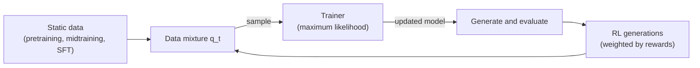
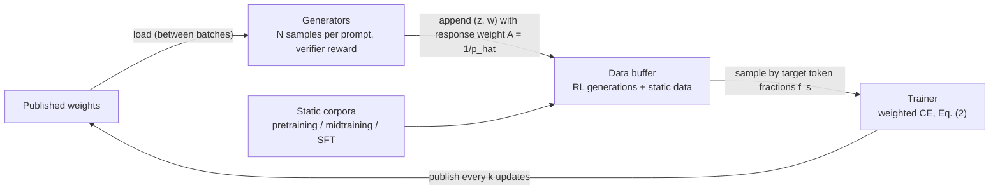
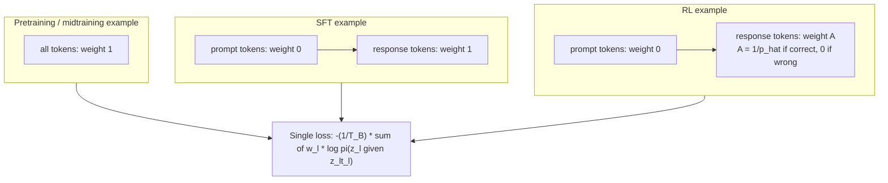
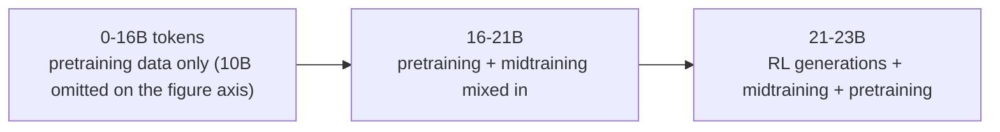

# Paper 08 — Training Foundation Models with a Single Algorithm

> Reporting week: 2026-W44 (2026-10-26 to 2026-11-01, IST). Source read: local PDF `./paper-08.pdf` (67 pages: main text pp. 1–13, appendices A–F incl. Tables 3–22).

---

## A. Overview

| Field | Value |
|---|---|
| Title | Training Foundation Models with a Single Algorithm |
| Authors | Yuda Song (equal contribution, project lead), Alvin Zhang (equal contribution), Fahim Tajwar (equal contribution), Daman Arora, Jeff Schneider, Daniel Khashabi, Ruslan Salakhutdinov, J. Andrew Bagnell (equal advising), Aarti Singh (equal advising), Andrea Zanette (equal advising) |
| Institutions (from the PDF title page) | Carnegie Mellon University (Song, Tajwar, Arora, Schneider, Salakhutdinov, Bagnell, Singh, Zanette); Johns Hopkins University (Zhang, Khashabi); Aurora Innovation (Bagnell) |
| Identifier | arXiv:2610.40564v1 [cs.LG] |
| Date | First submitted 2026-10-29 (v1; this is the version analysed) |
| Status | **New** (first published inside the reporting week) |
| Area | Training, RL, post-training |
| Official link | https://arxiv.org/abs/2610.40564v1 |
| Local PDF | [./paper-08.pdf](./paper-08.pdf) |
| Code / artefacts (hyperlinks on the PDF title page) | Website https://yudasong.github.io/unified-training/ · GitHub https://github.com/yudasong/unified-training · Hugging Face https://huggingface.co/sfanm/unified-training |

**Abstract (paraphrased).** LLMs are trained in stages — pretraining, midtraining, SFT, RL — each with its own algorithm and data. The authors show the algorithmic split is not fundamental: by writing suitable RL objectives (MaxRL, REINFORCE, TailRL) as maximum-likelihood fitting to a *model-generated target distribution*, every stage becomes the same weighted next-token likelihood loss over a different data source. Training then reduces to choosing **which data, in what proportions, and when**; staged training is the special case where the mixture jumps abruptly between sources. A single asynchronous trainer that mixes static data and reward-weighted RL generations improves the accuracy–compute trade-off and coverage, preserves broader capabilities, and gives a better starting point for continual learning.

---

## B. Problem

**What it solves.** Today's LLM recipes are a pipeline of separately engineered stages, each with its own loss, infrastructure and tuning. Interactions between stages (e.g. how midtraining data shapes later RL, or how RL erodes pretraining knowledge — catastrophic forgetting) are studied one stage at a time.

**Why it matters.** Decisions taken early (what to midtrain on, how long) are usually judged by stage-local metrics, yet what matters is the final model. Also, RL post-training is known to cause forgetting; the common fix is a tuned auxiliary loss (e.g. InstructGPT's pretraining-likelihood term on top of PPO) or a KL penalty.

**Prior limitations.**
- RL is formulated as policy optimisation, seemingly incompatible with the MLE used for every other stage.
- Hybrid SFT+RL methods add a *separately weighted* supervised term whose coefficient must be tuned or scheduled.
- Scaling-law work characterises single stages, not trajectories across stages.

**Gap addressed.** A single, theoretically justified loss and a single trainer for all data sources, turning "stage design" into "data-mixture-schedule design", and an empirical study of mixture proportion, timing and compute allocation across the full lifecycle.

---

## C. Fundamentals

**Concrete example first.** Suppose a model answers a maths question 16 times and 4 answers are correct. Plain "rejection-sampling fine-tuning" would just do SFT on the 4 correct answers. This paper says: that *is* (finite-sample) RL — specifically MaxRL — if you weight each correct answer by \(1/\hat p = 1/(4/16) = 4\) and incorrect ones by 0. Now the 4 correct answers are just more training text with token weights, sitting in the same batch as web text (weight 1 per token) and SFT demonstrations (weight 1 on answer tokens, 0 on prompt tokens). One loss, one trainer.

Terminology:
- **Maximum likelihood estimation (MLE).** Fit \(\pi_\theta\) so that observed sequences are probable: minimise average negative log-likelihood (cross-entropy). Pretraining (web text), midtraining (curated corpora, e.g. reasoning traces) and SFT (instruction–response pairs) all use it, differing only in data.
- **Forward KL equivalence.** Minimising NLL on data from \(\mu\) equals minimising \(\mathrm{KL}(\mu\,\|\,\pi_\theta)\) up to a constant — "make the model cover the target distribution".
- **Policy gradient / REINFORCE.** For reward \(r\in\{0,1\}\), \(\nabla J=\mathbb{E}[r\,\nabla\log\pi_\theta(y|x)]\): increase log-prob of rewarded samples.
- **MaxRL (Tajwar et al., 2026).** Instead of maximising expected success \(p_\theta(x)\), maximise \(\log p_\theta(x)\). Its gradient equals the expected score under the *success-conditioned* policy \(\pi^+_\theta\) — i.e. MLE on the model's own correct answers.
- **pass@k.** Probability that at least one of \(k\) samples is correct; pass@1 = accuracy, pass@16/32/256 = coverage.
- **On-policy vs asynchronous.** On-policy RL generates with the current weights; asynchronous systems let generators use slightly stale weights while the trainer keeps updating (actor–learner).

---

## D. Core contribution

1. **Unified likelihood formulation (Sec. 3).** Every source \(s\) at iteration \(t\) is a (prompt distribution \(\rho_{s,t}\), target distribution \(\mu_{s,t}\)) pair (Table 1). Mixing weights \(\lambda_{s,t}\) define a joint distribution \(q_t\); training minimises NLL on \(q_t\). Staged training = all weight on one source at a time.
2. **Arbitrary generators.** Generations from any fixed policy \(\nu\) (stale copy, other model) define a valid target \(\nu^+\); generation and optimisation can therefore be decoupled without changing the training rule (though the update is no longer the exact current-policy MaxRL gradient).
3. **Other RL objectives as (target, effective prompt distribution) pairs** (Table 2): REINFORCE = same target as MaxRL but prompts re-weighted by \(p_{\theta_t}(x)\); TailRL and continuous-reward REINFORCE for \([0,1]\) rewards (Appendix F).
4. **Unified system (Sec. 4, Fig. 2).** Shared data format (token sequence + per-token weights), shared weighted-CE loss with a single token-mean normaliser, data buffer holding static data and RL generations, asynchronous generators with periodic weight sync.
5. **Empirical study** of proportions, schedules, compute allocation, retention and continual learning (124M controlled; 0.76B real-world).

**What differs from prior work.** STaR / ReST-EM / RAFT also do MLE on filtered self-generations, but without the \(1/\hat p\) MaxRL weighting and without unifying them with pretraining/midtraining data in one mixture. Hybrid SFT+RL (InstructGPT ptx, LUFFY-style) uses a separate coefficient; here relative weight is set only by the token mixture (Appendix C.9 compares).

---

## E. Architecture deep dive

Full architecture document: [../architectures/paper-08-architecture.md](../architectures/paper-08-architecture.md). Raw system diagram: [../diagrams/paper-08-system.mmd](../diagrams/paper-08-system.mmd).

The "architecture" is a **training system**, not a new network: the model is a standard decoder-only transformer (124M: 12 layers, hidden 768, 12 heads, GPT-2 tokenizer, 2048 context, tied embeddings, RoPE, RMSNorm — Table 6).

### E.1 Level 1 — Concept — **[From paper: Fig. 1 (left)]**, redrawn



### E.2 Level 2 — Components — **[From paper: Fig. 2 (left)]**, redrawn



### E.3 Level 3 — Token-weight data format — **[From paper: Fig. 2 (right)]**, redrawn as a flow



### E.4 Data composition over training (one controlled run) — **[From paper: Fig. 3]**, schematic



(Axis breakpoints 0 / 16 / 21 / 23 B tokens are from Fig. 3, which illustrates the Appendix C.8 run; the figure's per-segment percentages are rounded estimates and are not reproduced here.)

---

## F. Low-level mechanics

Shapes use: \(B\) = examples per batch, \(L\) = sequence length (≤ 2048), \(V\) = vocabulary (GPT-2, 50,257), \(d\) = hidden size (768 for the 124M model). Logits \(\in\mathbb{R}^{B\times L\times V}\); weights \(w\in\mathbb{R}_{\ge 0}^{B\times L}\).

### F.1 MLE loss and gradient (Sec. 2.1)

$$
\mathcal{L}(\theta;\rho\circ\mu)=-\mathbb{E}_{x\sim\rho}\,\mathbb{E}_{y\sim\mu(\cdot|x)}\big[\log\pi_\theta(y|x)\big],\qquad
\nabla_\theta\mathcal{L}=-\mathbb{E}_{x\sim\rho}\mathbb{E}_{y\sim\mu}\big[\nabla_\theta\log\pi_\theta(y|x)\big]
$$

- \(\pi_\theta(y|x)\): model probability of completion \(y\) given prompt \(x\) (product over tokens).
- \(\rho(x)\): prompt distribution (empty prompt for pretraining/midtraining).
- \(\mu(y|x)\): target completion distribution in the data.
- Equal, up to a \(\theta\)-independent constant, to \(\mathbb{E}_\rho[\mathrm{KL}(\mu\|\pi_\theta)]\).

### F.2 RL objective and policy gradient (Eq. 1)

$$
J(\theta)=\mathbb{E}_{x\sim\rho}\mathbb{E}_{y\sim\pi_\theta}[r(x,y)],\qquad \nabla_\theta J=\mathbb{E}_{x\sim\rho}\mathbb{E}_{y\sim\pi_\theta}\big[r(x,y)\,\nabla_\theta\log\pi_\theta(y|x)\big]
$$

- \(r(x,y)\in\{0,1\}\): verifiable reward.

### F.3 MaxRL as likelihood fitting (Sec. 3.1)

$$
p_\theta(x)=\mathbb{E}_{y\sim\pi_\theta}[r(x,y)],\quad \pi^+_\theta(y|x)=\pi_\theta(y|x,r=1),\quad
\nabla_\theta\log p_\theta(x)=\mathbb{E}_{y\sim\pi^+_\theta(\cdot|x)}\big[\nabla_\theta\log\pi_\theta(y|x)\big]
$$

- \(p_\theta(x)\): success probability on prompt \(x\).
- \(\pi^+_\theta\): distribution of the model's *successful* completions.
- Holding \(\pi^+_{\theta_t}\) fixed at iteration \(t\), the update is MLE: \(\mathcal{L}(\theta;\rho\circ\pi^+_{\theta_t})=-\mathbb{E}_\rho\mathbb{E}_{\pi^+_{\theta_t}}[\log\pi_\theta(y|x)]\).

### F.4 Unified objective (Sec. 3.2)

$$
q_t=\sum_s\lambda_{s,t}\,(\rho_{s,t}\circ\mu_{s,t}),\qquad \mathcal{L}(\theta;q_t)=-\mathbb{E}_{(x,y)\sim q_t}\big[\log\pi_\theta(y|x)\big]
$$

- \(s\in\{\text{pre},\text{mid},\text{sft},\text{rl}\}\); \(\lambda_{s,t}\ge 0\), \(\sum_s\lambda_{s,t}=1\): mixture weight of source \(s\) at iteration \(t\).
- \(\mu_{\text{rl},t}=\pi^+_{\theta_t}\) (on-policy) or \(\nu^+\) (any generator).
- Sources and weights are held fixed when differentiating (stop-gradient through the target).

### F.5 Effective targets for other RL objectives (Table 2)

| Method | Reward | Target \(\mu_s\) | Effective prompts \(\rho_s\) |
|---|---|---|---|
| MaxRL | binary | \(\pi^+_{\theta_t}\) | \(\rho(x)\) |
| REINFORCE | binary | \(\pi^+_{\theta_t}\) | \(\propto\rho(x)\,p_{\theta_t}(x)\) |
| TailRL | \([0,1]\) | \(\int_0^1\pi_{\theta_t}(\cdot|x,r>\tau)\,d\tau\) | \(\rho(x)\) |
| REINFORCE | \([0,1]\) | \(\pi_{\theta_t}(y|x)\,r(x,y)/\mathbb{E}_{y'}[r(x,y')]\) | \(\propto\rho(x)\,\mathbb{E}_y[r(x,y)]\) |

Interpretation: REINFORCE up-weights prompts the model already solves often; MaxRL treats all prompts equally (as long as one sample succeeds), which favours hard prompts and coverage.

### F.6 Practical weighted loss (Eq. 2)

$$
\hat{\mathcal{L}}(\theta;\mathcal{B})=-\frac{1}{T_{\mathcal{B}}}\sum_{(z,w)\in\mathcal{B}}\ \sum_{\ell=1}^{L}w_\ell\,\log\pi_\theta(z_\ell\mid z_{<\ell})
$$

- \(z=(z_1,\dots,z_L)\): token sequence (prompt + response, or plain text).
- \(w_\ell\ge 0\): per-token weight (1 for corpus tokens; 0 for prompt tokens; \(A\) for RL response tokens).
- \(T_{\mathcal{B}}\): number of **non-prompt** tokens in the batch — including tokens of *incorrect* RL responses (weight 0) — so one global token mean normalises all sources together.
- Implementation: standard cross-entropy on logits \(B\times L\times V\), multiply per-token losses \(B\times L\) by \(w\), sum, divide by \(T_\mathcal{B}\).

### F.7 RL weights — finite-sample MaxRL (Sec. 4.2)

$$
\hat p=\frac{1}{N}\sum_{i=1}^N r(x,y_i),\qquad A_i=\frac{r(x,y_i)}{\hat p},\qquad
\frac1N\sum_{i=1}^N\frac{r(x,y_i)}{\hat p}\nabla_\theta\log\pi_\theta(y_i|x)=\frac{1}{N\hat p}\sum_{i:\,r=1}\nabla_\theta\log\pi_\theta(y_i|x)
$$

- \(N\): samples per prompt (16 in the experiments); \(\hat p\): empirical pass rate.
- The update is the average score over correct completions; zero if none is correct.
- In expectation (generator \(\nu\)) prompts are weighted by \(1-(1-p_\nu(x))^N\), the probability that at least one sample is correct: \(N=1\) recovers REINFORCE; \(N\to\infty\) recovers MaxRL's uniform prompt weighting.
- Staged MaxRL baseline uses \((r-\hat p)/\hat p\) (baseline subtraction); same expected on-policy gradient since \(\mathbb{E}[\nabla\log\pi]=0\) (Appendix D.6).

### F.8 Mixing by token fraction (Sec. 4.3, Appendix A.1)

Sample source \(s\) at rate \(\propto f_s/T_s\) (\(f_s\): target token fraction, \(T_s\): mean tokens per example). Real-world runs define \(f=T_{\text{mid}}/(T_{\text{mid}}+T_{\text{rl}})\). Schedules with average \(a=0.005\), progress \(u\in[0,1]\):

$$
f_{\text{const}}=a,\quad f_{\text{growth}}=2au,\quad f_{\text{full}}=2a(1-u),\quad f_{\text{half}}=4a\max\{1-2u,0\}
$$

Unified vs separate normalisation (Appendix A.1):

$$
\mathcal{L}_{\text{unified}}=\frac{N_R+wN_D}{T_R+T_D},\qquad \mathcal{L}_{\text{separate}}=\frac{N_R}{T_R}+\alpha\frac{N_D}{T_D}
$$

- \(N_R, N_D\): summed weighted NLL of RL and midtraining response tokens; \(T_R,T_D\): their token counts; \(w\): weight on midtraining tokens; \(\alpha\): fixed coefficient. In the unified loss the effective relative coefficient \(wT_D/T_R\) tracks batch composition automatically.

### F.9 Forward/backward, optimisation, complexity

- **Forward/backward** are those of a standard decoder transformer: per token \(\approx 6\times\) params FLOPs for training; attention \(O(L^2d)\) per layer.
- **Optimiser:** AdamW. Controlled RL: lr \(10^{-5}\) constant, betas (0.9, 0.999), 32 prompts × 16 generations = 512 responses/update, max response 1280 tokens, no KL, no entropy bonus (Table 7). Real-world: lr \(10^{-6}\), 12,000 updates (Table 13).
- **Compute:** generation dominates RL cost; the paper's compute axes (Figs. 1, 5) include pretraining, midtraining and generation+training FLOPs (Appendix A.2).
- **Memory:** identical to ordinary SFT on the trainer side (no value network, no reference model since no KL); generators hold separate inference copies.

---

## G. Execution walkthrough

One trainer update in the real-world setting (0.76B model, 2% constant midtraining fraction); token counts illustrative.

1. **Generators** hold weights published ≤ some updates ago (measured staleness of available rounds: 12–44 updates behind, Appendix D.6). A MATH prompt \(x\) is sampled; 16 completions are generated (temperature 1, top-k 50, top-p 0.95, ≤ 1024 tokens).
2. **Verifier** scores them: say 4 correct → \(\hat p=0.25\); correct completions get response weight \(A=4\), incorrect get 0. Each becomes a \((z,w)\) pair: prompt tokens weight 0.
3. **Buffer** receives these alongside a static midtraining corpus (web text, maths, code, reasoning traces; 240M tokens).
4. **Trainer sampling:** keeps 512 RL responses per update and adds enough midtraining examples to hit 2% of tokens, using mean lengths measured before training.
5. **Batch tensor:** packed token ids \(B\times L\); weights \(B\times L\) (1 on midtraining response tokens, 4 on the correct maths answers, 0 elsewhere).
6. **Forward:** logits \(B\times L\times V\) → per-token NLL \(B\times L\) → multiply by \(w\) → sum → divide by \(T_\mathcal{B}\) (all non-prompt tokens, including the zero-weight incorrect responses).
7. **Backward + AdamW step.** Every 4 updates the trainer publishes weights; generators reload between batches.
8. **Effect:** the model is pulled toward its own successful solutions *and* toward the midtraining distribution in one gradient — reducing forgetting (held-out loss −0.1269 nats/token vs base at 2%, Table 16).

---

## H. Comparison with prior approaches

| Approach | Training rule | Data | Inference | Reported trade-off | Limitation |
|---|---|---|---|---|---|
| Staged pipeline (pretrain → midtrain → SFT → RL) | MLE then policy gradient | one source per stage | standard | strong pre-RL accuracy but forgetting (Table 11) | stage-wise tuning; abrupt shifts |
| RL + KL penalty to base | PG + KL | RL only | standard | strong KL reduces loss deterioration but hurts maths (Appendix E) | does not replicate mixing benefits |
| SFT term + RL (InstructGPT ptx etc.) | PG + \(\alpha\)·NLL | RL + static | standard | needs tuned \(\alpha\) | coefficient varies by config (Appendix C.9) |
| STaR / ReST-EM / RAFT | MLE on filtered samples | self-generations | standard | — | no MaxRL weighting / no lifecycle mixture |
| **Unified training** | **one weighted MLE** | static + reward-weighted generations, mixture schedule | standard | better retention, coverage, continual learning; maths accuracy similar | small scale; no rule for choosing mixtures |

Compute: same per-token cost as SFT for training; async generation gave 3.7 s/update vs 28.8 s for the staged RL implementation (7.8×, but 24 vs 16 GPUs and different systems; Appendix D.6).

---

## I. Experiments

### I.1 Controlled full-pipeline study (Sec. 5.1)
- **Model:** 124M (123,587,328 params) decoder, trained from scratch on a fixed 20B-token pretraining corpus (ClimbMix/Dolmino mix per Table 11) + fixed 510M-token midtraining corpus of oracle reasoning solutions for Reasoning-Gym-style puzzles.
- **Settings:** *Base* (puzzle sizes within midtraining range), *Extended* (larger puzzles in RL), *Extended generalization* (12-person puzzles unseen in both).
- **Unified variants:** 133M–2.14B midtraining tokens mixed into the final 8,147 pretraining updates; 4–64 midtraining examples added per RL update.
- **Staged baselines:** 1/2/4 midtraining epochs × 2 learning rates; best by final pass@1 = 2 epochs at 2e-4 (Table 9: Base pass@1 24.54, Extended 16.91, Extended-gen 5.58).
- **Results:** best unified configurations beat the best staged reference on Base, Extended and Extended generalization (Fig. 4; values shown graphically). Compute-matched (Fig. 5): staged is accuracy-optimal at intermediate budgets, unified at the smallest and larger budgets; unified best on almost all budgets for generalization; staged more compute-optimal for coverage on the primary tests.
- **Retention before RL (Table 11):** unified held-out pretraining loss 2.537–2.540 nats/token vs 2.537 pretrain-only; staged 4.135 (best, 1 epoch @5e-5) to 15.104. Mean general-benchmark score: unified 41.85–42.42 vs pretrain-only 42.37; staged 35.00–38.49.
- **Pre-RL accuracy is misleading (Table 8):** staged 2-epoch has 86.97% on demonstrated patterns before RL vs ≤ 51.98% for unified, yet unified wins after RL.

### I.2 Real-world midtraining data (Sec. 5.2), 0.76B model, Math12K RL
- **Proportion sweep (Tables 15–16, Fig. 7):** maths accuracy roughly flat (MATH-500 pass@1 16.11–16.91 unified vs 16.98 staged). Held-out midtraining loss change: −0.0154 (0.1%) to −0.1474 (5%) vs +0.0472 staged. SciQ up to 67.00 (2%) vs 53.00 staged. Coding accuracy falls with more mixing (HumanEval+ pass@1 10.90 at 5% vs 15.51 staged) while coding coverage rises (pass@32 45.17% at 5% vs 44.62% RL-only).
- **Schedules (Fig. 8, Table 17):** half-annealing (stop mixing at the midpoint) improves Coding and SciQ vs constant but keeps less of the loss reduction.
- **Continual learning (Fig. 9, Table 22):** after 4,000 KodCode coding-RL updates, Unified 5% reaches HumanEval+ pass@1 24.96 / pass@16 46.95 and MBPP+ 32.69 / 58.47 vs staged 22.94 / 45.12 and 29.81 / 52.12. Also confirmed on WebInstruct (Appendix D.8).
- **MaxRL vs REINFORCE (Appendix D.5):** at 2% mixing REINFORCE has higher maths accuracy, MaxRL higher coverage; REINFORCE better retention.
- **KL comparison (Appendix E):** no tested KL penalty reproduced unified training's combination of maths performance, lower corpus loss and higher SciQ/MMLU.
- **Zero-mixing vs staged RL (Appendix D.6):** Math pass@1 24.75 vs 24.16; pass@32 68.88 vs 68.56; loss increase 0.074 vs 0.047 nats/token.

---

## J. Implementation

Official code: https://github.com/yudasong/unified-training (linked from the PDF; not inspected here). The bibliography cites THUDM's *slime* RL framework; whether the system is built on it is not stated in the pages we read.

**Components:** (1) generator workers (vLLM/SGLang-style inference) with a verifier; (2) shared buffer of \((z,w)\) records; (3) mixture sampler by token fraction and schedule; (4) a plain causal-LM trainer with weighted CE; (5) weight publication every \(k\) updates.

**Illustrative, not from the paper** — the core loss and RL weighting in PyTorch:

```python
import torch, torch.nn.functional as F

def rl_records(prompt_ids, completions, rewards):
    """Turn N sampled completions for one prompt into (tokens, weights) with MaxRL weights."""
    p_hat = sum(rewards) / len(rewards)
    out = []
    for comp, r in zip(completions, rewards):
        A = (r / p_hat) if p_hat > 0 else 0.0
        z = prompt_ids + comp
        w = [0.0] * len(prompt_ids) + [A] * len(comp)          # prompt masked
        nonprompt = [0] * len(prompt_ids) + [1] * len(comp)   # counts toward T_B even if A == 0
        out.append((z, w, nonprompt))
    return out

def unified_loss(model, tokens, weights, nonprompt):
    # tokens: B x L (long), weights, nonprompt: B x L (float)
    logits = model(tokens[:, :-1]).logits                      # B x (L-1) x V
    nll = F.cross_entropy(logits.transpose(1, 2), tokens[:, 1:], reduction="none")  # B x (L-1)
    w, m = weights[:, 1:], nonprompt[:, 1:]
    return (w * nll).sum() / m.sum().clamp(min=1)

# Static records: pretraining/midtraining text -> weights 1 everywhere;
# SFT -> 0 on prompt, 1 on response. All go into the same batch.
```

**Hardware (reported):** the async unified trainer used 24 GPUs vs 16 for the staged RL implementation (Appendix D.6); compute from DOE ALCC (OLCF, ALCF), NCSA DeltaAI and CMU clusters (Acknowledgments).

**Pitfalls.**
- Token-fraction targets are set from pre-training mean lengths; actual fractions drift as RL responses change length (Appendix A.1).
- Policy staleness from async generation means the update is not the exact on-policy MaxRL gradient.
- Normalising by all non-prompt tokens (including zero-weight wrong answers) matters for the effective learning rate.
- More midtraining mixing can trade off task accuracy (coding) for retention/coverage — schedule matters.
- Don't select midtraining configs by pre-RL accuracy (Table 8 vs Fig. 4).

---

## K. Limitations

- **Small scale:** 124M and 0.76B models; results may not transfer to frontier scale (acknowledged in Sec. 7).
- **No mixture-selection rule:** trade-offs among accuracy, coverage and retention are characterised, but no universally preferred mixture or schedule, and no predictive scaling laws (Sec. 7).
- **Single RL task at a time;** multi-task joint training not studied.
- **Stages not fully eliminated:** downstream adaptation still needs a new phase (Sec. 7).
- **Mixed results:** coding accuracy drops with more midtraining mixing (Table 16); staged is compute-optimal at intermediate budgets for accuracy and for coverage on primary tests (Fig. 5).
- **Confounds in system comparisons:** zero-mixing vs staged differs in async execution, baseline subtraction and GPU count; consumed-data policy versions were not logged (Appendix D.6).
- **Theory scope:** unification holds for objectives expressible as likelihood fitting to a fixed target (MaxRL, REINFORCE, TailRL); PPO/GRPO-style clipped objectives are only preliminarily explored (Appendix D.5 is MaxRL vs REINFORCE).
- Only two seeds for RL results in the controlled study.

---

## L. Learning takeaways

- RL with verifiable binary rewards can be rewritten as **weighted SFT on your own correct samples** (weight \(1/\hat p\)) — the MaxRL view. This collapses RL infrastructure into an SFT trainer plus a generator.
- Once everything is weighted MLE, **the training lifecycle is a data-mixture schedule**; replaying midtraining/pretraining data during RL is a cheap, principled anti-forgetting tool that beat KL regularisation in this study.
- Judge early-stage choices by **what they enable after later training**, not by their immediate metrics.
- Coverage (pass@k) and accuracy (pass@1) can move in opposite directions; track both.

**Study next:** MaxRL (Tajwar et al., 2026) and TailRL; REINFORCE/GRPO and baseline subtraction; STaR, ReST-EM, RAFT; InstructGPT's PPO-ptx; asynchronous RL systems (IMPALA, AReaL, PipelineRL); data-mixture optimisation (DoReMi) and RL scaling studies.
