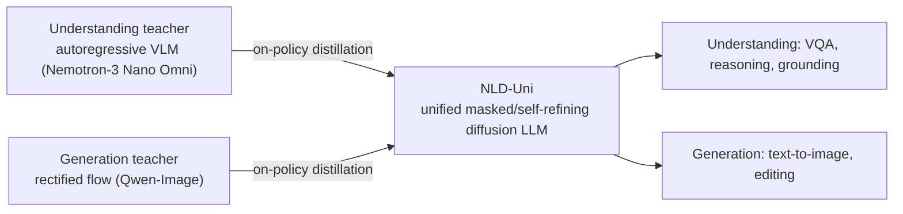
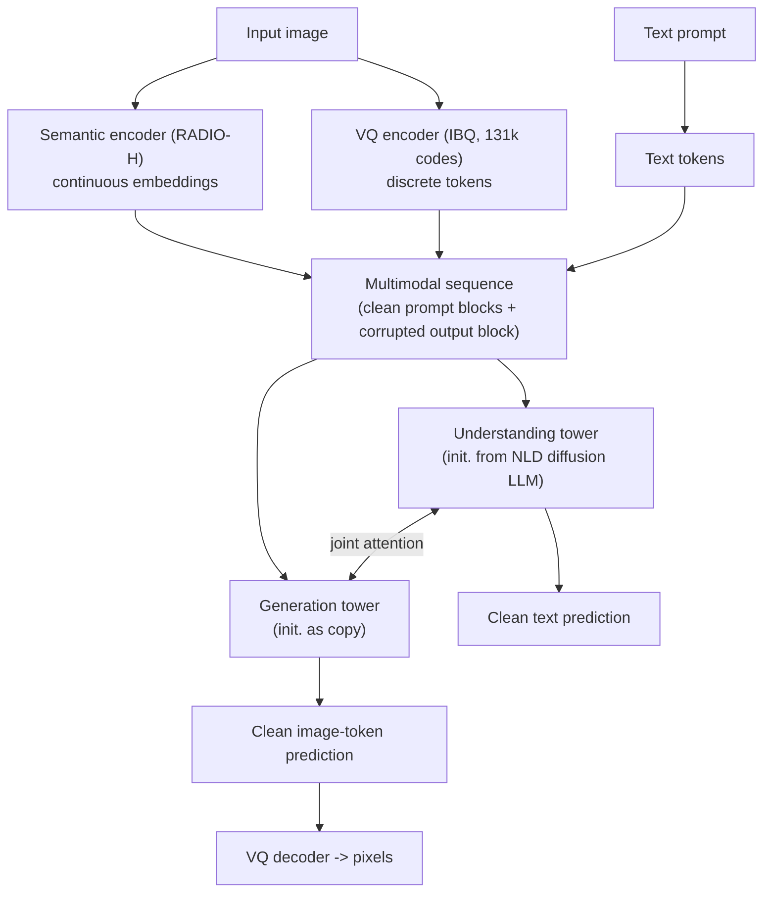
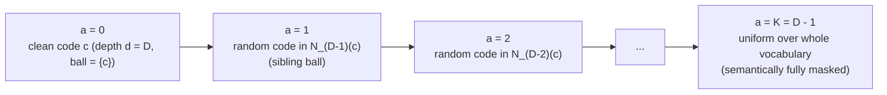
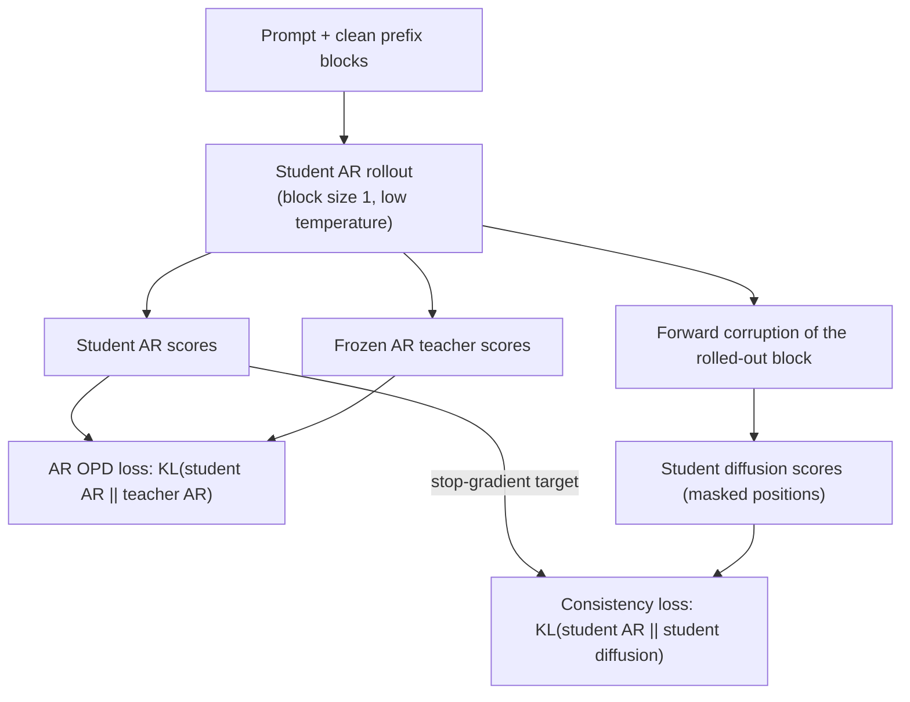
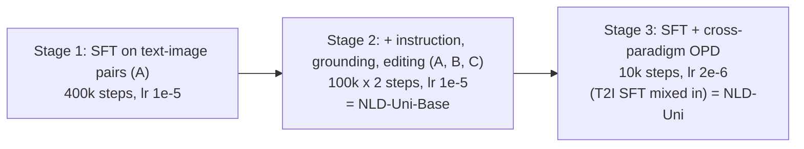

# Paper 09 — Nemotron-Labs-Diffusion-Uni: Elastic Self-Refining Unified Diffusion LLM with Cross-Paradigm On-Policy Distillation

> Reporting week: 2026-W44 (2026-10-26 to 2026-11-01, IST). Source read: local PDF `./paper-09.pdf` (33 pages, main text pp. 1–10, appendices A–D), text extracted locally from the PDF.

---

## A. Overview

| Field | Value |
|---|---|
| Title | Nemotron-Labs-Diffusion-Uni (NLD-Uni): Elastic Self-Refining Unified Diffusion LLM with Cross-Paradigm On-Policy Distillation |
| Authors | Shufan Li\*, Hanrong Ye\*, Greg Heinrich\*, Yonggan Fu, Haotian Zhang, Sifei Liu, Aditya Grover, Pavlo Molchanov (\* core contribution) |
| Institutions | **The PDF lists no per-author affiliations.** It is an NVIDIA-branded report ("© 2026 NVIDIA. All rights reserved." footer; model released at `huggingface.co/nvidia/NLD-Uni`, code at `github.com/NVlabs/...`). Individual affiliations (e.g. any university affiliation for Aditya Grover) are **not stated in the paper**. |
| Identifier | arXiv:2610.36466v1 [cs.CV] |
| Date | arXiv v1 2026-10-27 (the PDF header is dated 2026-10-28); this is the version analysed |
| Status | **New** (first published inside the reporting week) |
| Area | Diffusion LLMs, unified multimodal understanding + generation |
| Official link | https://arxiv.org/abs/2610.36466v1 (HTML: https://arxiv.org/html/2610.36466v1) |
| Local PDF | [./paper-09.pdf](./paper-09.pdf) |
| Code / model (hyperlinks on the PDF title page) | https://github.com/NVlabs/Nemotron-Labs-Diffusion-Uni · https://huggingface.co/nvidia/NLD-Uni |

**Abstract (paraphrased).** NLD-Uni is a single discrete-diffusion LLM that both understands images (VQA, reasoning, grounding) and generates/edits them. Two innovations: (1) **cross-paradigm on-policy distillation (OPD)** that transfers understanding from an autoregressive VLM teacher and generation from a continuous rectified-flow teacher into a discrete diffusion student; (2) a **progressive self-refining diffusion process** in which image tokens are corrupted through intermediate states (not a single jump to `[mask]`), so at inference a token can be committed early and then refined. The authors report state-of-the-art results among unified diffusion LLMs across understanding, reasoning, grounding, text-to-image and editing.

---

## B. Problem

**What it solves.** Unified multimodal models come in three families: all-autoregressive over discrete tokens (Emu3, Janus-Pro), AR text + continuous diffusion images (BAGEL, Cosmos), and unified discrete diffusion (MMaDA, LaViDa-O, LLaDA2-Uni). The third has a single objective and parallel decoding, but lags specialist AR VLMs on understanding and continuous flow models on image quality.

**Why it matters.** A single diffusion LLM that can decode many tokens per step is attractive for speed and simplicity; closing the quality gap makes the paradigm practical.

**Prior limitations.**
1. **No strong teachers in the same paradigm.** On-policy distillation works well for AR VLMs and for flow models, but there is no strong masked-diffusion teacher, and AR / flow teachers speak a different "language" (next-token logits / continuous latents) from a masked-diffusion student.
2. **No self-correction in masked image diffusion.** In masked diffusion models (MDMs) a token jumps from `[mask]` straight to a final value and never changes; tokens unmasked in the same step are sampled independently even though image tokens are highly correlated. Existing fixes (special unmasking orders such as Halton; remasking/token-editing) rely on heuristic confidence thresholds and create train/inference mismatch. MDM-Prime's sub-token partial masking was only shown at 32×32 and failed to converge in the authors' 1024×1024 setting (Appendix C.1.1, Fig. 15).

**Gap addressed.** A distillation recipe that bridges paradigms, and a corruption process with intermediate states that allows coarse-to-fine refinement of discrete image tokens.

---

## C. Fundamentals

**Concrete example first.** Picture a 4-token sentence "Jason visited San Francisco". An AR model writes it left to right. A *masked diffusion* model starts from "[m] [m] [m] [m]" and, over a few steps, fills in several positions at once — e.g. step 1 "Jason [m] [m] Francisco", step 2 the rest. Once a word is written it is never revised. For images (thousands of VQ tokens), never revising is costly: two adjacent patches unmasked in the same step may disagree.

Terminology:
- **Vector-quantised (VQ) image tokens.** An image is encoded into a grid of discrete codes from a codebook (NLD-Uni: 131k codes, IBQ tokenizer). Generating an image = generating these codes; a VQ decoder maps them back to pixels.
- **Masked diffusion model (MDM).** Forward process: each token is independently replaced by `[m]` with probability \(t\in[0,1]\). The network predicts clean tokens from a partially masked sequence; loss is cross-entropy weighted by \(1/t\).
- **Block / semi-autoregressive diffusion (SBD).** Split the sequence into blocks; generate blocks left-to-right (causal across blocks), tokens within a block in parallel (bidirectional within a block). Block size 1 = an ordinary AR model ("AR view"). NLD-Uni treats a whole image as one block.
- **Mixture-of-Transformers (MoT).** Separate parameter towers per modality/task that share attention over a common sequence ("joint attention").
- **On-policy distillation (OPD).** The *student* generates; the *teacher* scores the student's own samples (reverse-KL per token). Avoids the exposure bias of training on teacher-generated text.
- **Rectified flow.** Continuous generative model that interpolates linearly between data latents and Gaussian noise, \(x_r=(1-r)x_0+r\delta\), and learns to integrate back with an ODE.
- **Ball tree.** Balanced binary tree over points (here, VQ code embeddings); each node is a ball; parents are bigger balls. Siblings are near neighbours.

---

## D. Core contribution

1. **Elastic Mixture-of-Transformers (Elastic-MoT) model** following LaViDa-O: an understanding tower (initialised from the NLD diffusion LLM) and a generation tower (initialised as a copy) linked by joint attention. Three "views" load only needed weights (Fig. 2): VLM view 8B active (understanding branch), T2I view 12B active (4B understanding + 8B generation), interleaved view 16B active (both full branches). Input images are encoded by both a semantic encoder (RADIO-H) and a VQ encoder (IBQ); output images are VQ codes only (Fig. 3).
2. **Self-refining discrete diffusion (Sec. 3.2).** State space \(\mathcal{V}\times\mathcal{A}\) with token age \(a\in\{0,\dots,K\}\) instead of \(\mathcal{V}\cup\{[m]\}\). Corruption moves a token to a random code in progressively larger ball-tree neighbourhoods of its VQ embedding; age \(K\) = uniform over the vocabulary (fully uninformative). Each token is corrupted during its own time window \((\tau_i,\tau_i+\epsilon)\) (non-Markov DNDM-style schedule), so at inference tokens are committed coarsely and then refined over several steps.
3. **Cross-paradigm OPD for understanding (Sec. 3.3).** "Transitive" distillation: AR teacher → student's AR view (block size 1) via reverse KL on the student's AR rollouts; student's AR view → student's diffusion view via a self-consistency KL on masked positions (stop-gradient on the AR target).
4. **Cross-paradigm OPD for generation (Sec. 3.4).** For image editing, the student's output is re-encoded into the flow teacher's (Qwen-Image) VAE latent, partially noised (\(r=0.9\) best), re-denoised by the teacher with multiple ODE steps, re-tokenised to VQ, and used as an SFT target — a "teacher-refined student output".

**What differs from prior work.** OPD-LM distils an AR model into a *same-weights* diffusion copy by copying teacher scores to the diffusion view; NLD-Uni shows that this yields ill-formed targets when teacher and student differ (Table 2 "Naive OPD" collapses). Prior unified DLLMs (MMaDA, LaViDa-O) use plain masked diffusion with no self-refinement.

---

## E. Architecture deep dive

Full architecture document: [../architectures/paper-09-architecture.md](../architectures/paper-09-architecture.md). Raw system diagram: [../diagrams/paper-09-system.mmd](../diagrams/paper-09-system.mmd).

### E.1 Level 1 — Concept: cross-paradigm teachers into one DLLM — **[From paper: Fig. 1 (left)]**, redrawn



### E.2 Level 2 — Components: tokenisation and Elastic-MoT — **[From paper: Figs. 2–3]**, redrawn



Elastic views (Fig. 2): VLM view = understanding tower only (8B active); T2I view = half the understanding layers (4B) + generation tower (8B) = 12B; interleaved view (reason, locate, then edit) = both full towers, 16B.

### E.3 Level 3a — Self-refining corruption of one image token — **[From paper: Fig. 4 / Fig. 11]**, redrawn as a flow



Timing: token \(i\) stays clean on \([0,\tau_i]\), ages uniformly through \((\tau_i,\tau_i+\epsilon)\), stays at age \(K\) on \([\tau_i+\epsilon,1]\). Reverse direction at inference = coarse-to-fine refinement.

### E.4 Level 3b — Understanding OPD (transitive distillation) — **[From paper: Fig. 5]**, redrawn



### E.5 Level 3c — Generation OPD (teacher-refined student output) — **[From paper: Fig. 6, Algorithm 1 (Appendix A.4)]**, redrawn

```mermaid
flowchart LR
    IN["Input image + edit instruction"] --> ST["Student rollout X_out<br/>(self-refining diffusion)"]
    ST --> DEC["VQ decode -> pixels"]
    DEC --> VAE["Teacher VAE encode -> x_0"]
    VAE --> NZ["Add noise: x_r = (1 - r) x_0 + r * delta"]
    NZ --> ODE["Teacher multi-step ODE denoise -> x_hat_0"]
    ODE --> RE["VAE decode, VQ re-encode, stop-grad -> X_hat_0"]
    RE --> COR["Corrupt with Eq. 18 -> X_hat_t"]
    COR --> LOSS["SFT loss: -(1/t) log p(X_hat_0 given X_hat_t, image, instruction)"]
```



### E.6 Training pipeline — **[Conceptual reconstruction]** from Sec. 4.1 and Table 5



---

## F. Low-level mechanics

Named dims: \(L\) sequence length, \(N\) block size, \(K_b\) number of blocks, \(H_{img}\times W_{img}\) VQ grid (image block size \(=H_{img}W_{img}\), resolution-dependent), \(|\mathcal{V}|\approx 131\text{k}\) image codes (plus text vocabulary), \(d\) hidden size (not reported in the pages read).

### F.1 SBD training objective (Eq. 1)

$$
\mathcal{L}_{\text{SBD}}=\mathbb{E}_{i\sim\{1..N\},\,t\sim U[0,1],\,X\sim\mathcal{D}}\Big[-\tfrac{1}{t}\log p\big(B^0_i\mid B^0_{j<i},\,B^t_i\big)\Big]
$$

- \(X=[B^0_1,\dots,B^0_N]\): sequence split into clean blocks (here \(N\) indexes blocks).
- \(B^t_i\): block \(i\) corrupted to noise level \(t\) (each token masked with prob. \(t\)).
- \(B^0_{j<i}\): all preceding clean blocks (causal context).
- \(1/t\): standard MDM ELBO weighting — lightly corrupted examples weigh more per masked token.
- \(\mathcal{D}\): data distribution.

**Two-stream training (Appendix A.1, Fig. 10).** Input is the concatenation \([B^0_1..B^0_K,\ B^t_1..B^t_K]\) (length \(2L\)). Attention mask: clean tokens are causal; a noisy block attends to itself bidirectionally and to all preceding *clean* blocks. AR cross-entropy on the clean stream (AR view) and diffusion cross-entropy on the noisy stream are computed in one forward pass; block size is randomised per step, and image tokens of one image always share a block. Logits: \(\mathbb{R}^{B\times 2L\times|\mathcal{V}|}\).

### F.2 Masked-diffusion forward marginal and reverse step (Appendix Eqs. 5, 7)

$$
q(X^t_{b,i}\mid X^0_{b,i})=(1-t)\,\mathbf{X}^0_{b,i}+t\,\mathbf{M},\qquad
p_\theta(X^s_{b,i}\mid\cdot)=\begin{cases}\mathbf{X}^t_{b,i}, & X^t_{b,i}\neq[M]\\ \frac{t-s}{t}\,p_\theta(X^0_{b,i}\mid B^0_{j<b},B^t_b)+\frac{s}{t}\mathbf{M}, & X^t_{b,i}=[M]\end{cases}
$$

- \(\mathbf{X}\), \(\mathbf{M}\): one-hot vectors of the clean token and the mask token.
- \(0\le s<t\le 1\): going from noise level \(t\) to a cleaner \(s\); a masked token is revealed with probability \((t-s)/t\). Unmasked tokens are frozen — the property NLD-Uni removes for images.

### F.3 Ball-tree corruption kernel (Eqs. 2, 9–12)

$$
U_{k|k-1}(u\mid c)=\frac{\mathbb{1}\{u\in N_{D-k}(c)\}}{|N_{D-k}(c)|},\qquad
U_{j|k}(u\mid c)=\frac{\mathbb{1}\{u\in N_{D-j}(c)\}}{|N_{D-j}(c)|},\qquad
U_{k|j}(c\mid u,\hat c)=U_{k|0}(c\mid\hat c)
$$

- \(c\): current code; \(u\): code after corruption; \(\hat c\): original clean code (at inference: model prediction).
- \(N_d(c)\): all codes sharing an ancestor with \(c\) at tree depth \(d\); \(N_1(c)=\mathcal{V}\) (root), \(N_D(c)=\{c\}\) (leaf). \(|N_{D-j}(c)|=2^j\) in a balanced binary tree.
- \(D\): tree depth = 18 for 131k codes; \(K=D-1=17\) ages. \(K\) is randomised per training step in \(\{1..17\}\) (skipping ages uniformly) for flexible inference.
- \(U_{K|k}(u|c)=Q(u)\): terminal age is uniform over the vocabulary (stationary, independent of \(c\)).
- Reverse: given the noisy code \(u\) at age \(j\) and a predicted clean code \(\hat c\), the less-corrupted state at age \(k<j\) is just a uniform draw from \(\hat c\)'s smaller ball — no learned transition beyond predicting \(\hat c\).
- **Memory trick:** a full pairwise distance matrix over 131k codes would need 32 GB VRAM; the 18-depth binary tree stored as a 1-D array takes 524 KB (Sec. 3.2).

### F.4 Per-token jump schedule (Eqs. 15–17)

$$
\tau_i\sim U([0,1-\epsilon]),\quad \tau_i'=\tau_i+\epsilon,\qquad
a_i(t)=\begin{cases}0, & t\le\tau_i\\ \lfloor K(t-\tau_i)/\epsilon\rfloor, & \tau_i<t<\tau_i'\\ K, & t\ge\tau_i'\end{cases}
$$

- \(\tau_i\): when token \(i\) starts being corrupted; \(\epsilon\in(0,1]\): length of its corruption window.
- \(\epsilon\to 0\): one-jump DNDM (equivalent marginals to vanilla MDM); \(\epsilon=1\): all tokens corrupted at the same rate.
- Ages are deterministic once \((\tau_i,\tau_i')\) are pre-sampled; the forward kernel is then \(q(X^t_i=(u,a)\mid X^s_i=(c,a'))=b^t_i(a)\,U_{a|a'}(u|c)\) for \(a>a'\) (Eq. 18).
- In practice the authors parameterise inference by NFE (number of function evaluations) and \(N\) = refinements per token; \(N=8\) at 64 NFE is the default (Appendix C.2, Table 6).

### F.5 Understanding OPD (Eqs. 3, 20, 23–24)

$$
\mathcal{L}_{\text{OPD-und}}=\underbrace{D_{\mathrm{KL}}\big(p^{AR}_s(B^0_i\mid B^0_{j<i})\,\|\,p^{AR}_t(B^0_i\mid B^0_{j<i})\big)}_{\text{AR OPD}}+\underbrace{D_{\mathrm{KL}}\big(\mathrm{sg}[p^{AR}_s(B^0_i\mid B^0_{j<i})]\,\|\,p^{Diff}_s(B^0_i\mid B^0_{j<i},B^t_i)\big)}_{\text{consistency}}
$$

- \(p_s,p_t\): student and teacher; superscripts AR (block size 1) and Diff (block size \(N>1\)).
- \(B^0_i\): block rolled out by the student in AR mode (low temperature; 0.4 gave the best diffusion accuracy, Table 8); \(B^t_i\): its forward-corrupted copy.
- \(\mathrm{sg}\): stop-gradient; consistency KL evaluated only on masked positions, averaged with \(1/(K N t)\) weighting in Eq. 23.
- First term is reverse KL per token (MiniLLM-style OPD), averaged over the \(L\) rollout tokens (Eq. 20).
- Why not copy teacher scores to the diffusion view (OPD-LM, Eq. 25)? The teacher's next-token distribution is conditioned only on the left context; the diffusion view also sees right context, so a teacher-preferred token can be ill-formed there ("[m] Francisco" → "New Francisco").

### F.6 Generation OPD (Eq. 26, Algorithm 1)

$$
x_r=(1-r)\,x_0+r\,\delta,\ \ \delta\sim\mathcal{N}(0,I);\qquad
\hat{\mathcal{L}}_{\text{OPD-Gen}}=-\frac{1}{t}\log p_\theta\big(\hat X^0\mid\hat X^t,V_{in},p\big)
$$

- \(x_0\): teacher-VAE latent of the student's decoded output; \(r\): refinement strength (0.9 best, Table 9); \(\delta\): Gaussian noise.
- \(\hat X^0=\mathrm{sg}[\mathrm{EncodeVQ}(\mathrm{DecodeVAE}(\hat x_0))]\): teacher-refined target in the student's token space; \(\hat X^t\): its corruption via Eq. 18; \(V_{in}\), \(p\): input image and instruction.
- It is an SFT loss, but on-policy because the target is built from the student's own rollout.

### F.7 Total loss, optimisation, compute

- Stage 3 objective = SFT (T2I and others) + \(\mathcal{L}_{\text{OPD-und}}\) (reasoning prompts, 76.8k samples) + \(\hat{\mathcal{L}}_{\text{OPD-Gen}}\) (editing prompts, 100k samples) (Appendix B.1). Relative weighting of terms: not reported in the pages read.
- AdamW, \(\beta=(0.99, 0.999)\); lr 1e-5 / 1e-5 / 2e-6; 400k / 2×100k / 10k steps (Table 5).
- Training: 64 H100 GPUs (8 nodes), 26 days total, of which OPD stage 5 days (Appendix B.3).
- **Complexity.** Within an image block attention is bidirectional, \(O((H_{img}W_{img})^2 d)\) per layer per step, repeated for NFE steps (64 by default) — but each step predicts all image tokens in parallel, versus \(H_{img}W_{img}\) sequential steps for AR image generation. Text uses block-causal attention with small blocks. Ball-tree sampling adds negligible cost (array lookups).

---

## G. Execution walkthrough

**Case: "Remove the red fruit from the cutting board" (interleaved view, Fig. 2).**

1. **Input encoding.** The photo is encoded twice: RADIO-H semantic embeddings (continuous) and IBQ VQ codes (discrete grid). The instruction is tokenised. These form clean prompt blocks.
2. **Reasoning text (diffusion over text blocks).** The model decodes a text block such as "I will remove the red apple … located at [120,464,388,704]" — block-by-block, tokens within a block unmasked in parallel by the understanding tower; standard binary masking is used for text.
3. **Image block initialisation.** The output image is one block of VQ positions, all at age \(K\) (uniform random codes = "fully masked").
4. **Sampling loop (64 NFE).** Each step, both towers run with joint attention; the generation tower outputs \(p_\theta(\hat c\mid\cdot)\) for every image position. For each token, its pre-sampled window determines its current target age; a token whose window has begun is re-sampled from the ball around the predicted \(\hat c\) at its new, smaller age (Eq. 12). Early in its window a token is only committed to a coarse neighbourhood (e.g. "some reddish-brown wood texture"); over ~8 refinement steps it narrows to a single code, and neighbouring tokens can adjust to each other.
5. **Finish.** All tokens reach age 0 → VQ decoder produces the edited 1024×1024 image.
6. **Training-time counterpart (OPD-Gen).** During stage 3 this student output would be VAE-encoded for Qwen-Image, noised at \(r=0.9\), re-denoised, re-tokenised and used as the target.

---

## H. Comparison with prior approaches

| Model family | Architecture | Training | Inference | Reported performance (this paper's tables) | Limitation |
|---|---|---|---|---|---|
| AR VLM (Qwen3-VL-8B) | causal decoder | SFT/RL | token by token | Table 1 avg 78.1; MathVista 77.2 | no image generation |
| AR + continuous diffusion (BAGEL) | MoT | separate AR + flow objectives | AR text, ODE images | Table 1 avg 65.6; GenEval 0.88 | balancing conflicting objectives |
| Unified masked DLLM (MMaDA, LaViDa-O, LLaDA2-Uni) | MDM (+ MoT for LaViDa-O) | masked diffusion SFT | parallel unmasking, no revision | LLaDA2-Uni Table 1 avg 61.2; ImgEdit 3.92 | quality gap; no self-refinement |
| MDM + token editing / remasking | MDM | MDM | heuristic remasking | below self-refining on GenEval/DPG/HPSv3 in Fig. 7 | threshold-sensitive, train/test mismatch |
| **NLD-Uni** | Elastic-MoT (8B+8B), self-refining discrete diffusion | 3-stage SFT + cross-paradigm OPD | parallel, coarse-to-fine refinement (64 NFE) | Table 1 avg 78.3; GenEval 0.89; HPSv3 11.12; ImgEdit 4.17 | needs strong external teachers; 64×H100 for 26 days |

---

## I. Experiments

**Understanding (Table 1).** NLD-Uni: MMMU 60.7, RealWorldQA 70.5, ChartQA 89.9, DocVQA 94.2, InfoVQA 84.0, TextVQA 76.2, AI2D 85.0, RefCOCO 94.1, ScienceQA 95.4, ScreenSpot-Pro 49.2, OCRBenchV2 62.1, **average 78.3**, +17.1 over the best prior discrete-diffusion model (LLaDA2-Uni 61.2) and slightly above Qwen3-VL-8B (78.1) and Cosmos3-Nano (77.9) on the table average. Largest gains vs diffusion SOTA: ScreenSpot-Pro +48.8, OCRBenchV2 +23.2. The authors attribute these gains "mostly" to scaling training data.

**Multimodal reasoning (Table 2).** NLD-Uni-Base → NLD-Uni (cross-paradigm OPD): MathVista 71.5 → 77.0, DynaMath 68.3 → 74.7, MathVision 35.8 → 45.4, MathVerse 35.5 → 45.3, Geometry3k 54.4 → 67.9, LogicVista 52.4 → 55.9, We-Math 59.8 → 74.9 (+15.1). Naive OPD (OPD-LM-style copying of teacher scores) *drops* to e.g. MathVista 47.7, We-Math 42.0.

**Text-to-image (Table 3).** NLD-Uni (12B active): GenEval 0.89 overall, DPG 86.6, **HPSv3 11.12** — above FLUX.1-dev (10.88) and Qwen-Image (10.91), and LLaDA2-Uni (9.47). No OPD teacher was used for T2I because the base model already beat candidates on GenEval/HPSv3 (Sec. 4.1).

**Image editing (Table 4, ImgEdit).** NLD-Uni overall **4.17** vs NLD-Uni-Base 3.81 (+0.36), off-policy KD 3.90 (+0.27 for OPD), LaViDa-R1 3.90, LLaDA2-Uni 3.92; below only Qwen-Image (4.27, the teacher) and GPT-4o (4.20).

**Ablations.**
- Self-refining vs uniform, masked, masked + token-edit diffusion over 20k steps at 64 diffusion steps (Fig. 7): best on average; comparable to uniform on GenEval, consistently better on DPG and HPSv3 (largest gain on HPSv3).
- Refinement steps (Table 6, HPSv3): at 64 NFE, \(N=1\): 11.0051, \(N=8\): 11.1050; at 4 NFE \(N=1\) is best (7.37) and \(N=4\) collapses (−2.49). \(\epsilon=1\) (\(N=\)NFE) works poorly.
- OPD objective variants (Fig. 16, Appendix C.3.1): only AR-OPD+Consistency and AR-OPD+SFT improve the diffusion view; consistency-only collapses to 24.1 MathVista at 400 steps.
- Rollout temperature (Table 8): diffusion MathVista 73.9 (T=0), 74.8 (T=0.4), 74.6 (0.6), 73.8 (1.0).
- Teacher choice (Table 7, earlier checkpoint): Nemotron teacher → MathVista 78.10 vs Kimi K2.6 teacher → 71.60, despite Kimi being stronger (different tokenizer and thinking format).
- Noise ratio \(r\) for generation OPD: 0.9 best (Table 9).
- MDM-Prime: GenEval 0 after 20k steps at 1024×1024 (Appendix C.1.1).

**Speed.** Fig. 1 (right) reports multimodal-reasoning tokens/s and T2I / editing images/min against LLaDA2-Uni and BAGEL; the exact values are drawn on the chart and are not tabulated, so we do not reproduce them.

---

## J. Implementation

Official code and weights: https://github.com/NVlabs/Nemotron-Labs-Diffusion-Uni · https://huggingface.co/nvidia/NLD-Uni (linked from the PDF; not inspected here).

**Components to build:** NLD diffusion LLM backbone (block-diffusion, position-shifted SBD); Elastic-MoT duplication with joint attention; RADIO-H semantic encoder; IBQ VQ tokenizer/decoder (131k codes); ball tree over VQ code embeddings; sampler with per-token windows; OPD infra (AR teacher server, Qwen-Image VAE + flow teacher for refinement).

**Illustrative, not from the paper** — ball-tree corruption and the self-refining sampler step:

```python
import numpy as np

# Leaves ordered so that codes sharing an ancestor at depth d are contiguous blocks of size 2**(D-d).
# perm[k] = VQ code at leaf position k; pos[code] = leaf position. Built once by recursively
# splitting code embeddings (ball tree). D = 18 for ~131k codes (padded to 2**17 leaves).
D = 18
K = D - 1

def neighbourhood(pos_c, age):
    """Leaf positions of N_{D-age}(c): an aligned block of size 2**age."""
    size = 2 ** age
    start = (pos_c // size) * size
    return start, start + size

def corrupt(code, age, pos, perm, rng):
    s, e = neighbourhood(pos[code], age)
    return perm[rng.integers(s, e)]

def token_age(t, tau, eps, K=K):
    if t <= tau: return 0
    if t >= tau + eps: return K
    return int(np.floor(K * (t - tau) / eps))

def refine_step(pred_clean_codes, t_next, taus, eps, pos, perm, rng):
    """One reverse step: re-sample each token from the ball of its predicted clean code at its new age."""
    out = []
    for c_hat, tau in zip(pred_clean_codes, taus):
        a = token_age(t_next, tau, eps)
        out.append(c_hat if a == 0 else corrupt(c_hat, a, pos, perm, rng))
    return out
```

**Illustrative, not from the paper** — understanding-OPD loss sketch:

```python
import torch.nn.functional as F
def opd_und_loss(student, teacher, prompt, rollout_block, mask):
    s_ar = student.ar_logits(prompt, rollout_block)            # block size 1, T x V
    t_ar = teacher.logits(prompt, rollout_block).detach()
    ar_opd = F.kl_div(t_ar.log_softmax(-1), s_ar.log_softmax(-1), log_target=True, reduction="batchmean")  # KL(s || t)
    corrupted = student.forward_corrupt(rollout_block, mask)
    s_diff = student.diff_logits(prompt, corrupted)             # T x V
    tgt = s_ar.detach().log_softmax(-1)
    cons = F.kl_div(s_diff.log_softmax(-1)[mask], tgt[mask], log_target=True, reduction="batchmean")      # KL(sg AR || diff)
    return ar_opd + cons
```

**Hardware.** Reported training: 64 H100s for 26 days. Inference for the 16B interleaved view needs a large-memory GPU; the 8B VLM view loads only the understanding tower.

**Pitfalls.**
- Teacher/student mismatch (tokenizer, thinking format) can make a stronger teacher worse (Table 7).
- Never copy AR teacher scores directly to diffusion-view masked positions (Table 2 naive OPD).
- At low NFE, multi-step refinement hurts — use \(N=1\) (Table 6).
- The model can predict \(\hat c\) outside the current ball; the authors allow it (self-correction) and report no meaningful difference vs constraining it (Appendix A.2.1).
- Teacher refinement must use a high noise ratio yet still stays close to the student's output (r = 0.9).

---

## K. Limitations

- **Affiliations and some details not stated** (per-author institutions, hidden size, loss weights among stage-3 objectives).
- **Heavy dependence on external teachers** (Nemotron-3 Nano Omni, Qwen-Image); editing remains below the Qwen-Image teacher and GPT-4o (Table 4).
- **Understanding gains largely from data scaling** by the authors' own account (Sec. 4.1), so architecture vs data contributions are entangled; comparisons are against reported numbers of other models with different data.
- **Self-refinement only for images;** text still uses one-shot masking.
- **No OPD for text-to-image;** T2I quality relies on the base model.
- **Refinement fragility at low NFE** (Table 6), and the authors note failures when many tokens are refined simultaneously.
- **Cost:** 64 H100 × 26 days; 12–16B active parameters for generation views.
- Ablations of OPD were on reasoning-only post-training or earlier checkpoints, "not directly comparable" to the main run (Appendix C.3).
- Authors acknowledge better data mixture and architecture optimisation could improve the model further (Sec. 1).

---

## L. Learning takeaways

- **Block diffusion gives a free AR view** (block size 1). That makes AR teachers usable for diffusion students — distil into the AR view, then tie the diffusion view to it with a self-consistency KL.
- **Context mismatch is the core hazard** of cross-paradigm distillation: a teacher's left-to-right distribution is not a valid target where the student also sees right context.
- **Discrete diffusion can borrow continuous-diffusion behaviour** by using codebook geometry: corrupting tokens to progressively larger embedding-space neighbourhoods yields a smooth, refinable process (PSNR declines smoothly with age, Fig. 13).
- **Teacher-refined student outputs** (SDEdit-style partial noising by the teacher) are a practical way to do "on-policy" distillation from a continuous generator into a discrete one.
- **Elastic MoT** lets one checkpoint serve 8B / 12B / 16B-active task views.

**Study next:** masked diffusion LMs (MDLM, LLaDA), Block Diffusion / SDAR / Set Block Decoding, DNDM non-Markov discrete diffusion, MaskGIT and Meissonic, LaViDa-O (Elastic MoT), MiniLLM / GKD on-policy distillation, OPD-LM, rectified flow and SDEdit, ball trees.
