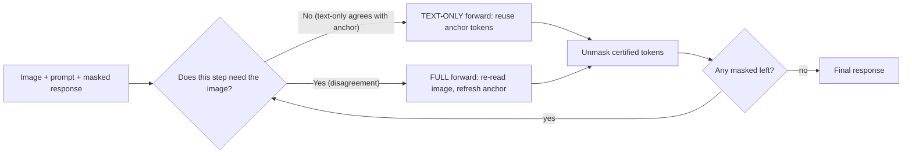
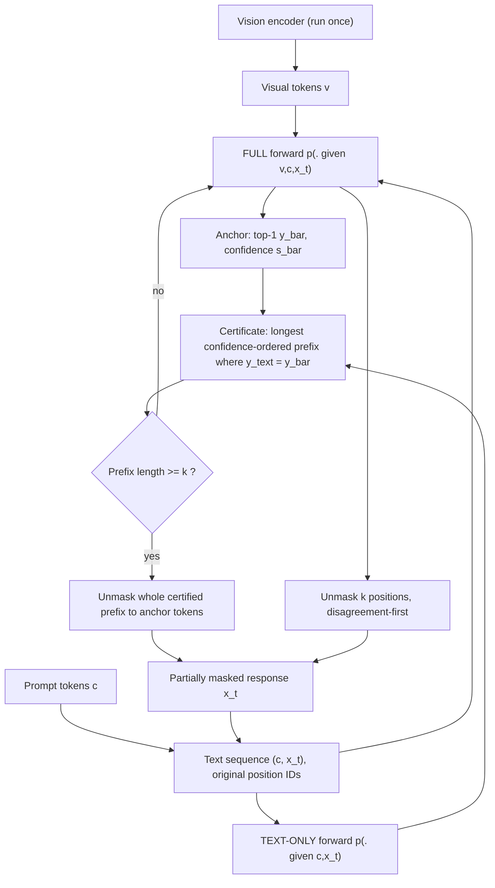
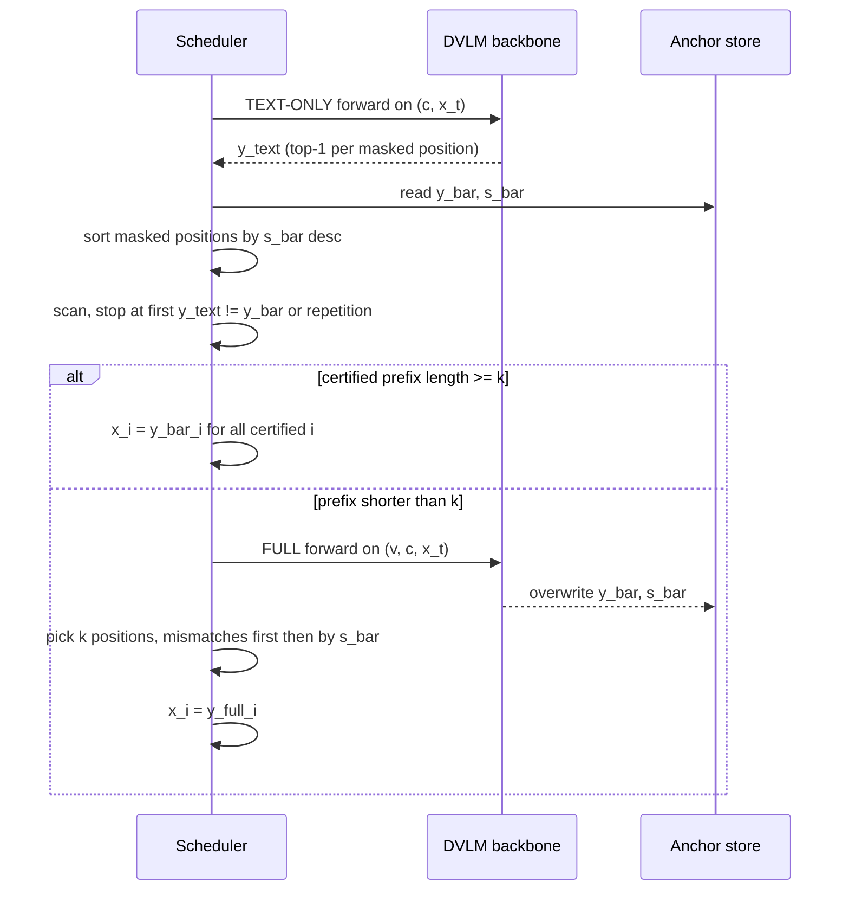

# Paper 10 — Look Only When Needed (LOWN): Certificate-Guided Visual Routing for Efficient Diffusion VLMs

## A. Overview

| Field | Value |
|---|---|
| Title | Look Only When Needed: Certificate-Guided Visual Routing for Efficient Diffusion VLMs |
| Authors | Donghyeon Cho\*, Joowon Kim\*, Seungho Shin, Eunho Yang† (\*equal contribution, †corresponding) |
| Institutions (confirmed from PDF p.1) | KAIST (all authors); AITRICS (Eunho Yang) |
| Identifier | arXiv:2610.36671v1 [cs.CV] |
| Date | First submitted 2026-10-27 (v1; this is the only version analysed) |
| Status | **New** (first published inside 2026-W44, 2026-10-26 → 2026-11-01 IST) |
| Official link | https://arxiv.org/abs/2610.36671v1 |
| Local PDF | [./paper-10.pdf](./paper-10.pdf) |
| Code / project | https://hyeon9698.github.io/LOWN/ (the paper states "Code and project page are available" there; a separate repository URL is not given in the PDF) |
| Areas | Multimodal, diffusion vision-language models (DVLMs), inference efficiency |

**Abstract (paraphrased).** Diffusion VLMs re-process the whole multimodal input at every denoising step, and visual tokens are 89–97% of that input on the studied benchmarks. Comparing LLaDA-V's predictions with and without the image along its own decoding trajectory, the authors find the image changes a token being unmasked on only 22.8% of steps on average (as low as 7.9%). LOWN runs a cheap *text-only* forward every step and only runs the expensive image-conditioned (*FULL*) forward when the text-only prediction disagrees with the last FULL prediction ("anchor"). Agreement "certifies" the anchor tokens, and the number of certified tokens also sets how many tokens are unmasked. Without training or a tuned threshold, LOWN keeps 99.6% of LLaDA-V's score on ten benchmarks at 35.3% of decoding FLOPs, transfers to LaViDa and VidLaDA, and composes with visual-token pruning and KV caching.

## B. Problem

- **What it solves.** Inference cost of *masked-diffusion* VLMs (LLaDA-V, LaViDa, VidLaDA). These decode a response by iteratively unmasking tokens over `T` steps. Because attention is bidirectional, exact autoregressive-style KV caching does not apply, so every step re-runs the full sequence — image tokens included.
- **Why it matters.** Visual tokens are 89–97% of LLaDA-V's input (Fig. 1b, Table 6, mean 94.4%), while a forward without them costs only 3–10% as much (Table 8, mean ρ between 2.54% and 10.07%). So most decoding compute is spent re-reading an unchanging image.
- **Prior limitations.** (1) Visual-token pruning (RedVTP, ZOO-Prune, D3ToM) shrinks each forward but *permanently loses* removed visual information and still reads the remaining image every step. (2) Approximate caches (Fast-dLLM, dLLM-Cache) reuse internal states but still process the image. (3) Parallel-unmasking schedules (KLASS, Prophet) run fewer steps but each step still reads the image. None asks *whether the current step needs the image at all*.
- **Gap.** A per-input, per-step decision of "read the image or not", made without training and without a hand-tuned threshold.

## C. Fundamentals

**Concrete example first.** Imagine captioning a photo: "There is a polar bear." After the model has decided the noun "bear" while looking at the photo, guessing the article "a" and the full stop "." does not require looking at the photo again — the text so far determines them. Only "polar" vs "brown" really depends on the image. LOWN formalises "do I need to look again?" with a cheap check.

**Masked diffusion language models (MDLMs).** Instead of generating left-to-right, the response starts as `L` `[MASK]` tokens. At each denoising step the transformer predicts a distribution over the vocabulary for *every* masked position in parallel; a scheduler then commits ("unmasks") the `k` most confident positions. After `T = L/k` steps, all are unmasked. LLaDA (Nie et al.) and its VLM version LLaDA-V use this "low-confidence remasking" scheme.

**Diffusion VLM (DVLM).** An image encoder produces visual tokens `v`; these are concatenated with prompt tokens `c` and the partially masked response `x_t`. The whole sequence is processed with bidirectional attention.

**Why no exact KV cache.** In an autoregressive model, earlier tokens never attend to later ones, so their keys/values never change. In a bidirectional diffusion model, unmasking any response token can change every token's hidden state, including the image tokens' — so exact reuse is impossible and approximate caches (e.g. Fast-dLLM) are used.

**Top-1 prediction and confidence.** For a masked position `i`, the top-1 token is the argmax of the softmax; its probability is the "confidence". Both come for free from any forward.

**Visual token pruning.** Dropping a fraction of visual tokens before decoding — reduces cost per forward but discards information.

## D. Core contribution

1. **Measurement (Sec. 3.2, Table 6).** Paired FULL vs TEXT-ONLY forwards along LLaDA-V's baseline trajectory: 83.4% of unmasked positions get the same top-1 token with or without the image; 85.0% of final tokens were already top-1 before being unmasked; image-dependent steps vary from 7.9% (MMBench) to 43.8% (DocVQA), and cluster early in decoding on 8 of 10 benchmarks (Fig. 2). So fixed schedules don't fit.
2. **LOWN decoding rule (Sec. 4, Alg. 1).**
   - Keep an **anchor** = top-1 predictions `ȳ` and confidences `s̄` from the latest FULL forward.
   - Each step, run a TEXT-ONLY forward (image tokens removed, position IDs preserved).
   - Scan masked positions in decreasing anchor confidence; a position is **certified** if the text-only top-1 equals the anchor's. The **longest certified prefix** is `𝒰_text` (with a repetition guard).
   - If `|𝒰_text| ≥ k`: skip the FULL forward and unmask *all* certified positions (can be more than `k`).
   - Else: run a FULL forward, refresh the anchor, and unmask `k` positions, putting positions where text and full disagree **first** ("disagreement-first order").
3. **Properties.** Training-free, threshold-free, never takes more than the baseline's `T` steps, orthogonal to pruning (pruning lowers cost per FULL forward; LOWN lowers how often FULL is run) and compatible with Fast-dLLM's KV cache.

What differs from prior work: the decision variable is *whether to read the image this step*, and the same agreement signal jointly decides *how many tokens to commit*.

## E. Architecture deep dive

Full architecture document: [../architectures/paper-10-architecture.md](../architectures/paper-10-architecture.md). Raw diagram: [../diagrams/paper-10-system.mmd](../diagrams/paper-10-system.mmd).

### Level 1 — concept **[Conceptual reconstruction]** (based on Fig. 1a)



### Level 2 — components **[From paper: Fig. 3 and Algorithm 1]** (redrawn)



### Level 3 — per-step execution **[Conceptual reconstruction]** from Algorithm 1



## F. Low-level mechanics

**Notation and shapes** (LLaDA-V numbers from App. B.2: `L=32` layers, `d=4096`, FFN width `m=12288`, vocabulary `|𝒱|=126,349`).

- Visual tokens `v`: `|v|×d`; prompt `c`: `|c|×d`; response state `x_t`: `|x_t|` positions (response length, e.g. 16–128, App. C.1).
- FULL input length `N_F = |v|+|c|+|x_t|`; TEXT-ONLY length `N_T = |c|+|x_t|`. Hidden states `N×d`; logits `N×|𝒱|` (only masked positions are used).
- Batch size 1 in the paper's experiments.

**FULL prediction (Eq. 1).**

$$\hat y^{\text{full}}_{t,i}=\arg\max_{w} p_\theta(y_i=w\mid v,c,x_t),\qquad \hat s^{\text{full}}_{t,i}=\max_{w} p_\theta(y_i=w\mid v,c,x_t)$$

- `t`: denoising step index; `i ∈ M_t`: a currently masked response position.
- `w`: a vocabulary token; `p_θ`: the DVLM's softmax output with parameters `θ`.
- `v, c, x_t`: visual tokens, prompt tokens, partially masked response.
- `ŷ^full_{t,i}`: the most likely token at position `i`; `ŝ^full_{t,i}`: its probability (confidence).
The TEXT-ONLY prediction `ŷ^text_{t,i}` is the same expression with `v` removed (`p_θ(·|c,x_t)`), keeping original position IDs.

**Certificate (Sec. 4.1).** Let `ȳ, s̄` be the anchor from the last FULL forward. Order masked positions by `s̄` descending: `i_1, i_2, …`. Then
`𝒰_text = {i_1,…,i_r}` where `r` is the largest index such that `ŷ^text_{t,i_j} = ȳ_{i_j}` for all `j ≤ r` (and no repetition-guard violation).

**State update (Eq. 2).**

$$x_i\leftarrow\begin{cases}\bar y_i, & i\in\mathcal U^{\text{text}},\ |\mathcal U^{\text{text}}|\ge k\\ \hat y^{\text{full}}_{t,i}, & i\in\mathcal U^{\text{full}},\ |\mathcal U^{\text{text}}|<k\end{cases}$$

- `x_i`: response token at position `i` (was `[MASK]`).
- `ȳ_i`: anchor token; `𝒰_text`: certified prefix; `k`: tokens the baseline unmasks per step (response length / `T`; `k=2` or `1` in the experiments).
- `𝒰_full`: the `k` positions chosen after a FULL forward, those with `ŷ^text ≠ ŷ^full` first, then by FULL confidence.

**Cost model (Eq. 3).**

$$R=\frac{F_{\text{LOWN}}}{F_{\text{base}}}=\frac{n_F}{T}+\frac{n_T}{T}\frac{\mathcal C(N_T)}{\mathcal C(N_F)}=f+\sigma\rho$$

- `F_base = T·𝒞(N_F)`: baseline FLOPs (T FULL forwards).
- `n_F`: number of FULL forwards LOWN runs; `n_T`: number of TEXT-ONLY forwards (= number of LOWN steps; every step has one).
- `f = n_F/T`: FULL frequency; `σ = n_T/T ≤ 1`: relative step count; `ρ = 𝒞(N_T)/𝒞(N_F)`: relative cost of a TEXT-ONLY forward.
- With pruning ratio cost `π`, composition costs `πf + σρ` (Sec. 4.3).

**Per-forward FLOPs (Eq. 4).**

$$\mathcal C_{\text{layer}}(n)=8nd^2+4n^2d+6ndm,\qquad \mathcal C(n)=L\cdot\mathcal C_{\text{layer}}(n)+2nd|\mathcal V|$$

- `n`: tokens in the forward; `d`: hidden width; `m`: FFN width; `L`: layers; `|𝒱|`: vocabulary size.
- `8nd²`: Q/K/V/O projections; `4n²d`: `QKᵀ` and `AV` (quadratic); `6ndm`: three gated-FFN matrices; `2nd|𝒱|`: LM head. A multiply-add counts as 2 FLOPs.
- Because of the quadratic term, removing `v` (which shrinks `n` ~9–33×) cuts cost by more than the length ratio — hence ρ of 2.5–10% (Table 8).

**Training / backprop / loss.** Not applicable: LOWN is a pure inference-time decoding rule; no parameters are trained or changed, and the attention pattern is unchanged (Sec. 4).

**Complexity and memory.** Each step costs one TEXT-ONLY forward `O(L(N_T d² + N_T² d))` plus, on a fraction `f` of steps, a FULL forward `O(L(N_F d² + N_F² d))`. Extra memory: storing anchor tokens and confidences — `O(|x_t|)` scalars. Image is encoded once and the visual embeddings reused for FULL forwards (Sec. 5.1).

## G. Execution walkthrough

Using the paper's Fig. 3 toy example ("There is a [polar/brown] bear ."), `k = 2` assumed for illustration:

1. **Init.** Response = 6 masks. Alg. 1 line 1 runs one TEXT-ONLY draft, then a FULL forward (line 3): anchor `ȳ` = "There is a brown bear ." with confidences. `k` positions unmasked (disagreement-first) → e.g. "? ? ? ? bear ?" becomes partially filled.
2. **Step t (text-only succeeds).** TEXT-ONLY forward on prompt + "There is ? ? bear ?" (no image). Ordered by anchor confidence, text-only predictions match the anchor for "There", "is", ".", "a" … the first mismatch ("polar" vs anchor "brown") stops the scan. Prefix length ≥ k → unmask all certified positions using anchor tokens. No image read.
3. **Step t+1 (text-only fails).** Remaining mask is the adjective. TEXT-ONLY says "polar", anchor says "brown" → prefix length 0 < k → run FULL forward with the image; new anchor; the mismatched position goes first in the unmask order → "brown" committed from the FULL prediction.
4. **Done.** "There is a brown bear ." — the image was read only on the steps where it mattered.

Intermediate representations: visual embeddings (cached once), hidden states per forward, per-position top-1/confidence arrays (anchor and text-only), a sorted index list, the certified prefix set, and the updated token array `x`.

## H. Comparison with prior approaches

| Approach | What it changes | Training | Inference behaviour | Reported performance (LLaDA-V, FLOPs-matched, Table 1) | Compute | Limitations |
|---|---|---|---|---|---|---|
| LLaDA-V baseline | — | — | FULL forward every step, unmask k | 100% | 1.0× | Re-reads image every step |
| RedVTP (visual-token pruning) | Which visual tokens each forward sees | None | Prunes via masked-response attention | 93.0% avg at ×0.392 | Fixed ratio | Loses pruned evidence |
| ZOO-Prune | Which visual tokens (zeroth-order sensitivity) | None | Select once, reuse | 94.2% at ×0.405 | Fixed ratio | Loses evidence; code built for AR LLaVA |
| KLASS (schedule) | How many tokens per step | None (thresholds tuned per benchmark) | Confidence + KL stability | 91.9% at ×0.423 | Fewer steps | Task-specific thresholds |
| Fast-dLLM (approx. KV cache) | Reuse of internal states | None | Block-wise cache | Table 2: e.g. MathVista 57.30 at 0.0856 FLOPs | Much cheaper per forward | Still reads image every forward |
| **LOWN** | **Whether to read the image + how many tokens** | **None, no threshold** | Text-only check every step, FULL on disagreement | **99.6% at ×0.353** | Adaptive per input | Cost not fixed in advance; weaker savings on chart/doc reading |

## I. Experiments

- **Models.** LLaDA-V (main), LaViDa, VidLaDA-8B (video).
- **Benchmarks.** MathVista, ScienceQA, ChartQA, MME, MMBench, DocVQA, GQA, LLaVA-Bench, CapArena, DeCapBench; video: EgoSchema (500-q subset), MLVU (502-q test).
- **Metrics.** Task-specific scores; analytical decoding FLOPs relative to baseline (vision encoder excluded, adds 0.16–1.89%); wall-clock time on NVIDIA H200 at batch 1. Judges: GPT-4o (MathVista extraction, CapArena, LLaVA-Bench), GPT-3.5-turbo (MMBench fallback), Qwen3.5-35B-A3B (DeCapBench) (App. C.2).
- **Protocol.** Greedy, temperature 0, CFG 0; competitors given the cheapest grid setting with **at least** LOWN's FLOPs (App. C.3).

**Main results (reported):**

| Result | Value | Source |
|---|---|---|
| LOWN avg. relative score / FLOPs on LLaDA-V | 99.6% at ×0.353 | Table 1 |
| Best accelerated method on | 8 of 10 benchmarks | Table 1 / Sec. 5.2 |
| Capped-at-100% average | 98.6% | Sec. 5.2 |
| RedVTP / ZOO-Prune / KLASS at ≥ LOWN's FLOPs | 93.0% / 94.2% / 91.9% | Table 1 |
| LOWN + RedVTP (r=50%) | 98.3% at ×0.223, best on all 10 | Table 1 |
| Extra FLOPs cut for RedVTP 50% / ZOO-Prune 33% | 57.6% / 60.6% | Sec. 5.2 (Table 11) |
| Fast-dLLM + LOWN vs Fast-dLLM | time −38.1% to −50.1%; FLOPs −44.1% to −58.9%; scores within 2.0 of LLaDA-V but below Fast-dLLM (−5.0 on LLaVA-Bench) | Table 2 |
| With KV cache, total speed-up vs model alone | 5.6–7.0× | Sec. 1 |
| LaViDa | 99.7% at ×0.174 | Fig. 5 / Sec. 5.2 |
| VidLaDA EgoSchema / MLVU | 60.2 vs 60.6 at 0.255×; 43.3 vs 41.8 at 0.272× | Table 3 |
| Wall-clock generation time reduction (standalone) | 57.4% avg, up to 73.2% | Sec. 5.2 |
| Time-matched comparison | LOWN 99.6% vs ≤ 94.6% for competitors | Table 10 / App. D.2 |

**Ablations.**
- *Schedules (Table 4):* vs a Random schedule matched to LOWN's FULL count, LOWN is 4.9–13.0% better (normalised); Period-4 uses similar compute on MathVista (×0.321 vs ×0.325) but scores 4.0 points lower (52.00 vs 56.00).
- *Visual routing vs adaptive acceptance (Table 5):* routing alone cuts FLOPs 27–68%; adaptive acceptance removes a further 21–43% and scores higher on 7 of 10 benchmarks.
- *Fewer uniform steps* (2× or 4× fewer) degrade performance (Table 12, referenced in Sec. 5.3).
- *Certificate reliability:* fresh FULL disagrees with certified tokens 4.1–11.0% for a one-step-old anchor, up to 25.3% on DocVQA at 8 steps old; on LOWN's own trajectories 2.2–4.7%; 92–97% of TEXT-ONLY-unmasked tokens use an anchor from the previous step (Table 16). An oracle schedule costs 0.33× vs LOWN's 0.35×.

## J. Implementation

**Components.** (1) A DVLM with a callable forward that can accept the sequence with or without visual embeddings while keeping position IDs; (2) an anchor buffer; (3) the scan with repetition guard; (4) the disagreement-first selector. Framework: PyTorch + the released LLaDA-V/LaViDa code.

**Pseudocode — Illustrative, not from the paper** (follows Algorithm 1):

```python
# Illustrative, not from the paper's official code
def lown_decode(model, vis_emb, prompt_ids, L, k, MASK):
    x = [MASK] * L
    y_text = model.top1(prompt_ids, x, vis=None)          # draft
    while MASK in x:
        logits = model.forward(prompt_ids, x, vis=vis_emb)  # FULL
        y_bar, s_bar = logits.argmax(-1), logits.softmax(-1).max(-1)
        masked = [i for i in range(L) if x[i] == MASK]
        # disagreement-first, then FULL confidence
        order = sorted(masked, key=lambda i: (y_text[i] == y_bar[i], -s_bar[i]))
        for i in order[:k]:
            x[i] = y_bar[i]
        while MASK in x:
            y_text = model.top1(prompt_ids, x, vis=None)    # TEXT-ONLY
            masked = sorted([i for i in range(L) if x[i] == MASK], key=lambda i: -s_bar[i])
            cert = []
            for i in masked:
                if y_text[i] != y_bar[i] or repeats_neighbor(x, cert, i, y_bar[i]):
                    break
                cert.append(i)
            if len(cert) < k:
                break                                       # certificate failed -> FULL
            for i in cert:
                x[i] = y_bar[i]
    return x
```

**Hardware.** Paper's timing: NVIDIA H200, one experiment per GPU, batch size 1 (App. D.1). LOWN itself needs no extra GPU memory beyond small buffers.

**Pitfalls.**
- TEXT-ONLY forward must **preserve original position IDs** of prompt/response tokens (Sec. 3.2, 5.1); re-indexing would change predictions.
- The **repetition guard** is needed: independently predicted adjacent positions can share the same token and produce repeated words (App. B.1).
- With Fast-dLLM, maintain **separate image-conditioned and TEXT-ONLY prefix caches** and take the union of selected tokens (App. D.3).
- Batch >1 is not evaluated; per-sample branching (some samples need FULL, others not) complicates batching — not reported in the paper.

## K. Limitations

- **Approximation error.** Reused anchor tokens can differ from a fresh FULL prediction, more often as the anchor ages (App. F.2) — LOWN is not exact.
- **Weaker on dense visual reading.** Chart and document tasks need the image more often (DocVQA 43.8% image-dependent steps), so savings are smaller (ChartQA ×0.576, Table 1).
- **Unpredictable cost.** The number of FULL forwards is decided during decoding, so the budget can't be fixed beforehand; combining with pruning partially restores control (Sec. 6).
- **Scope.** Evaluated only on LLaDA-based DVLMs at batch size 1 with greedy decoding; VidLaDA used a controlled protocol (128 tokens, 32 frames) different from its released evaluation (App. C.4).
- **LLM judges** score several benchmarks; same judge across methods, but absolute numbers depend on them.
- **Open questions.** Behaviour at large batch sizes, with sampling temperature > 0, and for very long responses; whether a learned router could beat the agreement rule.

## L. Learning takeaways

- **Measure redundancy before optimising.** The paired FULL/TEXT-ONLY probe is a cheap, general diagnostic for "how much does modality X actually influence the decision?"
- **Agreement as a free certificate.** Comparing a cheap model call against a cached expensive one is a reusable pattern (cf. speculative decoding's draft-then-verify, but here the verifier is the *cached past*).
- **Orthogonal efficiency axes compose.** Cost = frequency × per-call cost; pruning, caching, and routing attack different factors (Eq. 3).
- **Study next:** LLaDA / LLaDA-V, masked diffusion LMs (MDLM, Sahoo et al.), Fast-dLLM, speculative decoding, early-exit and token-routing methods (Mixture-of-Depths), visual token pruning (FastV, SparseVLM, VisionZip).
