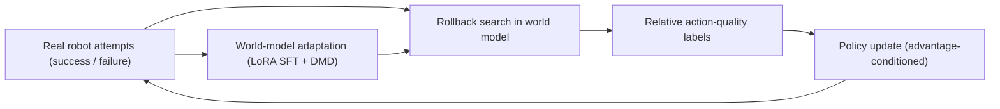
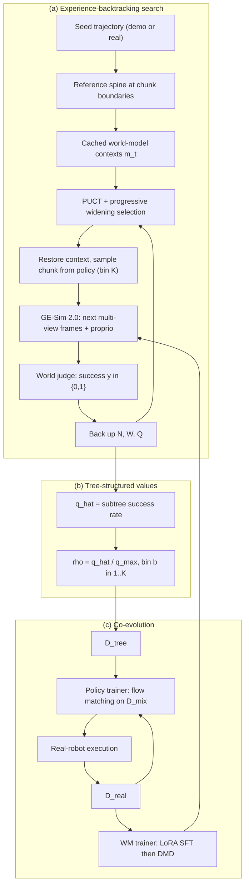
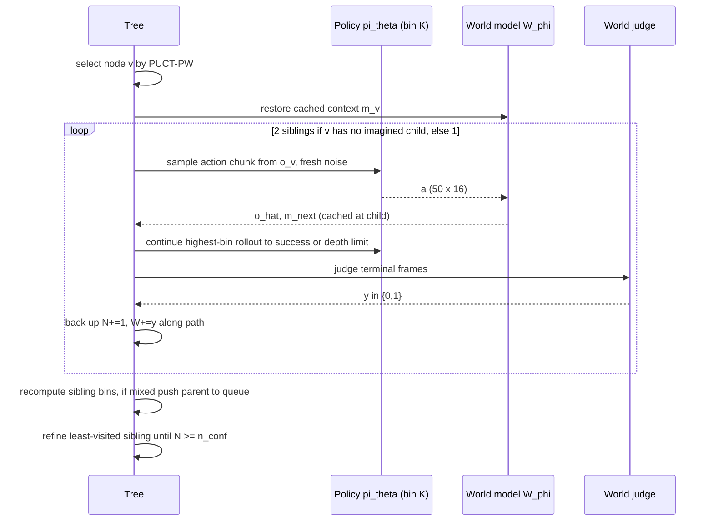

# Paper 11 — Rollback: Experience Backtracking in World Models for Policy Improvement

## A. Overview

| Field | Value |
|---|---|
| Title | Rollback: Experience Backtracking in World Models for Policy Improvement |
| Authors | Jiayi Luo\*, Yang Zhang\*, Liliang Chen\*† (project leader), Nan Wang, Chen Gao, Boxiang Qiu, Zhuoxuan Li, Baorui Peng, Chuankang Li, Yuxiang Yan, Si Liu, Qingyun Sun, Shuicheng Yan, Maoqing Yao, Jianxin Li⋄, Guanghui Ren⋄ (\*equal contribution, ⋄corresponding) |
| Institutions (confirmed from PDF p.1) | AgiBot; BUAA (Beihang University); NUS (National University of Singapore) |
| Identifier | arXiv:2610.36068v1 [cs.RO] |
| Date | First submitted 2026-10-26 18:01 UTC (23:31 IST); v1 is the version analysed |
| Status | **New** (inside 2026-W44, 2026-10-26 → 2026-11-01 IST) |
| Official link | https://arxiv.org/abs/2610.36068v1 (HTML: https://arxiv.org/html/2610.36068v1) |
| Local PDF | [./paper-11.pdf](./paper-11.pdf) |
| Project page | https://rollback-wm.github.io/ |
| Code repo | Not reported in the paper |
| Areas | Reinforcement learning, world models, real-robot learning, VLA post-training |

**Abstract (paraphrased).** World-model-based robot RL usually treats the world model as a forward-only simulator. Rollback exploits something a physical environment cannot do: **rewind** to a past decision point and branch into alternative actions. It runs Monte Carlo tree search inside a video world model, starting from real robot trajectories, compares sibling actions' downstream outcomes to obtain action-level advantage labels (no learned value model), and trains a π0.5 policy with advantage-conditioned flow matching. A cloud–edge system runs distributed search concurrently with asynchronous real-robot execution, and real transitions continually correct the world model via LoRA SFT + DMD ("test-time physics grounding"). On three real tasks it beats the strongest baseline by absolute 10.67 / 11.11 / 11.85 points and surpasses average human players on ball tossing and tabletop curling within 8 hours.

## B. Problem

- **What it solves.** Sample-efficient improvement of a generalist robot policy (VLA) on real tasks where real trials are slow, need manual resets, and produce only binary success/failure.
- **Why it matters.** Physical RL is expensive; world models promise "practice in imagination", but existing methods (World-Env, WMPO, World-Gymnast, RISE, WoVR) improve unsteadily.
- **Prior limitations (Sec. 1, Fig. 1).**
  1. *Uninformative exploration:* independent forward rollouts spend budget regenerating shared prefixes and can't focus on the few decisions that determine the outcome.
  2. *Sparse credit assignment:* trajectory-level success doesn't reveal which action mattered; learned value models add bias.
  3. *Biased world-model predictions:* as the policy improves, it visits states the world model saw least, and search can exploit model errors.
- **Gap.** Use the world model's unique ability to restore a cached context and branch, anchored on *real* decision points, plus keep the world model grounded with real data during training.

## C. Fundamentals

**Concrete example first.** A robot pushes a curling stone. It fails: the stone stops short. With a real robot you can't rewind to the instant before the second push and try a harder push. In a learned video simulator you can: save its internal state at that instant, try two different pushes, and see which one reaches the target. The difference between those siblings tells you precisely that *the push* was the decision that mattered.

- **Action-conditioned world model** `W_φ`: given past context `m_t` and an action, predicts the next observation (here: three camera views + proprioceptive state) and updates context.
- **Action chunk:** VLA policies output a block of `H` future actions (`H×d_a`), here 50 steps of 16-D joint/gripper commands at 30 Hz.
- **Monte Carlo Tree Search (MCTS):** repeatedly (1) select a node using a score balancing exploitation (high success) and exploration (few visits), (2) expand a new child, (3) roll out to a terminal outcome, (4) back up the outcome to ancestors.
- **PUCT:** the AlphaGo-style selection score `Q + c·P·√N_parent/(1+N_child)`.
- **Progressive widening:** in continuous action spaces, limit the number of children of a node to grow slowly with its visit count.
- **Advantage-conditioned policies (RECAP / CFG-style):** train the policy to generate actions conditioned on a quality label; at deployment ask for the best label, optionally with classifier-free guidance.
- **Flow matching:** a generative training objective in which the network predicts the velocity that moves noise toward data along a straight path.
- **LoRA:** low-rank adapters for cheap fine-tuning. **DMD (distribution matching distillation):** distils a many-step diffusion generator into a few-step one.

## D. Core contribution

1. **Experience-backtracking tree search (Sec. 4.1).** Build a "spine" from a real seed trajectory (success or failure) at action-chunk boundaries; its real outcome is backed up as the first evaluated branch. Cache GE-Sim 2.0 world-model contexts at each node; branch from them with policy-proposed action chunks; select with PUCT + progressive widening; expand two siblings per new branch; **disagreement-driven refinement** spends more rollouts on sibling groups whose outcomes differ until each has `n_conf` visits.
2. **Tree-structured value estimation (Sec. 4.2).** Chunk value = empirical success rate of leaves in its subtree; normalise by the best sibling; discretise into `K=5` bins; groups whose siblings all fall in one bin are discarded. No learned critic — only a success classifier (GE-Sim 2.0 "world judge").
3. **Advantage-conditioned policy update** (RECAP-style) of π0.5 with flow matching on a mixture of tree samples, demos, and real trajectories.
4. **World model–policy co-evolution / test-time physics grounding (Sec. 4.3).** Continually adapt the world model on newly collected real trajectories with 400 LoRA-SFT steps + 100 DMD steps per adaptation.
5. **Asynchronous cloud–edge–device training system (Sec. 5).** 40 H200 GPUs for search, 8 for policy training, one physical robot; version-pinned search jobs; an "Experience Fabric" data pool; no process waits on another.

How it differs: AlphaGo/MuZero search with exact simulators or latent models; Go-Explore returns to states in exact simulators; RISE uses forward rollouts + a learned progress value model. Rollback searches inside a *video* world model, starting from *real* decision points, and derives values from sibling comparisons.

## E. Architecture deep dive

Full architecture document: [../architectures/paper-11-architecture.md](../architectures/paper-11-architecture.md). Raw diagram: [../diagrams/paper-11-system.mmd](../diagrams/paper-11-system.mmd).

### Level 1 — concept **[From paper: Fig. 1 and Fig. 2]** (redrawn)



### Level 2 — components **[From paper: Fig. 2]** (redrawn)



### Level 3 — search inner loop **[Conceptual reconstruction]** from Algorithms 2 and 3



## F. Low-level mechanics

**Problem formulation (Sec. 3.1).** Instruction `g`; observation `o_t` = 3 RGB views (mapped to a 384×512 canvas, App. B) + proprioception (7 arm joints + 1 gripper per arm). Policy outputs action chunk `a_t ∈ ℝ^{H×d_a}`, `H=50`, `d_a=16`. World model step:

$$(\hat o_{t+1}, m_{t+1}) \sim \mathcal W_\phi(\cdot \mid m_t, a_t, g)$$

- `m_t`: retained temporal context (an explicit, cacheable data structure); `a_t`: action chunk; `g`: instruction; `ô_{t+1}`: predicted multi-view frames + proprio state; `φ`: world-model parameters. GE-Sim 2.0 generates 25 frames per action chunk at 16 fps (Table 5).

Objective: `J(π_θ) = E_{τ∼π_θ}[y_τ]`, `y_τ ∈ {0,1}` episode success.

**Experience backtracking (Eq. 1).**

$$m_t \xrightarrow{\text{RESTORE}} \{(\hat o^{(i)}_{t+1}, m^{(i)}_{t+1}) \sim \mathcal W_\phi(\cdot\mid m_t, a^{(i)}_t, g)\}_{i=1}^{n}$$

- `n` alternative chunks `a^{(i)}_t` all branch from the same restored context; the shared prefix is never regenerated, so a branch's cost depends only on its own length.

**Selection (Eq. 2).**

$$U(v,u) = Q(u) + c_{\text{puct}}\,P(u\mid v)\,\frac{\sqrt{1+N(v)}}{1+N(u)}$$

- `v`: parent node; `u`: child; `Q(u) = W(u)/N(u)`: empirical success rate (accumulated return / visits); `N(·)`: visit count; `P(u|v)`: prior, uniform over existing children; `c_puct = 1.5` (Table 5).
- Progressive widening: at most `⌈c_pw · max(1,N(v))^α⌉` children, `0<α<1` (`(c_pw, α)` = (1.5, 0.5) / (4.0, 0.5) / (1.5, 0.5) per task). A zero-valued virtual child with prior `1/(|C(v)|+1)` competes for "expand new action".

**Chunk value (Eq. 3).**

$$\hat q(v,a_i) = \frac{1}{|\mathcal L(u_i)|}\sum_{\ell\in\mathcal L(u_i)} y_\ell$$

- `a_i`: action chunk from `v` to child `u_i`; `𝓛(u_i)`: leaves of the subtree rooted at `u_i`; `y_ℓ ∈ {0,1}`: world-judge success for leaf `ℓ` (success threshold 0.5).

**Relative bins (Eq. 4).**

$$\rho_i = \frac{\hat q(v,a_i)}{q_{\max}(v)},\qquad b_i = \min(K, 1+\lfloor K\rho_i\rfloor)$$

- `q_max(v)`: best sibling value (must be > 0, at least two siblings); `ρ_i ∈ [0,1]`; `K = 5` bins; `b_i` the discrete advantage label. Groups where all `b_i` are equal are dropped. Analogous to GRPO's group-relative advantage, but the group is "actions from the same restored context".

**Policy loss (Eq. 5) — advantage-conditioned flow matching.**

$$\mathcal L_\pi(\theta) = \mathbb E_{(o,g,a,b)\sim\mathcal D_{\text{mix}},\ s,\epsilon,\tilde b\sim p(\tilde b\mid b)}\Big[\big\| v_\theta(x_s, s\mid o,g,\tilde b) - (\epsilon - a)\big\|_2^2\Big],\quad x_s=(1-s)a+s\epsilon$$

- `a`: normalised action chunk (`50×16`); `ε ∼ 𝒩(0,I)`: noise of the same shape; `s ∈ [0,1]`: flow time; `x_s`: interpolated noisy action; `v_θ`: the π0.5 action-expert velocity field; `ε − a`: target velocity; `b̃`: bin label after random dropout (`p_drop = 0.5` → unconditional); `𝒟_mix`: tree samples + demos + real trajectories (real successes → bin K, failures → bin 1).
- Inference uses classifier-free guidance `v_guided = v_∅ + β(v_K − v_∅)`, `β = 1.5`.

**World-model adaptation (Eq. 6).**

$$\mathcal L^{(k)}_{\text{SFT}}(\phi) = \mathbb E_{\tau\sim\mathcal D^{(k+1)}_{\text{real}}}\Big[\sum_t \ell_{\text{WM}}(\phi; o_{\le t}, a_t, o_{t+1}, g)\Big]$$

- `k`: adaptation round; `𝒟^{(k+1)}_real = 𝒟^{(k)}_real ∪ 𝒟^{(k)}_new`; `ℓ_WM`: the world model's native action-conditioned prediction loss on frames and proprio. Each real transition is its own target — no labels needed. Then DMD restores few-step sampling.

**Optimisation / compute (Sec. 6.1, Table 5).** WM init SFT 10K steps (32 H200, batch 128) + DMD 2,500 steps (16 H200, batch 16). Policy warm-up 100K steps (16 H200, batch 64). Online: 40 H200 search + 8 H200 DDP policy training; imagination budget `B = 256` action chunks per tree; `D_max` = 12 / 2 / 8 chunks; `n_conf` = 5 / 9 / 5.

**Complexity.** Cost per tree ≈ (#simulated chunks ≤ B, soft) × (cost of one few-step WM generation). Context caching removes the `O(depth)` prefix regeneration per branch. Memory: each worker keeps its trees' contexts in GPU memory until the tree finishes (Sec. 5.2).

## G. Execution walkthrough

Following Fig. 7 / Sec. 6.5 (Tabletop Curling):

1. **Seed.** A real attempt (blue path) with outcome recorded. Observations at chunk boundaries become spine nodes; the real outcome is backed up along the spine.
2. **Select.** PUCT picks a spine node near step 200 (second push). Its context is restored from cache (or materialised on first use by conditioning on the recorded observation).
3. **Expand.** The highest-bin policy samples a new 50-step action chunk (fresh noise). GE-Sim 2.0 predicts 3-view frames + proprio; context cached at the child.
4. **Roll out.** Policy keeps acting in imagination until success or depth limit; world judge outputs `y`. In the paper's example the imagined gentler push leaves the stone short of the house (`y=0`) while the recorded push reaches it.
5. **Back up and bin.** Sibling subtrees differ (one success, one failure) → parent enters the refinement queue; additional rollouts until each sibling has `n_conf` visits. Then `q̂`, `ρ`, bins computed (e.g. subtree values 0.67 vs 0.33 in Fig. 9).
6. **Supervision.** Samples `(o_v, g, a_i, b_i)` go to `D_tree` in the Experience Fabric.
7. **Train.** Policy trainer mixes `D_tree`, demos, `D_real`; flow-matching update; publishes snapshot.
8. **Deploy.** Edge runtime switches the robot to the new snapshot at the next episode boundary; the new real episode feeds `D_real`; WM trainer adapts the world model; next trees use the new WM and policy.

## H. Comparison with prior approaches

| Method | Environment | Exploration | Credit assignment | World-model updates | Reported success avg. (Table 1) | Limitations |
|---|---|---|---|---|---|---|
| π0.5 + SFT | Demos only | None | Imitation | — | 40.30% | Bounded by demo quality |
| π0.5 + RECAP | Real robot | On-policy real | Learned value model | — | 44.22% | Costly real interaction |
| π0.5 + RISE w/ GE-Sim2 (authors' reproduction) | Same world model | Forward rollouts | Learned progress value model | Not described as part of RISE reproduction | 46.72% | Unstable; value bias |
| AlphaGo / MuZero / Go-Explore | Exact simulator or latent model | Tree search / return-then-explore | Search values | — | not applicable | Need exact sim / compact latent |
| **Rollback** | Video WM + real robot | MCTS from real decision points | Sibling subtree comparison, no critic | LoRA SFT + DMD continually | **57.93%** | Heavy compute (48 H200), single robot evaluated |

## I. Experiments

- **Robot / tasks.** AGIBOT Genie-02 (G2); Block Extraction (Jenga), Ball Tossing, Tabletop Curling (vs a human). 6 initial positions (9 for curling), 15 trials per position (25 for block extraction). Real success labelled from physical outcomes; the world judge is used only in imagination (App. B).
- **Baselines.** SFT, RECAP, RISE w/ GE-Sim2 — all from the same π0.5 init, ~8 h with one robot and similar H200 counts.

**Main results (Table 1, success %).**

| Method | Block Extraction | Ball Tossing | Tabletop Curling | Avg |
|---|---|---|---|---|
| π0.5 + SFT | 48.67 | 23.33 | 48.89 | 40.30 |
| π0.5 + RECAP | 56.00 | 25.56 | 51.11 | 44.22 |
| π0.5 + RISE w/ GE-Sim2 | 58.67 | 28.89 | 52.59 | 46.72 |
| **Rollback** | **69.33** | **40.00** | **64.44** | **57.93** |
| Gain over strongest | +10.67 | +11.11 | +11.85 | +11.21 |

Relative improvement over RISE w/ GE-Sim2: 24.0% average; 38.5% on Ball Tossing (Sec. 6.2).

**Ablations (Table 2, Block Extraction).**

| Variant | Target contact | Task success | Consecutive extractions |
|---|---|---|---|
| Frozen world model | 78.67 | 64.67 | 1.90 |
| Direct reward supervision (single-rollout labels) | 77.33 | 59.33 | 1.73 |
| Rollback (full) | 89.33 | 69.33 | 2.60 |

Frozen WM on Ball Tossing yields 26.67% (Sec. 6.4, Table 7).

**Training dynamics (Fig. 5).** Ball Tossing: Rollback 25.56% → 40.00% in 8 h; RISE dips to 24.44% at 2 h and ends at 28.89%. Curling: Rollback 51.11% → 64.44%; RISE ends at 52.59%.

**Human comparison (Fig. 6, Sec. 6.6).** Ball Tossing: humans 31.48%, teleoperation 16.53%; Rollback passes humans after 6 h (33.33%), ends at 40.00%. Curling: humans 58.39%, teleop 38.94%; Rollback passes humans after 4 h, ends at 64.44%.

**World-model fidelity (Tables 3–4, Fig. 8).** Block Extraction open-loop (40 rollouts): PSNR head/left/right 23.41/20.63/20.85 dB; RGB L1 6.79 first quarter → 11.79 last quarter; 0/40 reward false positives. Curling (64 episodes × 3): co-evolved vs frozen RGB L1 average 12.96 vs 19.52; last-quarter L1 14.47 vs 23.73; rollout spread 6.12 vs 9.39.

## J. Implementation

**Components to build.** (1) An action-conditioned video world model with explicit, cacheable context and a proprio head (GE-Sim 2.0); (2) a success classifier on imagined videos; (3) a chunked flow-matching VLA with a text-encoded quality bin (π0.5 + RECAP-style conditioning); (4) a per-GPU MCTS worker holding contexts in GPU memory; (5) a data pool with separate real / tree streams; (6) a LoRA-SFT + DMD world-model trainer; (7) an edge runtime that swaps policy weights only at episode boundaries.

**Pseudocode — Illustrative, not from the paper** (mirrors Algorithms 2–3):

```python
# Illustrative, not from the paper's official code
def backtrack_search(seed, policy, wm, judge, B=256, K=5, c_puct=1.5, c_pw=1.5, alpha=0.5, n_conf=5):
    tree = build_spine(seed)                 # nodes at chunk boundaries, real outcome backed up
    n_sim = 0
    while n_sim < B and tree.expandable():
        v = select_puct_pw(tree, c_puct, c_pw, alpha)
        for _ in range(2 if not v.imagined_children else 1):
            ctx = wm.restore(v.context)      # no prefix regeneration
            a = policy.sample(v.obs, bin=K)  # fresh noise, 50x16 chunk
            leaf, used = rollout(wm, policy, ctx, a, depth_limit=v.depth_limit)
            n_sim += used
            backup(leaf, judge(leaf.frames))
        if siblings_in_different_bins(v, K):
            refine_until_confident(v, n_conf)
    return extract_labels(tree, K)

def extract_labels(tree, K):
    out = []
    for v in tree.parents_with_imagined_children(min_children=2):
        q = {a: mean(leaf.y for leaf in u.leaves()) for a, u in v.children()}
        qmax = max(q.values())
        if qmax == 0: continue
        bins = {a: min(K, 1 + int(K * q[a] / qmax)) for a in q}
        if len(set(bins.values())) == 1: continue
        out += [(v.obs, v.goal, a, b) for a, b in bins.items()]
    return out
```

**Hardware.** Paper: 48 NVIDIA H200 (40 search, 8 policy training) + 1 robot for ~8 h online; plus offline WM SFT on 32 H200, DMD on 16 H200, policy warm-up on 16 H200.

**Pitfalls.**
- **Version pinning:** a tree must use one policy and one world-model snapshot throughout, or sibling outcomes stop being comparable and caches become invalid (Sec. 5.2).
- **Reward false positives** corrupt relative labels; the paper checks 0/40 false positives on replayed failures (Table 3).
- **Long imagined horizons drift** (L1 error ×1.74 over a rollout, Table 3), so branch from real observations rather than long imagined chains.
- **Real-time chunking** with delay 6 and replanning stride 32 is used on the robot (App. B).
- Search throughput eventually becomes bottlenecked by the policy trainer and data pool as GPUs are added (Sec. 5.2).

## K. Limitations

- **Compute-heavy.** 48 H200s for one robot; the paper doesn't report results with fewer GPUs.
- **Scale of evaluation.** Three tasks, one robot platform, one edge site; multi-site configurations "have not been evaluated" (Sec. 5.1).
- **Baseline reproduction.** RISE is the authors' reproduction on GE-Sim 2.0, not the original paper's numbers (Sec. 6.1).
- **Binary outcomes only.** Values come from a binary success judge; tasks with graded rewards are not studied.
- **Dependence on world-model fidelity and judge accuracy**; frozen-WM ablation shows degradation, and fidelity is reported only for Block Extraction and Curling.
- **Human comparison** is averaged over three people per task.
- **Code not reported** as released; reproducibility depends on GE-Sim 2.0 and π0.5 access.
- **Open questions:** scaling to many robots/tasks, cost-efficiency vs real RL, using continuous rewards, generalisation of the co-evolved WM across tasks.

## L. Learning takeaways

- **Simulators you can rewind enable counterfactual credit assignment.** Comparing siblings from an identical context isolates the effect of one decision — a cleaner signal than trajectory-level rewards or a learned critic.
- **Anchor imagination on real data.** Starting branches from real decision points limits compounding model error.
- **Keep the simulator learning.** An improving policy drifts into states the world model has seen least; continual LoRA updates ("test-time physics grounding") measurably cut error (Table 4).
- **Systems matter.** Asynchronous, version-pinned producers/consumers keep both robots and GPUs busy.
- **Study next:** AlphaGo / Expert Iteration, Sampled MuZero, progressive widening, Go-Explore, GRPO, RECAP (π*0.6), π0/π0.5 flow-matching VLAs, DMD, Dreamer, RISE, WoVR, World-Gymnast.
