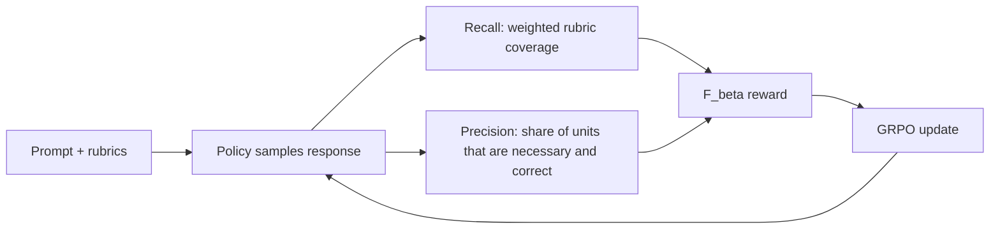
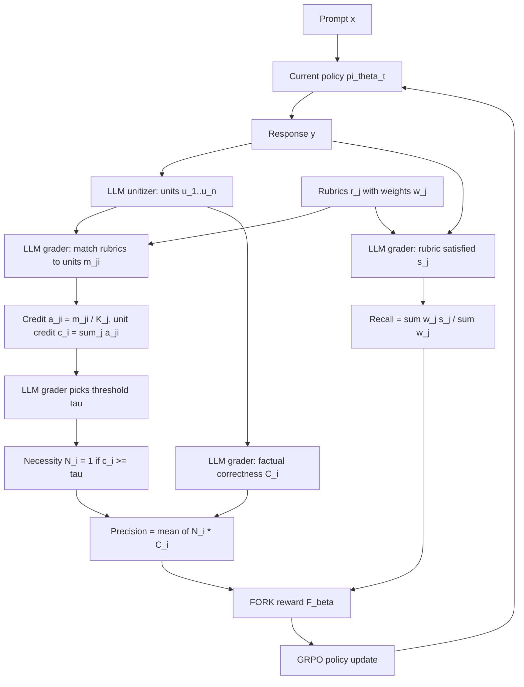
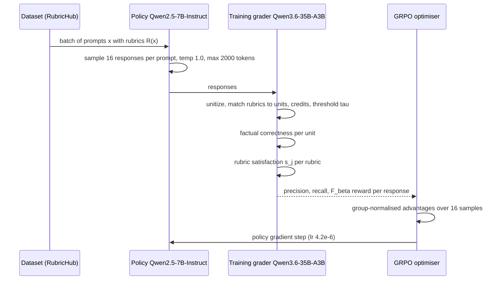

# Paper 12 — Eat Your Precision: Precision Objective Mitigates Reward Hacking in Rubric-based RL (FORK)

## A. Overview

| Field | Value |
|---|---|
| Title | Eat Your Precision: Precision Objective Mitigates Reward Hacking in Rubric-based RL |
| Authors | Hyun Ryu\*, Jong-Heon Kim\* (written "Jongheon Kim" in the PDF), Yiqing Xie, Seungone Kim, Carolyn Rosé†, Eunho Yang† (\*equal contribution, †equal advising) |
| Institutions (confirmed from PDF p.1) | KAIST AI (Ryu, Kim, Yang); Carnegie Mellon University, Language Technologies Institute (Ryu, Xie, S. Kim, Rosé) |
| Identifier | arXiv:2610.33512v1 [cs.CL] |
| Date | First submitted 2026-10-24 (v1; the version analysed) |
| Status | **Older, trending** — original date 2026-10-24 (before 2026-W44); featured on the Hugging Face Papers daily page on 2026-10-27 (evidence supplied by the discovery step of this run) |
| Official link | https://arxiv.org/abs/2610.33512v1 |
| Local PDF | [./paper-12.pdf](./paper-12.pdf) |
| Code | https://github.com/JHKim631/FORK (stated in the paper, footnote 1) |
| Areas | RL for LLMs, alignment, reward hacking, rubric-based rewards |

**Abstract (paraphrased).** Rubric-based rewards make RL possible on non-verifiable tasks, but because they score *weighted rubric coverage* they behave like a **recall** objective. RL-trained models become more complete but also more verbose and include more unnecessary or factually wrong content — so they lose to the base model in preference judgments. FORK adds a **precision** objective: every unit (≈ sentence) of a response should be both *necessary* (measured with rubric-driven necessity credits) and *factually correct* (an LLM grader). The reward is the F_β of precision and recall. FORK reaches similar rubric coverage to the recall reward but much higher precision and shorter responses, raising win rate vs the base policy from 10.6% to 68.0% on RubricHub-Medical and from 22.1% to 74.1% on HealthBench (vs the strongest rubric-coverage baseline).

## B. Problem

- **What it solves.** Reward hacking in rubric-based RL ("Rubrics as Rewards", RLCF, RubricHub): the policy learns to pad answers to tick more rubric boxes.
- **Why it matters.** Rubric rewards are a leading way to do RL on open-ended domains (medicine, science QA, deep research). If the trained model becomes longer and less correct and is *less* preferred than its starting point (Fig. 1: win rate vs base collapses with the standard reward), the method fails at its purpose.
- **Prior limitations.** RubricHub is 90.2% presence-based and 8.6% absence-based rubrics (footnote 3, citing Mahmoud et al.), so penalties for bad content are rare. Fixes so far *refine the rubric set* (universal anti-verbosity criteria in RLCF, OnlineRubrics, contrastive rubric refinement, DR Tulu evolving rubrics, AMARIS) — they still score coverage of a finite list.
- **Gap.** A score over *all generated content*, not just required items: what fraction of what the model says is needed and correct?

## C. Fundamentals

**Concrete example first (from Fig. 2).** Question: "Why do leaves change colour in autumn?" The rubric asks for three facts (chlorophyll breaks down; yellow/orange pigments are revealed; shorter days trigger the change). A response with those three facts plus "trees shed leaves to reduce water loss" (true but not asked) and "cold air directly dyes leaves red overnight" (false) gets **100% rubric coverage** — the extra and wrong sentences cost nothing. A precision score notices that only some sentences are needed and correct.

- **Rubric-based reward.** For a prompt, a list of criteria with weights; an LLM grader marks each criterion satisfied/unsatisfied; reward = weighted fraction satisfied → this is *recall*.
- **Precision vs recall.** Recall = how much of what's required you covered. Precision = how much of what you produced is good. Optimising recall alone encourages "say everything".
- **F_β score.** Weighted harmonic mean of precision and recall; low precision can't be compensated by high recall. `β>1` weighs recall more, `β<1` precision more.
- **Reward hacking.** The policy exploits a gap between the measured reward and the true goal.
- **GRPO.** Group Relative Policy Optimization: sample a group of responses per prompt, normalise their rewards within the group to get advantages, and do a PPO-style clipped update without a value network.
- **LLM-as-grader.** A model judging rubric satisfaction, necessity, correctness; its agreement with stronger models is a proxy for reliability.

## D. Core contribution

1. **Diagnosis.** Training on the standard coverage reward: recall saturates quickly, while precision and win rate vs base keep falling and length grows (Fig. 1, Qwen2.5-7B-Instruct on RubricHub-Medical).
2. **Measuring precision of free-form responses (Sec. 3.2).**
   - *Unitization:* split the response into ~sentence units, keep wording, drop greetings/headers/discourse markers (LLM unitizer).
   - *Credit-based necessity:* LLM matches each rubric to the units that address it; each rubric distributes **one** unit of credit equally among matched units; a unit's credit is the sum over rubrics; an LLM grader then picks a threshold `τ`, and units with credit ≥ τ are necessary. Redundant repeats split credit and fall below τ.
   - *Factual correctness:* strict per-unit correctness label by the LLM grader.
   - *Precision* = fraction of units that are necessary AND correct.
3. **FORK reward (Sec. 3.3).** `F_β(Precision, Recall)`, optimised with GRPO.
4. **Grader selection (App. B).** Choose the training grader by Pearson correlation with majority judgments of three frontier models; Qwen3.6-35B-A3B wins (avg r = 0.714, Table 7).

Difference from prior work: rather than expanding the rubric list, it scores every unit of generated content against the rubric list (necessity derived from contribution to rubrics) plus correctness — adapting FActScore-/FineSurE-style content-level precision to rubric RL.

## E. Architecture deep dive

Full architecture document: [../architectures/paper-12-architecture.md](../architectures/paper-12-architecture.md). Raw diagram: [../diagrams/paper-12-system.mmd](../diagrams/paper-12-system.mmd).

### Level 1 — concept **[Conceptual reconstruction]** (based on Fig. 1 and Fig. 2)



### Level 2 — reward pipeline components **[From paper: Fig. 2]** (redrawn)



### Level 3 — training-step data flow **[Conceptual reconstruction]** (GRPO details are standard GRPO, not specified beyond hyperparameters in the paper)



## F. Low-level mechanics

**Rubric recall (Eq. 1).**

$$\mathrm{Rec}(x,y)=\frac{\sum_{j=1}^{M} w_j\,s_j(x,y)}{\sum_{j=1}^{M} w_j}$$

- `x`: prompt; `y`: response; `M`: number of rubrics; `r_j`: rubric text; `w_j > 0`: its importance weight; `s_j(x,y) = 𝟙[y satisfies r_j] ∈ {0,1}` from the LLM grader.

**Unitization.** `U(y) = (u_1,…,u_n)`, `n` = number of substantive units (≈ sentences).

**Necessity credit (Eq. 2).**

$$a_{ji}=\begin{cases}\dfrac{m_{ji}}{K_j}, & K_j>0\\[4pt] 0, & K_j=0\end{cases},\qquad K_j=\sum_{i=1}^{n} m_{ji},\qquad c_i=\sum_{j=1}^{M} a_{ji}$$

- `m_ji = 𝟙[u_i contributes to addressing r_j]`: grader match between rubric `j` and unit `i`.
- `K_j`: number of units matched to rubric `j`.
- `a_ji`: credit rubric `j` gives unit `i` — each rubric's total budget is 1, split equally.
- `c_i`: accumulated credit of unit `i` (can exceed 1 if a unit serves several rubrics). Note: credits are *not* weighted by `w_j`.

**Necessity label (Eq. 3).** `N_i = 𝟙[c_i ≥ τ]`, `τ > 0` chosen by an LLM grader after reading all units and their credits (dynamic per response).

**Correctness (Eq. 4).** `C_i = 𝟙[u_i is factually correct given x]`, strict: any factual error → 0.

**Precision (Eq. 5).**

$$\mathrm{Prec}(x,y)=\frac{1}{n}\sum_{i=1}^{n} N_i C_i$$

- Fraction of units that are both necessary and correct.

**FORK reward (Eq. 6).**

$$r_{\text{FORK}}(x,y)=\begin{cases}\dfrac{(1+\beta^2)\,\mathrm{Prec}\,\mathrm{Rec}}{\beta^2\,\mathrm{Prec}+\mathrm{Rec}}, & \mathrm{Prec}+\mathrm{Rec}>0\\[4pt] 0, & \text{otherwise}\end{cases}$$

- `β`: recall-vs-precision weight; `β = 1` (F1) and `β = 1.25` used; `β > 1` favours recall.

**Objective (Eq. 7).** `max_θ E_{x∼D, y∼π_θ(·|x)}[r_FORK(x,y)]`, giving `π_{θ_{t+1}}` from `π_{θ_t}`.

**GRPO advantage (standard GRPO from Shao et al. 2024, cited by the paper; formula not restated in the paper).**

$$A_{g}=\frac{r_g-\operatorname{mean}(r_1,\dots,r_G)}{\operatorname{std}(r_1,\dots,r_G)}$$

- `G = 16` rollouts per prompt (Sec. 4.1); `r_g`: FORK reward of rollout `g`; `A_g`: advantage applied to all tokens of rollout `g`.

**Tensor view.** Per step: 128 prompts (batch size) × 16 rollouts × ≤ 2,000 tokens; per-token log-probs `B×G×T`; one scalar reward per rollout (`B×G`). The reward involves several grader calls per rollout: unitization, `M×n` rubric–unit matching, threshold, `n` correctness labels, `M` rubric-satisfaction labels (the exact batching of prompts to the grader is not reported).

**Complexity.** Grader work per response grows with `M·n` matches (possibly done in one prompt per response; not reported). Policy-side cost equals standard GRPO.

## G. Execution walkthrough

Using the Fig. 2 example. Rubrics: r1 "chlorophyll breaks down" (w = 0.45), r2 "yellow/orange pigments revealed" (0.35), r3 "shorter days trigger change" (0.20). Units: u1 "Shorter days trigger chlorophyll breakdown." u2 "Chlorophyll loss reveals yellow/orange pigments." u3 "Trees shed leaves to reduce winter water loss." u4 "Cold air directly dyes leaves red overnight."

1. **Matching (from Fig. 2).** r1 → {u1, u2} so each gets ½; r2 → {u2} gets 1; r3 → {u1} gets 1. Credits: c = (1½, 1½, 0, 0).
2. **Threshold** (illustrative; the grader chooses τ): τ = 1 → N = (1, 1, 0, 0).
3. **Correctness** (illustrative): u1–u3 correct, u4 wrong → C = (1, 1, 1, 0).
4. **Precision** = (1·1 + 1·1 + 0·1 + 0·0)/4 = 0.5.
5. **Recall** (illustrative: all three rubrics satisfied) = (0.45+0.35+0.20)/1.0 = 1.0.
6. **FORK (β = 1)** = 2·0.5·1.0/(0.5+1.0) ≈ 0.667, whereas the standard reward would give 1.0. Removing u3 and u4 would raise precision to 1.0 and reward to 1.0 — exactly the behaviour FORK trains for.
7. **GRPO** compares this response's reward with the other 15 samples for the same prompt; concise, correct samples get positive advantage.

## H. Comparison with prior approaches

| Approach | Reward signal | Extra cost | Reported medical results (Table 1: Recall / Precision / F1 / Win vs base / Length) | Limitation |
|---|---|---|---|---|
| Standard coverage (Rubrics as Rewards) | Weighted rubric recall | — | 35.7 / 25.5 / 26.4 / 3.1 / 9,195 | Pure recall → verbosity |
| OnlineRubrics | Recall over rubrics expanded each step via current vs control comparison | Rubric elicitation per step | 38.7 / 26.8 / 28.8 / 10.6 / 8,736 | Still coverage-based |
| Universal Rubrics | Recall + two generic criteria (necessary, correct) | Minimal | 37.6 / 27.6 / 28.4 / 4.3 / 8,457 | Two rubrics are weak against many presence rubrics |
| Reweighted absence-based rubrics | Recall with heavier absence rubrics | LLM reweighting | 36.4 / 24.2 / 25.7 / 8.5 / 9,106 | Few absence rubrics exist |
| Holistic preference | 1 / 0.5 / 0 by grader preference vs base | Pairwise judging | 27.5 / 47.5 / 31.3 / 65.4 / 3,584 | Recall drops sharply |
| **FORK (β = 1)** | F1 of unit precision and rubric recall | Unitization + matching + correctness | **32.5 / 53.2 / 37.5 / 68.0 / 3,533** | Grader-dependent; extra grader calls |

## I. Experiments

- **Policy.** Qwen2.5-7B-Instruct. **Data.** RubricHub-Medical (12,519 train / 1,391 test), RubricHub-Science (19,806 train / 2,201 test, ResearchQA-sourced items excluded). **External.** HealthBench (medical), ResearchQA (science).
- **Training.** GRPO, 16 rollouts/prompt, context 2,000 tokens, temperature 1.0, batch 128, lr 4.2×10⁻⁶ constant with 5% warm-up, 3 epochs, 8× H100 (Sec. 4.1).
- **Training grader.** Qwen3.6-35B-A3B (avg Pearson r = 0.714 vs majority of GPT-6 Astra, Gemini 3.8 Flash, Claude Opus 5 on 40 responses; Table 7). Its necessity correlation is only 0.534 — necessity is the hard judgment.
- **Reference grader for evaluation.** GPT-5.4; rubric-free judge prompt from Mahmoud et al.; metrics macro recall, precision, F1, win rate vs base, length in characters.

**Key reported results.**

| Result | Value | Source |
|---|---|---|
| Medical win rate vs base: best coverage baseline → FORK (β=1) | 10.6% → 68.0% | Table 1 |
| HealthBench win rate: 22.1% (OnlineRubrics) → FORK | 74.1% | Table 1 |
| Medical F1: 28.8 (OnlineRubrics) → FORK | 38.6 (β = 1.25) | Sec. 4.2, Table 6 |
| Medical precision: Standard 25.5 → FORK β=1 | 53.2 | Table 1 |
| Length: Standard 9,195 → FORK β=1 | 3,533 chars (factor ≈ 2.6) | Table 1, Sec. 1 |
| Science win rate: Universal Rubrics 42.5 → FORK β=1.25 | 61.5% | Table 2 |
| ResearchQA win rate: 26.6 → FORK β=1.25 | 67.1% | Table 2 / Sec. 4.2 |
| Science length: 4,453 (Standard) → FORK β=1.25 | 3,038 | Table 2 |
| Absence-based rubric satisfaction: base 40.4, Standard 37.2, FORK β=1.25 | 42.9 | Table 3 |
| Presence-based satisfaction: Standard 35.3 vs FORK β=1.25 | 34.9 | Table 3 |
| Quality dims (1–7 Likert) FORK β=1 vs Standard | Conciseness 4.49 vs 1.14; Factual 4.81 vs 3.77; Safety 6.06 vs 4.98; Overall 5.20 vs 3.29 | Table 8 |

**Ablations and robustness.**
- *Precision variants (Table 1, β = 1):* Generic Criteria (prompted necessity) 47.7 precision / 44.0 win; Offline Criteria 35.1 / 20.7; Online Criteria 39.3 / 14.3 — FORK's credit-based necessity is best (53.2 / 68.0).
- *Aggregation (Table 6):* simple average R/P/F1 = 26.2/55.3/32.8; F1 32.5/53.2/37.5; F1.25 35.8/49.0/38.6; F2 35.5/43.6/36.7 — harmonic mean beats averaging; F2 hurts both.
- *Necessity accuracy (Fig. 4):* removing credit-predicted unnecessary units causes almost no recall drop until ~40% of units removed (723 units / 40 responses), whereas prompting-based removal reduces recall gradually.
- *Unit definition (Table 5):* sentence units 33.8 recall / 44.0 win / 4,312 length vs line-break units 35.7 / 37.8 / 5,775 (with Generic Criteria precision).
- *Alternative judge prompt (Table 4):* FORK β=1.25 89.3% medical win; β=1 88.6% on HealthBench; Holistic Preference 89.4% on HealthBench.
- *Evaluating with the training grader (Fig. 3):* FORK rewards have the highest win rates; β = 1.25 is Pareto-optimal on recall vs win rate.

## J. Implementation

**Components.** GRPO trainer (e.g. verl/TRL-style); an LLM grader server; prompts for unitization, rubric–unit matching, threshold selection, factual correctness, rubric satisfaction (paper's prompts in App. E; official code at https://github.com/JHKim631/FORK).

**Reward function — Illustrative, not from the paper's code:**

```python
# Illustrative, not from the official FORK repository
def fork_reward(prompt, response, rubrics, grader, beta=1.0):
    units = grader.unitize(response)                       # list[str]
    n, M = len(units), len(rubrics)
    if n == 0:
        return 0.0
    # recall
    sat = [grader.satisfies(prompt, response, r.text) for r in rubrics]  # 0/1
    rec = sum(r.w * s for r, s in zip(rubrics, sat)) / sum(r.w for r in rubrics)
    # credit-based necessity
    match = grader.match(rubrics, units)                   # M x n of 0/1
    credit = [0.0] * n
    for j in range(M):
        K = sum(match[j])
        if K:
            for i in range(n):
                credit[i] += match[j][i] / K
    tau = grader.choose_threshold(units, credit)            # > 0
    N = [c >= tau for c in credit]
    C = [grader.is_correct(prompt, u) for u in units]
    prec = sum(a and b for a, b in zip(N, C)) / n
    if prec + rec == 0:
        return 0.0
    b2 = beta ** 2
    return (1 + b2) * prec * rec / (b2 * prec + rec)
```

**Hardware.** Policy training on 8× H100; plus serving a 35B-A3B MoE grader (serving setup not reported).

**Pitfalls.**
- **Grader quality dominates** — the paper selects the grader by correlation with frontier-model majority judgments; necessity judgments are the weakest (Table 7).
- Unitization must **not summarise or rewrite**; only minimal pronoun resolution, and drop purely organisational text (Sec. 3.2).
- **β choice matters:** F2 hurt both precision and recall (Table 6); optimal β is left open.
- Grader latency per rollout (several calls × 16 rollouts × 128 prompts) can bottleneck RL throughput — cost not reported.

## K. Limitations

- **LLM-grader dependence.** All labels (match, threshold, correctness, coverage) come from one 35B MoE grader; necessity correlation with references is moderate (0.534). Evaluation uses GPT-5.4 judges and win rates are prompt-sensitive (addressed partly by Table 4).
- **Recall trade-off.** FORK β=1 has lower recall than the Standard reward on medical (32.5 vs 35.7) and lower ResearchQA recall (58.9 vs 64.4 for Standard).
- **Single base model and two domains** (Qwen2.5-7B; medical, science). Scaling to larger policies or other domains is not reported.
- **Threshold τ is LLM-chosen**, a non-transparent component; credits are unweighted by rubric importance.
- **Factual correctness "given x"** relies on grader knowledge, not retrieval; errors in the grader's knowledge propagate.
- **Compute overhead** of the precision reward is not quantified.
- **Open questions:** best β, retrieval-grounded correctness, applying unit precision to agentic or long-form research tasks, and whether policies learn to hack the necessity grader.

## L. Learning takeaways

- **Reward = recall is a hacking invitation.** Any checklist reward needs a counter-force on *everything else* the model says.
- **Credit splitting is a neat trick** to penalise redundancy without an explicit "no repetition" rubric.
- **Harmonic mean > average** for combining objectives that must both be satisfied (Table 6).
- **Pick your grader empirically** — measure agreement with stronger judges per judgment type before training.
- **Study next:** Rubrics as Rewards (Gunjal et al.), RLCF / checklists, RubricHub, Mahmoud et al. "Reward hacking in rubric-based RL", FActScore, FineSurE, GRPO, OnlineRubrics, DR Tulu.
