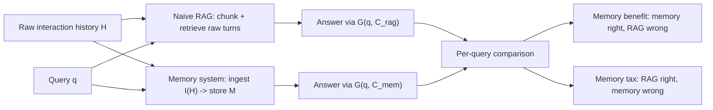
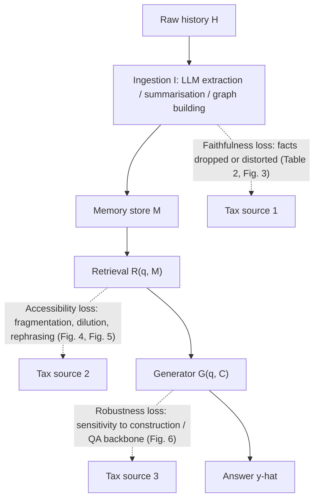
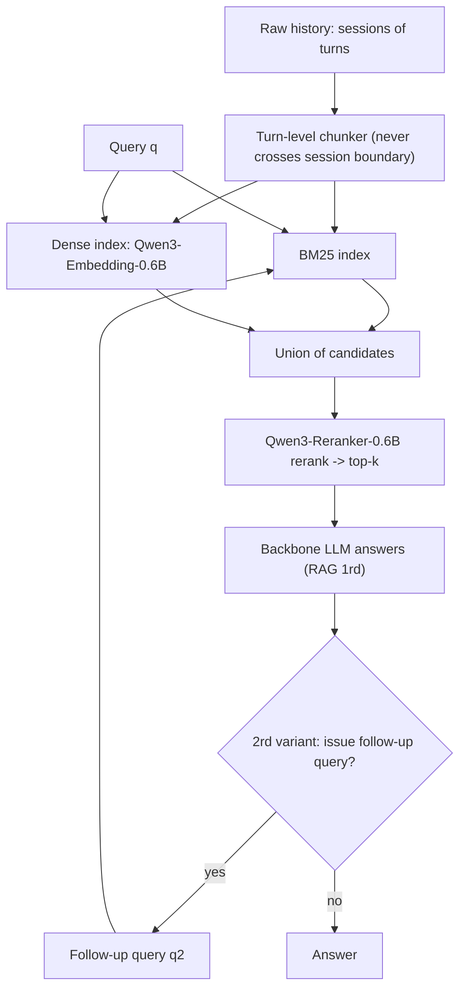

# Paper 13 — Memory Tax: Dissecting the Net Value of Agent Memory

> Reporting week 2026-W44 (2026-10-26 to 2026-11-01 IST). Source read: the arXiv HTML render of v1 (https://arxiv.org/html/2610.34073v1). The local PDF could not be rendered in this environment (no PDF rasteriser available), so every number below was taken from the HTML version of the same v1 paper. Tables and figures are cited by the paper's own numbering.

---

## A. Overview

| Field | Value |
|---|---|
| Title | Memory Tax: Dissecting the Net Value of Agent Memory |
| Authors | Xuan He, Sining Zhoubian, Ruozhen Yang, Yuhao Wen, Zhineng Wang, Yuyang Hu, Ke Yang, Yuyu Zhang, Ping Nie, Jiawei Han, ChengXiang Zhai |
| Institutions (confirmed from the paper) | University of Illinois Urbana-Champaign (He, Yang R., Wang, Yang K., Han, Zhai); Tsinghua University (Zhoubian, Wen); Renmin University of China (Hu); Verdent.ai (Zhang); University of Waterloo (Nie) |
| Identifier | arXiv:2610.34073v1 (cs.CL) |
| First submitted / this version | 2026-10-25 05:29 UTC / v1 |
| Status | **Older, trending.** Submitted 2026-10-25, one day before the reporting window opened. It was featured on the Hugging Face Papers daily page on 2026-10-28. |
| Areas | Agent memory, retrieval-augmented generation (RAG), evaluation methodology |
| Official link | https://arxiv.org/abs/2610.34073v1 |
| Project page | https://hexuan21.github.io/MemoryTax/ |
| Code / results | https://github.com/hexuan21/MemoryTax ; result dump https://huggingface.co/datasets/hexuan21/MemoryTax-Res. The paper says code and results will be open-sourced. |
| Local PDF | [./paper-13.pdf](./paper-13.pdf) |

**Abstract (paraphrased).** Long-horizon agents often add a dedicated memory system that ingests, summarises, links or reorganises past interactions. It is unclear whether this beats simply retrieving from the raw history. The authors evaluate many memory systems against a carefully specified naive RAG baseline across benchmarks and backbones, and find that many memory systems score below RAG. That gap is negative net value. They split net value into **memory benefit**, the queries memory solves that RAG misses, and **memory tax**, the queries RAG solves that memory loses. They trace the tax to deviations that memory construction and memory access introduce, measured as faithfulness, accessibility and robustness. They then extend the analysis to experiential memory and world-model memory.

---

## B. Problem

- **What it solves.** It answers whether an agent memory system adds value over the simplest strong alternative. In this paper that alternative is to keep the raw history, chunk it, and retrieve from it.
- **Why it matters.** Memory layers (MemGPT-style OSes, graph memories, trained memory policies) are becoming default components in agent stacks. They cost extra LLM calls during ingestion, extra tokens and extra latency. If they do not beat RAG, teams pay that cost for nothing.
- **Prior limitations.** Most memory papers do not report a RAG baseline at all. Of the papers reviewed in Appendix B.2, only LightMem, PlugMem and Mem-T report one, and their RAG setups are often underspecified (chunking, retriever and reranker unstated). Retrieval budgets also differ across systems, so the comparisons are not like for like.
- **Gap addressed.** The paper supplies a well-specified RAG reference, a budget-alignment metric (Retrieval Scope), per-query accounting of where memory wins and loses, and a diagnosis of why it loses.

---

## C. Fundamentals

**A concrete example first.** Suppose a user told an assistant 40 sessions ago, "My sister's wedding is in Lisbon on 14 June." Now the user asks, "Which city do I fly to in June?"

- *Naive RAG* keeps the original turn verbatim. It splits the history into turn-sized chunks, finds the turn mentioning June and Lisbon, and hands it to the LLM. The fact survives exactly as it was said.
- *A memory system* would have run an LLM at ingestion time to write a memory unit, for example "User has family event in Portugal in summer." Information may already be lost here ("Lisbon" became "Portugal"; "14 June" became "summer"). Even if it was kept, the rewritten unit may no longer look similar to the query, so the retriever may miss it.

That is the memory tax in miniature: the transformation that was supposed to help can delete information or make it harder to find.

**Terminology.**
- **Interaction history** — the raw log of turns or sessions an agent has seen.
- **Memory ingestion / construction** — an offline or streaming process (often LLM-driven) that turns raw history into a memory store: facts, summaries, graphs, hierarchical pages or learned policies.
- **Retrieval** — selecting a subset of the store for the current query. Sparse retrieval uses BM25 keyword scoring. Dense retrieval uses embedding cosine similarity. A reranker is a cross-encoder that rescores the candidates.
- **RAG (1rd / 2rd)** — one retrieval round, or two rounds where the backbone may issue one follow-up query.
- **LLM-as-judge accuracy** — an LLM grades whether the generated answer matches the gold answer. Here the judge is Qwen3.6-27B, validated against human labels.
- **Experiential memory** — memory of past task trajectories, distilled into workflows or skills.
- **World-model memory** — the frames, latents or KV caches that a video world model keeps so that revisited scenes stay consistent.

---

## D. Core contribution

1. **A net-value framing.** Memory is not judged by absolute score but by its per-query difference from naive RAG: *net value = benefit − tax*.
2. **A strong, specified RAG reference.** Turn-level chunks that never cross session boundaries, a union of BM25 and dense retrieval (Qwen3-Embedding-0.6B), and reranking with Qwen3-Reranker-0.6B. Ablations in Table 6 show the result is stable across reasonable RAG variants.
3. **Retrieval Scope (RS).** A budget-alignment metric so that memory systems and RAG are compared at matched amounts of retrieved content.
4. **A large controlled evaluation.** 12 memory systems in four families (flat, hierarchical/lifecycle, graph, trained policy), 3 benchmarks and 3 backbones (Table 1), with full cost accounting.
5. **A diagnosis of the tax** along three axes:
   - *Faithfulness*: does information survive construction?
   - *Accessibility*: can surviving information be retrieved?
   - *Robustness*: does the system survive a change of construction or QA backbone?
6. **Generalisation** of the concept to experiential memory (agent task benchmarks) and world-model memory (video generation consistency).
7. **Design implications.** Keep the raw source retrievable alongside memory, let memory be recursive (past queries and evidence become memory), and model future demand rather than only compressing the past.

What differs from prior work: earlier memory papers propose systems and compare them against each other or against no-memory baselines. This paper is an **audit**. It proposes no new memory system. Its main tool is a counterfactual comparison against RAG.

---

## E. Architecture deep dive

Full diagrams: [../architectures/paper-13-architecture.md](../architectures/paper-13-architecture.md). Raw diagram: [../diagrams/paper-13-system.mmd](../diagrams/paper-13-system.mmd).

### Level 1 — the comparison the paper makes **[Conceptual reconstruction]** (based on the Section 2 formalisation)



### Level 2 — where the tax originates **[Conceptual reconstruction]** (based on Sections 4 and 5 and Figures 3–6)



### Level 3 — the naive RAG reference pipeline **[Conceptual reconstruction]** (from the RAG specification in Section 3 and the Table 6 ablation axes)



There is no paper figure of the pipeline itself. The paper's figures are result plots: Fig. 1 Pareto, Fig. 2 Venn, Fig. 3 gold-unit bars, Fig. 4 retrieval rounds, Fig. 5 similarity shift, Fig. 6 robustness, Fig. 7 retrieval baselines, Fig. 8 experiential, Fig. 9 world-model frames.

---

## F. Low-level mechanics

This is an evaluation paper, so there are no new tensor-level architectures or training losses. The relevant mechanics are the pipeline formalisation, the retrieval scoring, and the metrics. Items such as backprop, optimiser and training objective do not apply because nothing is trained. The trained-policy baselines (Mem-T, Memory-R2) are used as released.

### F.1 Pipeline formalisation (Section 2)

$$\mathcal{H} = \{h_1, \dots, h_T\}$$
- $\mathcal{H}$: the full interaction history. $h_i$: the $i$-th turn or record. $T$: number of records. For LongMemEval-s a corpus is about 115k tokens (Table 4).

$$\mathcal{M} = I(\mathcal{H})$$
- $I$: the ingestion process (LLM extraction, summarisation, graph or tree construction). $\mathcal{M}$: the resulting memory store of units. For naive RAG, $I$ is just chunking, so $\mathcal{M}$ is the raw turns.

$$\mathcal{C} = R(q, \mathcal{M})$$
- $q$: the task query. $R$: retrieval (BM25 / dense / graph walk / policy). $\mathcal{C}$: the retrieved context, a subset of units.

$$\hat{y} = G(q, \mathcal{C})$$
- $G$: the backbone LLM generating the answer. $\hat{y}$: the predicted answer, graded by the LLM judge.

### F.2 Benefit, tax and net value

The paper defines these at the query level in prose and via the Venn plot (Fig. 2). It gives no explicit equation, so the formulas below are **our formalisation of the paper's definitions**. Let $Q$ be the query set and $\mathbb{1}[\cdot]$ the judge's correctness indicator.

$$\text{Benefit} = \frac{1}{|Q|}\sum_{q\in Q} \mathbb{1}[\hat{y}^{\text{mem}}_q \text{ correct}]\cdot \mathbb{1}[\hat{y}^{\text{rag}}_q \text{ wrong}]$$

$$\text{Tax} = \frac{1}{|Q|}\sum_{q\in Q} \mathbb{1}[\hat{y}^{\text{rag}}_q \text{ correct}]\cdot \mathbb{1}[\hat{y}^{\text{mem}}_q \text{ wrong}]$$

$$\text{Net value} = \text{Benefit} - \text{Tax} = \text{Acc}_{\text{mem}} - \text{Acc}_{\text{rag}}$$

- $\hat{y}^{\text{mem}}_q$, $\hat{y}^{\text{rag}}_q$: the memory system's and RAG (1rd)'s answers to query $q$.
- The last equality holds because queries both get right, or both get wrong, cancel. Net value is therefore exactly the accuracy gap in Table 1, but the decomposition shows that a small gap can hide a large benefit and a large tax at the same time.

### F.3 Retrieval scoring (standard definitions; illustrative, not paper-specific)

Dense similarity between the query embedding $\mathbf{e}_q\in\mathbb{R}^{d}$ and the chunk embedding $\mathbf{e}_c\in\mathbb{R}^{d}$ ($d$ is the embedding width of Qwen3-Embedding-0.6B; the paper does not state $d$):

$$s_{\text{dense}}(q,c) = \frac{\mathbf{e}_q^\top \mathbf{e}_c}{\lVert\mathbf{e}_q\rVert\,\lVert\mathbf{e}_c\rVert}$$

BM25 (standard form):

$$s_{\text{BM25}}(q,c)=\sum_{w\in q}\text{IDF}(w)\,\frac{f(w,c)\,(k_1+1)}{f(w,c)+k_1\left(1-b+b\,\frac{|c|}{\text{avgdl}}\right)}$$

- $f(w,c)$: frequency of term $w$ in chunk $c$. $|c|$: chunk length. avgdl: average chunk length. $k_1, b$: BM25 hyperparameters. IDF: inverse document frequency.

The union of both candidate lists is rescored by a cross-encoder reranker $s_{\text{rr}}(q,c)$ and the top-$k$ are kept.

**Why the similarity shift (Fig. 5) matters.** Rewriting a turn into a memory unit changes $\mathbf{e}_c$. If $\cos(\mathbf{e}_q,\mathbf{e}_{\text{unit}}) < \cos(\mathbf{e}_q,\mathbf{e}_{\text{raw}})$, the evidence slides down the ranking even though it was preserved. Fig. 5 shows this distribution shift between (query, gold raw turn) and (query, gold memory unit).

### F.4 Retrieval Scope (Section 3)

$$\text{RS} = \frac{\text{tokens of memory units the LLM actually sees during QA}}{\text{total tokens in the retrievable store}}$$

- The numerator is the tokens surfaced to $G$. The denominator is the size of $\mathcal{M}$ in tokens. RS lets the authors align top-$k$ across systems (Tables 7–8). For example, A-Mem on LME-s rises from 73.0 at default $k{=}5$ to 84.0 at $k{=}15$.

### F.5 Cost model

The paper reports four costs: (1) total tokens across ingestion plus QA, input and output; (2) end-to-end wall-clock, normalised to single-concurrency hours; (3) number of LLM calls; (4) memory store size in tokens (bubble size in Fig. 1).

**Complexity intuition (our analysis).** RAG ingestion is $O(T)$ embedding passes with no LLM generation. LLM-driven memory ingestion is $O(T)$ LLM generation calls or more; graph systems may add pairwise linking. At query time both are $O(\log N)$ to $O(N)$ retrieval plus one generation, except multi-round or trained-policy systems that loop. One example of the magnitude: in Table 16 (ALFWorld, Qwen3.5-4B), SkillPro averages 1226.3K tokens against 234.8K for naive RAG.

---

## G. Execution walkthrough

One LongMemEval-s query, roughly a 115k-token corpus (Table 4), traced through both arms. The flow is our reconstruction of the paper's protocol.

1. **Input.** A history of many sessions (about 115k tokens) and the query "What did I say my favourite hiking trail was?" The gold answer comes from one turn in one session.
2. **RAG arm.**
   1. The chunker splits the history into turn-level chunks within sessions, producing a few hundred to a few thousand short text chunks.
   2. BM25 and the dense index each return candidate lists. Their union is reranked by Qwen3-Reranker-0.6B, and the top-$k$ chunks are kept (the default $k$ for RAG is not reported in our extraction).
   3. The backbone (for example Q3.6-27B) receives the query plus the verbatim chunks and answers.
   4. In the 2rd variant, the backbone may emit one follow-up query, and steps 2–3 repeat.
3. **Memory arm (for example LightMem).**
   1. At ingestion, an LLM extracts facts from user and assistant turns. Table 10 shows that extracting from user-only turns drops LME-s Q27B from 78.8 to 70.6. The output is a store of compressed units.
   2. At query time the system retrieves units through its own mechanism (topic index, graph walk, hierarchy).
   3. The same backbone answers from units instead of raw turns.
4. **Judging.** Qwen3.6-27B judges each answer, which places each query in one of four Venn cells (Fig. 2).
5. **Diagnosis.** If memory lost the query:
   - *Faithfulness check*: replace retrieval with the **gold memory units**. If the score recovers, the information survived but was not accessible. If not, construction lost it (Fig. 3, Table 2).
   - *Accessibility check*: replay retrieval rounds until all evidence is found. Memory units need more rounds than raw chunks (Fig. 4).
   - *Robustness check*: swap the construction model or the QA model and look for drops larger than RAG's (Fig. 6, red segments).

---

## H. Comparison with prior approaches

Values are from Table 1 where cited; qualitative cells summarise the paper's characterisation.

| Family (paper's grouping) | Representative systems | Construction | Retrieval / inference | LME-s Q3.6-27B (Table 1) | Cost profile | Main failure mode per paper |
|---|---|---|---|---|---|---|
| Retrieval-only | RAG (1rd), RAG (2rd) | Chunk + index only | BM25 ∪ dense → rerank; 2rd adds one follow-up | 77.6 / 81.4 | Lowest ingestion cost; no LLM at ingest | Limited by chunk granularity |
| Flat store | A-Mem, SimpleMem, MemOS | LLM-written notes / units | Similarity over units | 79.4 / 73.6 / 76.6 | LLM calls per turn | Rephrasing shifts similarity (Fig. 5) |
| Hierarchical / lifecycle | MemoryOS, LightMem, OpenViking | Pages, topics, tiers, consolidation | Hierarchical lookup | 73.4 / 78.8 / 58.8 | High ingest cost | Information loss; OpenViking has 38.0% facts with no unit (Table 2) |
| Graph-based | HippoRAG2, PlugMem, MAGMA | Entity / relation graphs | Graph walk + passage retrieval | 78.2 / 75.8 / 68.2 | Graph build cost | Fragmentation of evidence |
| Trained policy | Mem-T, Memory-R2 | RL-trained memory operations | Policy-driven read/write | 75.0 / 73.0 | Highest inference tokens (Mem-T 1202.9K on MINT Q3.5-4B, Table 20) | Backbone sensitivity |
| Full context | — | None | Whole history in context | 68.4 | Very long prompt | Long-context degradation |

---

## I. Experiments

**Benchmarks (Table 4).**
- LongMemEval-s: 500 questions, about 115k tokens per corpus, short answers. GPT-5.6 Luna was run on a stratified 100-corpus subset.
- PersonaMem-v2: a 20% subset (40 of 200 corpora), 934 questions, 4-way multiple choice, about 123k tokens per corpus.
- MINT-Eval: a 10% stratified sample (60 of 595 corpora), 1,557 questions, about 139k tokens per corpus, covering dialogue, state tracking, GitHub commits and wiki revisions.

**Backbones.** Qwen3.5-4B, Qwen3.6-27B and GPT-5.6 Luna (low).

**Judge.** Qwen3.6-27B. Agreement with human labels is 95.1% on LME-s, 100.0% on PM-v2 and 97.3% on MINT.

**Metrics.** Judge accuracy, plus token, time, LLM-call and store-size costs.

**Headline results (Table 1, accuracy %).**

| Method | LME-s 4B | LME-s 27B | LME-s Luna | PM-v2 27B | MINT 27B | MINT Luna |
|---|---|---|---|---|---|---|
| Full Context | 58.6 | 68.4 | 84.0 | 45.4 | 28.7 | 39.7 |
| RAG (1rd) | 70.2 | 77.6 | 82.0 | 46.8 | 28.6 | 29.9 |
| RAG (2rd) | 72.2 | 81.4 | **90.0** | 48.7 | 33.1 | 34.5 |
| A-Mem | 70.4 | 79.4 | 84.0 | 48.4 | 24.4 | 27.1 |
| MemOS | 62.0 | 76.6 | 78.0 | **50.2** | 19.7 | 30.3 |
| LightMem | 57.6 | 78.8 | 77.0 | 47.0 | 23.0 | 25.2 |
| OpenViking | 31.8 | 58.8 | 63.0 | 38.7 | 18.6 | 24.2 |
| HippoRAG2 | 68.8 | 78.2 | 81.0 | 46.5 | 23.5 | 27.8 |
| PlugMem | 68.0 | 75.8 | 70.0 | 45.2 | 33.3 | 37.8 |
| Mem-T | **71.0** | 75.0 | 78.0 | 42.1 | 30.4 | **38.4** |
| Memory-R2 | 65.8 | 73.0 | 79.0 | 48.4 | 21.5 | 22.9 |

*Reading it:* on LongMemEval-s with GPT-5.6 Luna, the two-round RAG baseline (90.0) beats every memory system in the table (the best is 84.0). On MINT-Eval with Q3.5-4B, most memory systems fall well below RAG (1rd) at 25.8. OpenViking scores 10.2 and MemOS 18.0. A few systems beat RAG in single cells, such as MemOS on PM-v2 27B (50.2 vs 46.8) and Mem-T on MINT Luna (38.4 vs 29.9), which is the benefit side of the ledger.

**Faithfulness (Table 2, Fig. 3).** OpenViking has 38.0% of sampled facts with no memory unit (NU) and LightMem 9.6%. MemoryOS keeps 98.4% of facts with no loss (NL) and MAGMA 93.6%. Systems with high fact retention still pay tax, which points to accessibility rather than faithfulness.

**Accessibility (Figs. 4–5).** Memory units need more retrieval rounds than raw chunks before all evidence is recovered. The query–evidence similarity distribution shifts downward after memory rewriting.

**Robustness (Fig. 6).** Swapping the QA backbone often causes larger accuracy swings for memory systems than for RAG.

**Benchmark headroom (Table 15, LME-s, k=10).** IDF-keyword scores 46.2, RAG-Emb 72.6 and RAG-Hybrid 77.6. Simple baselines already capture most of the available headroom.

**RAG ablations (Table 6).** Most variants stay within a few points of the default. The worst are streaming chunking (LME-s Q27B 69.4 vs 77.6) and BM25-only (68.2).

**Configuration sensitivity.**
- Table 9: MemOS on PM-v2 Q27B moves from 42.7 to 50.2 with official post-processing disabled and reranking enabled.
- Table 10: LightMem extracting from user-only turns drops to 70.6.

**Experiential memory (Table 16, Qwen3.5-4B).**
- ALFWorld success: No Memory 52.2, Naive RAG 73.1, Memp 76.1, G-Memory 73.9, ReasoningBank 62.7, SkillPro 47.0.
- Token cost: SkillPro averages 1226.3K tokens vs 234.8K for RAG.
- The paper states that memory helps on web tasks but often trails RAG on tool use (Fig. 8).

**World-model memory (Table 3 / Table 17, C-as-M-eval, PSNR / SSIM / 1−LPIPS).** Naive frames (I3DM) 19.8 / .560 / .704; WorldKV (raw KV cache) 13.5 / .372 / .459; FramePack (visual latents) 9.1 / .217 / .312. The simplest representation wins.

**Human annotation of memory units (Table 13, % correct / extraneous / missing).** SimpleMem on LME-s 92.2 / 5.8 / 2.0; LightMem 85.0 / 14.2 / 0.8; Memory-R2 on PM-v2 85.9 / 12.5 / 1.6.

**Design-implication experiments (Section 6).** These cover raw-plus-memory joint retrieval, recursive memory, and just-in-time memory. The paper reports consistent gains from jointly retrieving raw history and memory, but the specific numbers were not available in the extracted text, so none are quoted here.

---

## J. Implementation

**To reproduce the audit on your own memory system:**
1. Build the reference RAG exactly as specified: turn-level chunks that do not cross sessions, BM25 plus a dense index, union, cross-encoder rerank, then a 1-round and a 2-round variant.
2. Align retrieval budgets with Retrieval Scope before comparing.
3. Log per-query correctness for both arms and compute benefit, tax and net value.
4. For losses, run the gold-unit substitution (faithfulness), round replay (accessibility) and backbone swaps (robustness).
5. Report costs: tokens, wall-clock, LLM calls and store size.

**Frameworks.** Any retrieval stack works (for example rank_bm25 or Elasticsearch for BM25, FAISS for dense search, and a Qwen3 embedding and reranker served via vLLM or sentence-transformers). The paper's own harness is at the GitHub link in section A.

**Illustrative code (not from the paper).** A per-query tax ledger plus the design implication "retrieve raw history alongside memory":

```python
# Illustrative, not from the paper.
from dataclasses import dataclass

@dataclass
class Outcome:
    qid: str
    rag_correct: bool
    mem_correct: bool

def tax_ledger(outcomes):
    n = len(outcomes)
    benefit = sum(o.mem_correct and not o.rag_correct for o in outcomes) / n
    tax     = sum(o.rag_correct and not o.mem_correct for o in outcomes) / n
    return {"benefit": benefit, "tax": tax, "net_value": benefit - tax}

def hybrid_retrieve(query, raw_index, mem_index, reranker, k=10):
    """Design implication 1: keep raw source recoverable; rerank raw chunks and memory units jointly."""
    cands = raw_index.search(query, k=3 * k) + mem_index.search(query, k=3 * k)
    scored = [(reranker.score(query, c.text), c) for c in cands]
    return [c for _, c in sorted(scored, key=lambda x: -x[0])[:k]]
```

**Hardware.** The audit runs at inference time only. The heavy part is LLM-driven ingestion over corpora of roughly 115–139k tokens per corpus. Hardware specifics are not reported in our extracted text.

**Pitfalls.**
- Underspecified RAG baselines inflate memory gains.
- A mismatched top-$k$ changes conclusions (Tables 7–8).
- Default post-processing in some systems hurts (Table 9).
- Extracting from only user turns loses assistant-provided facts (Table 10).

---

## K. Limitations

From the paper:
- The baseline selection is representative, not exhaustive.
- Official configurations were used, and per-system tuning might help.
- Benchmarks are static, offline and English-only.
- Omnimodal, latent and parametric memory are not studied.
- Compute limits meant subsets for some benchmarks and backbones, and no frontier model stronger than GPT-5.6 Luna (low).

Our observations:
- Benefit and tax are defined relative to one RAG design. A stronger or weaker reference shifts both.
- The judge is an LLM (Qwen3.6-27B). Its human agreement is high but below 100% on two of the three benchmarks.
- The benchmarks are question answering over a fixed history. Production agents with writes, updates, contradictions and months-long horizons may favour consolidation more than these benchmarks do.
- Open question: can memory construction be made provably lossless with respect to the raw source, for example memory as an index over raw text rather than a replacement for it?

---

## L. Learning takeaways

- **Always benchmark memory against a strong, well-specified RAG.** "Memory beats no-memory" is not evidence of value.
- **Look at per-query wins and losses, not only the mean.** A tie can hide large offsetting benefit and tax.
- **Separate information loss from information access.** Gold-unit substitution is a cheap diagnostic.
- **Rewriting text changes its embedding geometry.** Compression can make facts unretrievable even when they are preserved.
- **Practical design rule:** keep raw history addressable and treat memory as an additional index, not a lossy replacement.

**Study next.** LongMemEval, PersonaMem, MemGPT/Letta, A-Mem, HippoRAG 2, LightMem, Mem-T, BM25 and dense hybrid retrieval, cross-encoder reranking, and LLM-as-judge reliability.
