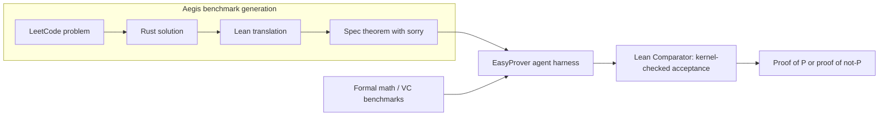
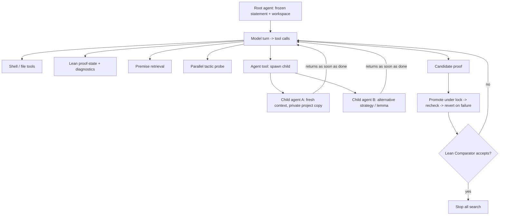
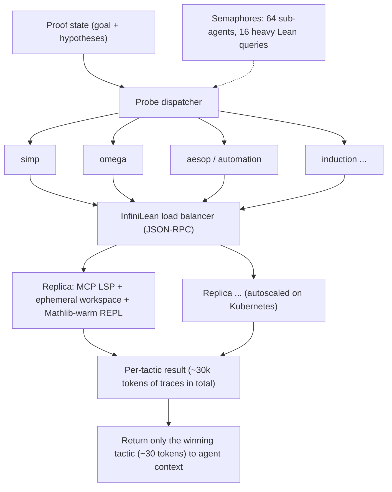

# Paper 14 — Scaling Lean Theorem Proving for Real-World Code Verification (EasyProver / Aegis)

> Reporting week 2026-W44 (2026-10-26 to 2026-11-01 IST). Source read: the arXiv HTML render of v1 (https://arxiv.org/html/2610.38174v1). The local PDF could not be rendered in this environment (no PDF rasteriser available), so all numbers were taken from the HTML version of the same v1 paper. Diagrams marked "From paper: Fig. X" are redrawn from the paper's figure descriptions, not copied images.

---

## A. Overview

| Field | Value |
|---|---|
| Title | Scaling Lean Theorem Proving for Real-World Code Verification |
| Systems introduced | **EasyProver** (agentic Lean prover) and **Aegis** (auto-generated Rust→Lean verification benchmark) |
| Authors | Debargha Ganguly, Divya Raghunathan, Dejan Jovanović, Vikash Singh, Soonho Kong, Aaron Tomb, Aman Goel, Ferhat Erata, Sam Bayless |
| Institutions (confirmed from the paper) | **Amazon Web Services** (Raghunathan, Jovanović, Kong, Tomb, Goel, Erata, Bayless); **Case Western Reserve University** (Ganguly, corresponding author, work done during an AWS internship; Singh) |
| Identifier | arXiv:2610.38174v1 |
| Submitted | 2026-10-28 (v1) |
| Status | **New** (first published inside the reporting window) |
| Areas | AI coding, formal verification, LLM agents |
| Official link | https://arxiv.org/abs/2610.38174v1 |
| Local PDF | [./paper-14.pdf](./paper-14.pdf) |
| Code / data release | No release links for EasyProver, InfiniLean or Aegis appear in the paper text we read: **not reported**. The paper cites only third-party tools (Lean Comparator, Plausible, Charon/Aeneas, lean-lsp-mcp, LeanDojo). |

**Abstract (paraphrased).** EasyProver is a Lean 4 proving harness built from recursive agents with isolated contexts, asynchronous search, parallel tactic probing and an elastic Lean elaboration service (InfiniLean). It uses an off-the-shelf frontier model ("Anthropic Fable-5" as written in the paper) with no additional training. Its results:
- 669/672 PutnamBench problems and all six IMO 2026 formalisations proved.
- 597/600 NTP4VC verification conditions and all 189 VERINA tasks resolved, by proof or by refutation.

Because these benchmarks are close to saturation, the authors also build **Aegis**. It turns competitive-programming problems into verification tasks over Rust implementations translated mechanically into Lean, producing 2,045 differentially validated Rust–Lean program pairs and 11,533 candidate specifications. On a 2,000-statement sample, EasyProver proves 1,054 (52.7%) within 30 minutes per statement.

---

## B. Problem

- **What it solves.** It scales automated formal proof from competition mathematics to proof obligations over real code: fixed-width integers, explicit failure, loops, casts and mutation.
- **Why it matters.** AI-written code needs guarantees that tests cannot give. A Lean proof that an implementation meets its specification is kernel-checked, so it cannot be gamed by a confident model.
- **Prior limitations.** Formal-math benchmarks (miniF2F, PutnamBench) are close to saturation. Verified-programming benchmarks (VERINA 189, CLEVER 161, AlgoVeri 77) are small and may be contaminated. Writing new tasks by hand needs rare combined expertise in programming, specification and Lean.
- **Gap addressed.** (1) A general-purpose prover that needs no model training and nearly saturates the existing suites. (2) A scalable, automatically generated and differentially validated benchmark whose obligations come from actual implementation semantics.

---

## C. Fundamentals

**A concrete example first.** Take a Rust function `fn max3(a: u32, b: u32, c: u32) -> u32`.
- A *test* checks `max3(1,5,3) == 5`.
- A *specification* says "for all a, b, c the result is ≥ each input and equals one of them."
- A *proof* in Lean shows the specification holds for **every** input, and Lean's small trusted kernel checks each step.

If the Rust code were translated into Lean with u32 wrap-around arithmetic, the proof also has to reason about overflow. These are the "real-world" obligations the paper targets.

**Terminology.**
- **Lean 4 / Mathlib.** An interactive theorem prover and its mathematics library. Proofs are written as *tactics* (`simp`, `omega`, `induction`, `aesop`) that transform a *proof state* (the hypotheses plus the goal) until no goals remain.
- **Elaboration.** Lean type-checks and expands source into kernel terms. Importing Mathlib takes tens of seconds; a warm elaboration takes about 0.2 s (per the paper).
- **`sorry`.** A placeholder proof. A *frozen statement* means the theorem text cannot be changed, only its proof body.
- **Refutation.** Proving ¬P, which shows the specification is false.
- **Charon / Aeneas.** Charon extracts Rust's MIR into LLBC, and Aeneas translates it into pure functional Lean code using a `Result` monad for panics and overflow.
- **Differential validation.** Run the Rust original and the Lean translation on the same tests and require identical outputs.
- **pass@k.** Success if any of $k$ attempts succeeds. EasyProver reports a single run (pass@1, "resolved").
- **RLVR.** Reinforcement learning with verifiable rewards. Aegis labels (proved or refuted) could serve as rewards; the paper proposes this but does not evaluate it.

---

## D. Core contribution

1. **Harness, not model.** All gains come from the agent harness around an untrained frontier model:
   - **Recursive delegation.** Any agent can spawn child agents with fresh contexts and private workspace copies for alternative strategies or auxiliary lemmas, and children can spawn their own children.
   - **Asynchronous search.** Results return to the parent as soon as they finish, without waiting for siblings, and the search ends at the first accepted proof.
   - **Parallel tactic probing.** Many candidate tactics run concurrently on a proof state. Only the winning tactic (about 30 tokens in the paper's example) re-enters the context; the probe traces (about 30,000 tokens) are discarded. This is context hygiene.
   - **Admission control.** Process-wide semaphores cap active sub-agents at 64 and concurrent expensive Lean queries at 16.
   - **InfiniLean.** A stateless, load-balanced and autoscaled Lean elaboration service on Kubernetes. It exposes JSON-RPC and a language-server MCP interface, with Mathlib-preloaded REPL workers.
   - **Trust boundary.** Only Lean Comparator acceptance counts (`lake env lean` plus `#print axioms` against a read-only toolchain). Agent self-reports never count.
2. **Aegis.** A pipeline that generates and validates benchmark tasks: Rust solution → Charon/Aeneas → Lean → differential test → specification agent writes P (intended to hold or to fail) → filters → prover.

**What differs from prior work.** Prior provers such as DeepSeek-Prover, Kimina, Goedel-Prover and Seed-Prover train specialised models with SFT or RL, or use MCTS with value functions. EasyProver trains nothing and lets the model direct the search. The paper calls its structure only "loosely analogous" to MCTS because there are no visit counts and no value estimates.

---

## E. Architecture deep dive

Full diagrams: [../architectures/paper-14-architecture.md](../architectures/paper-14-architecture.md). Raw diagram: [../diagrams/paper-14-system.mmd](../diagrams/paper-14-system.mmd).

### Level 1 — the two systems **[Conceptual reconstruction]**



### Level 2 — the EasyProver asynchronous agent loop **[From paper: Fig. 1 — redrawn]**



### Level 3 — tactic probing and InfiniLean **[From paper: Fig. 2 and Fig. 3 — redrawn]**



---

## F. Low-level mechanics

**No model is trained**, so tensor shapes, backprop, losses and optimisers do not apply. The frontier model is used as a black-box policy over tool calls. The "mechanics" are search, context management, concurrency and verification.

### F.1 Search as a recursive process (our formalisation)

Let a node be $n=(s, \mathcal{W}, \kappa)$:
- $s$ is the Lean proof state, the remaining goals.
- $\mathcal{W}$ is the node's private workspace (a copy of the project).
- $\kappa$ is its context window (messages so far).

The model policy $\pi_\theta$ (frozen) maps the context to an action:

$$a_t \sim \pi_\theta(\cdot \mid \kappa_t),\quad a_t \in \{\text{edit}, \text{lean\_query}, \text{probe}(\tau_{1..m}), \text{spawn}(g_1..g_j), \text{submit}\}$$

- $\theta$: the frozen model weights (no updates).
- $\tau_{1..m}$: candidate tactics probed in parallel.
- $g_1..g_j$: sub-goals or alternative strategies given to child agents.

The search terminates at

$$t^\star = \min\{t : \text{Comparator}(\text{file}_t) = \text{accept}\}$$

- $\text{Comparator}$ returns accept only if the file elaborates, the frozen statement prefix is unchanged, and `#print axioms` shows no forbidden axioms (such as `sorryAx`).

### F.2 Context-cost of probing

With $m$ probes producing traces of length $\ell_i$ tokens, naive inclusion costs $\sum_i \ell_i$ context tokens. Probing returns only the winning tactic $\tau^\star$:

$$\Delta\kappa_{\text{probe}} = |\tau^\star| \approx 30 \text{ tokens} \quad\text{vs}\quad \sum_i \ell_i \approx 30{,}000 \text{ tokens (Fig. 2 example)}$$

That is about a 1000× context saving per probe step, which keeps long searches within the window.

### F.3 Concurrency bounds

Active agents satisfy $A(t)\le 64$ and concurrent expensive Lean queries satisfy $L(t)\le 16$ (process-wide semaphores). The hardest proofs used **more than 300 sub-agents** in one run, sequentially within the cap.

Elaboration latency per query is roughly

$$T_{\text{query}} \approx T_{\text{import}}\cdot\mathbb{1}[\text{cold}] + T_{\text{elab}}$$

with $T_{\text{import}}$ in the tens of seconds and $T_{\text{elab}} \approx 0.2$ s warm. This is why InfiniLean keeps Mathlib-preloaded workers warm and autoscales on load.

### F.4 Aegis label semantics

For each specification $P$ over a translated program $f$, the outcome is

$$\text{label}(P) = \begin{cases} \text{proved} & \text{if } \vdash P \\ \text{refuted} & \text{if } \vdash \neg P \\ \text{unresolved} & \text{otherwise within 30 min} \end{cases}$$

The optional Plausible property-based test screens for counterexamples before proof search and never yields positive labels.

### F.5 Complexity

- Wall-clock is dominated by model turns and Lean elaboration.
- Cost scales with the number of agents spawned × turns per agent.
- Parallelism is bounded by the semaphores.
- Per-task cost and time distributions for NTP4VC are plotted in Fig. 5, but summary values were not stated in the text, so they are **not reported** here.

---

## G. Execution walkthrough

One Aegis task, following the pipeline in Fig. 4:

1. **Problem.** A LeetCode-style problem whose solution is a single pure function over first-order data.
2. **Coding agent** writes safe Rust that passes the retained reference tests.
3. **Charon** extracts the Rust into LLBC, and **Aeneas** emits Lean definitions where operations such as `+` on `u32` return `Result` (failing on overflow) and loops become recursive functions.
4. **Differential validation.** The Rust and Lean outputs must agree on every retained test. 2,045 of 2,356 attempted problems (86.8%) passed all stages.
5. **Specification agent** writes `theorem spec_... : ∀ xs, ... := by sorry`, asked to produce statements that either hold or fail. Duplicates, trivial or vacuous claims and non-elaborating statements are filtered out. The categories include edge-case, explicit contract, functional correctness, totality and relational behaviour.
6. **EasyProver.**
   - The root agent reads the definitions and the goal, then queries the proof state through InfiniLean.
   - It probes `simp`, `omega`, `unfold`, `aesop` in parallel. Suppose `unfold f; simp` reduces the goal to a loop invariant.
   - The root spawns child A to prove an invariant lemma by induction on the loop counter, and child B to try a refutation (looking for a counterexample to P).
   - Child A finishes first and returns the lemma text. The root composes the final proof.
   - The proof is promoted to the solution file under a lock and rechecked.
7. **Lean Comparator** elaborates the file with a read-only toolchain, confirms the frozen statement, and checks axioms. If accepted, the label is *proved* and all agents stop.
8. **Output.** A kernel-checked proof artifact. The median accepted Aegis artifact is 104 lines and the largest is 1,167 (Appendix A.1).

---

## H. Comparison with prior approaches

Figures are from Tables 1–2 of the paper.

| Approach | Architecture | Training | Inference | Reported performance | Compute / cost | Limitations |
|---|---|---|---|---|---|---|
| Chung et al. (+NL) | Prover with natural-language guidance | Not detailed in our extraction | @4 attempts on PutnamBench | miniF2F 100.0; PutnamBench 88.8 @4; Putnam'25 11/12 | not reported here | Multiple attempts |
| Chen et al. 2025a/b | Specialised prover | Trained model | — | PutnamBench 50.4 → 87.9 [660] | — | — |
| Varambally et al. | — | — | @1840 | PutnamBench 70.0 [660] | Very many samples | — |
| Li et al. (2026) | Hierarchical search | — | pass@32 | VERINA 68.8; CLEVER 54.0; AlgoVeri 62.3 | 32 samples | — |
| Xu et al. (2026) | Specialised provers | Trained | pass@8 | NTP4VC 2.17–3.00 | — | Very low on VCs |
| Zhang et al. (2026); Axiom Math | — | — | — | PutnamBench 100.0 (Zhang); IMO'26 6/6 (both) | — | — |
| **EasyProver** | Recursive async agents + parallel probing + InfiniLean | **None** (off-the-shelf model) | One run (pass@1) | miniF2F 99.6; PutnamBench 99.6 (669/672); Putnam'25 12/12; IMO'26 6/6; VERINA 100.0; CLEVER 79.0 (113/143 translatable); AlgoVeri 100.0; NTP4VC 99.5 | Up to 300+ sub-agents on the hardest; per-task cost in Fig. 5 | No ablations; depends on a frontier closed model |

---

## I. Experiments

**Benchmarks.**
- Formal maths: miniF2F, PutnamBench (672), Putnam 2025 (12), IMO 2026 (6). IMO 2025 and USAMO 2026 appear in Table 1 only as other systems' results.
- Code verification: VERINA (189), CLEVER (161; 143 translate to Lean 4.32), AlgoVeri (77), NTP4VC (600).
- Aegis: a 2,000-statement stratified sample.

**Metric.** Resolved rate (proof or refutation) in a single run.

**Main results.**
- **Table 1.** PutnamBench **99.6% (669/672)**, 72 problems above Chung et al.'s strongest configuration (597/672). miniF2F 99.6. Putnam 2025 12/12. IMO 2026 6/6.
- **Table 2.** VERINA 100.0. CLEVER 79.0 (113 of 143 translatable). AlgoVeri 100.0. NTP4VC **99.5 (597/600: 588 proofs, 9 refutations)**, against 2.17–3.00 reported for specialised provers at pass@8 (Xu et al.).
- **Aegis (Section 5).**
  - Overall: 1,997 statements attempted, **1,054 proved (52.7%)**, 943 unresolved.
  - By category: edge-case specifications 84.1%, explicit contracts 31.0%.
  - By difficulty: Easy 66.7%, Hard 37.6%.
  - Pool: 11,533 candidate specifications over 1,257 translated programs; 2,045 / 2,356 problems (86.8%) passed validation.
- **Proof sizes (App. A.1).** 145,646 physical lines across 1,054 artifacts; median 104 lines, maximum 1,167.
- **Fig. 5.** Time and cost cumulative distributions over NTP4VC (summary numbers not given in the text).
- **Ablations.** **None.** The authors explicitly do not ablate harness components and do not compare against the same model using Lean as a plain tool.

---

## J. Implementation

**Components to build.**
1. An agent runtime with a recursive `Agent` tool that gives each child a fresh context and a copy-on-write workspace.
2. An async scheduler that returns child results immediately, with global semaphores (64 agents, 16 heavy Lean queries) and a stop signal on first acceptance.
3. Lean tooling: proof-state and diagnostics queries (for example lean-lsp-mcp), premise search, and a parallel tactic prober that returns only the winner.
4. An elaboration service: stateless JSON-RPC Lean servers with Mathlib preloaded, behind a load balancer with autoscaling (Kubernetes HPA-style target tracking).
5. A trusted checker: Lean Comparator or equivalent, with a frozen statement prefix, `#print axioms`, a read-only toolchain, and locked promote-recheck-revert.
6. For Aegis: an LLM coding agent, Charon + Aeneas, a differential test harness, a specification agent plus filters, and Plausible screening.

**Illustrative code (not from the paper).** The asynchronous recursive search skeleton:

```python
# Illustrative, not from the paper.
import asyncio

AGENTS = asyncio.Semaphore(64)
LEAN_HEAVY = asyncio.Semaphore(16)
solved = asyncio.Event()

async def probe(state, tactics, lean):
    async def try_one(t):
        async with LEAN_HEAVY:
            r = await lean.run_tactic(state, t)      # traces stay here
        return t if r.no_goals_or_progress else None
    results = await asyncio.gather(*(try_one(t) for t in tactics))
    return next((t for t in results if t), None)     # only winner re-enters context

async def agent(goal, workspace, llm, lean, depth=0):
    async with AGENTS:
        ctx = [f"Goal:\n{goal}"]
        while not solved.is_set():
            act = await llm.next_action(ctx)          # frozen frontier model
            if act.kind == "probe":
                ctx.append(f"probe winner: {await probe(act.state, act.tactics, lean)}")
            elif act.kind == "spawn":
                kids = [asyncio.create_task(agent(g, workspace.fork(), llm, lean, depth + 1))
                        for g in act.subgoals]
                for done in asyncio.as_completed(kids):   # no waiting on slow siblings
                    ctx.append(f"child result: {await done}")
            elif act.kind == "submit":
                if await lean.comparator_accepts(workspace.promote_locked(act.proof)):
                    solved.set(); return act.proof
                ctx.append("comparator rejected; reverted")
            else:
                ctx.append(await workspace.execute(act))
```

**Hardware.** A Kubernetes cluster for InfiniLean replicas, sized for 16 concurrent heavy queries per process plus autoscaling, and API access to a frontier model. Exact compute is **not reported**.

**Pitfalls.**
- Agents may "prove" by editing the statement or using `sorry`/axioms, so only external comparator acceptance can be trusted.
- Cold Mathlib imports take tens of seconds, so keep workers warm.
- Probe traces will flood the context unless they are discarded.
- Aeneas fidelity is only differentially tested, not proven.

---

## K. Limitations

From the paper:
- No component ablations.
- No comparison with the same model using plain Lean tools.
- Aegis is evaluated only with EasyProver, and RL use is not evaluated.
- The model's training cutoff is unknown, so contamination of informal solutions cannot be excluded, although proofs remain kernel-checked.
- CLEVER is evaluated on 143/161 tasks.
- 943 Aegis statements are unresolved, and mutation-generated tasks are not evaluated.
- Translation fidelity is supported by tests, not proof.

Our observations:
- Results depend on a specific proprietary frontier model, and per-problem cost and time totals are not summarised numerically.
- Aegis programs are single pure LeetCode-style functions. Real systems code (I/O, concurrency, unsafe, traits) is out of scope.
- "Resolved" counts refutations, so a specification-writing error can be resolved by disproving it rather than by verifying the code.

Open questions:
- How much of the gain comes from the harness and how much from the model?
- Does Aegis work as an RLVR curriculum?
- Can explicit-contract specifications (31.0%) be closed?

---

## L. Learning takeaways

- **The harness is now a first-class research artifact.** Recursive delegation, async returns and context-hygienic tool use took an untrained model to near-saturation on formal benchmarks.
- **Return only what matters to the context.** Parallel probing with winner-only returns cuts context by about 1000× in the paper's example, and this transfers directly to coding agents (run many tests or commands, return only the decisive result).
- **Put trust outside the agent.** Use a kernel or external checker, a frozen statement, and promote-recheck-revert.
- **Benchmarks should be generated and validated.** Use differential validation and both satisfiable and unsatisfiable specifications.

**Study next.** Lean 4 tactics and Mathlib, Aeneas/Charon, LeanDojo, PutnamBench, VERINA/CLEVER, RLVR, and MCTS-style proof search compared with model-directed search.
