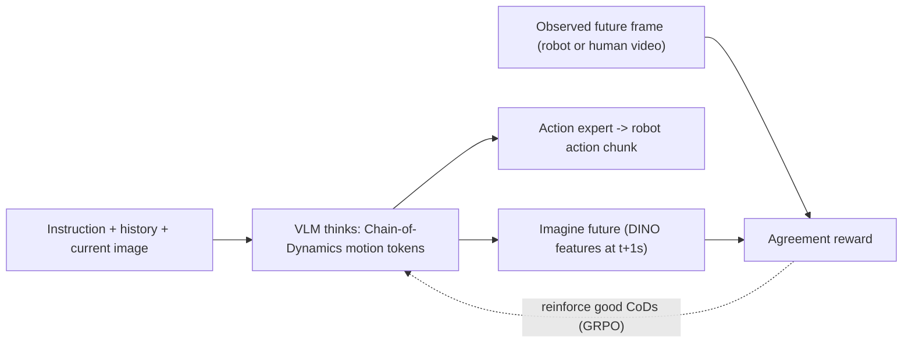
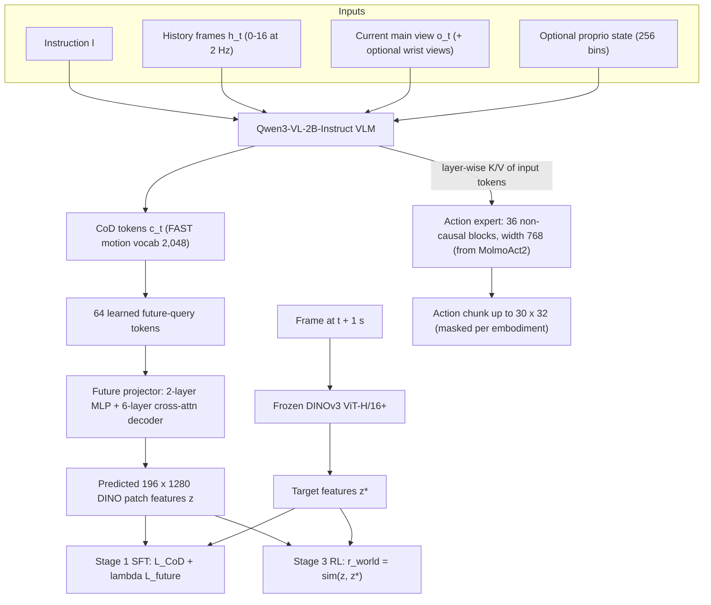
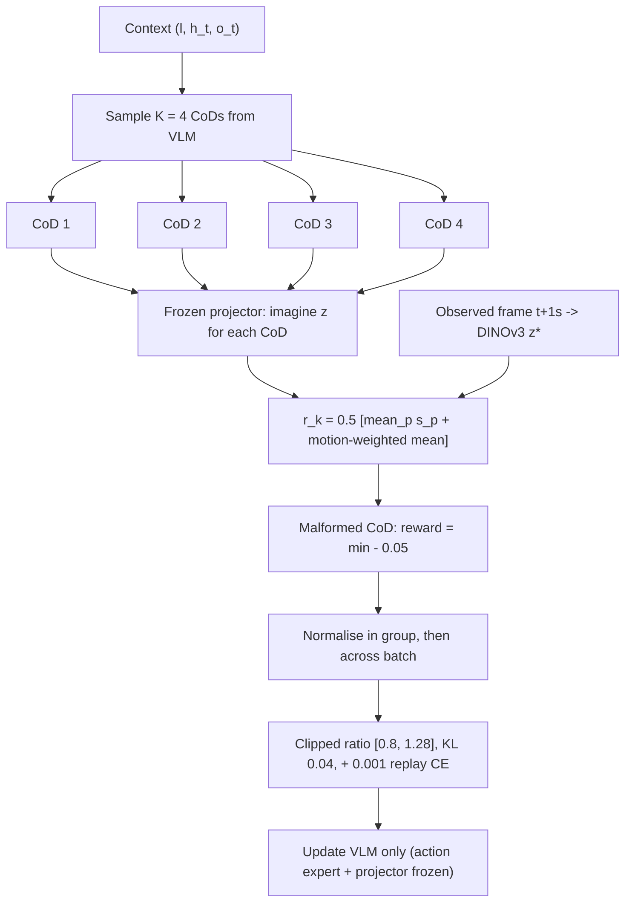

# Paper 15 — ThinkWorld: World Imagination Reinforces Chain-of-Dynamics Reasoning

> Reporting week 2026-W44 (2026-10-26 to 2026-11-01 IST). Source read: the arXiv HTML render of v1 (https://arxiv.org/html/2610.37666v1). The local PDF (about 18 MB) could not be rendered in this environment, so all numbers were taken from the HTML version of the same v1 paper. Diagrams labelled "From paper: Fig. 2" are redrawn from the paper's described architecture figure, not copied images.

---

## A. Overview

| Field | Value |
|---|---|
| Title | ThinkWorld: World Imagination Reinforces Chain-of-Dynamics Reasoning |
| Authors | Chaehyun Kim, Chi-Pin Huang, Jisoo Kim, Min-Hung Chen, Yu-Chiang Frank Wang, Seungryong Kim, Fu-En Yang |
| Institutions (confirmed from the paper) | **NVIDIA** (C.-P. Huang, M.-H. Chen, Y.-C. F. Wang, F.-E. Yang, corresponding author); **KAIST** (J. Kim, S. Kim); Chaehyun Kim is listed with both NVIDIA and KAIST |
| Identifier | arXiv:2610.37666v1 |
| Submitted | 2026-10-27 (v1) |
| Status | **New** (first published inside the reporting window) |
| Areas | Robotics, vision-language-action (VLA) models, embodied reasoning, world models, RL |
| Official link | https://arxiv.org/abs/2610.37666v1 |
| Project page | https://thinkworld-project.github.io/ |
| Code | No repository link appears in the paper text: **not reported** |
| Local PDF | [./paper-15.pdf](./paper-15.pdf) |

**Abstract (paraphrased).** VLA policies are limited by how few and how narrow action-labelled robot demonstrations are. Human videos are abundant but carry no robot actions. ThinkWorld makes the model "think" in a **Chain-of-Dynamics (CoD)**: a short sequence of discrete motion tokens describing how the world will move from now to about one second ahead.
1. The CoD is grounded with supervised data.
2. The model then imagines the future that each CoD implies, as predicted DINOv3 features.
3. Reinforcement learning (GRPO) rewards CoDs whose imagined future matches the future that actually happened.

Since the reward needs only video, unlabelled human video can supervise robot reasoning. The paper reports gains in simulation (LIBERO, LIBERO-PRO, LIBERO-Plus, SimplerEnv) and on a real bimanual robot, including skill composition guided by human video.

---

## B. Problem

- **What it solves.** It learns a reasoning space for robot control that can be trained by both robot demonstrations (which have actions) and human videos (which do not).
- **Why it matters.** Robot data collection is the bottleneck for generalist manipulation. A policy that can learn from passive video could scale with internet- and egocentric-video data.
- **Prior limitations.**
  - Textual chain-of-thought reasoning in VLAs (for example MolmoAct2-Think) adds latency and is not grounded in physics.
  - Latent-action or world-model approaches either need actions or generate expensive pixels.
  - Human-to-robot transfer usually needs retargeting or paired data.
- **Gap addressed.** A compact, physics-grounded intermediate "thought" (motion tokens) whose correctness can be verified against future observations. This yields a verifiable RL reward from video alone.

---

## C. Fundamentals

**A concrete example first.** A robot is told "hang the cup on the hook."
- Before moving, the robot writes a short plan in a "motion alphabet", for example tokens meaning *move right hand up-left, rotate wrist, move forward*. This is the CoD.
- It then pictures what the camera image should look like one second later if that plan were executed: the cup lifted and closer to the hook.
- One second later, the robot (or, during training, a recorded video) shows what actually happened.
- If the imagined and actual futures match, the plan was good and gets reinforced.

The same check works on a video of a *human* hanging a cup, because it never needs the robot's joint commands.

**Terminology.**
- **VLA.** A vision-language model that also outputs robot actions.
- **Action expert.** A separate network (here a flow-matching transformer) that decodes continuous action chunks conditioned on the VLM.
- **FAST tokenizer.** Compresses continuous motion trajectories into discrete tokens (DCT plus byte-pair encoding). The vocabulary here is 2,048 tokens over one-second wrist-motion deltas: 6-D for one hand, 12-D for two.
- **DINOv3.** A self-supervised vision transformer whose patch features encode semantics and geometry. They are used as the *target space* for imagination, which is cheaper and more semantic than pixels.
- **Flow matching.** Learns a velocity field transporting noise to data. At inference, a few Euler steps (10 here) integrate it to produce actions.
- **GRPO.** Group Relative Policy Optimisation. Sample K outputs per prompt, normalise their rewards within the group, and apply a PPO-style clipped update with no critic network.
- **t-SNE.** A 2-D visualisation of high-dimensional features (Fig. 5).

---

## D. Core contribution

1. **Chain-of-Dynamics as the reasoning medium.** Reasoning tokens are motion tokens in a space shared between human hands and robot end-effectors, not words. Fig. 5 shows human and robot CoDs of similar motions clustering together.
2. **World imagination head.** 64 learned future-query tokens appended after the CoD are decoded into 196 predicted DINOv3 patch features (a 14×14 grid) of the frame about 1 s ahead.
3. **Imagination-as-reward RL.** The reward is the agreement between the predicted and observed future features, motion-weighted toward changing patches. It needs no action labels, so human video can reinforce reasoning.
4. **Decoupled action generation.** A MolmoAct2-initialised flow-matching action expert reads layer-wise VLM key/value features of the *input* tokens. Inference therefore does not need to wait for long textual chains. The paper reports p50 latency of 324.84 ms against 879.37 ms for MolmoAct2-Think (Table 9).

**How it differs from prior work.**
- Compared with textual CoT VLAs: grounded, verifiable, shorter thoughts.
- Compared with pixel world models: it predicts frozen DINO features, not pixels.
- Compared with latent-action pretraining: the latent is tied to an explicit motion tokenizer and is refined by RL against real futures.

---

## E. Architecture deep dive

Full diagrams: [../architectures/paper-15-architecture.md](../architectures/paper-15-architecture.md). Raw diagram: [../diagrams/paper-15-system.mmd](../diagrams/paper-15-system.mmd).

### Level 1 — concept **[From paper: Fig. 1 — redrawn as a flow]**



### Level 2 — components and training stages **[From paper: Fig. 2 — redrawn]**



### Level 3 — RL step **[Conceptual reconstruction]** (from Eq. 4 and the GRPO settings)



---

## F. Low-level mechanics

### F.1 Shapes (named dimensions)

| Tensor | Shape | Notes |
|---|---|---|
| History frames | $N_h \times 3 \times H \times W$, $N_h\in[0,16]$ at 2 Hz | Main view, oldest to newest |
| VLM token sequence | $B \times T \times d_{\text{vlm}}$ | Qwen3-VL-2B; $d_{\text{vlm}}$ not stated in our extract |
| CoD tokens | $B \times T_{\text{cod}}$, values in $\{0..2047\}$ | $T_{\text{cod}}$ not stated; covers about 1 s of motion |
| Future queries | $B \times 64 \times d_{\text{vlm}}$ | Learned embeddings |
| Predicted features $z$ | $B \times 196 \times 1280$ | 14×14 grid, DINOv3 ViT-H/16+ width |
| Target features $z^\star$ | $B \times 196 \times 1280$ | 224×224 input, frozen encoder |
| Action chunk $a$ | $B \times 30 \times 32$ (max, masked) | e.g. YAM 30×14, DROID 15×8, BC-Z 10×7 (Table 4) |
| Action expert hidden | $B \times 30 \times 768$ | 36 non-causal blocks, FP32 |

### F.2 Stage 1 — VLM SFT

$$\mathcal{L}_{\text{SFT}} = \mathcal{L}_{\text{CoD}} + \lambda_{\text{future}}\,\mathcal{L}_{\text{future}}$$

- $\mathcal{L}_{\text{CoD}}$: token-level cross-entropy between the generated CoD and the target CoD $c^\star_t$, tokenised from robot wrist motion or annotated human hand motion.
- $\mathcal{L}_{\text{future}}$: the distance between imagined and observed future features (below).
- $\lambda_{\text{future}}$: a weighting coefficient whose value was not stated in our extraction.

$$\mathcal{L}_{\text{future}} = \text{dist}(z, z^\star) = \frac{1}{|V|}\sum_{p\in V}\Big[\,1-\cos(z_p, z^\star_p) + \lambda_{\text{SL1}}\cdot \text{SmoothL1}_\beta(z_p, z^\star_p)\Big]$$

- $V$: the set of valid patches. $p$: patch index (up to 196).
- $z_p, z^\star_p \in \mathbb{R}^{1280}$: predicted and target patch features, both $\ell_2$-normalised.
- $\cos$: cosine similarity, which aligns direction. $\text{SmoothL1}_\beta$: a Huber-style magnitude term with $\beta=0.01$.
- $\lambda_{\text{SL1}} = 0.25\times 21.792413$: a scale-balancing constant, as given in the paper.

During training, future queries attend to the **ground-truth CoD** $c^\star_t$ (teacher forcing), written in the paper as $\text{VLM}(l, h_t, o_t, c^\star_t, q_{t+\Delta})$.

### F.3 Stage 2 — action expert (masked flow matching)

$$z\sim\text{Beta}(1,1.5),\quad t = 0.001 + 0.999\,z,\quad x_t = (1-t)\,\epsilon + t\,a,\quad \epsilon\sim\mathcal{N}(0,I)$$

$$\mathcal{L}_{\text{FM}} = \frac{1}{\sum m}\sum m \odot \big\lVert v_\phi(x_t, t, \text{KV}_{\text{VLM}}) - (a-\epsilon)\big\rVert^2$$

- $a$: the clean normalised action chunk. $\epsilon$: Gaussian noise. $t$: flow time in $(0,1]$ (this $z$ is a scalar sample, distinct from the DINO features).
- $x_t$: the interpolated noisy action. $v_\phi$: the action expert's predicted velocity.
- $\text{KV}_{\text{VLM}}$: layer-wise key/value features of the VLM's input tokens only. CoD and future-query tokens are not in the expert's direct context.
- $m$: the mask over valid timesteps and channels for each embodiment.
- Eight noisy samples are drawn per example.
- The paper describes the loss in prose as "regress $a-\epsilon$ with masked MSE". The closed form above is our rendering of that description.
- The VLM is frozen in this stage.

**Inference:** 10 Euler steps, $x_{t+\delta} = x_t + \delta\, v_\phi(x_t,t,\cdot)$, from $t\approx 0$ to $1$.

### F.4 Stage 3 — RL with the world-imagination reward

$$r_{\text{world}} = \text{sim}(z_{t+\Delta}, z^\star_{t+\Delta}),\qquad \Delta = 1\text{ s}$$

$$\text{sim} = \tfrac12\Big[\tfrac{1}{|P|}\textstyle\sum_p s_p + \frac{\sum_p w_p s_p}{\sum_p w_p}\Big],\qquad s_p=\cos(z_p, z^\star_p)$$

- $s_p$: per-patch agreement.
- $w_p$: motion weight. It is 0.2 for patches whose DINO change is at or below the median, rises linearly to 1 at the 90th percentile, and is clipped. For static targets the global average is used.
- The first term rewards overall scene agreement. The second focuses on what moved, such as hands and objects (Fig. 8 attention maps).

$$\mathcal{L}_{\text{RL}} = \lambda_{\text{GRPO}}\,\mathcal{L}_{\text{GRPO}}(r_{\text{world}}) + \lambda_{\text{replay}}\,\mathcal{L}_{\text{replay}},\quad \lambda_{\text{GRPO}}=0.999,\ \lambda_{\text{replay}}=0.001$$

- $\mathcal{L}_{\text{replay}}$: teacher-forced cross-entropy on canonical CoDs. It is an anchor that keeps CoDs well-formed and grounded.
- $\mathcal{L}_{\text{GRPO}}$ follows Shao et al. (2024). The paper does not write it out, so the standard form is given here as **illustrative**.

$$\mathcal{L}_{\text{GRPO}} = -\frac{1}{K}\sum_{k=1}^{K}\frac{1}{|c^{(k)}|}\sum_{j}\min\!\big(\rho_{k,j}\hat A_k,\ \text{clip}(\rho_{k,j}, 0.8, 1.28)\hat A_k\big) + \beta_{\text{KL}}\,\text{KL}(\pi_\theta\Vert\pi_{\text{ref}})$$

- $K=4$: CoDs per context.
- $\rho_{k,j}$: token-level importance ratio $\pi_\theta/\pi_{\theta_{\text{old}}}$ for token $j$ of CoD $k$.
- $\hat A_k$: the reward standardised within the group of four, then across the batch.
- $\beta_{\text{KL}} = 0.04$. The clip range [0.8, 1.28] is asymmetric, as given in the paper.
- A malformed CoD gets reward (group min − 0.05).
- Only the VLM is updated.

### F.5 Compute and memory

- **Stage 1:** 150k iterations, batch 128, on 128 H100 GPUs; VLM LR 1e-5, projector LR 1e-4.
- **Stage 2:** 50k iterations; LR 1e-4 decaying to 5e-5.
- **Stage 3 (RL):** 2k iterations, LR 1e-6, on 64 H100 GPUs.
- **Model size:** 2.9B parameters (Table 1).
- **Inference (Table 9, H100, batch 1):** p50 latency 324.84 ms and 7.07 GiB, against MolmoAct2 at 335.07 ms / 12.11 GiB and MolmoAct2-Think at 879.37 ms / 12.12 GiB.

Whether the future head runs at deployment is not stated in our extraction. It is needed only for training and reward computation.

---

## G. Execution walkthrough

One real-robot step on the bimanual YAM cup-hanging task:

1. **Inputs.**
   - The instruction "hang the cup on the rack".
   - Up to 16 past main-view frames at 2 Hz.
   - The current top-view RGB image plus two wrist RGB images (three RealSense cameras).
   - A text prompt containing the embodiment, an optional discretised joint state, and a note that the future target is the main view one second ahead.
2. **Encoding.** Qwen3-VL-2B tokenises the images into visual tokens and the text into word tokens, giving a sequence of $T$ tokens × $d_{\text{vlm}}$.
3. **Thinking.** The VLM autoregressively emits CoD tokens from the 2,048-entry motion vocabulary. Decoded, these describe 12-D two-hand wrist deltas over the next second, for example "right hand rises and moves toward rack while rotating".
4. **Acting.** The action expert takes layer-wise K/V from the VLM's input tokens and integrates 10 Euler steps from noise to a 30×14 absolute-joint action chunk for YAM. The robot executes it.
5. **During training only, imagining.** 64 future queries follow the CoD. The projector maps them to 196×1280 predicted DINO features for t+1 s.
6. **Reward (RL stage).** The real frame at t+1 s goes through frozen DINOv3. A per-patch cosine is computed, with patches around the cup and gripper upweighted. Four sampled CoDs are compared and the better ones are reinforced.
7. **With a human video instead.** Steps 2, 3, 5 and 6 run unchanged. Step 4 is skipped because there is no robot action. The VLM still learns which motion thoughts lead to the observed outcome.

---

## H. Comparison with prior approaches

Numbers are from Tables 1, 6, 8 and 9 of the paper.

| Approach | Architecture | Training | Inference | Reported performance | Compute / latency | Limitations |
|---|---|---|---|---|---|---|
| Diffusion Policy | Visuomotor diffusion | Behaviour cloning | Iterative denoising | Real robot macro SR 32.8% (Table 6) | — | No language reasoning |
| MolmoAct2 | VLA + action expert | SFT | Direct action | Real robot 62.2% macro (Table 6) | p50 335.07 ms, 12.11 GiB (Table 9) | No grounded thought |
| MolmoAct2-Think | VLA + textual reasoning | SFT | Reason then act | not reported here | p50 879.37 ms (Table 9) | High latency |
| LaWAM | Latent world-action model | — | — | Real robot 45.6% macro (Table 6) | — | — |
| VLA-JEPA | JEPA-style latent prediction VLA | — | — | LIBERO-PRO avg 48.5 (authors' reproduction, Table 1) | — | — |
| DreamVLA / OpenVLA-OFT / π0-FAST | Various VLAs | — | — | LIBERO-Plus avg 69.9 / 69.6 / 61.6 (Table 8) | — | — |
| **ThinkWorld** (2.9B) | Qwen3-VL-2B + CoD + future DINO head + flow-matching expert | SFT → action SFT → GRPO with imagination reward | CoD + action expert | LIBERO avg 97.3; LIBERO-PRO avg 55.6; LIBERO-Plus avg 71.7; real robot 94.4% macro | p50 324.84 ms, 7.07 GiB | Single training seed; limited real-robot task scope |

---

## I. Experiments

**Data.**
- Human egocentric video: EgoDex and EgoVerse.
- Robot data: YAM, DROID, RoboCOIN, Bridge, RT-1, BC-Z.
- Auxiliary VQA data.

**Benchmarks.**
- LIBERO (Spatial / Object / Goal / Long).
- LIBERO-PRO (shifts in object, position, semantics, task, environment).
- LIBERO-Plus (camera, robot, language, light, background, noise, layout).
- SimplerEnv.
- Real bimanual YAM: color matching (60 demos), cup hanging (45), sorting (100), and oven skill composition (100 robot atomic-skill episodes plus 90 human videos).

**Results.**
- **Table 1 (LIBERO, success %).** Spatial 98.2, Object 98.8, Goal 97.8, Long 94.2, **avg 97.3**.
- **Table 1 (LIBERO-PRO).** Object 73.3, Position 18.2, Semantic 93.9, Task 31.9, Environment 60.9, **avg 55.6**, against VLA-JEPA at 48.5. The gains are +11.1 on Task and +19.9 on Environment.
- **Table 6 (real robot).** ThinkWorld macro SR **94.4%** and micro **93.3%**: in-domain 60/60, out-of-distribution 52/60. The baselines are MolmoAct2 62.2 / 60.0, LaWAM 45.6 / 44.2 and Diffusion Policy 32.8 / 36.7. Fig. 3 shows ThinkWorld with the highest OOD success on all three tasks.
- **Table 8 (LIBERO-Plus).** Avg **71.7**, against DreamVLA 69.9, OpenVLA-OFT 69.6 and π0-FAST 61.6.
- **Table 7 (SimplerEnv).** Google visual matching 49.31; WidowX visual matching 41.67; overall micro 46.51.
- **Fig. 6 (human-video scaling).** LIBERO-PRO rises monotonically from 45.4% with robot-only data to 47.8% at a 50% human-video fraction. A scale-matched robot-only control is about 1.2 points lower.
- **Fig. 4.** A human demonstration of a full oven task guides composition of the atomic robot skills open, put-left, put-right and close.

**Ablations.**
- **Table 3 (LIBERO-PRO avg).** Qwen baseline 40.1 → +history 40.7 → **+future prediction 50.4** → +CoD 54.4 → +RL 55.6. The largest single gain comes from adding future prediction.
- **Table 2 (future-prediction cosine).** All patches: 0.74 with the real CoD against 0.71–0.72 with shuffled, empty or no CoD. Top-25% motion patches: 0.62 against 0.54–0.55. The CoD carries real information about how the future moves.
- **Figs. 5 and 8.** Human and robot CoDs for similar motions cluster together. CoD attention concentrates on hands, arms and manipulated objects.

---

## J. Implementation

**Components.**
1. A VLM backbone: Qwen3-VL-2B-Instruct with the vocabulary extended by 2,048 motion tokens.
2. A motion tokenizer: a FAST-style DCT plus BPE over one-second windows of wrist deltas (6-D or 12-D). Robot end-effector deltas and human hand-pose deltas (EgoDex/EgoVerse annotations) are mapped into the same space.
3. A future head: 64 learned queries, a 2-layer MLP, and a 6-layer cross-attention decoder producing a 196×1280 output.
4. A target encoder: frozen DINOv3 ViT-H/16+ at 224×224, fed the main-view frame about 1 s ahead.
5. An action expert: a MolmoAct2-initialised 36-block non-causal transformer (width 768) reading VLM K/V, trained with masked flow matching.
6. A GRPO trainer for the VLM only, with the replay CE anchor.

**Frameworks (assumed, not stated).** PyTorch, HF Transformers for Qwen3-VL, and a TRL- or verl-style GRPO loop.

**Hardware.** 128 H100s for stage 1, 64 H100s for RL (paper). The deployment footprint is about 7 GiB on an H100 (Table 9).

**Illustrative code (not from the paper).** The imagination reward:

```python
# Illustrative, not from the paper.
import torch, torch.nn.functional as F

def motion_weights(z_now, z_future):
    # per-patch DINO change; 0.2 at/below median, linear to 1.0 at 90th percentile
    delta = (z_future - z_now).norm(dim=-1)                  # [B, 196]
    med = delta.median(dim=-1, keepdim=True).values
    p90 = torch.quantile(delta, 0.9, dim=-1, keepdim=True)
    w = 0.2 + 0.8 * ((delta - med) / (p90 - med + 1e-6)).clamp(0, 1)
    return w

def world_reward(z_pred, z_star, z_now):
    # z_pred, z_star, z_now: [B, 196, 1280]
    s = F.cosine_similarity(F.normalize(z_pred, dim=-1), F.normalize(z_star, dim=-1), dim=-1)  # [B,196]
    w = motion_weights(z_now, z_star)
    return 0.5 * (s.mean(-1) + (w * s).sum(-1) / w.sum(-1))   # [B]

def grpo_advantages(rewards, K=4):
    r = rewards.view(-1, K)
    a = (r - r.mean(1, keepdim=True)) / (r.std(1, keepdim=True) + 1e-6)
    a = a.flatten()
    return (a - a.mean()) / (a.std() + 1e-6)                  # group-then-batch normalisation
```

**Pitfalls.**
- Without the small replay term, RL can drift CoDs into malformed or ungrounded token strings, which is why the paper adds a malformed-CoD penalty.
- The future target must be roughly time-aligned (the closest frame to +1 s).
- Freeze the projector during RL. Otherwise the reward model co-adapts with the policy and can be gamed.
- Human and robot motion must share a coordinate convention for tokens to be meaningful across embodiments.

---

## K. Limitations

From the paper (Appendix D):
- Results come from a single training seed, and the confidence intervals reflect evaluation variance only.
- Real-robot evidence is limited to the reported trials and task scope.
- Latency depends on hardware and input configuration.

Our observations:
- The human-video gain on LIBERO-PRO is modest: 45.4 → 47.8 at 50% human data (Fig. 6).
- LIBERO-PRO Position (18.2) and Task (31.9) remain low in absolute terms.
- The reward measures agreement in DINO-feature space at a one-second horizon. Tasks with long-delayed consequences, or with visually subtle but physically critical changes (force, contact), may be poorly rewarded.
- Human data still uses annotated hand-motion tokens in SFT, so "unlabelled" applies mainly to the RL and future-prediction signals.
- No code release link is given.

Open questions:
- How does the method scale with far more human video?
- Would longer horizons or multi-step imagination help?
- Can the imagination reward drive on-robot online RL?

---

## L. Learning takeaways

- **Make reasoning verifiable.** Choosing a "thought" whose consequence can be checked against reality turns RL from human-labelled to self-supervised.
- **Predict features, not pixels.** Frozen DINO targets give a cheap, semantic world-model objective. The ablation shows future prediction is the single biggest gain (Table 3: 40.7 → 50.4).
- **A shared motion vocabulary bridges embodiments.** Human hands and robot grippers meet in one token space.
- **Decouple thinking from acting for latency.** The action expert reads input K/V, so short motion thoughts beat long text chains on speed (Table 9).

**Study next.** FAST action tokenisation, π0/π0.5 flow-matching action experts, MolmoAct, V-JEPA / VLA-JEPA, DINOv3, GRPO (DeepSeekMath), LIBERO-PRO / LIBERO-Plus robustness suites, and EgoDex.
