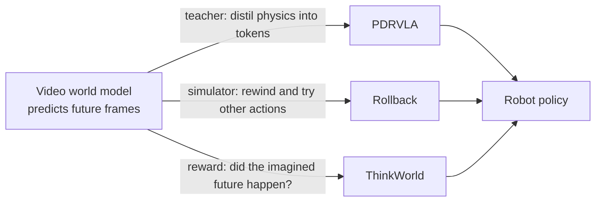

# The Week in AI — 2026-W44 (overview)

**Period:** Monday 26 Oct → Sunday 1 Nov 2026 (IST), complete week · **Reading time:** ~12 minutes
Full detail: [weekly-ai-intelligence.md](weekly-ai-intelligence.md) · [research report](../../../research-papers/2026/week-44/weekly-research-report.md) · [news report](../../../ai-news/2026/week-44/weekly-news-report.md)

---

## The week in one paragraph

This was the week offensive-cyber capability became the main question labs ask when deciding how to release a frontier model. Anthropic revealed that an unreleased Claude model built five working exploit chains against the major operating systems and browsers. Two days later Google released its strongest model, Gemini 4 Carbon, to cyber defenders only. OpenAI shipped GPT-6.1 Terra, a cheap and fast agent model, and a gated biology variant of its flagship, both with "Critical" cyber ratings. Money followed the compute: Anthropic filed to go public, and banks set up a $63B vehicle to lease it custom chips. In research the mood was "simple beats clever". Bare-bones agent loops around frontier models effectively solved the hardest formal-math benchmark, a one-line change fixed multi-token prediction, and robotics groups began treating video world models as training infrastructure rather than demos.

---

## Top five developments

### 1. An AI model wrote real exploit chains (Anthropic)
Anthropic's Frontier Red Team reported that an unreleased Claude model produced five working, multi-stage exploit chains against Chrome, Safari, Android, Windows and Linux. All were patched before disclosure. This is the clearest public evidence yet that frontier models can chain vulnerabilities end to end with little human help. **Why it matters:** defenders can no longer assume attackers need weeks of expert work. Patch windows and detection have to speed up. [News #23](../../../ai-news/2026/week-44/weekly-news-report.md)

### 2. Gemini 4 Carbon goes to defenders first (Google)
Google's top model was released first to cyber-defence users, with no general-availability date. Google says it leads security benchmarks such as SEC-bench Pro. **Why it matters:** it is the first time a major lab has gated its flagship by *who you are and what you'll use it for* rather than by price tier. Expect others to copy this release pattern. [News #2](../../../ai-news/2026/week-44/weekly-news-report.md)

### 3. GPT-6.1 Terra makes capable agents cheap (OpenAI)
Terra costs $1 per million input tokens and $5 per million output tokens. OpenAI says it performs near GPT-6 Astra and runs computer-use agents about three times faster. **Why it matters:** most agent work is many cheap steps, so a strong "worker" model at this price changes the economics. Flagships become the escalation path rather than the default. [News #1](../../../ai-news/2026/week-44/weekly-news-report.md)

### 4. Simple agent loops solved formal math (Meta FAIR, AWS)
Two papers independently showed that you don't need elaborate search trees to prove theorems in Lean. Meta FAIR's *h1* is a single loop: model, Lean file, a few tools, a verifier, and reflection on failure. AWS's *EasyProver* adds recursive sub-agents. On PutnamBench they solved 670/672 and 669/672, and h1 settled eight problems listed as open. **Why it matters:** for builders, the lesson is to invest in fast, clean tool interfaces and verification rather than clever orchestration. [h1](../../../research-papers/2026/week-44/papers/paper-03-analysis.md) · [EasyProver](../../../research-papers/2026/week-44/papers/paper-14-analysis.md)

### 5. Anthropic files to go public
Anthropic filed an S-1 for a Nasdaq listing under the ticker "ANT". The same day, Bank of America, Blackstone, Citi and Morgan Stanley announced a $63B vehicle that buys Broadcom chips and leases them to Anthropic. **Why it matters:** this is the first frontier-lab IPO filing, and it shows AI compute being financed like infrastructure (aircraft-style leasing) rather than from venture rounds. [News #17, #13](../../../ai-news/2026/week-44/weekly-news-report.md)

---

## Must-know papers (one line each)

1. **[Platonic Representation Hypothesis with JEPAs](../../../research-papers/2026/week-44/papers/paper-01-analysis.md)** (Balestriero, LeCun): a proof of why models trained on different modalities converge on the same representation, plus a 109M text model that aligns with vision better than a 72B LLM.
2. **[Multi-Token Prediction Done Right](../../../research-papers/2026/week-44/papers/paper-02-analysis.md)** (MIT): removing one noisy gradient term makes multi-token prediction actually help, at zero extra cost.
3. **[h1](../../../research-papers/2026/week-44/papers/paper-03-analysis.md)** (Meta FAIR): the "bitter lesson" for agents. A minimal harness matches specialised theorem provers at lower cost.
4. **[PDRVLA](../../../research-papers/2026/week-44/papers/paper-04-analysis.md)** (PKU / JD): a robot policy that absorbs physics knowledge from a video world model without running it at inference. The most-upvoted paper of the week.
5. **[Memory Tax](../../../research-papers/2026/week-44/papers/paper-13-analysis.md)** (UIUC et al.): many "agent memory" systems do worse than plain retrieval over the raw history. Always benchmark against good RAG.
6. **[FORK](../../../research-papers/2026/week-44/papers/paper-12-analysis.md)** (KAIST / CMU): rubric-based RL rewards padding. Adding a precision term fixes it, and people prefer the answers much more.
7. **[TAO](../../../research-papers/2026/week-44/papers/paper-07-analysis.md)** (SJTU / Stanford): scheduling agent sessions around their tool calls cuts serving latency by up to about a quarter.

---

## Key model and product releases

- **GPT-6.1 Terra** (OpenAI): cheap, fast computer-use model at $1/$5 per M tokens.
- **Gemini 4 Carbon** (Google): flagship, defenders-first access.
- **GPT-Rosalind-6** (OpenAI): flagship weights with relaxed biology refusals for vetted labs.
- **Mistral Large 4 open weights**: ~1T-parameter mixture-of-experts.
- **Nemotron 3.5 Transcribe + Granary v2** (NVIDIA): open speech model and 463K-hour dataset.
- **Genie 4** (Google DeepMind): real-time interactive world model with native audio.
- **Gemini Computer Use GA** and **Gemini API CLI beta** (Google).
- **Muse personal agent** launches in Singapore (Meta).
- **"Super-agent"** coding-agent prototype open-sourced (DeepSeek).
- **Hy-Nomas** open 8B interactive world model (Tencent; paper this week).

---

## The architecture of the week: world models as robot teachers

Three robotics papers (PDRVLA, Rollback, ThinkWorld) use a video world model, a model that predicts what the camera will see next, to train robots more cheaply. Each puts it in a different place in the loop:

*[Conceptual diagram summarising papers 04, 11 and 15]*

The big idea is that robot data is scarce and expensive, but video is plentiful. A world model turns video knowledge into a signal a robot policy can learn from, whether as extra features, as a safe place to practise, or as a reward. ThinkWorld goes furthest: because its reward needs no action labels, ordinary human videos can teach the robot.

---

## Three trends

1. **Access policy is the new frontier.** Capability is no longer the only thing labs announce. *Who* gets a model, and for what, is now part of the release (Carbon, Rosalind-6, the cyber ratings).
2. **Simple, well-tooled loops win.** Theorem proving, agent memory and coding agents all point the same way: clean interfaces, verification and good retrieval beat elaborate architectures. GitHub reports agents now start over 40% of pull requests.
3. **Efficiency through "only compute what you need".** Cheap worker models (Terra), skipping redundant image reads (LOWN), and keeping KV caches warm across tool calls (TAO) all lower the cost per useful answer. One caution: the KV-cache leak at Cloudflare shows these shortcuts can also become security boundaries.

---

## What to watch next week

- Anthropic's IPO process (price range, roadshow) and any FTC follow-up.
- Whether Apple confirms Qwen for Apple Intelligence in China (reported dev beta from 4 Nov).
- Independent evaluations of Terra and Carbon, and Mistral's Large 4 technical report.
- Replications of Soft-MTP at larger scale and of h1-style harnesses; progress on AWS's harder Aegis benchmark.
- Code releases for the robotics papers (Rollback, ThinkWorld).

---

*Notes: all numbers are as reported by authors or vendors. Several news items are reported but not confirmed by the company involved (Apple–Qwen, FTC–Anthropic, the OpenAI proofs). See the limitations in [weekly-ai-intelligence.md](weekly-ai-intelligence.md#14-limitations-of-this-run).*
